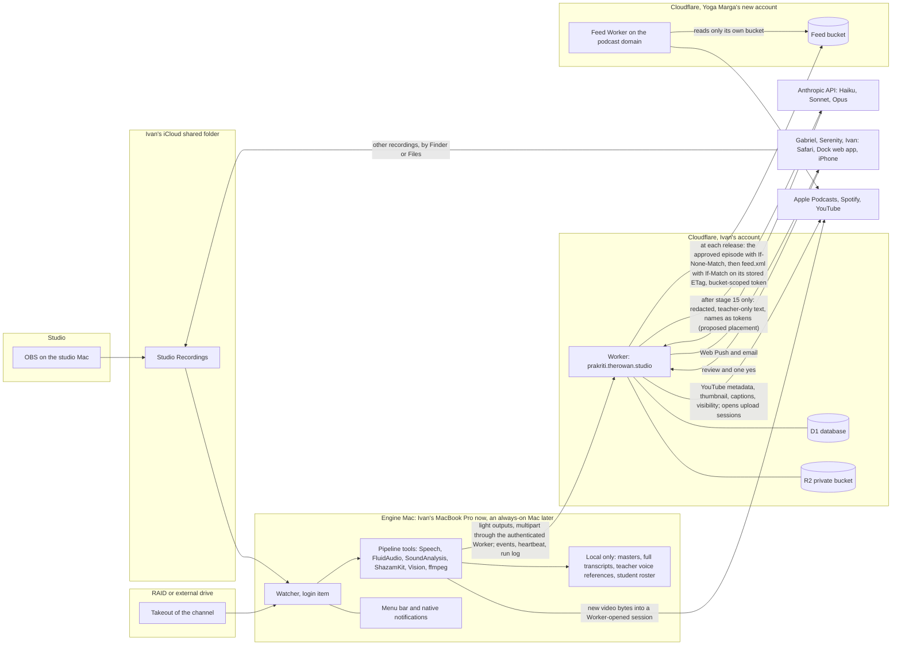
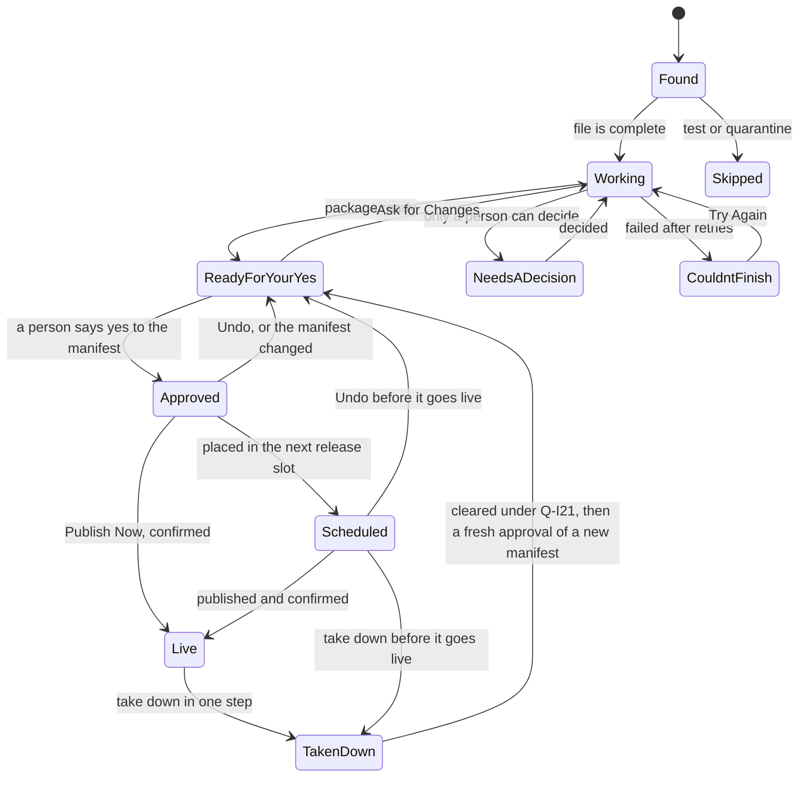

# Prakriti: the scope

**Status:** current-state scope, written Thu 8 Oct 2026 by Sonny and revised the same day for
feedback rounds 1, 2 and 3 (every finding and its reasoning: `docs/FEEDBACK.md`). The front door
(`web/public`) and its Worker (`web/src/index.js`) are written and not deployed; nothing else below
is built yet unless it says so. **Internal:** written for Ivan first and for the builder (Sonny)
second. Gabriel and Serenity read `/roadmap` on the site, not this file, because this
file carries money, internal debates and facts about students.

---

## 0. How to read this

- **The spine** is `research/DECISIONS.md` (decisions D1 to D16). Where a research file and
  DECISIONS disagree, DECISIONS wins, and §0.3 lists every place that happened.
- **The evidence** is `research/01` to `research/09`. Citations look like this: "01 §4" means
  `research/01-conversations.md` section 4; "D9" means decision 9 in DECISIONS.md; "01 C-02" is a
  ledger item in file 01 (file 01 also numbers its conflicts K-01 to K-17 in §9; those are cited as
  "01 §9 K-08"); "09 B1" is an idea in file 09; "08 P12" is a policy rule in file 08.
- **Status words** used everywhere:
  - **Decided**: settled in DECISIONS.md or by the person who owns it.
  - **Proposed**: this scope recommends it. Change it freely.
  - **OPEN**: belongs to a named person. Listed in §18 with a recommended answer and a date.
  - **Gated**: waits on a named consent or answer before it may switch on.
  - **Owner action**: a person does it, not code.
  - **Rejected** or **Never**: with the reason, so nobody re-derives it.
- **Numbers marked "proposed"** are Sonny's, for the team to change. Numbers marked "measured" were
  measured on Ivan's Mac on 2026-10-08 and the citation names the file that holds the method.
- **Every weekday** in this file was computed with `date(1)`, not recalled.
- **Ivan's ten-minute read:** §0.2, §1, §2, §15, the top of §17, §18. The builder reads everything.
- `PLAN.md`, written alongside this file, carries the step-by-step build order. This file says what
  and why; PLAN.md says when and in what order.

### 0.1 Facts that shape everything (all measured or sourced in the research)

1. **The archive is 958 videos, about 1,175 hours**, Nov 2023 to May 2026, on the Yoga Mārga School
   YouTube channel, 945 unlisted. It holds guest teachers, student practicums, 114 untitled "Recording
   Testing" uploads (92 hours), about 33 duplicates, and a private playlist of 1:1 coaching calls.
   Most of it is Serenity teaching (01 §4).
2. **The studio folder is 6 real sessions, about 5.4 hours**, not 12 recordings: horizontal and
   vertical twins plus four tests of 8 to 153 seconds (09 §1; 07 §1.2).
3. **The 2026-09-14 class (62 minutes) has a completely silent audio track** (-91 dB) and nobody
   noticed for 24 days (07 §1.3).
4. **Every studio file is one mixed microphone, duplicated into two identical channels.** The existing
   speaker labels put a student's personal story under the teacher's name (07 §0, §1.4). Speaker
   labels cannot carry the privacy promise on their own.
5. **The teacher says students' first names out loud** in the first minute of classes (08 §0.1).
   Keeping only the teacher's voice still publishes the roster.
6. **Students were told the recordings are for the private community** (08 §0.3). Publishing them is
   a new purpose that needs new consent.
7. **Nothing usable has been recorded in the studio since Wed 23 Sep** (01 §5). No studio recording of
   Serenity exists yet.
8. **The Google Takeout of the channel is about 69% downloaded and its link likely expired today**
   (01 §0.1). About 694 of 958 videos are complete inside the partial files. The whole Takeout is
   about 388 GB, from its own part sizes (01 l.55). With the partial download kept, the salvage
   output, the re-run zips and their extraction do not all fit on Ivan's Mac (about 811 GiB free,
   `df`, Thu 8 Oct), so an encrypted external SSD of about 2 TB is recommended (Q-I17; §7.1).
   The older "1 to 2.7 TB" was an unverified bitrate estimate (06 l.95) and is retired. **None of the
   archive is transcribed yet**; only the studio sessions are.
9. **R2 is not enabled** on Ivan's Cloudflare account, and Ivan has **no Developer ID certificate**
   yet (07 §0, §5).
10. **RedCircle and Spotify have no upload API.** Fully hands-off podcast publishing means a feed
    Prakriti hosts itself, or a host with an API such as Transistor (06 §3).
11. **YouTube:** uploads have their own quota (100 a day); the channel **owner** must click one Google
    consent; three-thumbnail Test & Compare has **no API**; archive talks are already on YouTube, so
    publishing one can be a metadata and visibility change (06 §2; D10).
12. **ElevenLabs only lets a person clone their own voice**, verified by them (06 §4.4). Prakriti
    prepares datasets; it never clones anyone.
13. **On-device processing is fast and free:** Apple's speech engine ran at 97 to 206 times real time on
    the M5 Pro; the whole archive transcribes in hours (02 §2.3; 06 §1.3).
14. **Gabriel paused new Yoga Marga enrollment in January 2026.** Archive pieces advertise offers that
    no longer exist; talks contain spoken promises ("below this video...") and earnings claims (09 §1).
15. **The school's email runs on Google Workspace.** Its public mail records (MX to Google's servers,
    SPF including `_spf.google.com`) were checked Thu 8 Oct (`docs/FEEDBACK.md`, Round 3). Which account
    owns the YouTube channel is still for Serenity to confirm (Q-GS7).
16. **Ivan's Apple team ID is LD587PB2H8** (07 l.509-511). K55TBYNKUC is his Apple Development
    certificate's identifier; 02 l.751 calls it the team and is wrong.

### 0.2 Before you read on: the uncomfortable things

These are said first because each one changes what happens this week.

1. **The 25 are proposed podcast episodes, counted on the feed, from teacher-only talks and
   self-contained stretches of them (PIP-34).** The archive is mostly Serenity's teaching (167
   descriptions name her, 25 name Gabriel; 01 §4), and her pieces need her own yes, so her pieces
   join when she says yes. The pool is small: the first metadata screen (round 2, counts only; the
   numbers are in PLAN.md row 5) found few talks of Gabriel's alone. So Ivan confirms the number with
   Gabriel on Fri 9 Oct, with two counts: talks from sessions with no students present, and talks
   from sessions where students only listened, which wait on Serenity (Q-S30). If the pool does not
   clearly exceed 25, Ivan resets the number in that same message. Fallback: "10 by Fri 6 Nov, and 25
   once Serenity's talks are cleared." Mon 26 Oct is a confirmation only. Archive talks on YouTube
   follow after Fri 6 Nov and are not counted.
2. **Two things Ivan told Gabriel on 10-07 are not true.** "Correct" to "we already have transcripts"
   (no archive transcripts exist; 01 A-03), and "this is the first time podcast has been brought up"
   (it was raised 09-11, 09-24, 09-28 and 10-01; 01 §9 K-08). Gabriel is planning on both. The one
   Fri 9 Oct message to Gabriel fixes it (Q-I6).
3. **Serenity is waiting for an archive assessment before she will meet** ("We can meet after you have
   everything and Sunny has assessed it", 10-01; 01 A-12). ARC-08 delivers it: a first look from
   on-Mac counts in Ivan's Fri 9 Oct message, a first meeting of 30 to 45 minutes in the week of
   Mon 12 Oct, the fuller assessment targeted for Thu 22 Oct, no later than Mon 26 Oct, and a second
   meeting, 30 minutes on Tue 27 Oct, after it. Gabriel gets the assessment after she has seen it, no
   later than Mon 26 Oct, with a one-paragraph summary.
4. **The input has stopped.** Nothing usable since Wed 23 Sep. So the first episode is Gabriel's
   studio talk of Sun 6 Sep (file `2026-09-06 18-06-33.mp4`), planned to go live Fri 23 Oct: it is
   already on the Mac and has one voice; Serenity hears its passages about her first, at her first
   meeting. It is approved in two versions, with and without the passage that names her, so her
   answer never voids Gabriel's yes. There is no trailer. A Sunday talk where only Gabriel speaks can
   become episode two (Q-G5).
5. **The 72 hours are on the record with Gabriel** (roadmap page sent 10-07). On a laptop that
   travels and sleeps with the lid closed, they are not true. They are now a proposed target, ready
   for a yes within 72 hours of a new studio recording ending, and the clock starts only when an
   always-on Mac runs the engine (D2).
6. **Gabriel opened the money conversation on 10-07 and Ivan closed it** (01 J-01). Prakriti is now a
   named, roadmapped project inside a $500 a month retainer. D16's gate stands: Prakriti is priced
   before lane 2 (studio video) switches on, and the price question (Q-I5) is due Fri 23 Oct.
7. **The privacy answer given to Serenity on 09-24 was speaker separation, and it already failed** on
   the 09-20 call, and failed open (student labeled as teacher). The fix is a studio setting
   (SET-03). Until then the promise is the check, not the software: speaker verification in short
   windows (§7.8), a post-render check on every exact MP3 (§7.4), and Ivan listening at the queued
   moments of every archive piece before it reaches its approver (PRV-05).
8. **The archive does not fit on Ivan's Mac** once it is unzipped. About 811 GiB is free with the
   partial download (about 253 GB) still on disk; the salvage output (about 250 GB), the re-run zips
   (about 388 GB) and their extraction need more. An encrypted external SSD of about 2 TB (cost to
   price) is recommended (Q-I17), with a 100 GB free-space floor that pauses archive work only.
9. **Round 2 found that the lexicon stage sent raw transcript text to Claude** before names were
   tokenized and other voices removed (stage 11 ran before stages 14 and 15). Now every cloud call
   runs after stage 15, and the lexicon is local (§7.4).
10. **Sonny is Claude.** Round 3 found Sonny drafting Serenity's assessment from her transcripts,
    which is a cloud call on her teaching (finding S2). Until Q-S13 is Granted, no Claude session,
    Sonny included, opens a transcript, title or description of Serenity's teaching or of any class;
    Sonny sees only counts and categories printed by a script on the Mac.
11. **The build did not fit the booked hours.** Round 3 counted about 100 features against about 24
    hours of sessions (findings C3, E1). PLAN.md now carries a written cut line, made on Fri 9 Oct
    before the two messages: what is built by Fri 6 Nov, and what waits. The Phase column in §5
    follows it.

### 0.3 Where the research disagreed, and what this scope does

| Topic | Research said | This scope does | Why |
|---|---|---|---|
| Transcription and speakers | Buy cloud transcription, about $207 for the archive (05 §8.1) | Local: Apple SpeechAnalyzer plus FluidAudio on the engine Mac (D1) | Free, 97 to 206 times real time, keeps student audio off the cloud (PR-12). A cloud service is allowed later only for teacher-only audio if local labels fail the sample test (§19) |
| Podcast host | Buy Transistor (05 §8.1) | A new Yoga Marga show, which Gabriel names, on a web address Yoga Marga buys only for the podcast, held as its own zone in a new Cloudflare account registered to a Yoga Marga address, separate from the account that runs VeraSales production (07 l.355); Ivan's Worker is the only publisher; the existing RedCircle show stays as it is; Transistor only with Gabriel's yes (D9; OPEN Q-G2, Q-G26) | The only fully hands-off route at near-zero cost; `yogamarga.school` and its email are never touched; full classes can later go to a private feed |
| Posting layer | GoHighLevel's Social Planner now (09 T10) | YouTube directly, for archive talks after Fri 6 Nov (D10; round 3, conflict 3); GoHighLevel for other platforms in Phase 5 (D12) | Podcast and YouTube first; one lane at a time |
| Approve from a notification | Approve button on the notification (09 E1) | No Approve or Publish action in any notification (D4) | Approving unseen work defeats review; the tap opens the review screen |
| Archive video on YouTube | Never flip an original to public (08 P21) | Flip metadata and visibility on the existing video (D10), **only** when picture and sound are teacher-only and no student is named in it; otherwise a new redacted upload (PRV-15). After Fri 6 Nov, at most two a day | Keeps D10's speed and P21's safety; the build cannot carry the YouTube work before Fri 6 Nov (round 3, conflict 3) |
| Archive triage | Triage from YouTube's own captions (09 C2) | Transcribe everything locally (D11) | Under a day of machine time, versus about three weeks of caption quota |
| Quality | Three numbers out of 10 (04 §13a) | Plain verdicts with reasons (D8) | Apple's guidance: no bare numbers for confidence (03 §0.7) |
| Notification name | "Ready for Review" (03 §4.4) | "Ready for your yes" (D4) | D4 wins |
| Which model writes | Opus 5.5 writes the package (06 §8.3) | Sonnet 5.5 writes; Opus 5.5 judges the shortlist and checks accuracy (§13) | Model choice is the cost lever; judgment is where Opus earns its price |
| Sidecar `.txt` files | "OBS already writes a .txt beside each .mp4" (05 §2E) | Ignore them | Hark wrote them on 10-07; OBS does not (02 §2.2; 07 §1.4) |
| Serenity's email | "No email anywhere" (vault; 08 §2) | She gave her email on 09-24 (01 §0.3); Ivan confirms it and her surname spelling privately by text before the invitations go out (the morning sign-in opens, by Mon 26 Oct), including which Google account her invitation must match | The vault is stale; the question is kept off every page Gabriel reads |
| YouTube upload limit | "About 6 uploads a day" (vault, July plan) | 100 uploads a day in their own bucket since 1 Jun 2026 (06 §2.1) | Stale truth |
| Thumbnail size | Aim for 3840 x 2160 (06 §2.5) | Deliver 1280 x 720 and keep a 3840 x 2160 master (PKG-06) | 1280 x 720 is the working standard; the master costs nothing to keep |
| Mastering | Buy Auphonic (05 §8.1) | ffmpeg chain by default; Auphonic only if the first three episodes sound uneven (Q-I14) | Decide by ear, not in advance |
| Archive episodes on YouTube by RSS | Ingest the feed into YouTube (09 E4) | Never for the bulk archive; a Phase 3 decision for new episodes only | YouTube's inauthentic-content policy targets hundreds of static-image videos (06 §2.12) |

---

## 1. What Prakriti is

**In one paragraph.** Prakriti is the content engine for Yoga Marga, the yoga teacher-training school
Gabriel Galindo and Serenity run. It watches for raw recordings (new studio sessions, and the 958-video
archive), and without anyone touching it, it checks them, transcribes them, separates the teachers'
voices from everyone else's, removes students, scores the result in plain words, and assembles a
publishable package: a mastered podcast episode first, and later edited video, three thumbnails,
chapters, captions, shorts, a per-teacher library and clean voice datasets. Then it stops and asks one
person for one yes. After the yes, it publishes and confirms the piece is live. It is a small Mac app
that does the heavy work where the files live, and a private web page at `prakriti.therowan.studio`
where the three of them review, approve and get notified. The name is the yoga-philosophy word for the
raw matter every form is made from: like the *Voyager* replicator, it recomposes raw material into
something new instead of picking from a catalog of finished things (DEC-Prakriti, BRIEF).

### Who it serves

| Person | Role | What they need from Prakriti | What they never have to do |
|---|---|---|---|
| **Gabriel** | Co-founder, product-minded, the one who wants Yoga Marga visible | Their teaching out in the world without it becoming his job | Upload, edit, rename files, remember to post |
| **Serenity** | Co-founder and teacher; most of the archive is her | Students kept out; anything public accurate; reviews that take minutes | Read a full transcript, learn a tool, trust a model's guess about who spoke |
| **Ivan** | Builder and operator (and Chief of Staff elsewhere, so time is scarce) | Autonomy he can trust, a visible cost, a finish line | Babysit the engine, chase approvals by text |
| Students | Protected, not users | Never heard, named or shown in public without their own written yes | Anything |
| Listeners and viewers | Served | Easy to find, easy to consume, honest about when it was recorded | Wade through setup chatter |

### The goal, as complaint → vision → number

The coaching move (CLAUDE.md, "a complaint is a latent vision"): flip the complaint, then make it
specific. The number is the half that does the work.

| Who | The complaint, in their words | The vision underneath | The number (status) |
|---|---|---|---|
| **Gabriel** | *"For whatever reason we're incapable of hitting post and share"* (10-07 call; 01 G-02) | Yoga Marga has a visible public body of work, and posting no longer depends on anyone's willpower | **Proposed: 25 archive talks as podcast episodes by Fri 6 Nov 2026,** counted on the feed, from teacher-only talks and self-contained stretches of them; Serenity's pieces join when she says yes (proposed on the roadmap page Gabriel has; 01 G-09). Ivan confirms the number with Gabriel on Fri 9 Oct with two counts, and any reset happens in that same message (fallback: "10 by Fri 6 Nov, and 25 once Serenity's talks are cleared"). Mon 26 Oct is a confirmation only. YouTube is not counted. **Proposed target: every new studio recording ready for a yes within 72 hours of the recording ending, once the engine runs on an always-on Mac.** Going live also needs a person's yes; the median time from ready to live is measured but not promised (the 7 Oct roadmap said "live within 72 hours"). **Proposed: under 2 minutes of Gabriel's time per piece, after Ivan's listen** (09 l.71 proposed it; it is his goal only if he says yes, Q-G19) |
| **Serenity** | Student privacy, and *"If it's going to be published to the public, though, I want to make sure that I get the year right"* (09-24; 08 §2) | Nothing a student said leaves the room, and everything public is something she would sign | **Zero student voices and zero student names in anything public (Serenity's condition)**, shown on a receipt per piece, with Ivan listening at the queued moments before it reaches its approver. **Each of Serenity's reviews is prepared so it can take about 5 minutes; nothing is published to meet a clock** (proposed; 09 §2) |
| **Ivan** | *"At the end of this all, I'm not sure what we're aiming at"* (10-07 call) and the vault's repeated "scope grows without a compensation conversation" | One engine with a finish line and a cost anyone can see | **Run cost per piece visible on the home screen** (proposed); **Prakriti priced before the second lane switches on** (D16) |

**Definitions that make the numbers checkable** (proposed):
- A **piece** is one recording, or one self-contained segment of one, published as a podcast episode, a
  YouTube video, or both. **A segment inherits its source recording's type, gates and required
  approvers**, so a stretch of a class is a class until Serenity answers Q-S24.
- **Live** means the platform itself confirms it: the episode is in the published feed and the feed
  validates, or the YouTube video reads back as public. Prakriti's own status row is not proof
  (memory: "the record is not the thing"). The 25 is counted on the podcast feed.
- **Gabriel's time per piece** is measured by the web app: from opening the review page to the
  approval. **Ivan's listen** is logged separately, per moment, with who and when; its time per piece
  is measured on the Sun 6 Sep talk first, then budgeted.
- **Teacher-only** is defined once, in §5.16.

---

## 2. Principles

Each principle states its reason, because a principle without a reason gets argued away.

1. **The autonomy line (D3).** Everything up to "ready for your yes" runs on its own: detect, wait
   until the file is complete, check, transcribe, label, score, cut, master, package, notify.
   **Publishing waits for one human tap per piece.** Reason: the standing rule (nothing outward-facing
   without a human yes), YouTube's developer policy (express consent before each upload action; 06
   §2.3), and Serenity's accuracy condition all require it. The yes is made as small as possible, and
   it is tied to a publication manifest (§9.1 item 6). **Publish unless stopped:** Ivan decides
   whether the setting ever exists, not before Mon 30 Nov and only after 20 clean approvals in a
   lane. It applies to a teacher's pieces only with that teacher's own yes for that lane, and never
   to anything with other voices.
2. **Privacy by construction (D5).** The software makes the wrong thing impossible or loud; nobody is
   trusted to remember. An unknown voice is a student; anything uncertain is cut. Every recording so
   far has one shared microphone, and on one microphone software can mistake a student for a teacher
   without knowing it, so **the promise is the check, not perfection**: short-window verification,
   a post-render check, and Ivan listening at the queued moments before a piece reaches its
   approver. Reason: the 09-20 student
   story was labeled as the teacher (07 §1.4), and an accidental publish of a student cannot be
   fully undone (podcast apps cache downloads).
3. **Accuracy is a feature, not a promise (D6).** Every piece carries a short checklist of checkable
   claims, archive pieces get a stale-truth check and a "Recorded in" label, and a Yoga Marga lexicon
   corrects transcripts. Reason: Serenity's second condition, and the brand name is already
   mis-transcribed six ways (09 §1).
4. **The session is the unit, not the file (D7).** Twins pair, tests file themselves, each session is
   routed to a venture. Reason: 12 files were 6 sessions; treating files as recordings would double
   the work and turn notifications into noise.
5. **Plain verdicts, never scores (D8).** Ready to post / Worth a look / Source only, each with factual
   reasons. Reason: a bare "73" means nothing to Gabriel or Serenity, and Apple's guidance says to turn
   confidence into concepts people already understand (03 §0.7).
6. **Evidence every run (D13).** Every run writes a dated line, including "found nothing", and every
   filter reports what it kept against what it was given. Reason: the 09-14 silent class and the
   transcription skill's voice-detection gate that silently dropped 80% of a tape (07 §7).
7. **Buy the commodity, build the yoga-school layer (05 §0).** Transcription engines, loudness
   algorithms, hosting and storage are commodities. Consent, student-aware handling of classes,
   per-teacher knowledge, archive-scale triage and accuracy are not sold anywhere. Reason: nobody sells
   Prakriti (05 §0.1); every vendor optimizes for virality, not for Serenity's conditions.
8. **Masters stay home (D1).** Full recordings never leave the engine Mac or the RAID, and no raw
   recording is ever uploaded to the cloud, by anyone, for any reason. Only lightweight, redacted
   outputs go to the cloud. Anything recorded outside the studio flow goes into the shared Studio
   Recordings folder (Finder on a Mac, Files on an iPhone). Reason: privacy, cost (a full archive in
   R2 is $13 to $38 a month; 06 §12), and the 100 MB request limit of Cloudflare Workers.
9. **One lane at a time, each with an exit check (D12).** Build the engine once; switch outputs on one
   at a time, podcast audio first. Reason: agreed sequencing on 10-07, and Ivan asked to be held to
   finishing before pivoting (memory).
10. **Describe, never sell. Never skeuomorphic. No em dashes in anything Gabriel or Serenity read.**
    Reason: Ivan's standing taste rules (memory), and generated copy is where they would leak.
11. **Fail loud, never silent.** A silent or broken recording is a same-day decision, a missing
    artifact is a visible task, a quiet engine is an alert. Reason: the 09-14 class.

---

## 3. Raw material

### 3.1 Every source

| # | Source | What it is | How it enters Prakriti | Phase | Notes |
|---|---|---|---|---|---|
| 1 | **Studio folder** | OBS recordings saved automatically into Ivan's iCloud shared folder `Design Work/Galindo x Lizarde/Studio Recordings ` (trailing space), one dated subfolder per day (BRIEF; 02 §2.2) | Watched by the engine (ENG-03) with iCloud placeholder handling (ENG-04) and the readiness rule (ENG-05) | 0 | Optimize Mac Storage is on, so files can turn into placeholders at any time (02 §2.1). OBS creates the file when recording *starts* |
| 2 | **Archive, re-run Takeout** | Google Takeout of the Yoga Mārga School channel, original upload quality, run by the account holder named in Q-GS7 (06 §2.13) | Requested Wed 14 Oct on Ivan's Mac, then downloaded over one to three days with the Mac on power and a wired network, one part at a time in Chrome with each part's size checked (about 388 GB, from the Takeout's own part sizes; 01 l.55); the account holder's session stays until the last part verifies, then signs out. Onto the encrypted external SSD (Q-I17), or extracted part by part with each zip deleted after its entries verify. Never extracted into a watched folder; the streaming extractor and its exclusion list apply (SET-02); then an "Archive" folder (ENG-13) | 0 (owner action), 2 (processing) | Takeout is an owner action; links live about 7 days [unverified for this account]. Off the critical path: the 694 salvaged files are the primary input. Skipped if the count shows the qualifying talks are already among the 694 salvaged. It does not all fit beside the partial download and the salvage (about 811 GiB free; §7.1). "1 to 2.7 TB" (06 §1.2) is retired |
| 3 | **Partial Takeout already on Ivan's Mac** | `~/Downloads/SerenityAI`, about 253 GB, 8 parts, about 694 of 958 videos complete (01 §0.1) | Salvage complete entries with a streaming extractor (SET-02), onto the external SSD once attached, never copying anything in the Private Meetings playlist, anything marked private, or anything titled as a meeting room | 0 | Contains the private 1:1 coaching calls; listed in "Where copies live" (PRV-13). Deleting it is Serenity's call (Q-S23) |
| 4 | **Other recordings** (replaces web drag and drop, round 1) | A file recorded outside the studio flow | Put into the shared Studio Recordings folder through Finder on a Mac; the engine already watches it (APP-09 guides people there). **No raw recording is ever uploaded to the cloud** | 0 | Conflict 6 in `docs/FEEDBACK.md`: keeps the front-door promise true by construction (PR-12) |
| 5 | **Phone recordings** | A video recorded on an iPhone | Saved into the same shared folder through the Files app on the iPhone | 0 | Needs the iPhone signed in to an Apple Account that has the shared folder [verify on their iPhones] |
| 6 | **Zoom cloud recordings** | Classes recorded by Zoom's cloud | Not connected | 5, only if reopened | Gabriel dropped Zoom API work on 10-07 ("Don't worry about it"; 01 K-04). Classes now record in OBS |
| 7 | **Skool classroom** | YTT V1, V2, V3 recordings (01 A-16) | Inventory row now; corpus for the YTT lane later, via an owner export | 1 (inventory), 4 or 5 | Skool has no public API (09 §7.12) |
| 8 | **Fathom** | Class recordings shared with members, plus sales calls (01 A-17) | Inventory row only | 1 (inventory) | Superseded as a content source (01 K-05) |
| 9 | **Gabriel's personal channel** | Content unknown (01 A-15) | Only if it holds Yoga Marga teaching | 2 | OPEN Q-G6 |
| 10 | **Hard drives in Colombia** | Recordings of client calls held by a former contractor (01 A-18) | Only through the quarantine lane, if they come home | 5 or when returned | Red row in "Where copies live" until return or a destruction certificate is logged (08 §3.10) |

### 3.2 What the material actually is (measured)

**Studio** (07 §1.2, 01 §5; weekdays computed):

| Session | Length | What it is | Who speaks | Notes that drive features |
|---|---|---|---|---|
| Sun 6 Sep 17:43 (+ vertical) | 2 min 33 s | Setup test | Gabriel | Test (PIP-02) |
| **Sun 6 Sep 18:06 (+ vertical)** | 55 min 39 s | Talking-head Yoga Marga School talk | Gabriel alone | **The first episode** (file `2026-09-06 18-06-33.mp4`), planned live Fri 23 Oct. Contains two income claims about Gabriel's own results, one in the opening line, and one spoken offer, decided by Gabriel by Fri 16 Oct and all cut if he does not answer, which removes the opening line (Q-G8; never quoted on any page); one story about a student, cut under the student rule unless Serenity answers otherwise first; and passages that name or refer to Serenity, once as "my partner", so she hears them at her first meeting and episode 1 is approved in two versions (ACC-04, PRV-04). The only session with a native vertical twin |
| Sun 13 Sep 18:25 | 15 min 48 s | "Life update" to students | Gabriel; students in chat | Discloses a death in Serenity's family; announces paused enrollment (PRV-04, ACC-02) |
| Mon 14 Sep 20:00 | 61 min 42 s | Yin class | none audible | **Silent audio** (-91 dB); no transcript (PIP-04) |
| Wed 16 Sep 20:03 | 66 min 16 s | Yin class on Zoom | Gabriel; a student at the open | -35.6 LUFS, peaks at -0.1 dBFS; 31% silence in holds |
| Thu 17 Sep 06:02 | 12 s | Audio test | Gabriel | Test |
| Sun 20 Sep 18:07 | 55 min 4 s | Small-group community call | Gabriel and students, family news on the record | Existing labels collapsed everyone into one speaker |
| Wed 23 Sep 19:59 | 71 min 35 s | Yin class; Serenity in the room off camera | Gabriel; students named in the first minute | 41% silence; "I'll be demoing" (visual cues) |
| Sat 26 Sep 10:29 | 9 s | "Press one button" demo for a third party | Gabriel | Third-party, never publish |
| Fri 2 Oct 15:10 | 10 s | Demo "for StudioBinder.com" | Gabriel | Third-party, never publish |

Format: H.264 1920 x 1080 at 29.97 fps, about 6 Mbps; one AAC stereo track at 48 kHz, 160 kbps, the two
channels identical; `moov` index at the end of the file; about 2.78 GB per hour, about 5.5 GB per hour
with the vertical twin (07 §1.2, §1.3). Loudness -24 to -36 LUFS integrated (07 §1.3), measured on
stereo or one channel; to be re-measured on a mono downmix (no new number until then). From Ivan's
studio visit, OBS records Hybrid MP4 (fragmented while recording), so readiness is format-aware
(§7.3).

**Archive** (01 §4): 958 videos; 1,175 hours; median 73.5 minutes; 945 unlisted, 9 private, 4 public;
44 under 5 minutes; 114 "Recording Testing" (92 hours); 22 duplicate groups (about 33 extra copies);
playlists include "Private Meetings" (private, 1:1 coaching and calls), "YTT Practicum" (40, public),
"Business Of Yoga" (69), "POD" (an unlisted playlist someone started on 2026-04-27); guest teachers
(Kristine 32 videos, Dr. Frank, Dr. Miller, Josh Lu, Luci, Joaquin); 478 auto-generated descriptions,
many naming students. Resolution of archive files is not yet measured. None of it is transcribed
yet.

### 3.3 Content-type handling matrix

Every session is classified (PIP-14, ARC-04) and handled by its type. "Teacher" means a consenting,
enrolled teacher (Gabriel; Serenity once she says yes).

| Content type | Example | What Prakriti does | Outputs | Who approves | Publishable when |
|---|---|---|---|---|---|
| **Talk, teacher only** | 09-06 talk; an archive talk by Serenity alone; a Business of Yoga recording with no other voices; a self-contained segment of any of these | Full pipeline; accuracy checklist; stale-truth check if archive; post-render check | Podcast episode (Phase 1 studio, Phase 2 archive); transcript, notes, chapters, verdicts, receipts; YouTube metadata and visibility for archive talks (after Fri 6 Nov); edited video, thumbnails, shorts for studio talks (Phase 3) | The speaker, or someone the speaker names (Gabriel's solo talks: Gabriel, or Ivan if Gabriel agrees, Q-G23). Pieces that name Serenity are shown to her until she says otherwise: she is a required viewer, and Approve waits until she has opened the piece or her hold time passes (Q-S26), after which the passage that names her is cut | That teacher's samples have passed (§19: Gabriel's release sample; Serenity's own solo-talk sample for hers), the piece is teacher-only (§5.16), the receipts are clear, Ivan has listened at the queued moments before it reached its approver, and the approver says yes. From a session where students were present, even if they only listened: only once Serenity answers Q-S30, and with her receipt |
| **Life update or announcement** | 09-13 | Full pipeline; disclosures flagged | Internal transcript by default; public only after both approve | Gabriel and Serenity | Both say yes; default stays internal |
| **Class with students** | Yin classes 09-16, 09-23; most archive classes; **any stretch cut from a class**, which inherits the class's type, gates and approvers until Serenity answers Q-S24 | Processed locally only. Every non-teacher voice cut, names muted, disclosures held, music checked, audio-only suitability checked (PIP-30) | Internal redacted transcript. Public: nothing until Serenity's rule exists; then a teacher-only audio episode (PKG-11) and, later, the full class on a private students-only feed (PUB-06) | Serenity (privacy receipt) and the teacher; Serenity sees any segment of her teaching | Only under the student rule: no student is heard, named or described in anything public unless Serenity's rule allows it and that student has said yes in writing. A class goes public only with every student removed, after Serenity sets her rule, a lawyer has read a new class release that the students have agreed to, and she approves that piece's privacy receipt. Also needs separate microphone tracks and the class samples passed. A teacher-only stretch of an archive class only if Serenity says yes to Q-S24, with her receipt on each. Earliest Phase 3 |
| **Small-group call or Q&A** | 09-20; archive Q&A and "Sangha" sessions | Processed locally; quarantined from public as-is | Internal redacted transcript; the teacher's answers can seed a fresh script for re-recording (ACC-08) | Serenity and Gabriel | Never as-is. Only as a new recording |
| **1:1 coaching or client call** | Archive "Private Meetings" playlist; anything marked private on YouTube; anything titled as a meeting room; anything like it inside "Recording Testing" | **Quarantine.** Excluded at inventory, before any audio step; not copied in the salvage, and in the re-run left inside the zip or put only in a separate encrypted quarantine folder; never extracted, opened, transcribed or sent to any AI (PRV-08). A call revealed later, inside an item that looked like something else, stops at that point and its transcript is deleted | None | Not Prakriti's to decide; the client's consent lives outside it | Never |
| **Guest teacher** | Kristine's 32 videos; Dr. Frank, Dr. Miller, Josh Lu, Luci, Joaquin | Inventory and classify; guest voice treated as Other voice; never enrolled | None public. Internal search only, attributed, after the guest's permission | The guest first, then Gabriel or Serenity | Only with the guest's written permission (Q-S15) |
| **Student practicum** | "YTT Practicum" playlist (40) | Inventory and classify only | None public; YTT corpus later, with Serenity | Serenity | Never public as-is |
| **Test clip** | Under 60 seconds; empty "Recording Testing" items | Filed as Test, silently; kept, not processed | None | Nobody | Never |
| **Third party or other venture** | "Press one button" demos; VeraSales sessions | Venture router (PIP-13): third-party demos filed out; VeraSales sessions get a private package from Phase 2, never published | VeraSales: a private package now; publishing in its own lane later (Phase 5) | Gabriel and Ivan for VeraSales | Third-party: never. VeraSales: Phase 5 (Q-G17) |
| **Silent or broken file** | 09-14; a crashed recording with no index | Sound check stops everything; "Needs a decision" the same day | None; filed as b-roll on Gabriel's say (01 B-12) | Gabriel | Never as content |
| **Untitled "Recording Testing"** | 114 archive items, 92 hours | Listed from metadata only and never opened until Serenity answers Q-S16; then classified locally first (duration, voice share, sound map) and routed to one of the rows above | Depends on the row | Depends | Depends |
| **Duplicate** | 22 groups in the archive | Audio fingerprint; the best copy is kept, the others linked to it | None for copies | Nobody | n/a |
| **Teleprompter re-record** (Phase 3 option for Gabriel) | A polished new take of a strong moment, from a weekly script drafted from Gabriel's own best moments and fact-checked before he records (ACC-08) | Treated as a talk | As a talk | The speaker; Serenity's checklist for her material | As a talk |

---

## 4. The package

Everything Prakriti makes from one session. Each output lists its exact specification, its source, and
who gets it.

### 4.1 Output specifications

#### PKG-01 Podcast episode audio
- **File:** MP3, constant 128 kbps, **mono**, 44.1 kHz. Reason: Apple recommends mono MP3 at 96 to 128
  kbps (06 §3.3); Spotify accepts 96 to 320 kbps (06 §3.2); about 58 MB per hour (06 §12), under
  RedCircle's 200 MB cap, so the same file serves the manual RedCircle kit (06 §3.1).
- **Loudness:** integrated **-16 LUFS ± 1 LU**, true peak **at or below -1.0 dBTP**, measured per ITU-R
  BS.1770-5 **on the encoded MP3**, not only on the WAV (Apple; 02 §2.2). The studio measures -21 to
  -36 LUFS today, so this needs compression, not just normalization (D9). That range was measured on
  stereo or one channel; it is re-measured on the mono downmix before anyone relies on it, and no
  new number is written until then (§7.11).
- **Structure:** intro, body, a 5-second mid-roll at the nearest natural pause (at least 1.5 seconds of
  silence, proposed) to the midpoint and never inside a sentence, body, outro. Intro, outro and
  mid-roll are **real recordings** by Gabriel (and Serenity if she wants), not AI (D9; SET-16).
- **Tags:** ID3v2.4 title, artist (the show's name, Gabriel's to choose, OPEN Q-G26), album, year, show art. Chapters travel in the
  feed, not in ID3 (proposed).
- **Name:** ASCII only, for example `2026-09-06-yoga-marga-talk.mp3`; a GUID per episode that never
  changes (Apple; 06 §3.3).
- **Master:** a WAV, 48 kHz, 24-bit, mono, kept on the engine Mac or RAID only.
- **Checks:** loudness re-measured on the MP3; the last 5 seconds decode (`ffmpeg -sseof -5`); duration
  equals the cut list plus intro and outro, within 1 second.
- **Who:** talks (Phase 1 studio, Phase 2 archive); classes only after Serenity's rule (PKG-11).
- **Intro:** the intro Gabriel records opens episode 1. There is no trailer (round 2).

#### PKG-02 Transcripts
Public variants are timed to the **published** audio; the internal variant is timed to the **source**.
- **`.md`** (people and the knowledge base): YAML front matter (title, recording id, recorded date,
  duration, speakers (teachers only), venture, provenance label, version, engine and model versions),
  then one paragraph per speaker turn with a heading line such as `**Gabriel** · 00:04:12`.
- **`.vtt`** (Apple Podcasts): WebVTT with voice spans `<v Gabriel>`, so Apple shows the speaker's name
  when it changes (06 §3.3); cues of at most 2 lines and 42 characters per line (proposed).
- **`.srt`** (YouTube captions): same cues, no speaker names (SRT has no speaker field). YouTube's
  automatic syncing is deprecated, so timed files are uploaded (06 §2.7).
- **`.json`** (internal): every word with start, end, confidence, speaker label, engine, and any
  lexicon correction with the original word kept.
- **Redaction:** in public files, Other voice sections are simply absent (the audio has them cut too),
  and student names are removed. The internal redacted copy, which may go to R2, marks a removed section
  as `[Other voice, 38 s]`. The un-redacted internal copy never leaves the engine (PR-12).
- **Who:** every processed session gets the internal set; public files only for pieces headed to
  publishing.

#### PKG-03 Quality verdicts (Audio, Video, Message)
Each dimension gets **Ready to post**, **Worth a look** or **Source only**, plus one to three factual
reasons with timecodes (D8). An internal rank number may exist for sorting the archive; it is never
shown (03 §6.6).

| Dimension | Source only (examples) | Worth a look (examples) | Ready to post | How it is measured |
|---|---|---|---|---|
| Audio | "Silent for 62 minutes"; "Recording stops at 41 of 72 minutes"; noise floor too high to master | "Peaks at 0 dB at 12:04"; "Zoom audio dropped at the start"; "Phone ringing at 31:10"; loudness range over 15 LU | None of those | ffmpeg volumedetect, ebur128, astats; SoundAnalysis labels; transcript phrases |
| Video | Camera failed; black or frozen for long stretches; teacher not in frame | "Darker than the usual studio frame"; "Lens looks hazy"; "More than one face on screen" (privacy); "Desk papers with figures at 50:00" | None of those | Vision aesthetics and face quality, lens smudge; ffmpeg blackdetect, freezedetect, signalstats brightness against the 09-06 baseline (07 §1.3) |
| Message | "Mostly logistics and check-ins; kept for the library" | "Strong middle; first 6 minutes are setup"; "Mentions a 2024 price" | "One complete idea, a clear opening, stands alone" | Claude Opus 5.5 on the shortlist, with each reason quoting the transcript (§13) |

Gabriel's rule from 10-07 holds: a Ready message can carry an archive piece whose Audio or Video is Worth
a look (01 A-05, A-07). Audio that is Source only blocks publishing.

#### PKG-04 Titles, descriptions and show notes
- **Titles:** three options per piece (01 D-11). YouTube allows 100 characters and no `<` or `>` (06
  §2.4); proposed working limit **60 characters** so a phone shows the whole title. Describe the idea;
  never promise more than the piece delivers (YouTube's misleading-metadata policy; 06 §2.12). The
  three options double as Test & Compare title variants (06 §2.6).
- **Description and show notes**, in this order: one paragraph that describes (never sells); the
  provenance label (ACC-03); chapters (PKG-05); the one call to action (BIZ-01); credits for any teacher
  or lineage named in the recording; the AI disclosure line if any synthetic audio was used (PRV-11);
  the safety line for practice episodes (PR-18); and one line, "Questions or a removal request: <address>", with
  the address OPEN for Serenity and Gabriel to choose and never invented (Q-GS1; §11.7).
- **Limits:** YouTube description at most 5,000 **bytes** (accented characters cost 2; 06 §2.4). No
  student names. No em dashes (an automatic check blocks them). No claim that is not in the transcript
  (evidence check, §13).
- **Replaces Growati:** titles, descriptions, thumbnails and chapters were Growati's four outputs (01
  K-01); Prakriti matches them on day one.

#### PKG-05 Chapters
Rules that satisfy both YouTube and Apple at once: first chapter at 00:00; at least three; each at least
**2 minutes** (Apple; YouTube needs only 10 seconds); no more than **6 per hour** (Apple); titles under
45 characters and under five words (Apple) (06 §2.10, §3.3). Sources: topic shifts proposed by Claude,
bells and gongs from the sound map, and teacher markers once they exist (PIP-28). Delivered as
`podcast:chapters` JSON in the feed, timestamps in the YouTube description (needs the channel's
advanced features; 06 §2.11), and in the show notes.

#### PKG-06 Three thumbnail options
- **Deliverable:** three JPEGs, **1280 x 720**, sRGB, under 2 MB each; plus a 3840 x 2160 PNG master of
  each, kept (YouTube accepts up to 50 MB since 14 Sep 2026 and added UHD sizes on 11 Sep 2026; 06 §2.5).
- **Type-led:** a few words of the title (at most five, proposed) set in the display face, over a real
  frame of a consenting teacher picked by Vision, or on a flat field. Each option tests one idea, with
  its reason written beside it, for example: A close frame plus two words; B type only; C wide frame plus
  a short phrase (04 §7).
- **Rules:** exactly one face in frame, and it is a consenting teacher (Vision face count; real frames
  of Gabriel need his yes, Q-G24, and of Serenity hers, Q-S9; until then, type-only); no students;
  no AI-made faces or scenes of real people (the AI rule; 08 §6 Q9); nothing misleading (06 §2.12); no
  textures, film strips or drawn objects (never skeuomorphic). The front door's sample shows type-only
  cards because of a rule for that page (no photographs of people in v1), not a rule for the product.
- **Use:** Prakriti sets option A through the API; B and C are ready for YouTube Studio's Test & Compare,
  which a person starts by hand (PUB-10). Podcast-only pieces use the show art.

#### PKG-07 Edited video (Phase 3)
- 1920 x 1080 at 29.97 fps (same as the source), H.264 High through VideoToolbox at 8 Mbps (a measured
  option; 02 §2.3), AAC-LC 48 kHz stereo at 160 kbps (matches the source; proposed), the same -16 LUFS
  master, MP4 with the index at the front for web playback.
- Cut from the same decisions as the podcast (PIP-22): warm-up trimmed, dead space shortened, filler
  trimmed conservatively. Gabriel's standard from 09-10: "sharper, removing some of the dead space and
  'ums'" (01 D-03).
- A 540p review proxy at about 1 Mbps for the web app (06 §12).
- Archive pieces are not re-edited; after Fri 6 Nov the existing YouTube video is used when it is
  teacher-only (PUB-08).

#### PKG-08 Shorts (Phase 3)
1080 x 1920 from the vertical twin (no AI reframing needed; 09 A1), 15 to 60 seconds (proposed), never
over 3 minutes (YouTube classes vertical videos up to 3 minutes as Shorts; 06 §2.9), at most 1080p.
Calm typographic captions burned in from word timings (PIP-24). Three to five per session (proposed),
picked from Claude's proposals and the teacher's own markers (PIP-28), each with its sentence, length and
reason. No student voice or face. Shorts thumbnails can only be set in Studio (06 §2.5).

#### ACC-01 Accuracy checklist
Five to ten items per piece. Each item: the exact quote, its timecode, its kind (year, number or price,
name, Sanskrit term, attribution or text, offer or program, health claim, earnings claim), why it is
checkable, and a status: unchecked, confirmed, fixed or cut. Archive pieces add stale-truth items
(ACC-02) and every piece adds spoken promises (ACC-05). **Publishing waits until every item is
resolved.** A spoken mistake cannot be rewritten in the audio, so "fixed" means one of: cut the passage,
add a correction line to the show notes, or keep it under the "Recorded in" label. On the review
page, by Mon 26 Oct, each item carries **Keep / Cut / Add a Note**, recorded on the manifest; a Cut goes
to Ivan, who makes it by hand.

#### PRV-05 Privacy receipt
One screen. Its real listening time is measured on 09-06 and budgeted from that measurement, not
designed around a minute (round 3, finding S1). This line is at the top: **"Labels can be wrong
without knowing it. This lists what was removed, not what was missed."**
- **Ivan's listen comes first:** before the piece reaches its approver, Ivan plays each Listen-here
  moment to its end, and only then is his step marked done, logged with who and when (the `listens`
  table, §10.1). The approver's Approve does not wait on playing the moments again (round 3,
  conflict 5).
- **Listen here:** the few teacher moments Prakriti is least sure about, 3 to 8 of them, all audio
  already headed public: the opening 2 minutes, the closing 3, every speaker change, and every kept
  segment within 10% of the match threshold. Each is one tap on a phone. Reason: a list of removals
  cannot show what was wrongly kept; listening at these moments can (round 1, finding S2). This is
  teacher-labeled audio headed public anyway, so it does not break PR-12; removed student audio
  never leaves the Mac. How Serenity checks a piece is her choice (Q-S18; suggested and default:
  both the moments and the written list).
- **Voices:** each teacher with minutes (from a track or the enrolled reference); "Other voice: 14
  segments, 6 minutes, all removed". Any piece in which an Other voice was found, even if all of it
  was removed, needs Serenity's receipt until her rule says otherwise (§9.4).
- **Names:** spoken names found in teacher speech, shown as tokens with context ("Welcome, [name 1]" at
  00:00:42) and what happened to each (muted). Real names never reach the cloud (PR-12).
- **Disclosures:** passages flagged as family, health, money, grief, faith or third parties, held for a
  decision. A passage about a teacher's own life (family, health, grief, money) is held for that
  teacher's yes for that passage, whoever's piece it is (Q-S25 for Serenity, Q-G27 for Gabriel).
- **Serenity:** whether the piece names her (found with the same phonetic matching as student names,
  failing toward showing her), and whether she has opened it or her hold time passed and the passage
  that names her was cut (Q-S26).
- **Removed:** the written list of what was removed: every cut with its reason and source
  timecodes.
- **On screen** (archive video): face count, any Zoom name labels, chat or shared screens found.
- **Music:** none, or found and how it was handled.
- **Minors:** none known, or flagged.
- **Consents relied on**, and **AI used** (none, or what and whose voice).
- **Post-render check:** passed or failed, on the exact MP3 (§7.4 stage 18a). Unresolved name
  candidates are counted here (§7.10).
- Any open item blocks publishing.

#### PKG-09 Captions on YouTube (after Fri 6 Nov)
The `.srt` from PKG-02, uploaded with `captions.insert` (400 quota units; 06 §2.7) for every long-form
piece. Corrected captions beat YouTube's automatic ones on accuracy, which is Serenity's condition.

#### LIB-03 Voice dataset (Phase 4, gated)
Per teacher: only segments with one speaker, no overlap, no music and no noise, trimmed 0.25 seconds at
each boundary (06 §6); one speaking style (talks); at least 30 minutes, 2 to 3 hours as the target;
files under 1 hour each (Voice Isolator limit); MP3 at 192 kbps or more, or WAV; same language as the
voice will speak (06 §4.4; 04 §13b). Handed to the teacher as a download with the steps; the teacher
uploads and verifies it in **their own** ElevenLabs account (fact 12). Serenity's stays locked until her
written yes.

#### LIB-01 Knowledge-base entry (Phase 4, gated)
One entry per teacher-attributed passage: teacher, text (their own words only), recording, start and end
timecode, topic and lineage tags, recorded date, the consent it relies on. Never included: Other voice,
disclosures, or anything the teacher marked "not how I'd say it" (05 §7C). Stored as Markdown plus JSON.

#### PKG-10 The downloadable package
Gabriel and Ivan's "giant zip folder" (01 H-02). The engine writes the folder and its manifest when a
session reaches "Ready for your yes" and uploads the files once; **the zip is built at download time**
from those files, so no second copy is uploaded (§7.13). Downloadable from the recording page with
every file ticked and a size total (04 §13c). Video files are listed as separate downloads because they
are gigabytes.

```
2026-09-06 Yoga Marga talk/
  manifest.json            every file, its hash, versions, verdicts
  podcast/episode.mp3
  podcast/show-notes.md
  podcast/chapters.json
  transcript/transcript.md
  transcript/transcript.vtt
  transcript/transcript.srt
  thumbnails/a.jpg  b.jpg  c.jpg   (and reasons.md)
  titles.md                three options
  receipts/privacy.md
  receipts/accuracy.md
  verdicts.md
  links.txt                edited video, proxy, shorts (separate downloads, Phase 3)
```

### 4.2 Which content type gets which output, and when

| Output | Talk, studio | Talk, archive | Class (after Serenity's rule) | Life update | Everything else |
|---|---|---|---|---|---|
| Podcast episode (PKG-01) | Phase 1 | Phase 2 | Phase 3 at the earliest, teacher-only (PKG-11) | Internal unless both approve | None |
| Transcripts (PKG-02) | Phase 1 | Phase 2 | Internal redacted from Phase 1; public with the episode | Internal | Internal only, never for quarantined items |
| Verdicts (PKG-03) | Audio and Message Phase 1; Video Phase 3 | Audio and Message Phase 2; Video after Fri 6 Nov | Phase 1 (internal) | Phase 1 | Inventory only |
| Titles, notes (PKG-04) | Phase 1 | Phase 2 | With the episode | Phase 1 (internal draft) | None |
| Chapters (PKG-05) | After Fri 6 Nov | After Fri 6 Nov | With the episode | No | None |
| Accuracy checklist (ACC-01) | Phase 1 | Phase 2, plus stale truth | With the episode | Phase 1 | None |
| Privacy receipt (PRV-05) | Phase 1 | Phase 2 | Phase 1 (internal), required before anything public | Phase 1 | None |
| Thumbnails (PKG-06) | Phase 3 | After Fri 6 Nov (for the YouTube flip) | Phase 3 at the earliest, teacher-only frames | No | None |
| YouTube captions (PKG-09) | Phase 3 | After Fri 6 Nov | With video, if ever | No | None |
| Edited video (PKG-07) | Phase 3 | Not re-edited; existing video if teacher-only | Not planned | No | None |
| Shorts (PKG-08) | Phase 3 (vertical twin) | Phase 5 at the earliest (16:9 only, needs reframing) | Not planned | No | None |
| Knowledge base (LIB-01) | Phase 4, gated | Phase 4, gated | Teacher passages only, Phase 4 | Phase 4 | Never for quarantined or guest material without permission |
| Voice dataset (LIB-03) | Phase 4, gated | Phase 4, gated | Teacher-only tracks, Phase 4 | No | Never |
| Spanish captions and notes (PKG-17) | Phase 4, for each teacher who says yes | Phase 4, for each teacher who says yes | With the episode, same condition | No | None |
| Package zip (PKG-10) | After Fri 6 Nov | After Fri 6 Nov | With the episode | After Fri 6 Nov | None |

---

## 5. Feature catalog

Every feature anyone has named, plus the ones research added, in one place. Grouped by area. Columns:
**Origin** names who asked (Gabriel, Ivan, Serenity) and where it is recorded, or which research file
proposed it. **Phase** is 0 to 5, or Never. **Status** uses the words in §0. Appendix A maps every item
in the 01 ledger to a row here; Appendix B does the same for every idea in 09. No Prakriti code exists
yet, so no row is "built".

**Round 3 drew a cut line** (PLAN.md, "The cut line", written by Sonny on Fri 9 Oct before the two
messages). Phase 1 is only the shortest safe path to episode 1. The Phase column also uses **By Mon 26
Oct** (above the line, before archive approvals open), **By Fri 6 Nov** (above the line) and **After 6
Nov** (below the line). Below the line: every YouTube API task, Web Push, Prakriti's own release slots,
the engine Settings window, Today and Recordings, Ask for Changes proper, chapters, the "Your consents"
screen, People and consent, onboarding, and, placed there by Sonny because neither list named them,
the cost ledger and the zip. Take down in one step (PRV-12), the quiet-engine email (NTF-09), the daily
sweep (OPS-02) and backups (OPS-08) are above it, before their first use. PLAN.md carries the exact
split, and every phase below matches it.

### 5.1 Setup and owner actions (SET)

| ID | Feature | What it does | Origin | Phase | Status |
|---|---|---|---|---|---|
| SET-01 | Re-run Google Takeout of the channel | The account holder named in Q-GS7 requests an export of every video at original quality on Wed 14 Oct, signed in on Ivan's Mac; the parts download over one to three days with the Mac on power and a wired network, one part at a time in Chrome, each part's size checked (about 388 GB), onto the encrypted external SSD (Q-I17) or extracted part by part. The account holder's session stays on Ivan's Mac until the last part's size verifies, then signs out. Off the critical path: the 694 salvaged files are the primary input. Skipped if the count shows the qualifying talks are already among the 694 salvaged | Ivan 10-01 (01 A-14); D11; 09 C3 | 0 | Owner action (account holder, Q-GS7), OPEN Q-G20 |
| SET-02 | Salvage the partial Takeout | Pulls the roughly 694 complete videos out of the stalled partial download, onto the external SSD once attached, so triage can start before the re-run lands. Starts this week; never copies anything in the Private Meetings playlist, anything marked private, or anything titled as a meeting room. **The re-run uses the same streaming extractor and exclusion list:** its zips are never extracted into a watched folder, private items stay in the zip or go to a separate encrypted quarantine folder, and no audio step runs on an archive file before inventory classifies it | 01 §13 trap 1 | 0 | Proposed |
| SET-03 | Studio multitrack audio | OBS records the mix, one track per teacher microphone, and one track for Zoom or computer audio; the teacher wears headphones. Set by Ivan at his studio visit with Gabriel in the week of Mon 12 Oct (fallback a 30-minute screen share), with a 2-minute test recording | D5; 07 §1.5; 09 A7; 06 finding 7 | 0 | Owner action (Ivan at the studio visit, Q-I18), OPEN Q-G4 |
| SET-04 | Crash-safe recording format | OBS writes **Hybrid MP4, never MKV**, so a crash does not lose the recording and chapter markers become possible. Not MKV, because Apple's frameworks cannot open Matroska. At the studio visit the 2-minute test's MP4 box tree is captured twice, during recording and after Stop, and committed as the fixtures that define "finished" (§7.3). The fixtures are also captured on the engine Mac's synced copy, at every iCloud version, during a test of at least 20 minutes; an unfinalized Hybrid file gets the same 3-hour quiet wait as a classic MP4, and a later finalized version clears the decision (§7.3) | 07 §1.3; 09 A6; finding E2; round 3 E11 | 0 | Owner action (Ivan at the studio visit) |
| SET-05 | Vertical canvas back on | Ivan turns OBS's vertical output back on for talks at his studio visit (it has been off since 09-06), so shorts have their native 9:16 source | 05 trap 9; 09 A1; round 2 finding G10 | 0 | Owner action (Ivan at the studio visit), Q-G4 |
| SET-06 | Studio sound check routine | A 10-second test recording before each session. Until the engine can confirm it (it runs on a laptop that sleeps, and sign-in is not open yet), Gabriel plays the test back himself. The weekly note lists each session that began with no test clip before it (NTF-06); the live recording guard (PIP-29) can retire this step in Phase 3 | DECISIONS Phase 0; 07 finding 2; round 2 findings B7, C22 | 0 | Proposed |
| SET-07 | Enable R2, and billing alerts | Turns on Cloudflare R2 storage in Ivan's account (billing step in the dashboard), with Cloudflare billing and usage notifications for Workers, R2 and D1 on the same day; confirms the Workers Paid plan before the Phase 0 heartbeat routes deploy | 07 finding 7; DECISIONS fact 11; 07 l.459-461; round 2 findings E8, E17 | 0 | Owner action (Ivan), Q-I2 |
| SET-08 | Developer ID certificate | Creates the certificate and notary credentials needed before the engine runs on any Mac but Ivan's, by Fri 16 Oct, so the studio Mac can serve as the travel fallback once a notarized build has launched there | 02 §12; 07 §5; round 2 finding C11 | 0 | Owner action (Ivan), Q-I3 |
| SET-09 | Keep the studio folder downloaded | "Keep Downloaded" on the studio folder and FileVault on, on the engine Mac | 02 §4.1; 08 P13 | 0 | Owner action (Ivan) |
| SET-10 | Clear student details out of the shared folder | Moves the 10-07 transcripts (which hold students' personal details) out of the iCloud folder everyone syncs | 07 §1.4; 08 P19 | 0 | Owner action (Ivan), Q-I11 |
| SET-11 | Repository hygiene | The first step of PLAN.md row 21, done by Ivan's pre-deploy sequence: `research/0*.md`, `*.mp4`, `*.mov`, `*.mkv`, `*.wav`, `*.m4a` and `*.mp3` added to `.gitignore`, because nine research files name students and media carries people's voices; then `git status` and a `git grep -i` for the known names over the staged tree before the first commit, never `git add -A`; a private remote before the first deploy | 08 F23; memory; round 3 E18 | 0 | Proposed |
| SET-12 | YouTube channel settings | Checks feature eligibility (phone-verified and advanced features) and sets automatic dubbing to "Publish manually", in the account holder's one sitting with Ivan beside, in the week of Mon 26 Oct | 06 §2.11, §2.12; D10 | 2 (week of Mon 26 Oct) | Owner action (account holder, Q-GS7) |
| SET-13 | YouTube API project and tests | A Google Cloud project for YouTube, separate from the sign-in OAuth client. The school's email runs on Google Workspace (public mail records, Thu 8 Oct), so once Serenity confirms the account (Q-GS7) the project is created inside the school's organization as Internal, with Ivan added, which needs no verification. If the account is not in that Workspace, the project is Ivan's, set "In production", WEB-06 is published first and verification is submitted the same day, and it is recorded as Ivan's, to be handed over in OPS-10. **Tests, in the account holder's sitting in the week of Mon 26 Oct, before the first archive video goes public, through the production Cloud project:** one throwaway private upload and one visibility change, on a test Brand Account channel owned by a Workspace user in the school's organization, never the school's own channel; if the private lock shows, Google's audit form is submitted the same day; and a test that the engine sends bytes to the Worker-opened session with no Authorization header (if that fails, Phase 3 uploads need a new design). Reason: a test through another project, on Ivan's own channel, could not prove the production project's lock | 06 §2.2, §2.3, l.187-191; 05 §11 Q9; round 1 E17; round 2 E12, C14; round 3 E13, C6 | 0 (project); week of Mon 26 Oct (tests) | Proposed |
| SET-14 | Channel owner's one-time consent | In the week of Mon 26 Oct, in one sitting with Ivan beside: the account holder named in Q-GS7 changes the account's password, turns on 2-Step Verification, sets dubbing to "Publish manually", then opens a single-use connect link Ivan minted and clicks Prakriti's Google consent once, after seeing screenshots of the unverified-app warning (if shown) and the consent screen. Ivan and Prakriti never handle the password. Access can be withdrawn in the Google Account, under third-party access | D10; 06 §2.3; round 1 C2; round 2 G5, S8, E12; round 3 E13, C6 | 2 (week of Mon 26 Oct) | Owner action (account holder), OPEN Q-G21 |
| SET-15 | The podcast's own address | A web address Yoga Marga buys only for the podcast (Gabriel says yes to the cost, which is unknown until priced), held as its own zone in a **new Cloudflare account registered to a Yoga Marga address** (the school's contact address, or Gabriel's own Yoga Marga address if he has one: to confirm), separate from the account that runs VeraSales production (07 l.355), so `yogamarga.school` and its email are never touched. Gabriel is owner; Serenity and Ivan are members. It is created at the studio visit, in the same sitting as his yes to the address cost, and R2 is turned on there. Ivan adds the zone, the bucket, a bucket-scoped token and the feed Worker, with the account's `account_id` pinned in the feed Worker's own wrangler config. Ready Tue 20 Oct | D9; 06 §3.3; round 1 E5; round 2 C2, G3, E4; round 3 E14, C7, G4 | 0 | OPEN Q-G2 |
| SET-16 | Real recorded intro, outro and mid-roll | Sonny drafts three scripts of about 30 words each by Mon 12 Oct, with "Welcome to <name>" and the listener ask as separate one-line takes so either can be swapped, and Ivan brings three suggested show names and two suggested asks (the name and the ask are Gabriel's, asked Fri 9 Oct and due the day before the visit; nobody invents them); Gabriel records them in one sitting during Ivan's studio visit, by Fri 16 Oct (Serenity too if she wants). The intro opens episode 1. A per-episode intro is a Phase 3 option if Gabriel wants it | Gabriel 10-07 (01 C-03); D9 | 0 | OPEN Q-G9 |
| SET-17 | Show art and show description | A 3000 x 3000 show cover and a plain description for the podcast, by Fri 16 Oct. Serenity sees the draft description at her first meeting, in the week of Mon 12 Oct | 06 §3.3 | 0 | Proposed (Ivan designs) |
| SET-18 | Who pays for Claude, and the cap | Prakriti's own Anthropic workspace and key, with a Console spend limit equal to the monthly cap | 07 §12 Q6; D13; round 2 finding E17 | 0 | OPEN Q-I4 |
| SET-19 | Email sending domain | Verifies therowan.studio in Resend so the Phase 1 email notice, weekly notes and fallbacks can be sent | 07 §12 Q7 | 0 | Owner action (Ivan) |
| SET-20 | Teachers' written voice-reference consent | Each teacher gives a plain-language written permission before their voice is enrolled from a 2 to 3 minute clip, replaced by a lawyer-read version within four weeks of the lawyer starting. Proposed retention: "deleted when you ask, or 3 years after last use, whichever comes first." Kept only on the Mac that runs Prakriti, never backed up or synced. Gabriel's is requested by Fri 16 Oct and never defaults to yes (without it Ivan labels his talks by hand, which limits how many of the 25 can be ready); Serenity's has no date. Until the "Your consents" screen exists, a written yes from the teacher's own email counts as Granted (§11.2) | D5; 08 P9, F4; round 1 S10; round 2 C7, E10, S16, S25 | 0 | OPEN Q-S5 (Serenity), Q-G10b (Gabriel) |
| SET-21 | Ask the privacy and accuracy questions | One message to Gabriel on Fri 9 Oct with the count, the "yes to the suggestions" line and his seven things; one to Serenity asking for two meetings (the week of Mon 12 Oct, and Tue 27 Oct), where her questions are asked (§11.9). Each question has a recommended answer | D5; 01 §11; 08 §6 | 0 | Owner action (Ivan) |

### 5.2 The front door (WEB)

| ID | Feature | What it does | Origin | Phase | Status |
|---|---|---|---|---|---|
| WEB-01 | Features page that is also the sign-in page | `prakriti.therowan.studio/` explains what Prakriti is and how it works, with the sign-in card beside it | Ivan 10-08 brief; D14; D15; 04 §1 | 0 | Decided; in progress |
| WEB-02 | Roadmap page | `/roadmap`: what is being built, in what order, and what is needed from whom, in plain words | D15 | 0 | Decided |
| WEB-03 | Package preview | Shows a real-looking package beside sign-in: the confirmed quote from Gabriel's Sun 6 Sep talk ("The second pattern is that people confuse cost with value."; its timecode measured from the file at 00:27:53 by two local transcription passes, recorded in `docs/FEEDBACK.md`; 00:26:10 is never reused); Message and Video verdicts "Worth a look"; the episode status "Ready for your yes"; three type-only thumbnail cards, captioned as a rule for this page; a placeholder for the show art. The income claim is never quoted | D15; 04 §1; 08 P20; findings G8, G9, S3, B17, B19 | 0 | Decided |
| WEB-04 | Honest sign-in card | One date in the card ("Sign-in opens by Monday 26 October."), no dates inside buttons; invitations come from Ivan the morning sign-in opens, by Mon 26 Oct; never a form that pretends to work. When the app exists, a returning person signs in with "Sign In with Passkey" in one step, and Google is used only for the first binding to the invitation and for recovery (§9.5) | D14; round 1 G21, H6; round 2 H2 | 0 | Decided |
| WEB-05 | Security and privacy of the page | Strict headers, noindex, robots disallow everything including AI crawlers, files only from `public/` | D15; 07 §4 | 0 | Decided |
| WEB-06 | Privacy policy and terms pages | Prakriti's privacy policy and terms pages, linking YouTube's Terms of Service, which YouTube's developer policy requires before using its API. Published by Fri 16 Oct, before the owner's consent click | 06 §2.3 (III.A.1/2); finding E17 | 0 | Proposed |
| WEB-07 | Privacy section naming every outside service | Says what runs on the Mac and what goes to which service | 03 A7; 04 §1e | 0 | Proposed |

### 5.3 The engine (ENG)

| ID | Feature | What it does | Origin | Phase | Status |
|---|---|---|---|---|---|
| ENG-01 | Native Mac engine, thin | A small Swift app that orchestrates command-line steps, each runnable by hand on one file | D1; 02 §12.3 | 0 | Decided |
| ENG-02 | Background watcher as a login item | Keeps watching after login and after a crash, whether or not the menu bar icon is shown. One nested app identity, not sandboxed, launched by `SMAppService.agent` (§7.2) | D1; 03 B7; finding E4 | 0 | Decided |
| ENG-03 | Folder watching that survives sleep | FSEvents with saved event IDs, replay of what happened while asleep, and a periodic full sweep | Ivan 10-08; D1; 02 §4.2; 01 H-04 | 0 | Decided |
| ENG-04 | iCloud placeholder handling | Notices when a file is only a cloud placeholder, asks iCloud for the real bytes, and waits without freezing | D1; 02 §4.1 | 0 | Decided |
| ENG-05 | Readiness rule | Processes a file only when it is downloaded, has stopped growing with no file events, has a finished index ("finished" for Hybrid MP4 defined only from the studio-visit fixtures), opens, and its last seconds decode; reads through `NSFileCoordinator` and works from a `clonefile` copy (§7.3) | D1; 02 §4.3; 07 §1.5; 09 A4; round 1 E2; round 2 E3 | 0 | Decided |
| ENG-06 | OBS "recording stopped" signal | Hears OBS say "stopped" over its websocket, when the engine runs beside OBS | 02 §4.3; 09 A4 | 3 | Proposed |
| ENG-07 | Menu bar menu | Status line, current step, recordings waiting for a yes, Add Recording..., Pause Watching, Settings..., Quit. "Settings..." is dimmed until ENG-08 lands after Fri 6 Nov; relaunching from Finder or Spotlight when the icon is hidden is documented in §7.15 | Ivan 09-24 (01 H-04); D1; 03 B13 | 0 | Decided |
| ENG-08 | Settings window | General, Folders, Notifications, Account | 03 B16 | After 6 Nov | Proposed |
| ENG-09 | Stable signing, then notarization | Signed with a stable certificate from the first build; Developer ID, notarized and stapled before any second Mac | 02 §5, §12 | 0 and 3 | Decided |
| ENG-10 | Sleep and wake handling | Keeps the Mac from idling to sleep only while a job runs, checkpoints before sleep, rescans on wake, and says "paused" honestly when the lid is closed | 02 §5; D2 | 0 | Decided |
| ENG-11 | Absolute paths and Keychain secrets | Every tool called by full path; secrets in the Keychain, never in a plist | 07 §8, §10 | 0 | Decided |
| ENG-12 | Engine API contract and auth | The one-page contract in §6.4, written before any engine code: a bearer token per engine, valid only on `/engine/*`; idempotent events; polled commands; who owns which states. Minimal auth lands in Phase 0; pairing from the web app and the settings pane after 6 Nov. The contract also carries the editorial endpoint, event ordering and the protocol header (round 2) | 04 §2b; round 1 E3, E21; round 2 E5 | 0 (contract and auth), after 6 Nov (pairing) | Proposed |
| ENG-13 | Several watched folders | Each folder is "Studio" (notify per recording) or "Archive" (daily summary only). Takeout zips are never extracted into a watched folder | 03 B18; round 2 S7 | 2 | Proposed |
| ENG-14 | Archive schedule (was "night shift") | Archive transcription runs whenever the Mac is plugged in, day or night, plus two booked nights, booked only after transcription passes on the Sun 6 Sep talk, for nights from Thu 22 Oct. The engine schedules archive work itself: it runs when the Mac reports AC power and no studio job is queued (§7.2); a 100 GB free-space floor pauses archive work, never studio work; audio-only work over all 958, Vision only on the shortlist (the machine-time budget in PLAN.md Phase 2) | 05 §2A (Eddie); 02 §5; round 1 C11; round 2 E18, E9 | 2 | Proposed |
| ENG-15 | Never write into the shared input folder | Outputs go to Prakriti's own storage; the shared folder is read-only to the engine | 07 §10; 08 P19 | 0 | Decided |
| ENG-16 | One heavy job at a time, resumable | A queue that survives restarts and never processes the same thing twice, with a timeout per stage and a crash-loop guard, counted in awake time (§7.2) | 07 §2.1; 05 §7D; round 2 E7; round 3 E8 | 0 | Decided |
| ENG-17 | Always-on engine Mac | Moves the same engine to an always-on Mac at the studio beside the RAID | D2; 02 §12.4; 01 I-01 | 3 | OPEN Q-I1 |
| ENG-18 | Preflight checks | Before each run: free disk (a 100 GB floor pauses archive work only), iCloud space, ffmpeg present, folder permission | 07 §8; 06 §1.2; round 2 E9 | 0 | Proposed |

### 5.4 The pipeline (PIP)

| ID | Feature | What it does | Origin | Phase | Status |
|---|---|---|---|---|---|
| PIP-01 | Session pairing | Treats a recording and its vertical twin as one session; ignores the old `.txt` files | D7; 09 A1 | 0 | Decided |
| PIP-02 | Test filing | Files anything under 60 seconds as a Test, quietly, with no notification | D4; D7; 09 A2 | 0 | Decided |
| PIP-03 | Sound check first | Checks for silence, clipping, loudness, number of tracks and duplicated channels before anything expensive | D4; 07 §1.5; Gabriel (01 B-12) | 0 | Decided |
| PIP-04 | Silent or broken means a same-day decision | A silent or broken recording asks a person the same day; on Gabriel's say it is filed as b-roll | D4; Gabriel 10-07 (01 B-12) | 0 | Decided |
| PIP-05 | Track-first voice separation | When teachers have their own tracks, uses those; the Zoom track never goes public; a bleed check catches students heard through the teacher's microphone | D5; 08 F3; 09 A7 | 1 | Proposed (needs SET-03) |
| PIP-06 | Transcription on the Mac | Apple's speech engine, no voice-detection gate, word timings, language chosen per file | D1; 02 §7.1; Ivan 09-24 (01 C-06, E-13); 01 E-12 | 1 | Decided |
| PIP-07 | Second transcription engine | Parakeet, in process through FluidAudio's Core ML build, fills coverage gaps on anything headed for publishing; a disagreement goes to review only when it touches a checklist quote, a lexicon term, a proper noun, a number or profanity (§7.7) | 06 finding 8; transcribe-audio skill; finding E19 | After 6 Nov | Proposed |
| PIP-08 | Coverage check after every filter | Compares what each stage kept against what it was given, so nothing drops silently | D13; 07 §2.3 | 0 | Decided |
| PIP-09 | Yoga Marga lexicon | Corrects the brand name, Sanskrit terms and names **locally**: a known-variant list plus Double Metaphone against the glossary, original kept. Glossary suggestions fold into the stage-16 Sonnet call, after redaction (§7.7) | D6; 09 C1; round 2 E2 | 1 | Decided |
| PIP-10 | Speaker labels that fail closed | Verifies Gabriel and Serenity against their enrolled references in short overlapping windows; anything unsure is "Other voice"; without a reference, Ivan labels a talk by hand on the hand-label screen, and the post-render gate re-checks the MP3 (§7.8) | D5; 02 §7.2; 06 §6; Ivan 09-24 (01 F-02); round 1 E1; round 2 E10 | 1 | Decided |
| PIP-11 | Sound map | Marks speech, music, silence, bells, laughter, coughs and ringtones along the recording | 02 §7.3 | After 6 Nov | Proposed |
| PIP-12 | Music check | Finds music (SoundAnalysis, a hard block from Phase 1), identifies known tracks (ShazamKit, after 6 Nov), and holds the piece until it is cut, muted or licensed | D5; 08 F7; 09 B11 | 1 (studio), 2 (archive) | Decided |
| PIP-13 | Venture router | Files each session under Yoga Marga School, Yogi Sales Support, VeraSales, personal, test or third party; VeraSales sessions get a private package, never published. Until it exists, Ivan tags VeraSales sessions by hand | D7; 09 A3; Gabriel 08-19 (01 B-11); 01 D-14 | After 6 Nov | Decided |
| PIP-14 | Content-type classifier | Talk, class, small-group call, 1:1, guest, practicum, test, other venture, silent | 01 §6; 08 F2 | 2 (archive); studio after 6 Nov | Proposed |
| PIP-15 | Schedule hint | Uses the weekly rhythm (Monday and Wednesday 8 pm yin, Sunday talk) as a hint for the type | 09 A8 | 2 | Proposed |
| PIP-16 | Warm-up trim | Removes mic checks and setup at the start | 09 §1; 03 §4.4 | 1 | Proposed |
| PIP-17 | Podcast cut list | Tops and tails, shortens dead space, trims filler gently; never shortens a yin hold | Gabriel 09-10 (01 D-03); 09-24 (01 D-05); Ivan 09-24 (01 C-06) | 1 | Proposed |
| PIP-18 | Mastering | Mono downmix first, then a compressor and an expander, then loudness to -16 LUFS and -1 dBTP with linear normalization, then a limiter (§7.11) | D9; 02 §7.7; finding E23 | 1 | Decided |
| PIP-19 | Intro, outro and mid-roll assembly | Joins the real recorded intro, outro and mid-roll to the episode | Gabriel 10-07 (01 C-03); D9 | 1 | Decided |
| PIP-20 | Thumbnail frame picking | Vision scores frames for beauty and face quality, rejects near-duplicates, and finds where type can sit | 02 §8; 06 §9 | After 6 Nov | Proposed |
| PIP-21 | Video quality signals | Brightness, haze, black or frozen frames, face count, for the Video verdict | 02 §8; 07 §1.3; 01 A-06 | After 6 Nov | Proposed |
| PIP-22 | Edited video | Cuts the video from the same decisions as the podcast | Ivan 10-07 (01 D-01); D12 | 3 | Decided |
| PIP-23 | Shorts from the vertical twin | Cuts shorts directly from the native vertical recording | D12; 09 A1; Gabriel 10-07 (01 B-10) | 3 | Decided |
| PIP-24 | Calm burned-in captions | Typographic captions on shorts from the word timings; no emoji, no pop effects | 05 §5 #6 | 3 | Proposed |
| PIP-25 | Packaging | One folder per session, predictable names, a manifest with hashes | Ivan 10-07 (01 H-02) | 1 | Proposed |
| PIP-26 | Upload light outputs to R2 | Sends audio, thumbnails and redacted text to the cloud as a multipart upload through the authenticated Worker from Phase 1 (32 MiB parts), the same path video uses in Phase 3, so no presigned link is ever needed (§7.13; supersedes the earlier presigned plan); masters never leave | D1; round 1 E12; round 2 E8, E19 | 1 | Decided |
| PIP-27 | Decode the tail of every output | Proves each produced media file plays to the end | memory "verify media by decoding its tail" | 1 | Decided |
| PIP-28 | "That was good" marker | A button or hotkey drops a chapter marker in OBS while teaching; Prakriti treats it as a top clip seed | 09 A6 | 3 | Proposed (needs SET-04) |
| PIP-29 | Live recording guard | Warns during the class if the main microphone is silent or clipping. It can retire the manual sound check (SET-06) | 09 A5; round 2 C22 | 3 | Proposed (needs ENG-17) |
| PIP-30 | Audio-only suitability check | Scores how visual a class is ("you can't see", "like this") before it becomes an audio episode | 09 B5 | Gated (classes) | Proposed |
| PIP-31 | Final Cut handoff | Exports the edit as FCPXML with chapter markers, so a human editor can polish rather than start over | Ivan 09-24 (01 D-10, C-06); 02 §11; 05 §5 #16 | 5 | Proposed |
| PIP-32 | Re-run when models improve | Re-runs chosen stages on the archive and shows what changed; published files are never overwritten | 09 G4 | 5 | Proposed |
| PIP-33 | Pose-aware class chapters | Uses body-pose detection to split talking from practice in classes | 02 §8 | 5 | Proposed |
| PIP-34 | Segment episodes | Turns "even five good minutes" of a long recording into its own episode. **A segment inherits its source recording's type, gates and required approvers**, so a segment of a class is a class until Serenity answers Q-S24; its checklist adds "From a class recorded in <month year>" where relevant; Serenity sees any segment of her teaching | Gabriel 10-07 (01 A-09); round 2 G1, S14 | 2 | Proposed |

### 5.5 Privacy and consent (PRV)

| ID | Feature | What it does | Origin | Phase | Status |
|---|---|---|---|---|---|
| PRV-01 | Unknown voice is a student | Any voice not confidently a consenting teacher is treated as a student and cut from anything public | Serenity 09-24 (01 F-01); D5 | 1 | Decided |
| PRV-02 | Teacher-only enrollment | Only consenting teachers get a voice reference; no student voiceprint is ever stored or compared across recordings | D5; 08 P9 | 1 | Decided |
| PRV-03 | Name scrubber | Mutes spoken student names in audio and removes them from text (and from the screen in archive video); the roster lives only on the engine Mac (Q-S11a) | D5; 09 B1; 08 P4 | 1 (audio and text); after 6 Nov (on screen, with PRV-14) | Decided |
| PRV-04 | Personal-disclosure flag | Flags family, health, money, grief and faith disclosures, including stories a teacher retells, for a person to decide | 08 P5; 09 B7; 01 F-10 | 1 | Decided (D5) |
| PRV-05 | Privacy receipt | One screen per piece: "Listen here" moments, voices, names, disclosures, removals, music, consents, the post-render check. Ivan plays each Listen-here moment to its end before the piece reaches its approver, logged with who and when; the real listening time is measured on 09-06, then budgeted (§4.1) | D5; 09 B2; finding S2; round 3 S1, C4 | 1 | Decided |
| PRV-06 | Consent registry | Per person, per channel, per use (podcast, YouTube, name, knowledge base, voice reference, voice model, likeness, translation); revocable. A teacher's own uses (voice reference, Library, Claude, Spanish, voice model, likeness) move to Granted only from that teacher's signed-in account; evidence Ivan records stays Pending until the teacher confirms in the app, and they are notified. **Until the "Your consents" screen lands after Fri 6 Nov,** a teacher's written yes sent from that teacher's own email address counts as Granted for that teacher's own uses; Ivan records it with the message reference; Ivan's word alone never does; the teacher re-confirms in the app when the screen exists (§11.2) | D5; 08 F1; 09 B8; 01 F-07, F-08; round 2 S15; round 3 E3, C13 | After 6 Nov (the registry's rows from Phase 1) | Decided |
| PRV-07 | Who is in this | Each recording lists who is in it, inferred automatically and confirmed by the approver, on the privacy receipt | Ivan 10-07 (01 H-01); 08 F2; round 3 S11 | By Mon 26 Oct (on the receipt) | Decided (D5) |
| PRV-08 | Quarantine lane | 1:1 coaching, client calls, private playlists and third-party demos never feed content, the library or voice training. Anything in the Private Meetings playlist, marked private on YouTube, or titled as a meeting room is excluded at inventory, before any audio step, and not copied (or copied only to a separate encrypted quarantine folder). In the re-run, private items stay inside the zip; nothing is ever extracted into a watched folder. They are never extracted, opened, transcribed or sent to any AI. A call revealed later stops there and its transcript is deleted | D11; 08 F22; 01 F-09; round 1 S11; round 2 S7 | 0 (inventory), 1 (studio), 2 (archive) | Decided |
| PRV-09 | Minors excluded | Anything with a known or suspected minor stays out of every public output and training set | 08 P10 | By Mon 26 Oct | Decided (D5) |
| PRV-10 | Processor allowlist | Only redacted, teacher-only material reaches any cloud service; names become tokens first. Every cloud call runs after stage 15, and the adapter asserts the blob carries `public_safe`, contains no Other-voice spans and no untokenized roster hits. Items whose metadata or voice share points to Serenity reach no cloud service until Q-S13 is Granted in the consent registry; the allowlist checks that consent and refuses otherwise. Q-S13 covers every Claude session, Sonny included: until it is Granted, no Claude session opens a transcript, title or description of Serenity's teaching or of any class. Gabriel's own text reaches Claude under his written yes of Fri 9 Oct, which, until the "Your consents" screen lands after Fri 6 Nov, counts as Granted because it came from his own email (§11.2) | 08 P12, F16; round 2 E2, S6; round 3 S2, E3 | 1 | Decided (D5) |
| PRV-11 | Automatic AI disclosure | Whenever a synthetic voice is used: a spoken line, a notes line, a show line, and YouTube's synthetic-media flag | D5; DECISIONS fact 8; 08 F8 | 4 (gated) | Decided |
| PRV-12 | Take down in one step | Sets YouTube to private, unpublishes the episode (rewrites `feed.xml`, removes the enclosure, adds the GUID to `takedowns.json`), revokes links, then checks the platform to confirm. It sets the piece to "Taken down", which voids its approvals (§9.2). Built by Mon 26 Oct, before the first archive episode (Tue 27 or Wed 28 Oct), and tested on a separate test feed, never with a throwaway episode in the real feed. Until it lands, a takedown is Ivan's hand step, done at once, and Gabriel can add a GUID to `takedowns.json` himself in Yoga Marga's account (§11.7). Who can lift it: OPEN for Ivan (Q-I21) | D5; 08 F12; round 2 S10, S12; round 3 E5, C6, C9 | By Mon 26 Oct | Decided |
| PRV-13 | Where copies live | A register of every place raw recordings sit, with owner, access and status; the Colombia row stays red until closed | 08 F13, P23; 09 C5 | After 6 Nov (the screen; §11.8 holds the rows now) | Proposed |
| PRV-14 | Archive screen check | Finds extra faces, Zoom name tiles, chat and shared screens in archive video. Until it lands after Fri 6 Nov, Ivan checks the shortlist by eye for the Mon 26 Oct YouTube count | 08 F6; round 3 S11, G5 | After 6 Nov | Decided (D5) |
| PRV-15 | Archive original public only if teacher-only | Flips an existing archive video to public only when picture and sound are teacher-only **and** no student or third-party name is spoken in it: before any flip, the name scrubber runs on the original's transcript, and any name found or unresolved blocks the flip, so the piece becomes a redacted copy or podcast only. Before any flip, also reads the comment count and the audio tracks through the API: comments present means hold them or publish a new copy; a dubbed track is removed first. Verified read-only on the first real video after the owner's consent, including whether YouTube's automatic captions stay visible after `captions.insert`; if they do, any name in the teacher's speech blocks the flip. **PRV-14 is a hard dependency:** no flip runs until the screen check exists | D10 reconciled with 08 P21; 08 §0.1; round 1 S13; round 2 S1; round 3 S11 | After 6 Nov (from Mon 9 Nov) | Decided (this scope) |
| PRV-16 | Serenity's approval queue | A phone-friendly list of what waits for her, with delegation she can switch on and off. Until it lands, the session email lists every piece waiting for her | 08 F10, P17 | After 6 Nov | Decided (D5) |
| PRV-17 | Find and forget a person | Lists every piece a person appears or is named in, and withdraws or redacts them in one action | 08 F14, P16; 09 B10 | 3 | Proposed |
| PRV-18 | Retention timers | Per kind of data, with automatic purge and a notice | 08 F15 | 3 | Proposed (values OPEN Q-S12) |
| PRV-19 | Consent capture kit | Spoken class note, Zoom disclaimer text, per-use release, guest and parent releases, English and Spanish | 08 F18; 01 F-06 | 2 (drafts for a lawyer) | Proposed |
| PRV-20 | Student opt-in registry | Students who say yes, through a GoHighLevel form, become allowed speakers | 09 B9 | 5 | Gated (Serenity) |
| PRV-21 | Likeness watch | Enrolls the teachers in YouTube's likeness detection once synthetic versions of them exist | 08 F19 | 5 | Proposed |
| PRV-22 | Encryption and least access | Sensitive columns encrypted in the app, private buckets, short-lived links, three named accounts | 08 P13, F17 | By Mon 26 Oct | Decided |

### 5.6 Accuracy (ACC)

| ID | Feature | What it does | Origin | Phase | Status |
|---|---|---|---|---|---|
| ACC-01 | Accuracy checklist | Five to ten checkable claims per piece, each with its quote and timecode; Keep / Cut / Add a Note on each, recorded on the manifest, by Mon 26 Oct | Serenity 09-24 (01 F-04); D6; 09 B3; round 3 H1 | 1 | Decided |
| ACC-02 | Stale-truth check | Flags old prices, closed offers, "enroll now", retreats and paused programs in archive pieces | D6; 09 B4 | 2 | Decided |
| ACC-03 | Provenance label | "Recorded in March 2025" for archive pieces, "Studio session" for new ones | D6; 09 D3 | By Mon 26 Oct | Decided |
| ACC-04 | Earnings, health and legal claims flag | Holds income claims, health or cure claims, and legally sensitive topics for a deliberate yes | 09 B6; 01 C-11; DECISIONS fact 12; round 3 S11 | By Mon 26 Oct | Decided (D6) |
| ACC-05 | Spoken-promise check | Finds promises like "below this video you'll see..." and blocks publishing until the description keeps them | 09 E5; DECISIONS fact 12; round 3 S11 | By Mon 26 Oct | Decided (D6) |
| ACC-06 | Corrections memory | Every fix feeds the lexicon and a claims memory, so the same mistake is caught next time | 09 B3 | 2 | Proposed |
| ACC-07 | Stated limitation | The review screen says plainly that transcripts can mishear Sanskrit and names | 03 C15; round 3 S11 | By Mon 26 Oct | Decided (D6) |
| ACC-08 | Fact-checked script for re-recording | An optional weekly teleprompter script drafted from Gabriel's own best moments, in his own phrasing, fact-checked before he records. Only if he wants it, his own material only, behind the money gate | Ivan 09-24 (01 F-05); Gabriel 10-07 (01 B-02, B-03); 09 D12; finding G10 | 3 (optional) | Proposed |
| ACC-09 | Lineage map and credits | Tracks teachers, texts and traditions cited, and credits them in show notes | 09 D14 | 5 | Proposed |

### 5.7 Package outputs (PKG)

| ID | Feature | What it does | Origin | Phase | Status |
|---|---|---|---|---|---|
| PKG-01 | Podcast episode | Mastered MP3 with real intro, outro and mid-roll (§4.1) | Gabriel 10-07 (01 C-01); D9 | 1 | Decided |
| PKG-02 | Transcripts | `.md`, `.vtt`, `.srt` public; full `.json` internal; speaker-tagged and timed | Ivan 10-07 (01 E-01); 09 D1 | 1 | Decided |
| PKG-03 | Quality verdicts | Audio, Video, Message: Ready to post, Worth a look, Source only, with reasons | Ivan and Gabriel 10-07 (01 A-08); D8 | 1 | Decided |
| PKG-04 | Titles and show notes | Three title options, a description and show notes | Gabriel 10-07 (01 C-05); 01 D-11; 01 K-01 | 1 | Decided |
| PKG-05 | Chapters | Chapters that satisfy both YouTube and Apple | 09 D2; D10 | After 6 Nov | Decided |
| PKG-06 | Three thumbnail options | 1280 x 720, type-led, one idea per option, over real frames of a teacher who said yes (Q-G24, Q-S9) | Ivan 10-07 (01 D-06); D10 | After 6 Nov | Decided |
| PKG-07 | Edited video | 1080p edit cut from the same decisions | Ivan 10-07 (01 D-01); D12 | 3 | Decided |
| PKG-08 | Shorts | Vertical clips with calm captions. They go to YouTube Shorts after a yes. Instagram waits for Phase 5 and nothing is asked of Gabriel there (Q-G29, OPEN for him); if he wants to share himself, the review screen gives him the file and caption | Gabriel 08-09, 10-07 (01 B-09, B-10); 01 D-12; D12; finding G16 | 3 | Decided |
| PKG-09 | YouTube captions | Corrected caption file uploaded with every long-form piece | 09 D1; 06 §2.7 | After 6 Nov | Proposed |
| PKG-10 | Downloadable package | The zip per recording | Ivan 10-07 (01 H-02); 04 §13c | After 6 Nov (placed by Sonny) | Decided |
| PKG-11 | Audio-only class episodes | Teacher-only class audio, students and names removed, safety line spoken; only under the student rule (§11.1 PR-2), with the teacher's microphone on its own track. Gabriel's yin idea lands here; a teacher-only stretch of an archive class waits for Q-S24 | Gabriel 10-07 (01 C-02); round 1 G15; round 2 G1 | Gated, earliest 3 | OPEN Q-S1 to Q-S4, Q-S24 |
| PKG-12 | Synthetic intro | An intro in a voice a teacher made themselves, in their own ElevenLabs account, used only for a script that teacher approved, always labeled as AI (the AI rule). Gabriel's option for the per-episode intro (Phase 3) | Gabriel 10-07 (01 C-04); D9; round 2 G12 | 4, gated | Proposed, not recommended |
| PKG-13 | Themed playlists and seasons | Groups pieces by theme into YouTube playlists and podcast seasons | 09 D6 | 3 | Proposed |
| PKG-14 | Quote cards | Three flat, typographic pull-quote cards per piece | 09 D4 | 5 | Proposed |
| PKG-15 | Newsletter and blog post | A short email and a longer web post per piece | 09 D5; Gabriel 10-07 (01 G-04) | 5 | Proposed |
| PKG-16 | Daily one-minute teaching | A short daily series cut from strong archive moments | 09 D7; Gabriel 08-09 (01 B-09) | 5 | Proposed |
| PKG-17 | Spanish captions and notes | Spanish caption files and show notes for each teacher who says yes, checked by a Spanish reader before publishing (translation is its own consent use; Sanskrit terms are an accuracy risk) | 09 D8; D12; finding S16 | 4 | Decided (D12); gated per teacher (Q-S21) |
| PKG-18 | Spanish audio | YouTube automatic dubbing or ElevenLabs dubbing, only with the speaker's written consent | 09 D8; D10 | 5 | Gated |
| PKG-19 | New episodes as YouTube videos by feed | Lets YouTube turn new audio episodes into static-image videos from the feed | 09 E4; 06 §3.3 | 3 (decision) | Proposed; never for the bulk archive |

### 5.8 Publishing (PUB)

| ID | Feature | What it does | Origin | Phase | Status |
|---|---|---|---|---|---|
| PUB-01 | Prakriti hosts the podcast feed | A new Yoga Marga show on its own podcast-only address. The feed and episode files live in an R2 bucket in Yoga Marga's new Cloudflare account (SET-15). Ivan's Worker is the only publisher: at each release it renders `feed.xml` from D1 and writes it, with the episode, into that bucket through a bucket-scoped token; a small feed Worker there reads only its own bucket (§12.1). Ivan publishes every episode through Fri 6 Nov, by hand for episode 1 and then with his release script; Prakriti's own release slots switch on after Fri 6 Nov | D9; round 1 E5; round 2 E4, E14, C2; round 3 E14, C7 | 1 | OPEN Q-G2, Q-G26 (recommended) |
| PUB-02 | Submit the feed once | One-time submission to Apple Podcasts Connect and Spotify, by Ivan, with whoever holds that Apple ID signing in beside him, within the hour of episode 1 going on the feed (Fri 23 Oct). It appears in their apps after their review; Ivan checks how long that takes on their own help pages by Mon 12 Oct. Prakriti never handles a password | 06 §3.3; round 2 G3; round 3 G10 | 1 | Proposed |
| PUB-03 | Feed extras | Transcript, chapters, person, guid and locked tags from day one | 06 §3.3 | 1 | Proposed |
| PUB-04 | RedCircle upload kit | Audio, title, notes, art and transcript link, built from the approved manifest. **No longer the Phase 1 path** (round 2): the existing RedCircle show stays as it is, and episodes go to the new show. If an episode is ever wanted on the RedCircle show, Ivan uploads it by hand from this kit; Gabriel never uploads | Gabriel 10-01, 10-07 (01 C-07, C-08); 06 §3.4; round 2 G3, G4 | Standby | Proposed |
| PUB-05 | Transistor adapter | Publishes through Transistor's API instead ($19 a month), only with Gabriel's yes. Never a no-answer default, because money never defaults | D9; 05 §8.1; round 2 C2 | 1 if chosen | OPEN Q-G2 |
| PUB-06 | Private students-only feed | Full classes, unredacted, for enrolled students only, with one feed link per student that can be switched off, only under the new class release; or full classes stay in Skool behind its login (Q-GS4) | D9; 05 §7B; round 2 S21 | 4, gated | Gated (Serenity) |
| PUB-07 | YouTube connection | The channel owner's one-time consent, in the week of Mon 26 Oct; Prakriti verifies it is the right channel | D10 | After 6 Nov (the consent itself in the week of Mon 26 Oct) | Decided |
| PUB-08 | Archive talk on YouTube | New title, description, chapters, thumbnail and captions on the existing video, then visibility, after one yes. From Mon 9 Nov, at most two a day, so the channel does not look like a dump of old uploads (a cap that is Gabriel's to change). Not part of the 25 | D10; round 3 G5, G15 | After 6 Nov | Decided |
| PUB-09 | New YouTube uploads | Uploaded private, approved by a person, then scheduled or made public | D10 | 3 | Decided |
| PUB-10 | Thumbnail and Test & Compare | Sets option A through the API, then gives a one-minute checklist to start Test & Compare in Studio | D10; 09 E8 | After 6 Nov | Decided |
| PUB-11 | YouTube chapters and captions | Timestamps in the description and a caption file per piece | D10; 06 §2.7, §2.10 | After 6 Nov | Decided |
| PUB-12 | YouTube flags set every time | Synthetic media, made for kids false, original recording date | 06 §2.4 | After 6 Nov | Proposed |
| PUB-13 | Release queue and runway | Approved pieces go out on a rhythm; the home screen shows how many days of approved content are queued. For the 25: the first approved archive episode goes out alone the morning after its approval (Tue 27 or Wed 28 Oct), 18 are live by Fri 30 Oct, then one a day Sat 31 Oct to Fri 6 Nov; for 10, 3 by Fri 30 Oct, then one a day. Until Fri 6 Nov Ivan's release script runs each release at a fixed morning hour (Q-I20); Prakriti's own release slots, with their cron, switch on after Fri 6 Nov. Archive talks on YouTube follow from Mon 9 Nov, at most two a day (§12.4) | 09 E2; round 1 C6; round 2 C10, B22, C18; round 3 C9, E15 | By Mon 26 Oct (Ivan's release script and the Undo); after 6 Nov (Prakriti's own slots) | Proposed |
| PUB-14 | Publish calendar | Week, month and list views with a rail of approved, unscheduled pieces; every rail item and chip has a "Schedule..." control (Next Open Slot, Pick a Day..., Unschedule) that works by keyboard and by tap, never drag only; on iPhone, scheduling lives in the Recordings tab's "Scheduled" group | 04 §8; round 2 H5 | After 6 Nov | Proposed |
| PUB-15 | Live means confirmed | A piece is "Live" only after the platform reads back public or the feed validates | memory "the record is not the thing" | 1 | Decided |
| PUB-16 | YouTube podcast playlist | Real-video episodes grouped as a YouTube podcast | 06 §2.8 | 3 | Proposed |
| PUB-17 | Download counts | The Worker counts episode downloads; the OP3 prefix is optional | 06 §3.3 | 1 (counts), 3 (OP3) | Proposed |
| PUB-18 | GoHighLevel for other platforms | Instagram, TikTok, Facebook and LinkedIn posting and approval through the Social Planner Yoga Marga already pays for | DECISIONS fact 13; 09 E3, T10 | 5 | Proposed |
| PUB-19 | Instagram Reels | Reels from the shorts, through GoHighLevel or Instagram's API | D12; 06 §10 | 5 | Proposed |
| PUB-20 | TikTok | Manual, or through GoHighLevel; direct posting needs a TikTok audit | 06 §11 | 5 | Deferred |
| PUB-21 | Publish unless stopped | Ivan decides whether the setting ever exists, not before Mon 30 Nov and only after 20 clean approvals in a lane. It applies to a teacher's pieces only with that teacher's own yes for that lane, and never to anything with other voices | D3; 09 E9; finding S6 | 5 | OPEN Q-I7 |

### 5.9 The web app (APP)

| ID | Feature | What it does | Origin | Phase | Status |
|---|---|---|---|---|---|
| APP-01 | Invite-only sign-in | A returning person signs in with "Sign In with Passkey" in one step; Google only for the first binding to the invitation and for recovery; "Last used" remembered; no sign-up (§9.5) | D14; 07 §3.1; round 2 H2 | By Mon 26 Oct | Decided |
| APP-02 | Today | What needs you, the goal line, runway, and who each waiting item waits on | 04 §13d; 09 E2 | After 6 Nov | Proposed |
| APP-03 | Recordings | Every session grouped by state, with the current step and time in step | 04 §3 | After 6 Nov | Proposed |
| APP-04 | Recording page | Step list, the package, the transcript as the timeline, the receipts; a phone layout (§9.1 #5); Serenity as a required viewer of any piece that names her. By Mon 26 Oct it ships as the one review page, with a secondary "Not Yet..." button whose one note goes to Ivan and the activity log, and "Next waiting piece" after an approval | 04 §3b, §6; Gabriel 10-07 (01 H-05); round 1 H4; round 2 S4 | By Mon 26 Oct | Proposed |
| APP-05 | Approve | One named button per output on the review screen, **"Approve for the Feed"**, with "Goes live <day, time>. Undo" under it, recording a yes on the publication manifest; approving places the piece in the next release (Ivan's release script until Fri 6 Nov, then Prakriti's own slot); "Publish Now..." keeps its sheet; "Approve all ready" for a batch | D3; 09 E1; round 1 E6, H3; round 2 H12; round 3 H1 | By Mon 26 Oct | Decided |
| APP-06 | Ask for changes | A note, and only the affected step runs again. Until it lands, "Not Yet..." (APP-04) carries one note to Ivan, who makes the change by hand | 04 §5; round 3 H1 | After 6 Nov | Proposed |
| APP-07 | Guided speaker correction | "Is this Serenity?" Yes / No; only a teacher can claim a voice as their own. Until separate tracks exist, Other voice segments are not offered for "Is this Serenity?" on the web, only at the engine Mac, so no possibly-student audio is uploaded (OPEN for Ivan, Q-I22) | 03 C13; 04 §6; round 2 S3 | After 6 Nov | Proposed |
| APP-08 | Undo until live | Approval can be withdrawn until it goes out; scheduled items can be unscheduled. The release-slot Undo lands by Mon 26 Oct; the rest after 6 Nov | 03 C20; finding H3 | By Mon 26 Oct (the release Undo); after 6 Nov (the rest) | Proposed |
| APP-09 | Add a recording (no upload) | A short guide, and an "Add Recording..." button that explains it: put the file into the shared Studio Recordings folder through Finder on a Mac or the Files app on an iPhone, and the engine takes it from there. **No raw recording is uploaded to the cloud** (replaces drag and drop to R2, round 1) | Ivan 10-07 (01 H-01); Gabriel 09-08 (01 H-03); 04 §2a; findings G14, E13 | After 6 Nov (the button and guide; the shared folder works now) | Proposed |
| APP-10 | Recordings library (browse) | Every recording and piece, filterable, with search across titles and transcripts. Named so it never reads as the Phase 4 Library of each teacher's words | 04 §4, §9; 01 A-11; round 2 C21 | After 6 Nov | Proposed |
| APP-11 | People and consent | The consent registry as a screen | D5 | After 6 Nov | Proposed |
| APP-12 | Sources and rules | Each source as a card with status and history; one readable rule per source with a preview | 04 §2b, §13e; Gabriel 10-07 (01 B-05) | After 6 Nov | Proposed |
| APP-13 | Notification settings | Delivery channels first, then events, per person and per device | 04 §10; D4 | After 6 Nov | Proposed |
| APP-14 | Activity log | What happened, in sentences, grouped by day | 04 §3c; Gabriel 10-07 (01 H-05) | By Mon 26 Oct | Proposed |
| APP-15 | Settings and kill switch | Pause everything (Pause All Publishing by Mon 26 Oct), connected accounts, lanes on or off, the cost cap (the rest after 6 Nov) | 03 C35; D5; D13 | By Mon 26 Oct (the pause) | Proposed |
| APP-16 | Onboarding | Add to Dock, Turn On Notifications, and (after consent) confirm your own voice | 04 §11 | After 6 Nov | Proposed |
| APP-17 | Engine presence | "Watching on Ivan's MacBook Pro, last seen 2 min ago" everywhere it matters | D13; 04 §2b | After 6 Nov | Decided |
| APP-18 | Role-specific home views | Serenity sees what needs her eyes; Gabriel sees what is ready and the runway; Ivan sees health, cost and failures | 09 G9 | After 6 Nov | Proposed |
| APP-19 | Web app manifest | Makes Add to Dock and Add to Home Screen work: name Prakriti, `id` and `start_url` `/today`, `scope` `/`, `display` standalone, light and dark theme colors, icons from the ultramarine dot (a 1024 master; 512 and 192 maskable; a 180 apple-touch-icon), each rendered and looked at in the Dock, on the Home Screen and in a delivered notification. Ships together with Web Push and the Turn On Notifications control, never after them. A Dock badge is not promised until it is seen working on their devices (03 C30 marks it unverified) | 03 C30; 07 §3.1; round 1 H2, H19; round 2 H8 | After 6 Nov | Proposed |
| APP-20 | Account page | How you are signed in, and a real Delete Account | 03 A17 | After 6 Nov | Proposed |
| APP-21 | One status vocabulary | D4's words, everywhere: Found, Working, Ready for your yes, Needs a decision, Approved, Scheduled, Live, Skipped, Couldn't finish (§9.2) | 04 cross-cutting rules; D4; finding H7 | By Mon 26 Oct (the words); after 6 Nov (the screens) | Proposed |
| APP-22 | Empty states that explain | Each empty screen says what will appear on its own and offers the manual path | 04 §12 | After 6 Nov | Proposed |
| APP-23 | Thumbnails in context | The three options shown as YouTube feed cards, not loose images | 04 §7 | After 6 Nov | Proposed |
| APP-24 | Timecoded comments | Notes pinned to a moment in a recording | 04 §5 | 3 | Proposed |
| APP-25 | Account-scoped data from day one | Everything belongs to an account, so a product later is not a rewrite | 09 G8; Ivan 10-07 (01 H-09) | 0 (design) | Decided |
| APP-26 | Prakriti MCP server | Lets Sonny read the library and queue, and draft packages, from a chat | 05 §4.2, §5 #13 | 4 | Proposed |
| APP-27 | Mac extras | Shortcuts actions, a desktop widget, a "Teaching" Focus filter | 02 §10; 03 §4.5 | 5 | Proposed |

### 5.10 Notifications (NTF)

| ID | Feature | What it does | Origin | Phase | Status |
|---|---|---|---|---|---|
| NTF-01 | One notification per recording, updated in place | Found, Started, and Ready for your yes are one entry that changes, not three banners | Ivan 10-08 brief; D4 | 0 (Mac); Web Push after 6 Nov | Decided |
| NTF-02 | Needs a decision | Its own notification in the same thread | D4 | 0 | Decided |
| NTF-03 | Couldn't finish | Only after automatic retries fail | D4 | 0 | Decided |
| NTF-04 | Live | Tells the approver and the teacher when the platform confirms. A release of two or more pieces in one slot sends one notice, "Live: N Archive Episodes". Approved never alerts (§8.3) | D4; round 3 H4 | After 6 Nov, with Web Push | Decided |
| NTF-05 | Daily archive summary | One line a day for archive work, never one per item. Gabriel's is on by default, for Ready counts only | D4; round 3 H2 | By Mon 26 Oct | Decided |
| NTF-06 | Weekly note | Monday email (and push once it exists): what went live, what waits on whom, runway, cost, anything broken, and each session that began with no test clip before it | D4; 09 G10; Gabriel 09-13 (01 H-11); round 2 C22 | After 6 Nov | Decided |
| NTF-07 | Web Push | To Gabriel's and Serenity's Macs (Dock web app) and iPhones (Home Screen web app); ships with the manifest and the Turn On Notifications control (APP-19), never before them. Until then notices come by email | D1; D4; round 1 H2, C9; round 2 C15 | After 6 Nov | Decided |
| NTF-08 | Email notice and fallback | Resend email. From Mon 26 Oct it is the notice: **one email per approval session**, sent that morning, titled "Ready for Your Yes: N Archive Talks" (tag `archive-ready-<date>`), listing each piece with exactly one "Open the Review Page" link and never an approve, publish or one-click link, because a mail scanner can open links; plus "To See" and "Needs a decision", one link each (§8.2, §8.3). Notices come by email until Web Push lands after Fri 6 Nov; later, the fallback when push is off or revoked. Episode 1 goes by review link instead (Wed 21 and Thu 22 Oct) | 02 §6.2; round 1 conflict 7; round 2 C15; round 3 H2, H3 | By Mon 26 Oct | Proposed |
| NTF-09 | Engine quiet alert | A Worker cron emails Ivan through Resend when `engines.last_heartbeat_at` is late (timings in §7.14), because a dead engine cannot notify anyone | D13; round 2 E13; round 3 E9, C8 | By Mon 26 Oct | Decided |
| NTF-10 | Preferences and quiet hours | Per person and per device; quiet hours hold non-urgent pushes until morning | D4 | After 6 Nov | Decided (preferences); Proposed (quiet hours) |
| NTF-11 | Impact note | Two days after a piece goes live, the teacher hears how many people played it. Off by default; each person opts in (D4) | 09 E10; finding H8 | 3 | Proposed |
| NTF-12 | Publishing paused or resumed | All three hear when the kill switch is used. Whether it is on for all three by default is OPEN for Ivan (Q-I19; suggested yes, a safety signal) | D5; finding H8 | After 6 Nov | OPEN Q-I19 |

### 5.11 The archive (ARC)

| ID | Feature | What it does | Origin | Phase | Status |
|---|---|---|---|---|---|
| ARC-01 | Archive inventory | Lists all 958 videos from the Takeout metadata: title, date, length, playlists, privacy, where the file is. Private items (PRV-08) are excluded here, before any audio step. Also yields the count for the Fri 9 Oct message, as two numbers: Gabriel's talks from sessions with no students present, and his talks from sessions where students only listened (which wait on Q-S30), each with how many are already among the 694 salvaged; plus how many privacy receipts Serenity can expect, and a substitute third release sample. Printed by a script on the Mac as counts and categories only. Titles are never copied into any document | D11; 01 §4; Gabriel 10-07 (01 A-01, A-02); findings S4, S11; round 3 C1, S2, S8 | 0 (metadata), 2 | Decided |
| ARC-02 | Dedupe by sound | Audio fingerprints collapse duplicate uploads | D11; 09 C4 | 2 | Decided |
| ARC-03 | Skip tests and very short clips | Filed, not processed | D11 | 2 | Decided |
| ARC-04 | Classify every item | Talk, class, coaching call, guest, practicum, test, from metadata, sound and voice share | D11 | 2 | Decided |
| ARC-05 | Transcribe the whole archive locally | About 7 hours, unattended, free, from Thu 22 Oct once transcription passes on the Sun 6 Sep talk; the second engine adds about 15 after Fri 6 Nov | D11; 06 §1.3; Gabriel 10-07 (01 A-10) | 2 | Decided |
| ARC-06 | Triage with Haiku | A cheap first read of redacted transcripts, after stage 15: type, topics, keep or skip. **Cloud triage only for items classified as talks from metadata**; classes and calls are triaged from metadata alone until separate tracks exist; items whose metadata or voice share points to Serenity are triaged on the Mac from metadata only until Q-S13 is Granted in the consent registry, and no Claude session, Sonny included, opens them. The first paid batch is a pilot of ten talks, checked against Anthropic's usage page before the rest runs | D11; round 1 S8; round 2 S6, C17 | 2 | Decided |
| ARC-07 | Score and shortlist | Opus judges the shortlist; the best become candidates for the 25. The allowlist refuses any of Serenity's items until Q-S13 is Granted | D11; Gabriel 10-07 (01 A-07); 01 C-11; round 2 S6 | 2 | Decided |
| ARC-08 | Archive assessment, for Serenity, then Gabriel | What the archive holds, in plain words: a first look in Ivan's Fri 9 Oct message, a first meeting in the week of Mon 12 Oct, the fuller assessment targeted for Thu 22 Oct, no later than Mon 26 Oct, and a second meeting on Tue 27 Oct. Then to Gabriel, no later than Mon 26 Oct, with a one-paragraph summary of what the archive holds and where the strongest material is. **Until Q-S13 is Granted, no Claude session, Sonny included, opens a transcript, title or description of Serenity's teaching or of any class. Sonny sees only counts and categories printed by a script on the Mac, and the name seed list is built the same way** | Serenity 10-01 (01 A-12); round 1 S7; round 2 S6; round 3 S2, G7 | 0 and 2 | Proposed |
| ARC-09 | Studio download fallback | For a handful of items missing from Takeout (Studio gives 720p or 360p, 5 a day) | 06 §2.13 | 2 | Proposed |
| ARC-10 | Further sources inventory | Skool YTT recordings and Fathom listed now; used later | 01 A-16, A-17, K-05 | 1 (inventory), 4 | Proposed |
| ARC-11 | Gabriel's personal channel | Included only if it holds Yoga Marga teaching | Gabriel 10-01 (01 A-15) | 2 | OPEN Q-G6 |
| ARC-12 | Colombian drives, if returned | Come in only through the quarantine lane | 08 §3.10; Gabriel 09-24 (01 A-18) | 5, or when returned | Proposed |
| ARC-13 | Zoom cloud recordings | Not connected; only if Gabriel reopens Zoom | Gabriel 10-07 (01 K-04, B-05) | 5 if reopened | Deferred |
| ARC-14 | Import never implies paid work | Adding 958 items to the inventory never starts 958 paid runs | 07 §10.9 | 2 | Decided |

### 5.12 The library and voices (LIB)

| ID | Feature | What it does | Origin | Phase | Status |
|---|---|---|---|---|---|
| LIB-01 | Per-teacher knowledge base | Each teacher's own words, with timecodes and sources. Each teacher owns the Library of their own words, can withdraw it at any time and takes it with them; nothing of theirs enters it without their yes (Q-G28, Q-S28) | Ivan 10-07 (01 E-02); Gabriel 10-07 (01 E-05); D12 | 4 | Decided, gated |
| LIB-02 | Ask the archive, quotes only | Answers with the teacher's actual words and a timecode; never generates an answer in their voice | D12; 09 D9 | 4 | Decided |
| LIB-03 | Voice datasets | Clean single-speaker audio per teacher, handed to them to train on their own ElevenLabs account. Under the AI rule: Prakriti never makes an AI voice or face of anyone; with that teacher's written yes it prepares clean recordings and uses the result only for a script that teacher approved, always labeled as AI | Ivan 10-07 (01 E-03); D12; DECISIONS fact 7 | 4 (Gabriel); Serenity locked | Decided, gated |
| LIB-04 | Member library | Curated paths and search for enrolled members | 09 D10; 01 A-11 | 5 | Proposed |
| LIB-05 | YTT coverage map | Maps archive passages to the three YTT syllabi | 09 D11; Serenity owes (01 E-10) | 5 (needs the syllabi) | Gated |
| LIB-06 | Feed for the self-paced YTT | Prakriti supplies the corpus; the course itself is another project | Serenity 09-24 (01 E-09) | 5 | Outside Prakriti |
| LIB-07 | Serenity AI | A model of her teaching. Nothing of Serenity's without her written yes; if ever, she makes it herself | 09-24 call (01 E-07) | 5 | Gated (her written consent) |
| LIB-08 | AI avatars | An avatar a teacher makes themselves, in their own account (for Gabriel, the VeraSales avatar decided 09-11 in that lane, as his own); used only for scripts that teacher approved, always labeled as AI | Ivan 10-07 (01 E-04); 09-11 (01 E-08); conflict 2 | 5 | Gated |
| LIB-09 | Continuing-education courses | Archive material packaged for registered teachers | 09 D13 | 5 | OPEN Q-S20 (Yoga Alliance status) |
| LIB-10 | Visual search across footage | "Every moment a teacher demonstrates a pose", over teacher-only footage, with each teacher's written yes | 05 §5 #14; round 3 S20 | 5 | Gated (each teacher's written yes; teacher-only footage) |
| LIB-11 | Digital-mind front end | A product like Delphi on top of the knowledge base | 05 §5 #24 | 5 | Proposed, gated |
| LIB-12 | Question and objection mining | Questions viewers ask in public comments, collected into a FAQ and topic list. Public viewer comments only, never students' speech from recordings | 09 D16; round 3 S20 | 5 | Gated (Serenity) |
| LIB-13 | Export a teacher's passages | Markdown export for syllabi and scripts | 04 §9 | 4 | Proposed |
| LIB-14 | Recording brief | Suggests what to record next from gaps and demand | 09 D12 | 5 | Proposed |

### 5.13 The business loop (BIZ)

| ID | Feature | What it does | Origin | Phase | Status |
|---|---|---|---|---|---|
| BIZ-01 | Call to action | One static ask per show now; a router by content type with tracked links later | D12; 09 E6 | 1 (static), 5 (router) | OPEN Q-G7 |
| BIZ-02 | Content-to-lead ledger | Leads through a piece's link are tagged in GoHighLevel and counted per piece | 09 E7 | 5 | Proposed |
| BIZ-03 | Testimonials with consent | A student's moment is used only after that student's written yes; never synthesised | 09 D15; 08 §3.13 | 5 | Gated |
| BIZ-04 | Past-student note | Students who opted in hear when their class becomes an episode | 09 E11 | 5 | Gated |
| BIZ-05 | Findability check | Weekly: how many of their own pieces a stranger finds searching "Yoga Marga" and the teachers' names | 09 E13; Gabriel 10-07 (01 G-04) | 3 | Proposed |
| BIZ-06 | Comment reply drafts | Drafts in the teacher's voice, only for a teacher who has said yes, and never in Serenity's name without her yes; queued for a tap; never sent automatically | 09 E12; round 3 S20 | 5 | Gated (each teacher's yes) |
| BIZ-07 | Seasonal calendar | Pulls matching archive pieces forward for dates like the International Day of Yoga | 09 D17 | 5 | Proposed |

### 5.14 The learning loop (LRN)

| ID | Feature | What it does | Origin | Phase | Status |
|---|---|---|---|---|---|
| LRN-01 | Performance feedback | Compares predicted verdicts with real watch and listen data, monthly | 09 F1; 05 §5 #23 | 5 | Proposed |
| LRN-02 | The audience picks the clips | Moments people rewatch become shorts candidates | 09 F2 | 5 | Proposed |
| LRN-03 | Taste log | Every edit or rejection asks one tap of why ("too salesy", "wrong year"), and that steers later drafts | 09 F3; 03 C17 | 3 | Proposed |
| LRN-04 | Test & Compare result recorded | The winning thumbnail or title is written back, so the library learns which styles win | 04 §7 | 3 | Proposed |

### 5.15 Operations (OPS)

| ID | Feature | What it does | Origin | Phase | Status |
|---|---|---|---|---|---|
| OPS-01 | Heartbeat | The engine checks in every few minutes; the web app shows when it was last seen | D13; 09 A10 | 0 | Decided |
| OPS-02 | Daily sweeper | Once a day, report-only until Fri 6 Nov: finds anything stuck or missing an expected output and reports it to Ivan. Its limits are counted in awake time: Working with no step change for 2 hours awake, or Found for 6 hours awake (§7.2). After Fri 6 Nov it may retry once before making a visible task | D13; 09 A9; round 2 E7; round 3 E9, C8 | By Mon 26 Oct | Decided |
| OPS-03 | Run log and evidence log | A dated line for every run, including "found nothing", with inputs, versions, costs and outputs | D13; 09 G1 | 0 | Decided |
| OPS-04 | Cost meter and monthly cap | Cost per piece and per month, with alerts at 50% and 80% of the cap. Reaching the cap is a Needs a decision for Ivan, never a silent pause: new paid archive work waits for his answer, studio work continues. The ledger and the screen land after 6 Nov (placed below the cut line by Sonny, because neither list in round 3 named them); until then the Anthropic Console spend limit, set equal to the cap, is the cap | D13; 09 G2; round 1 E14; round 2 E17 | After 6 Nov | Decided |
| OPS-05 | Retries for passing failures only | Automatic retries for network and service hiccups; real failures go to a person | D13 | 0 | Decided |
| OPS-06 | Kill switch | One control pauses every outward action at once; processing continues privately. Who can lift it: OPEN for Ivan (Q-I21) | D5; 09 G3; round 2 S12 | By Mon 26 Oct | Decided |
| OPS-07 | Audit log | Append-only record of every ingest, redaction, consent change, approval, publish and takedown; append-only enforced by SQLite triggers, not by convention (§10.1). Episode 1's manifest hash and Gabriel's written yes are copied in from the run log when it lands | D5; 08 P14; finding E11 | By Mon 26 Oct | Decided |
| OPS-08 | Database backups | Nightly encrypted exports through Up Next's `backup.mjs`, with absolute paths and a dated success line, running before the first approval is stored | 07 §3.2, §9; round 3 E9, C8 | By Mon 26 Oct | Proposed |
| OPS-09 | Storage lifecycle | Masters move off iCloud to the RAID; proxies and audio stay quick to reach; masters are never deleted automatically, only on a removal request or the retention rule, with a completion record (§10.3) | 09 G5; finding S12 | 3 | Proposed |
| OPS-10 | Ownership and exit export | One action exports everything to storage Yoga Marga controls, in open formats, and hands over anything held in Ivan's name, such as the YouTube Cloud project if it is not inside the school's Workspace | 09 G7; round 2 E12 | 3 | Proposed |
| OPS-11 | A lane for low verdicts | Nothing is deleted; low verdicts still feed the library | 09 G6; Gabriel 10-07 (01 A-05, B-14) | 2 | Proposed |
| OPS-12 | Smoke tests and screenshots | Production refusals tested as refusals; every screen rendered and looked at | 07 §9 | 0 | Decided |
| OPS-13 | Cost reconciliation | The first paid archive batch is a pilot of ten talks, checked against Anthropic's usage page before the rest of the triage runs; then monthly against the vendor's bill. On-Mac work starts Mon 19 Oct as planned | 07 §4; round 2 C17 | 2 | Proposed |
| OPS-14 | Pricing gate | Prakriti is priced before the second lane switches on | D16; Gabriel 10-07 (01 J-01, J-02) | Gate before 3 | Decided |
| OPS-15 | iCloud space watch | Warns before Ivan's iCloud fills, which would silently stop studio saves | 06 §1.2 | After 6 Nov | Proposed |

### 5.16 Never, rejected or retired (NEV)

**The Never list Gabriel and Serenity read** (front page and README), in this order. Round 1 kept
integrity nevers only: content direction, such as hooks and how much to chase attention, is
Gabriel's call (Q-G25), and "score work out of 100" left the list because plain verdicts (D8) are a
design decision, not a never.

| Heading | Where it is enforced |
|---|---|
| Publish without a yes | PR-1, APP-05, the publication manifest (§9.1 item 6) |
| Put a publish button inside a notification | NEV-08 |
| Publish a student | NEV-01, PR-2, PR-3; the student rule and the privacy promise below |
| Make an AI voice or face of anyone | NEV-28, PR-8; the AI rule below |
| Write answers for a teacher | NEV-02, LIB-02 |
| Upload a raw recording | NEV-17, PR-12, APP-09 (no upload path exists). The reason, as written on the front page: "Prakriti never uploads a raw recording or any removed audio." |
| Delete an original on its own | NEV-06, §10.3 |
| Open private coaching calls | PR-24, PRV-08: listed so nothing is lost, and never extracted, opened, transcribed or sent to any AI |
| Reply to comments on its own | NEV-04 |
| Fake footage or faces | NEV-13 |
| Make up a testimonial | NEV-26, BIZ-03 |

The sentences these rest on, identical wherever they appear (round 3, finding B16 rewrote the student
rule and conflict 6 the privacy promise):

- **Student rule:** "For now, a class goes public only with every student removed, and only after
  Serenity sets her rule, a lawyer has read a new class release the students have agreed to, and she
  approves that piece's privacy receipt. Whether a student who says yes in writing may ever be heard
  is Serenity's rule to set."
- **AI rule:** "Prakriti never makes an AI voice or face of anyone. A teacher may make their own, in
  their own account. With that teacher's written yes, Prakriti prepares clean recordings for it and
  uses the result only for a script that teacher approved, always labeled as AI. Nothing of
  Serenity's without her written yes."
- **Privacy promise:** "Nothing from a session where students were present goes public, whether they
  spoke or only listened, until Serenity decides otherwise. Every recording so far has one shared
  microphone, so the first pieces are talks where one teacher speaks alone."
- **Teacher-only, defined once:** no other voice heard, and no student named, described or answered.
  Until Serenity answers Q-S30, nothing from a session where students were present, whether they
  spoke or only listened, goes public. Every other use of "teacher-only" in this file, including R-01,
  means this.

The full register of rejected and retired items:

| ID | What | Why not | Origin |
|---|---|---|---|
| NEV-01 | Auto-publishing anything with an unconsented student voice or name | Serenity's first condition; a breach of trust that cannot be undone | 09 §6 |
| NEV-02 | An "Ask Serenity" chatbot that generates answers in her voice before she consents | She has not consented to an AI version of herself; quote-only search (LIB-02) gives most of the value | 09 §6 |
| NEV-03 | Waveform audiograms, film strips, drawn scrub bars, grain | Never skeuomorphic; quote cards are the flat alternative. The browser's own player controls are allowed (Q-I9) | 09 §6; memory |
| NEV-04 | Automatic comment replies | Outward-facing without a yes; drafts only (BIZ-06) | 09 §6 |
| NEV-05 | A virality score as the north star | Moved in round 1: how much to chase attention is content direction, which is Gabriel's (Q-G25). Prakriti still never shows a virality score; verdicts stay plain words (D8) | 09 §6; finding G17 |
| NEV-06 | Deleting an original on its own (for example, masters after processing) | Re-runs and future models need originals; lifecycle them instead (OPS-09). An original is deleted only on a removal request or the retention rule, by a person's decision, with a completion record (§10.3) | 09 §6; finding S12 |
| NEV-07 | Building Instagram, TikTok and Facebook posting in-house | GoHighLevel already does it and is paid for (PUB-18) | 09 §6 |
| NEV-08 | An Approve or Publish button inside a notification | Approving unseen work defeats review | D4; 03 §4.4; rejects part of 09 E1 |
| NEV-09 | Time Sensitive notifications | Nothing here is urgent within the hour, and it would break through Focus | 03 §4.4 |
| NEV-10 | Archive triage from YouTube's captions | Local transcription of all 958 takes under a day; caption downloads would take about three weeks of quota | rejects 09 C2 |
| NEV-11 | Downloading the archive with yt-dlp | YouTube's terms forbid it; Takeout is the sanctioned route | 06 §2.13 |
| NEV-12 | CapCut for anything with students | Its terms reportedly grant a perpetual license over faces and voices | 05 §2A |
| NEV-13 | Fake footage or faces: AI B-roll, eye-contact correction, any altered teacher face | Integrity: a viewer would see something that did not happen. Hook rewriting and emoji highlights moved out of this row in round 1, because titles and hooks are Gabriel's call (Q-G25, suggested: in his own words, no engagement bait) | 05 §6; finding G17 |
| NEV-14 | Archive.org export | Permanent public copies of material that may contain students | 05 §6 |
| NEV-15 | Face blurring the archive | About $135,000 to $259,000 at published rates; audio-only and teacher-only rules instead | 05 §2J |
| NEV-16 | Bulk archive onto YouTube as static-image feed videos | YouTube's inauthentic-content policy targets exactly that | 06 §2.12; 08 §3.7 |
| NEV-17 | Uploading a raw recording, or any removed audio, to the cloud, for any reason (including cloud transcription or speaker separation of raw class audio, temporary web uploads, and Other voice segments offered for "Is this Serenity?" on the web) | Students' voices would leave the Mac (PR-12). A cloud service is allowed only for teacher-only audio if local labels fail | 05 §8.1 vs D1; round 1 E13; round 2 S3 |
| NEV-18 | Apple's on-device model or Private Cloud Compute for editorial work | 8,192-token context cannot hold a talk; Private Cloud Compute is not available to a Developer ID app | 02 §7.5 |
| NEV-19 | A voice-activity gate or a denoiser before transcription | Both have silently lost or degraded speech on past jobs | 02 §7.1, §7.7; 07 §10 |
| NEV-20 | Shortcuts folder automation or NSFilePresenter as the watcher | Fires when OBS starts writing, not when it finishes; misses ordinary writes | 02 §4.2 |
| NEV-21 | Live Activities on the Mac | Not available to Mac apps | 02 §10 |
| NEV-22 | `sudo pmset -a disablesleep 1` to keep a laptop awake | A security and battery trap | 02 §5 |
| NEV-23 | Cloudflare Stream for the archive | About $270 a month in storage alone | 06 §12 |
| NEV-24 | Descript as the render engine; OpusClip as the clip engine; TubeBuddy or vidIQ | No media export by API; per-minute credits punish an archive; YouTube's free test replaced them. A one-month OpusClip benchmark is allowed in Phase 3 | 05 §2, §8.1; Ivan 08-20 (01 D-07) |
| NEV-25 | A NotebookLM-style generated podcast | Synthetic, and not this product | 01 C-12 |
| NEV-26 | Synthetic or unconsented testimonials | FTC rule; Serenity's privacy rule | 08 §3.13 |
| NEV-27 | Eleven Music for intro beds | Its prohibited industries include "religious organizations or institutions"; not worth the question | 05 §0.10 |
| NEV-28 | Instant voice cloning of anyone | A checkbox is not consent; the consent registry is the gate | 09 B8 |
| NEV-29 | DaVinci Resolve automation over MCP | FCPXML export (PIP-31) covers the human-editor handoff | Ivan 09-24 (01 D-10) |
| NEV-30 | Ad-hoc signing of the engine | Rebuilds silently lose folder permission | 02 §5 |
| NEV-31 | The Zoom-to-YouTube automation, make.com, Growati | Retired by Gabriel; Prakriti replaces Growati's outputs | 01 B-04, K-01 |

**Count:** 244 features across 15 areas, plus 31 rejected or retired items.

---

## 6. Architecture

### 6.1 The shape: one engine, one shared room, a few cloud services (D1)

| Part | What it is | What it does | What it never does |
|---|---|---|---|
| **Prakriti Engine** | A small native Mac app (Swift, SwiftUI) on one Mac: one nested, non-sandboxed app identity launched as a login item, with an optional menu bar menu (§7.2) | Watches folders, waits for complete files, does all the heavy media work locally (Apple speech, FluidAudio speaker labels, SoundAnalysis, ShazamKit, Vision, AVFoundation, ffmpeg), posts native notifications on its own Mac, uploads light outputs, and sends the bytes of a new YouTube video into an upload session the Worker opened after an approval | Decide to publish. Open an upload session. Upload a master or any raw recording to the cloud. Send student-bearing material to any cloud service |
| **Prakriti (the web app)** | `prakriti.therowan.studio` on Cloudflare, in Ivan's account: a Worker, a D1 database, R2 storage. Built on the Up Next template | Front door and sign-in; review, approve, library, rules, consent; email (and later Web Push) to all three people; **the only publisher of the podcast feed:** at each release slot it renders `feed.xml` from D1 and writes it, with the episode, into Yoga Marga's bucket; YouTube metadata, thumbnails, captions and visibility changes after approval; opens every YouTube upload session; heartbeat watch with the quiet-engine email; a daily report-only sweep; the Claude calls (proposed, §6.3) | Run ffmpeg or speech models (Workers cannot); accept a raw recording (PR-12); bind or query D1 across accounts |
| **The feed, in Yoga Marga's account** | The podcast-only address, held as its own zone, the feed bucket and a small feed Worker, in Yoga Marga's new Cloudflare account, registered to a Yoga Marga address and separate from the account that runs VeraSales production (§12.1) | Reads only its own bucket: serves `feed.xml` and the episode files (HEAD and Range), returns 404 for any GUID in `takedowns.json`, counts downloads in Analytics Engine there | Depend on Ivan's account, or read D1 |
| **Cloud services** | Anthropic (Claude), R2 (storage), Resend (email), YouTube Data API, Apple Podcasts and Spotify (read the feed) | Editorial thinking; storage; delivery | Hear raw class audio; see a student's name |

Nobody but the engine Mac installs anything. Gabriel and Serenity use Safari, on the Mac as a Dock web
app and on the iPhone as a Home Screen web app.

### 6.2 How data flows



The life of one recording, in words: OBS writes a file into the shared folder (and anything recorded
elsewhere is put into the same folder by hand). iCloud brings it to the engine Mac. The watcher sees
it, waits until it is complete, and the pipeline runs on a clone of the file. Heavy media work and
anything with student voices stays on the Mac. Only after redaction (stage 15) does any text leave:
redacted, teacher-only text with names replaced by tokens goes to Claude through the Worker's
editorial endpoint (proposed placement; §6.3, §6.4). Light outputs go to the private R2 bucket as a
multipart upload through the authenticated Worker. The Worker records each step, and when the package
is ready it sends one notice per person. A person opens the review screen and approves the
publication manifest. At the release slot, the Worker renders `feed.xml` and writes it, with the
episode, into the feed bucket in Yoga Marga's account (and, for YouTube, sets metadata and
visibility, or opens an upload session for a new video and gives the engine only the session URI).
The Worker then reads the platform back and only then marks the piece Live. For episode 1, before
sign-in exists, Gabriel's one written yes covers both versions and Ivan does the upload by hand. Until
Fri 6 Nov every later release is Ivan's release script, run at a fixed morning hour; Prakriti's own
release slots switch on after it.

### 6.3 Who does which job

| Job | Engine | Worker | Claude |
|---|---|---|---|
| Watch, wait, check, transcribe, label voices, find music, mute names | Yes | | |
| Classify, triage, write titles and notes, propose cuts, judge message, list claims | Prepares redacted, tokenized text after stage 15; posts it to `/engine/editorial`; fetches results on its command poll | Makes the calls, one Workflow step each, and records results in R2 and `ai_jobs` (proposed) | Yes |
| Master audio, cut video, pick frames, package | Yes | | |
| Store light outputs | Uploads | Runs a multipart upload through the R2 binding (32 MiB parts) for every file, from Phase 1 (§7.13) | |
| Notify | Native, on its own Mac | Email from Mon 26 Oct, then Web Push after Fri 6 Nov, everyone | |
| Approve | | Yes (records who, when, and the publication manifest's hash) | |
| Publish to the feed | | Yes, the only publisher: renders `feed.xml` and writes it, with the episode, into Yoga Marga's feed bucket at each release slot | |
| YouTube metadata, thumbnail, captions, visibility | | Yes | |
| Upload a new multi-gigabyte video to YouTube | Sends the bytes, after approval | Opens the resumable session with metadata fixed to private and the approved manifest; gives the engine only the session URI | |
| Heartbeat watch, sweeper, cost cap, kill switch | Reports | Enforces | |

**Where the Claude calls run: Proposed, for Ivan to confirm.** Claude calls run in the Worker as a
Cloudflare Workflow (the VeraSales pattern; 07 §3.2), **each Claude call its own Workflow step**; the
budget is reserved atomically in D1 before each call (the worst case for a Batch job); the kill switch
and the processor allowlist sit on one code path; Batch results are polled by a Worker cron. Reason:
one place enforces the cap, the kill switch and the allowlist, instead of two (round 1, finding E10).
The engine sends only redacted, tokenized text, marked public-safe, after stage 15, and receives the
result through the editorial endpoint (§6.4), because round 2 found no path for Claude's results in
the contract (finding E5).

### 6.4 Engine API contract

Written as one page before any engine code (Phase 0), because without it the engine and the Worker
would each invent auth, retries and state ownership, and disagree (finding E3). Minimal auth (ENG-12)
lands in Phase 0.

| Part | Rule | Reason |
|---|---|---|
| **Auth** | A bearer token per engine, minted by an operator script Ivan runs. Only its hash is stored, in `engines.token_hash`. It is valid only on `/engine/*` routes | A stolen engine token can report events; it can never approve, publish or reach the app's routes |
| **Events** | Each event is first written to a **local outbox in the same SQLite transaction** as the state change it reports, then sent with a client UUID and a sequence number per (engine, token epoch); minting a new token starts a new epoch and resets `last_seq`. The Worker stores events with `INSERT OR IGNORE` | Retries after a dropped connection never double-count a step, and a crash between the change and the send never loses the event (round 3, finding E7) |
| **Event order** | Events are applied per engine and epoch in sequence order; a gap is held until it fills; **a gap open more than 10 minutes while heartbeats arrive raises "Engine Out of Sync" to Ivan and queues a snapshot resync** (the engine sends its current state for every open piece, and the Worker replaces its view); an event about a superseded `artifact_version` is refused | A late or out-of-order event can never move a newer version backward, and one lost event can no longer freeze the sequence for good (E7). A §19 test drops one event |
| **Protocol version** | Every engine request carries an `X-Prakriti-Protocol` header; an unknown version is refused | An old engine build can never write into a newer contract |
| **Editorial** | `POST /engine/editorial` takes tokenized text, the kind of job, and the prompt and model version; its idempotency key is the hash of all of them; it returns a job ID. The result is stored in R2 and `ai_jobs`; the engine fetches `GET /engine/editorial/:id` on its command poll | Claude's results need a path back to the engine, and a retried request must never pay twice |
| **Commands** | The Worker writes `engine_commands` (Try Again, Ask for Changes, a re-run, pause); the engine polls them every 30 to 60 seconds while awake, and on wake | The Worker cannot reach a laptop behind a home router; polling needs no open port |
| **Who owns which states** | The engine owns Found to "Ready for your yes" (Found, Working, Needs a decision, Couldn't finish, Skipped). The Worker owns Approved to Live (Approved, Scheduled, Live) | One writer per state, so the two can never race |
| **Versions** | Every state transition carries the artifact version it is about | An approval can never land on a newer, unseen version |
| **Uploads** | From Phase 1, every file goes as a multipart upload through the authenticated Worker: `createMultipartUpload` and `uploadPart` on the R2 binding, 32 MiB parts. R2 multipart has no conditional put and no per-part checksum (Cloudflare's R2 Workers API, read by the round 3 critic), so integrity is hashed in the Worker: `head(key)` before `createMultipartUpload`, refusing if the key exists; a random key suffix plus `v<n>`; each part streamed through `crypto.DigestStream` and checked against the engine's declared SHA-256 for that part; one whole-file `DigestStream` pass after `complete()`; keys bound to `a/<account>/` (§7.13; round 3, finding E6). The Workers Paid plan is confirmed before the Phase 0 routes deploy | A single Worker PUT breaks on bodies above the 100 MB request limit, which a 128 kbps MP3 passes at about 104 minutes (07 l.407-411); one path serves audio now and video in Phase 3, so presigned links are never needed |
| **YouTube upload sessions** | The Worker opens every YouTube resumable session, with metadata fixed to private and the approved manifest; the engine only receives the session URI | The engine token can never publish without an approval (D3; finding E21) |

### 6.5 Alternatives considered, and why they lost

| Alternative | What it would look like | Why rejected | Evidence |
|---|---|---|---|
| **Pure web** | Everything in the browser and Workers; people upload files to a page | A browser cannot watch a folder on its own (Safari has no File System Access API; Chrome's observer needs an open tab). A one-hour file is 2.6 to 3.3 GB; Workers cap request bodies at 100 MB and cannot run ffmpeg or Apple's models | 02 §0; 07 §3.5 |
| **Pure native** | A Mac app on all three Macs, no server | Three people in three places need one library, one approval queue and phone notifications, which needs a server anyway. Native apps on three Macs triple the signing, notarization and macOS-version work for a non-engineer to maintain | 02 §0 |
| **Cloud processing** | Send recordings to cloud transcription and speaker services (AssemblyAI, ElevenLabs Scribe, pyannoteAI), or run ffmpeg in Cloudflare Containers | Sends students' voices to vendors (PR-12); costs about $200 to $2,000 for the archive versus $0 locally; local runs at 97 to 206 times real time already | 05 §8.1; 06 §13; 02 §2.3 |
| **Hazel or Shortcuts as the watcher** | A no-code rule calls a script | Fires when OBS starts writing, not when it stops; no state, no retries, no UI; fine for a demo, not to rely on | 02 §4.2; 05 §2H |
| **A SaaS stack** | Descript, OpusClip, Castmagic, Auphonic, RedCircle, Delphi, TubeBuddy | About $3,000 a year, plan caps that cannot hold the archive, no consent or student handling, not unattended end to end | 05 §8.2 |
| **GoHighLevel as the hub** | Post everything through the Social Planner | No podcast feed, no media processing; useful later for platforms beyond YouTube (PUB-18) | 09 T10; D12 |

---

## 7. The engine in detail

### 7.1 What the engine Mac needs

| Requirement | Why | Source |
|---|---|---|
| Apple Silicon, macOS 26 or later | Apple's SpeechAnalyzer needs macOS 26 | 02 §12.2 |
| macOS 27 for per-track transcription | `AssetInputSequenceProvider(...track:)` reads one audio track of a video directly; gated with availability checks | 02 §7.1 |
| 24 GB of memory or more (proposed) | Speech, speaker separation and Vision run one heavy job at a time, but the models are large | 07 §2.1; proposed |
| Disk: twice the largest session free, plus room for the archive, with **a 100 GB free-space floor** checked before every run | The budget on Ivan's Mac, which has about 811 GiB free (`df`, Thu 8 Oct) with the kept partial download (about 253 GB) already on disk: the salvage output (about 250 GB), the re-run zips (about 388 GB) and their extraction (about the same again) do not fit together. So **an encrypted external SSD of about 2 TB (cost to price) is recommended** (Q-I17), attached before the re-run lands; without it, extraction runs part by part and each zip is deleted after its entries verify, on Ivan's yes. Below the floor, archive work pauses; studio work never does. The "1 to 2.7 TB" estimate (06 §1.2) is retired | 01 l.55; `df` and `du`, measured Thu 8 Oct; round 2 E9, C5 |
| On power, always on, wired network if possible; on the always-on host, the FileVault items in §7.14 | The 72-hour target and archive work | D2; 02 §5; finding E16 |
| A logged-in user session | iCloud Drive and a launch agent need one; a launch daemon is the wrong tool | 02 §5 |
| iCloud Drive with the shared folder, "Keep Downloaded" set | Placeholders can appear at any time with Optimize Mac Storage on | 02 §4.1 |
| FileVault on | Masters, full transcripts and voice references live here | 08 P13 |
| ffmpeg 9.x with VideoToolbox, at a recorded absolute path | Loudness, encoding, analysis; a launch agent does not get Homebrew's PATH | 07 §2.5, §8 |
| A signed engine build | Apple Development on Ivan's Mac; Developer ID, notarized and stapled anywhere else | 02 §12.2 |
| ShazamKit App Service on the engine's App ID | The music check needs the Shazam catalog | 02 §7.4 |
| Folder chosen through the Open panel, kept as a plain bookmark or a stored path (the engine is not sandboxed, so no security-scoped bookmark is needed); the same for the archive drive and the salvage path | Survives restarts; the permission belongs to the one signed engine identity, which raises every prompt itself at setup (§7.2) | 03 B3; round 1 E4; round 2 E6 |

**v1 host:** Ivan's MacBook Pro, M5 Pro, 64 GB, macOS 27.2 (a beta build). It works now, pauses when
the lid is closed, and the web app says so honestly. **Recommended host before the 72-hour promise
starts:** an always-on Mac mini at the studio beside the RAID (D2; Q-I1). The code is identical.

### 7.2 Running in the background: the process model

Written down before any engine code, and proven by a spike before Wed 14 Oct, sized to fit one 2-hour
build session or a longer booked one. Reason: no process owned notifications or their permission
timing (round 1, findings E4, H5), and round 2 found that KeepAlive as first written would make Quit
do nothing, with agent and login-item APIs mixed (finding E6; 02 l.297-300, l.331-333).

- **One identity.** The engine is **not sandboxed**, uses the **hardened runtime**, and is one
  nested app: `Contents/Library/LoginItems/Prakriti Engine.app`, an `LSUIElement` app (no Dock
  icon). It is launched by `SMAppService.agent(plistName:)` from a plist written out in full:
  - the file: `Contents/Library/LaunchAgents/<bundle id>.plist`;
  - `BundleProgram`: the nested app's executable, `Contents/Library/LoginItems/Prakriti
    Engine.app/Contents/MacOS/Prakriti Engine`;
  - `KeepAlive`: `{ SuccessfulExit = false }`, so a crash restarts it and a clean Quit does not;
  - `ProcessType`: `Standard`;
  - `AssociatedBundleIdentifiers`: the outer app's bundle ID, so Login Items shows Prakriti by name.

  That one process owns FSEvents, the pipeline, its child processes (ffmpeg and the other tools),
  native notifications and the optional menu bar. Reason: notification permission and folder access
  attach to one signed identity; split across a helper and an app, one half silently loses its
  permission.
- **Quit means quit.** Quit posts "stopped by Ivan" to the Worker, then exits cleanly, so KeepAlive
  does not restart it and the web app never reads a Quit as a crash.
- **It is separate from the menu bar's visibility,** because a menu-bar-only app is terminated if its
  icon is removed and macOS lets people hide icons (03 §0.9). On launch the outer app reads the
  registration status; if macOS says it needs approval, it shows one sentence and a button that opens
  System Settings at Login Items (03 B7).
- **Every permission prompt is raised by the nested process at setup,** never later by a background
  job: the studio folder, Documents, notifications, removable volumes (the archive drive) and
  Downloads (the salvage path). Reason: a grant belongs to the process that asked, and a background
  process without a grant gets errors, not a prompt (02 §5).
- **Notification permission:** asked right after the folder is chosen, after a one-sentence explainer
  with one Continue button. It asks for alert and sound only, **never provisional** (provisional
  delivery is quiet, and "Ready for your yes" must make a sound, D4), and never badge, because the
  engine has no Dock icon to badge (round 3, finding H9).
- **Folder access:** a plain bookmark or a stored path, since the engine is not sandboxed.
- **The spike passes only if,** after a reboot with the archive drive attached, the studio folder,
  the drive and the salvage path all read with no prompt, and Quit stays quit. This is also the
  Phase 0 reboot check: reboot, log in, touch nothing; the engine reads every folder and posts a
  notification.
- **Staying awake for a job only:** each job holds `ProcessInfo.beginActivity(.idleSystemSleepDisabled)`
  and releases it when the job ends, so a crash can never pin the Mac awake (02 §5).
- **Lid closed:** a MacBook sleeps; nothing in software should fight that. Before sleep the engine
  checkpoints the current job (macOS allows up to 30 seconds); on wake it replays FSEvents and runs a
  full sweep (02 §5).
- **The archive queue:** the engine schedules archive work itself. An archive job starts only when
  `IOPSCopyPowerSourcesInfo` reports AC power and no studio job is queued, and holds the activity
  above for that job. `NSBackgroundActivityScheduler` is for housekeeping only, because it suits
  deferrable work at intervals and will not run multi-hour archive batches reliably (02 l.328-330;
  round 2 finding E18). Every archive run's start, stop and reason are logged ("on power, studio
  queue empty"; "unplugged"; "studio job arrived"; "below the 100 GB floor"). Archive transcription
  runs whenever the Mac is plugged in, day or night, plus two booked nights with the lid open (ENG-14;
  the machine-time budget in PLAN.md Phase 2). The engine posts "going to sleep" and "woke" to the
  Worker (§7.14).
- **Timeouts and a crash-loop guard, counted in awake time** (round 2, finding E7; round 3, finding
  E8), because D13 promises autonomy you can trust, "stuck" was undefined, and a clock-time timeout
  would park a healthy job as Couldn't finish every time the lid closes:
  - every stage records `attempt`, `started_at` and its awake seconds;
  - a child process gets a timeout of max(5 minutes, 3 x the recording's duration divided by that
    tool's measured speed), counted in awake time, then SIGTERM, then SIGKILL; timers restart on
    wake, and a sleep is never counted as a crash;
  - a job whose `crash_count` reaches 2 is parked as Couldn't finish, with the stage named;
  - the heartbeat carries `step`, `step_started_at` and `step_awake_s`;
  - the sweeper's limits are Working with no step change for 2 hours of awake time, or Found for 6
    hours of awake time;
  - §19 tests run a deliberately corrupt file through all of it, and close the lid for 20 minutes
    mid-transcription.

### 7.3 Watching and readiness

**Watching** (ENG-03): FSEvents with file-level events on the folder root, the last processed event ID
saved after each batch and passed back on launch, so everything that happened while the engine was off
is replayed. Apple calls the history advisory, so the engine also does a full sweep on every launch, on
every wake, every hour (proposed), and whenever FSEvents reports dropped events (02 §4.2).

**iCloud placeholders** (ENG-04): before touching a file, check the `SF_DATALESS` flag. If it is a
placeholder, call `startDownloadingUbiquitousItem` and wait until the download status is current. Scans
run with materialization turned off for the scanning thread, and nothing touches a placeholder on the
main thread, because that can freeze the app (Apple TN3150; 02 §4.1).

**Readiness rule** (ENG-05). A file is processed only when all of these hold, checked in this order.
It is **format-aware**, because OBS now records Hybrid MP4 (SET-04), and a fragmented MP4 passes a
naive "is there a `moov` box" check while it is still recording (finding E2):

1. It is not a placeholder (downloaded in full).
2. Its size has not changed for 5 minutes (proposed, configurable), **and no FSEvents arrived for this
   file during that window**. Reason: OBS creates the file when recording starts, and iCloud delivers
   in pieces.
3. **The index is finished, by format:**
   - **Classic MP4 or MOV** (every recording so far): a top-level `moov` box exists. These carry
     their index at the end, so a recording in progress or a crashed recording has none (02 §2.2).
   - **Hybrid MP4** (from Ivan's studio visit): "finished" is defined **only from the committed
     fixtures** captured at the studio visit (the 2-minute test's box tree during recording and
     after Stop; SET-04), never from "stopped growing". The expected shape, to be confirmed by the
     fixtures: in progress means the top-level `moov` contains `mvex`; finished means a `moov`
     without `mvex`, with populated sample tables. Until the fixtures exist, Hybrid files wait.
     **The fixtures are captured both on the studio Mac and on the engine Mac's synced copy, at every
     iCloud version, during a test of at least 20 minutes,** because iCloud can stall mid-recording
     and deliver a version that looks finished (02 §16 Q6 is unverified; round 3, finding E11).
   - **An unfinalized Hybrid file gets the same 3-hour quiet wait as a classic MP4,** silent until
     then. After 3 hours with no growth it becomes "Needs a decision: Recording ended without a clean
     stop", and **never continues on its own**. Reason: a partial Hybrid file opens and plays, so a
     truncated recording would otherwise reach "Ready for your yes" (02 l.229-233; round 2 finding E3).
     **A later finalized version of the same stem clears that decision automatically** and starts a
     new version (FM-43).
4. AVFoundation loads a duration within 2 seconds of the one in the index.
5. The last 5 seconds decode (memory: "verify media by decoding its tail").
6. When the engine runs beside OBS (Phase 3): OBS reports `RecordStateChanged` with "stopped" and the
   saved file's path over its websocket (ENG-06). This is the only signal that means "the person pressed
   Stop".

**Reading safely.** The engine reads through `NSFileCoordinator` and makes a `clonefile` copy in its
own work area; every stage reads the clone, never the synced original.

**A new version of the same recording.** The same stem and rendition with a new size or hash is a new
version: the running job is canceled, a new `artifact_version` starts, and every approval on the old
version is void.

**Containers Apple cannot open.** Every archive file that is not MP4 or MOV is remuxed into the work
area before any Apple framework opens it, because AVFoundation, SpeechAnalyzer, SoundAnalysis and
Vision cannot read Matroska or WebM. SET-04 and Q-G4 say Hybrid MP4, not MKV, for the same reason.

While a file is not ready, the menu says why ("Waiting for iCloud to finish downloading 1 recording",
"Recording in progress"); nobody is notified. A classic MP4 still unreadable 3 hours after it stopped
growing (proposed) becomes "Needs a decision: Recording incomplete".

**Phase 0 test:** copy a file while OBS is still recording it; the engine must not treat it as
finished.

### 7.4 The pipeline, stage by stage

Speeds are for a 55-minute talk on the M5 Pro, measured on 10-minute excerpts and extrapolated unless
marked. Two research tracks measured the speech engine under different loads, so both numbers are given.

| # | Stage | Tool | Speed | Output | Coverage check | On failure |
|---|---|---|---|---|---|---|
| 1 | Detect | FSEvents, saved event IDs | Instant | Candidate file | Hourly sweep compares the folder listing with known files | Rescan when FSEvents reports dropped events |
| 2 | Readiness | `stat` flags, size twice, MP4 box scan, AVFoundation, tail decode | Seconds | Ready, waiting, or incomplete | Box duration against AVFoundation duration | Keep waiting with the reason in the menu; incomplete after 3 hours becomes "Needs a decision" |
| 3 | Pair and file | Name pattern and duration | Instant | A session; Test if under 60 s | Every file belongs to exactly one session | Ambiguous pair: process separately, flag |
| 4 | Probe | ffprobe | Under 1 s | Track map, codecs, sizes | Number of audio tracks recorded; duplicated-channel test | No audio track: "Needs a decision" |
| 5 | Sound check | ffmpeg volumedetect, ebur128, astats, per track | About 2 s per hour (about 1,700x, 07 §1.5); full loudness pass 72 s (02 §2.3) | Silence, peaks, loudness, channel difference | Per track | Silent: "Needs a decision" the same day |
| 6 | Extract audio | ffmpeg stream copy; resample to 16 kHz mono per track for speech, 48 kHz for the master | 1.85 s stream copy (02 §2.3) | WAV files | Duration out equals duration in, within 0.1 s | Retry; then "Couldn't finish" |
| 7 | Language | `NLLanguageRecognizer` on a first-pass sample | Negligible | en-US or es-US | n/a | Default en-US and flag |
| 8 | Transcribe | SpeechAnalyzer with SpeechTranscriber; no voice-activity gate | 97x to 206x: about 16 to 34 s (02 §2.3; 06 §1.3) | Words with times and confidence | Speech found by an energy detector against speech transcribed; any untranscribed speech over 15 s is flagged; last word against file end (07 §2.3) | Second engine on the gap; still missing becomes a verdict reason, and a person checks before publishing |
| 9 | Speakers | Track map first; otherwise FluidAudio offline separation, then teacher verification in short overlapping windows (§7.8) | 42x to 126x with transcription: about 26 to 80 s (02; 06) | Windows and words labeled Gabriel, Serenity or Other voice | **A real coverage check:** every ASR word and every energy-detected speech second is assigned exactly once; orphan words (in no segment) count as Other voice. (The old check, "labeled plus Other equals total", was true by construction and caught nothing; finding E1) | Any failing window turns the span around it into Other voice; whole-file doubt is "Who's speaking?" |
| 10 | Second engine | Parakeet TDT v3, in process through FluidAudio's Core ML build, for anything headed to publishing (after Fri 6 Nov, recommended) | 61x including model load on MLX: about 55 s (06 §1.3); the Core ML speed is not yet measured | Alternate transcript, used to fill coverage gaps | Its own coverage check (it once dropped 85 seconds; 06 §1.3) | A disagreement goes to review only when it touches a checklist quote, a lexicon term, a proper noun, a number or profanity; never merged silently |
| 11 | Lexicon, local only | A known-variant list, then Double Metaphone matching against the glossary; no network call. Glossary suggestions that need judgment fold into the stage-16 Sonnet call | Seconds | Corrected words, originals kept | Word count and timings unchanged; with the network blocked it makes no request (§19) | Revert and flag |
| 12 | Sound map | SoundAnalysis built-in classifier, 3 s windows | About 720x: about 5 s (02 §7.3) | Timeline of speech, music, silence, bells, laughter, coughs, ringtones | Windows cover the whole file | Rerun once |
| 13 | Music check | ShazamKit on music windows, sliced to 12 s | Not measured | Matches with timecodes | Every music window queried | Unidentified music still blocks publishing |
| 14 | Names and disclosures | Local roster, phonetic matching and name tagging on teacher speech; disclosure candidates flagged locally (Claude's judgment comes in stage 16, after redaction); "names Serenity" found with the same phonetic matching, failing toward showing her | Seconds | Name occurrences with word times; disclosure passages; whether Serenity is named | Every roster and tagger hit resolved | Unresolved items are held (fail closed) |
| 15 | Redaction plan | Engine | Seconds | Public cut list: Other voice removed, names muted, disclosures held | **Checked against stages 9 and 14, not against itself:** every kept span lies inside teacher windows; every Other-voice window and orphan word lies inside a removed span; every name hit lies inside a muted span. Each count is reported; any miss is a Needs a decision. (The old check, "public plus removed equals source", was true by construction; round 2 finding E16.) **The plan is not trusted until the post-render gate (18a) passes on the exact MP3** | Impossible plan or any miss: "Needs a decision" |
| 16 | Editorial | Claude, only after stage 15, through `/engine/editorial` (§6.4), each call its own Workflow step: Haiku classifies and triages, Sonnet writes (and folds in glossary suggestions), Opus judges and checks claims and disclosures | API time; Batch for the archive | Titles, notes, chapters, cut proposals, checklist, flags as JSON | Evidence check: every quote and claim matches the transcript word for word | Passing failures retried; truncation retried once with a bigger budget; refusal becomes "Needs a decision" |
| 17 | Assemble | ffmpeg or AVMutableComposition | Not measured (stream operations) | Episode WAV | Expected length equals the cut list, within 1 s | Retry; then "Couldn't finish" |
| 18 | Master | ffmpeg: mono downmix, compressor and expander, two-pass loudnorm (linear, explicit LRA target), limiter; MP3 encode (§7.11) | Analysis 72 s (02 §2.3); render not measured | MP3 | Loudness re-measured on the MP3: -16 ± 1 LUFS, true peak at or below -1 dBTP; tail decodes; loudnorm reports linear mode | Re-render once with an adjusted target; a dynamic result becomes "Worth a look" on the Audio verdict |
| 18a | **Post-render privacy gate** | Engine, on the exact MP3 that would be published | About the time of stages 8 and 9 again | Pass or fail on the receipt | Speaker verification in short windows over the body spans; the intro, outro and mid-roll checked by hash against the approved recordings; a fresh transcription of the whole MP3 searched for roster names, greeting patterns and every muted token | **Any miss blocks Approve.** Reason: privacy was checked on the cut plan, not on the file that ships (finding E7). Ivan then listens at the queued moments before the piece reaches its approver |
| 19 | Thumbnails | Vision `VideoProcessor`, aesthetics, face quality, feature prints, saliency; type set as HTML or Core Image | About 41x: about 80 s for a whole-file pass (02 §2.3) | Three JPEGs and masters | Three distinct frames; exactly one face | Fall back to type-only cards |
| 20 | Video edit (Phase 3) | AVMutableComposition, VideoToolbox H.264 | About 9x: about 6 minutes (02 §2.3) | MP4 and a 540p proxy | Tail decodes; duration | Retry; then "Couldn't finish" |
| 21 | Package | Engine | Seconds | Folder, manifest with hashes, zip | Manifest lists every expected file | Missing file becomes a sweeper task |
| 22 | Upload | Multipart through the authenticated Worker, 32 MiB parts, for every file from Phase 1 (§7.13) | Network | Object keys | `head(key)` refuses an existing key; each part's `DigestStream` hash matches the engine's declared SHA-256; one whole-file hash after `complete()`; size and hash read back after upload | Retry the failed parts; then "Couldn't finish" |
| 23 | Report | Engine to Worker; notifications | Instant | Events and the run log | A run-log line even when nothing happened | Events queue locally until the Worker answers |

**Every cloud call runs after stage 15.** No stage before redaction calls any cloud service. The
cloud adapter checks the data, not the order: it asserts the blob carries `public_safe`, contains no
Other-voice spans and no untokenized roster hits, and refuses otherwise. Reason: round 2 found stage
11 sending raw transcript text to Haiku before names were tokenized and other voices removed (finding
E2), which would have sent students' words and names to a vendor.

**Machine time for a 55-minute talk:** about 3 minutes without video work, under 10 with a full video
re-encode (02 §2.3, extrapolated). Claude's time comes on top, and on the Batch API (archive only) can
take up to a day [unverified typical latency].

### 7.5 Session pairing and identity (PIP-01)

- **Identity.** A file's identity is (OBS stem, size, SHA-256 of its first and last 8 MB). A known
  identity seen at a new path is a **move**, not a new recording, so iCloud renames and folder tidying
  never trigger a second run. Reason: ENG-16 promised "never twice" with no definition of "the same
  file" (finding E20).
- **The OBS stem is the session key.** Files in the same dated folder with the same OBS timestamp stem
  (`2026-09-06 18-06-33`) form one session. The `-vertical` suffix marks the vertical rendition.
  Durations must match within 2 seconds, or they are processed separately and flagged.
- **A later twin attaches with no new notification.** If the vertical file arrives after the session
  is already working or ready, it joins that session silently. **The podcast never waits for a
  vertical twin.**
- Transcription runs once, from the horizontal file (its audio is 160 kbps against 127 on the vertical;
  07 §1.2). Crop timecodes apply to both.
- A `.txt` with the same stem is a legacy Hark transcript from 10-07 (07 §1.4). It is ignored, and its
  presence is flagged for removal from the shared folder (SET-10).
- A file under 60 seconds is a Test, quietly (D4).

### 7.6 Sound check (PIP-03)

Runs first, per audio track, before anything expensive. Thresholds are proposed and checked against the
measured files.

| Check | Rule (proposed) | Measured example |
|---|---|---|
| Digital silence | Peak at or below -90 dB for the whole track: "Silent". Stops the pipeline; "Needs a decision" | 09-14: -91 dB mean and peak, one silence from 0 to 3702 s (07 §1.3) |
| Dead start | No speech-level signal in the first 90 s, then normal: a verdict reason ("Mic came in at 1:32") | 09-16 opens with "I'm not getting your audio" |
| Clipping | True peak at or above -0.1 dBFS: Audio "Worth a look" | 09-16: -0.1 dBFS while averaging -35.6 LUFS |
| Loudness | Integrated LUFS and loudness range recorded for the master and the verdict | Talks -26.8 and -29.6; classes -24.2 to -35.6 (07 §1.3) |
| Duplicated channels | Left minus right at or below -90 dB: "one microphone, duplicated" | Every current file (07 §1.3) |
| Yin silences | Silences of 10 to 140 s are expected in classes; flagged only if silence exceeds 60% of the file | 09-16: 31% silence; 09-23: 41% |
| Track count | Recorded; more than one track switches on track-first separation (PIP-05) | Every current file has one |

### 7.7 Transcription and the lexicon (PIP-06, PIP-07, PIP-09)

- **Engine:** Apple SpeechAnalyzer with SpeechTranscriber, on device, with word timings and confidence.
  No voice-activity gate (Apple warns it can drop speech; a gate once dropped 80% of a tape; 02 §7.1).
  No denoising before transcription (it lowers accuracy; 07 §10).
- **Language:** a short first pass picks the locale with `NLLanguageRecognizer`. Spanish locales are
  supported and download on first use (06 §1.3). Code-switched speech is a known weak spot.
- **Second engine** (after Fri 6 Nov, recommended): Parakeet TDT v3 runs **in process through FluidAudio's Core ML
  build**, on anything headed for publishing. Reason: a separate MLX or Python process is fragile
  under launchd and would add a second toolchain (finding E19). The two engines made different errors
  on the same clip (Apple heard "shit" for "shin"; Parakeet dropped the last 85 seconds; 06 §1.3).
  Parakeet's job is to **fill coverage gaps**. A disagreement goes to review **only when it touches a
  checklist quote, a lexicon term, a proper noun, a number or profanity**; other disagreements are
  logged, not shown, because flagging every one would flood the review. Never a silent merge.
- **Lexicon:** SpeechTranscriber accepts no custom vocabulary (02 §7.1), so correction happens after,
  **locally**: first a list of known mis-hearings, then Double Metaphone matching of low-confidence
  words against the glossary. No network call: suggestions that need judgment fold into the stage-16
  Sonnet call, which sees only redacted text (round 2, finding E2). The original word is always kept.
  Seed list from the studio files (09 §1; 07 §1.4):

| Heard as | Correct |
|---|---|
| "yoga market" (8 times), "Yoga Margot", "Yokamarga", "Yogamarga", "Yoga Marka", "yoga marker", "Yoga Margo" | Yoga Marga (brand) / Yoga Mārga School (channel) |
| "Pradayama" | pranayama |
| "Sampia" | Samkhya |
| (class context) "shit" | shin, only when the second engine agrees |
| YTT, YMCT, Yogi Sales Support, Gabriel, Gab, Serenity, teacher and lineage names | as written |

- **Profanity guard:** any profanity in a class transcript is flagged to check against a mis-hearing
  before captions go public (proposed; the "shin" lesson).
- **Corrections memory:** every fix an approver makes is offered back to the lexicon (ACC-06).

### 7.8 Speaker labels, teacher enrollment and the fail-closed rules (PIP-10, PRV-01, PRV-02)

Apple has no speaker separation; FluidAudio (Apache 2.0, already inside Hark) provides it, including
known-speaker enrollment that Hark does not use yet (02 §7.2; 07 §2.1).

**Enrollment.** A teacher is enrolled only after their written consent is in the registry (use: "voice
reference"; SET-20), confirmed from that teacher's own signed-in account, or, until that screen exists,
by a written yes from that teacher's own email (§11.2). The reference uses
one length, a 2 to 3 minute clip of their clean solo speech: Gabriel's from the 09-06 talk; Serenity's
from a clip she chooses or records. It is **kept only on the Mac that runs Prakriti, never backed up or
synced**: the store is encrypted and excluded from Time Machine, its key sits in a Keychain item that
does not sync, and on a move to another Mac it is deleted from the old one, with the deletion logged
(round 2, finding S25). Proposed retention, in the spirit of Illinois BIPA (08 §3.4): **"deleted when
you ask, or 3 years after last use, whichever comes first."** The consent is a plain-language
permission now, replaced by a lawyer-read version within four weeks of the lawyer starting (Q-I12).
D1 holds only a note that it exists.

**Without a reference.** Gabriel: Ivan labels his talks by hand, on the hand-label screen below,
which limits how many of the 25 can be ready (Q-G10b). Serenity: for a recording where she teaches
alone, she may approve it by listening at the moments Prakriti queues, instead of giving a clip
(Q-S5).

**The hand-label screen** (round 2, finding E10), on the engine Mac: the diarization segments in
order, each with a Listen button and two choices, "Gabriel" or "Other voice", **defaulting to Other
voice**; every decision is stored (`speaker_labels`: recording, span, label, who, when). Ivan measures
his minutes per talk on 09-06 this week, before anyone budgets the archive by hand (PLAN.md row 26).
**The post-render gate for a talk with no reference** re-diarizes the exact MP3 and requires exactly
one speaker cluster **on the body spans only**, consistent with the hand labels; the intro, outro and
mid-roll are checked by hash against the approved recordings instead, because a second voice there
would otherwise trip the one-cluster test; the name and greeting search covers the whole MP3. Anything
else blocks Approve. A dry run on a 09-06 MP3 with the real intro happens before Wed 21 Oct (round 3,
finding E4).

**The rules, in order:**

1. **Tracks first.** When a teacher has their own microphone track (SET-03), that track is the
   teacher. The Zoom or computer track is always Other voice and never public.
2. **Bleed check.** A teacher's own track is still separated; any segment on it that does not match
   that teacher's reference is Other voice (students on room speakers leak into microphones; 08 F3).
3. **Single mixed track** (every recording so far): verification in **fixed windows of 1.5 to 3
   seconds with 50% overlap**, not whole clusters. Reason: on 09-20 a cluster labeled as the teacher
   held a student's story; a cluster-level label hides a short wrong stretch, a window does not
   (finding E1). A window is labeled as a teacher only if it clears that teacher's threshold **and
   its neighbours agree**. **Any failing window turns the surrounding span into Other voice, with
   padding.** A word counts as teacher speech only if its whole span lies inside teacher windows.
4. **Everything else is Other voice**, including overlaps, orphan words and anything short or
   uncertain.
5. **"Who's speaking?"** is triggered from the distribution of window scores (for example, many
   windows near the threshold), not only when separation returns one voice where the sound map or
   type says students were present. That second case is the exact failure of 09-20 and stays a
   trigger too.
6. **No memory of anyone else.** Embeddings of unknown voices exist only in memory for one job, are
   never written to disk, and are never compared across recordings (PR-4).
7. **Only a teacher can claim a voice.** An Other voice segment can be promoted to "Serenity" only by
   Serenity herself, from her own account (APP-07). Until separate tracks exist, Other voice segments
   are offered for "Is this Serenity?" only at the engine Mac, never on the web, so no possibly-student
   audio is uploaded (OPEN for Ivan, Q-I22).
8. **The threshold is calibrated on the 10-file sample** (§19), with **the 09-20 student story as a
   named must-reject case**: zero seconds of student speech may be labeled as a teacher. Teacher
   speech wrongly cut as Other voice is the accepted price.
9. **The promise is the check.** On one microphone, software can mistake a student for a teacher
   without knowing it. So the window rules above are backed by the post-render gate (§7.4, 18a) and a
   person listening at the queued moments (PRV-05).

### 7.9 Music check (PIP-12)

1. SoundAnalysis marks music and singing windows with timestamps (02 §7.3).
2. Each music window is sliced into 12-second pieces, because the Shazam catalog only accepts 3 to 12
   seconds (measured; 02 §7.4), and ShazamKit tries to identify each.
3. Result on the receipt: none; or "music, identified" with title and timecodes; or "music,
   unidentified".
4. Any music blocks publishing until a person chooses: cut, mute, replace, or attach a license record.
5. YouTube uploads go up private and wait for YouTube's own copyright Checks before going public (08
   §3.8): the second net.

Studio classes are taught without music by stated policy (09 §1); the Zoom-era archive is unknown, and
Prakriti checks every file anyway (which is why Q-G12 was dropped in round 1).

### 7.10 Name scrubber and redaction plan (PRV-03, PRV-04)

- **Roster:** a list of current and past student names, kept only on the engine Mac. Never uploaded.
  Serenity is asked for her list at her first meeting; it is needed Fri 16 Oct (Q-S11a). Until a list
  or a seed list exists, an archive piece from a session where students were present cannot be
  approved (round 3, finding S3).
- **Roster seeding:** with Serenity's yes, a seed list is built **only on the engine Mac**, by a script,
  from the archive's own descriptions (no Claude session reads the descriptions or the list until
  Q-S13 is Granted) (478 auto-generated descriptions, many naming students; 01 §4), so muting
  does not wait for her list. It is deleted when her list arrives. No new harvesting beyond that: no
  OCR of names from video frames (finding E8 rejected that part; PRV-14's screen check still blocks a
  frame with a name tile). Without her yes, no seed list is built and the tagger and greeting patterns
  carry the load, with anything uncertain held.
- **Detection in teacher speech:** roster matches, **phonetic matching** (for example Double
  Metaphone) of roster names against low-confidence and out-of-vocabulary words, a general
  personal-name tagger on the transcript (Apple's NaturalLanguage name tagging is the proposed tool
  [verify]), and greeting patterns ("welcome", "good to see you", "thank you" followed by a name; eight
  such phrases in the 09-20 call; 08 §0.1).
- **Fail closed where names cluster:** in greeting windows and in the first 2 minutes of any class, an
  unresolved candidate is muted, not kept. Unresolved candidates elsewhere are held, and their count
  is shown on the receipt.
- **Allowed names:** Gabriel, Serenity, Ivan; teachers and authors named as sources (lineage);
  guest teachers only with their permission.
- **"Names Serenity":** whether a piece names Serenity uses the same phonetic matching as student
  names, failing toward showing her (the 09-06 transcript renders her name once as "Sren"). **"My
  partner", and any similar words Gabriel confirms he uses for her, count as naming Serenity,** erring
  toward showing her: the 09-06 talk calls her "my partner", with her name misheard, in its first
  minutes (round 3, finding S18). A hit makes her a required viewer of that piece (§8.3, §9.4).
- **Audio:** mute each name with padding on both sides (150 ms proposed, tuned by listening, because
  transcript timings drift). For classes, trim the opening greeting entirely by default (09 B1).
- **Text:** replace with a role word ("a student"). Cloud calls see tokens such as `[NAME_1]`.
- **On screen** (archive video): Vision text recognition finds Zoom name tiles, chat and shared
  screens; any hit blocks the original from going public (PRV-14, PRV-15).
- **Disclosures:** family, health, money, grief, faith or third-party passages, including ones a
  teacher retells about a student, are held for a person. Classified by Claude on tokenized,
  teacher-only text only, in stage 16, after redaction, and never on Serenity's teaching or any class
  until Q-S13 is Granted. A passage about a teacher's own life is held
  for that teacher's yes (Q-S25, Q-G27).
- **The plan's coverage check:** against stages 9 and 14 (§7.4 stage 15): every kept span inside
  teacher windows, every Other-voice window and orphan word inside a removed span, every name hit
  inside a muted span.
- **What reviewers can hear:** the "Listen here" moments on the receipt (PRV-05): the few teacher
  moments Prakriti is least sure about, audio already headed public. Removed student segments are
  listed with reason and timecode but are never uploaded (PR-12). How Serenity checks a piece is her
  question (Q-S18; suggested and default: both).

### 7.11 Mastering and assembly (PIP-17, PIP-18, PIP-19)

The chain, applied after transcription and never before (proposed parameters, tuned by ear on the first
three episodes). Input loudness: the "-21 to -36 LUFS" range in D9 was measured on stereo or one
channel; it is re-measured on the mono downmix, and no new number is written until it is.

1. **Downmix to mono first.** Reason: the episode is mono, every studio file is one microphone
   duplicated into two channels, and loudness measured on stereo does not match the mono result.
2. Optional voice cleanup with Apple's `AUSoundIsolation` (High Quality Voice) mixed partly wet (about
   70%, proposed), never 100% (02 §7.7).
3. **Compressor and expander before loudnorm:** gentle compression (ffmpeg `acompressor`, about 3:1,
   proposed), and an expander that keeps yin holds quiet so silence is not pumped up into hiss.
4. Two-pass `loudnorm` to -16 LUFS integrated, true peak target -1.5 dBTP (proposed margin so the
   encoded MP3 still measures at or below -1.0), with an **explicit LRA target**, and the second pass
   must report **`normalization_type` linear**. Reason: when the input's loudness range exceeds the
   target, loudnorm silently falls back to dynamic mode, which pumps classes (finding E23). **A
   dynamic result becomes "Worth a look" on the Audio verdict**, never a silent pass.
5. True-peak limiter.
6. Encode MP3 128 kbps mono 44.1 kHz.
7. Re-measure the MP3 with `loudnorm` in print mode; decode the tail; then the post-render privacy
   gate (§7.4, 18a).

**Assembly:** intro, body, mid-roll, body, outro, each mastered to the same loudness, joined with short
crossfades (250 ms, proposed). The mid-roll goes at the pause of at least 1.5 seconds nearest the
midpoint, never inside a sentence (proposed). **Auphonic** is the paid alternative if the ffmpeg chain
sounds uneven (Q-I14); it would receive only teacher-only audio.

### 7.12 Thumbnails and video (PIP-20 to PIP-24)

- **Frame picking:** Vision's `VideoProcessor` samples frames (one every 2 seconds near moments Claude
  flagged), scores aesthetics and face capture quality, rejects near-duplicates with feature prints, and
  uses attention saliency to place type where the eye is not. The frame is converted from transcript
  time to an exact frame number (29.97 fps drifts from clock time, and a seek lands a frame late; memory
  "film stills have a procedure").
- **Type:** set in the display face as HTML rendered to an image, or with Core Image (decided in
  Phase 2 by rendering both and looking).
- **Edited video:** `AVMutableComposition` from the cut list, encoded through VideoToolbox H.264 (the
  M5 Pro has one video encode engine; hardware was not faster than software here, but it is cooler and
  quieter; 02 §2.3).
- **Shorts:** cut from the vertical twin; captions from word timings via ffmpeg subtitles, typographic
  and calm.

### 7.13 Packaging and upload (PIP-25, PIP-26)

- The engine writes the package folder in its own work area (never the shared folder), with a manifest
  listing every file, its SHA-256, the engine and model versions, and the verdicts.
- **From Phase 1, every file goes as a multipart upload through the authenticated Worker** (the
  engine's bearer token, valid only on `/engine/*`; §6.4): the Worker calls `createMultipartUpload`
  and `uploadPart` on the R2 binding, in **32 MiB parts**. This is also the Phase 3 video path, so
  presigned URLs are never needed. It supersedes PIP-26's earlier presigned plan and the round 1 CSP
  note for short-lived R2 links (finding H22). Reason: a single Worker PUT breaks on bodies above the
  100 MB request limit, which a 128 kbps MP3 passes at about 104 minutes (07 l.407-411; round 2,
  finding E8).
- **Integrity is hashed in the Worker,** because R2 multipart has no conditional put and no per-part
  checksum (round 3, finding E6). Before `createMultipartUpload` the Worker calls `head(key)` and
  refuses if the key exists; every key carries a random suffix plus `v<n>`, so an object is never
  overwritten; each part is streamed through `crypto.DigestStream` and checked against the engine's
  declared SHA-256 for that part; after `complete()` one whole-file `DigestStream` pass checks the
  whole object. Keys are bound to `a/<account>/`. The engine then reads each object back (size and
  hash) before reporting success.
- **At publish,** the Worker hashes the bytes it copies into Yoga Marga's bucket and refuses on a
  mismatch with the manifest. In that bucket each enclosure is written with `If-None-Match: *` and a
  HEAD after, and `feed.xml` with `If-Match` on the stored previous ETag (`shows.last_feed_etag`).
- **The Workers Paid plan is confirmed before the Phase 0 routes deploy** (Ivan), because the plan's
  limits decide what a request may do (07 §3.5).
- **The zip is built at download time** from the uploaded files, so no second copy is uploaded
  (PKG-10).
- **New YouTube videos:** the Worker opens the resumable session with metadata fixed to private and the
  approved manifest; the engine only receives the session URI (§6.4). SET-13 tests that the engine
  can send bytes to that session with no Authorization header; if it cannot, Phase 3 uploads need a
  new design.
- Objects are immutable: a changed output gets a new versioned key, never an overwrite (memory "never
  overwrite an immutable asset").
- What never uploads: masters, any raw recording, the un-redacted transcript, the student roster,
  voice references, removed segments.

### 7.14 Heartbeat (OPS-01)

- Every 5 minutes while awake (proposed), the engine posts: engine name, app version, macOS version,
  state (watching, working, paused, waiting for iCloud), queue length, current job, `step`,
  `step_started_at` and `step_awake_s`, free disk, iCloud space left, last event ID.
- **Sleep and wake are posted, not guessed.** The engine posts "going to sleep" before sleep (with a
  2-second timeout, so a dead network never delays sleep) and "woke" on wake; the first heartbeat
  after waking carries `slept_at`. The web app shows "Asleep since 9:40 pm. New recordings wait until
  it wakes." **only when the Mac said so**, and "Not heard from since 9:40 pm" otherwise. Reason: a
  guessed "Asleep" hides a crash (round 1, finding E16).
- The web app shows it everywhere it matters: "Watching on Ivan's MacBook Pro, last seen 2 min ago".
- A Worker cron emails "Engine Quiet" to Ivan through Resend when `engines.last_heartbeat_at` is late
  (NTF-09, by Mon 26 Oct; round 2, finding E13, because a laptop crash went unnoticed for 12 hours;
  round 3, finding E9, because the alert had landed after the window it protects):
  - on the always-on host, after **30 minutes** with no heartbeat;
  - on the laptop, after **60 minutes** of silence when the last post was a heartbeat, and after **20
    minutes** during a booked archive night;
  - after **12 hours** only when the last post was "going to sleep";
  - or 2 hours after a scheduled class ends with no new session seen (proposed, once the schedule is
    known).

  The alert comes from the Worker, because a dead engine cannot notify anyone.

**The always-on host and FileVault.** After a power cut or an update restart, a FileVault Mac waits at
the unlock screen with nobody logged in, so the engine, a login item, never starts. So the always-on
host needs:

- a UPS;
- "Start up automatically after a power failure" on;
- `fdesetup authrestart` for planned updates;
- automatic macOS updates off, so no restart happens unplanned;
- the 30-minute Engine Quiet alert above, and the sleep and wake posts.

### 7.15 The menu bar (ENG-07)

A menu, not a popover (Apple's guidance; 03 B13), with a template icon in an abstract mark (never a
camera, reel or microphone). Icon states differ by shape, not only color: Idle, Working (gently
animated, static under Reduce Motion), Waiting for you, Problem, Paused.

1. Status line: "Watching Studio Recordings. Nothing waiting." / "Working on Wed 23 Sep: separating
   voices" / "Paused" / "Waiting for iCloud to finish downloading 1 recording".
2. Current step and progress, with the step named, never "Processing...".
3. "Ready for Your Yes" submenu: each waiting recording, opening its page in the web app.
4. Open Prakriti. Add Recording... (the Open panel; Ivan's manual path on the engine Mac).
5. Pause Watching / Resume Watching (one item, changing label).
6. Settings... (Command-Comma), shown dimmed until the Settings window (ENG-08) lands after Fri 6
   Nov. Quit Prakriti.

**If the menu bar icon is hidden,** the engine keeps running as a login item and there is no menu to
Quit from. Opening Prakriti again from Finder (Applications) or Spotlight brings the menu back; to
stop the engine for good, turn it off under Login Items in System Settings [verify the exact pane on
the engine Mac's macOS] (round 3, finding H7).

Quitting mid-job is safe: the job resumes from its checkpoint when the engine is relaunched, so no
alert is needed (03 B15). Quit posts "stopped by Ivan" and the engine stays quit (§7.2).

### 7.16 Settings window (ENG-08)

| Pane | Contents |
|---|---|
| General | Launch at login; Show in menu bar |
| Folders | Watched folders with their paths, "+" and "-"; for each, "Treat as: Studio recordings / Archive" (archive work is summarized daily, never notified per item) |
| Notifications | A checkbox per event, with Ivan's three on; "Open Notification Settings..." for banner style and sound, which macOS owns |
| Account | "Signed in as Ivan", the engine's name as the web app shows it, Unpair (revokes the engine's token; §6.4) |

Text in Body size or larger, never the 10-point footnote styles (Ivan's 12 px floor; 03 B21).

### 7.17 Signing, notarization and permissions (ENG-09)

- **Every build is signed with a stable certificate**, from the first one. Reason: macOS ties the
  folder permission to the code signature; an ad-hoc signed build gets a new identity on every rebuild
  and silently loses the permission while System Settings still shows it ticked (02 §5). Hark is
  ad-hoc signed today; copying its build unchanged would bring this bug back.
- **On Ivan's Mac:** the existing Apple Development certificate is enough. Ivan's Apple team ID is
  **LD587PB2H8** (07 l.509-511); K55TBYNKUC is that certificate's identifier, and 02 l.751 has it
  wrong. The bundle IDs are proposed in `START_HERE.md`, for Ivan to confirm.
- **On any other Mac:** a Developer ID Application certificate (SET-08), then notarize with
  `notarytool`, staple, and check with `spctl -a -vv` before installing. Coffee Cup's Makefile already
  holds this pipeline (07 §5). Notarizing builds made on a beta macOS occasionally fails on Apple's side.
- **Deployment target pinned** to the lowest macOS the engine Mac runs, because this toolchain has
  defaulted to a future target before (Hark; 02 §12.1).
- **Purpose strings**, one active sentence each: "Prakriti reads new recordings in the folders you
  choose so it can prepare them for review." (03 B4).

### 7.18 Logs (OPS-03)

- **On the engine:** one file per day in `~/Library/Logs/Prakriti/`, kept 30 days (proposed). One line
  per run, including "found nothing", with the time, trigger, session, stages, durations, coverage
  results and outcome.
- **In D1:** a run record and a row per stage (tool, version, input and output durations, coverage,
  outcome, attempt, cost).
- **Never in any log:** secrets, student names, transcript text. Logs carry IDs and numbers.

### 7.19 The engine's own storage

| What | Where | Leaves the Mac? |
|---|---|---|
| Studio masters | Where OBS put them, until the lifecycle moves them to the RAID (OPS-09) | Never |
| Archive originals | `/Volumes/<external SSD or RAID>/Prakriti Archive/` (the encrypted external SSD, Q-I17, until the RAID exists) | Never |
| Working files and packages | `/Volumes/<RAID or drive>/Prakriti Work/<session>/` (falls back to a folder outside iCloud on the internal disk) | Light outputs only |
| Queue, saved event ID, state | `~/Library/Application Support/Prakriti/` (SQLite) | No |
| Un-redacted transcripts, student roster, teacher voice references | Encrypted store under Application Support, key in the Keychain. The voice-reference store is excluded from Time Machine and its key sits in a Keychain item that does not sync: kept only on the Mac that runs Prakriti, never backed up or synced | Never |
| Secrets (the engine's bearer token) | Keychain | No |

Never under `~/Documents`: it syncs to iCloud, which stalls builds and spreads data (memory "code repos
live outside iCloud").

---

## 8. Notifications

### 8.1 The rules (D4, with Apple's guidance in 03 §4.4)

1. **One notification per recording, updated in place.** Found, Started and Ready for your yes share
   one identifier, so Notification Center holds one row that changes, never three banners (03 §0.1).
2. **Two exceptions get their own notification in the same thread:** Needs a decision, and Couldn't
   finish (only after automatic retries fail).
3. **Archive work never notifies per item:** one daily summary (958 items times three would be about
   2,700 banners; 03 §0.2).
4. **Tests are silent.** Files under 60 seconds are filed with no notification.
5. **A silent or broken recording is a Needs a decision the same day** (the 09-14 lesson).
6. **Copy rules:** title case with the date, full sentences in the body, no app name, no "we", no em
   dashes, no emoji, no exclamation marks, **no student names and no quotes from a session** (they show
   on lock screens and mirrored devices; PR-22). Gabriel's and Serenity's names are fine.
7. **No Approve or Publish action inside a notification.** The tap opens the review screen.
8. **Never Time Sensitive.** Nothing here matters within the hour.
9. **Dates as "Wed 23 Sep"**, weekday computed, never recalled.
10. **Every hidden-preview string for a state uses §9.2's words** (Found, Working, Ready for your yes,
    Needs a decision, Approved, Live, Couldn't finish), so a lock screen and the page it opens say the
    same thing (round 2, finding H11).

### 8.2 Channels

| Channel | Who | How | Notes |
|---|---|---|---|
| Native macOS notifications | Ivan, on the engine Mac | UserNotifications from the engine app | Thread per session; identifier per status |
| Email (Resend) | Everyone | **From Mon 26 Oct, the notice:** archive pieces arrive as **one email per approval session**, sent that morning, titled "Ready for Your Yes: N Archive Talks" (tag `archive-ready-<date>`), listing each piece with exactly one "Open the Review Page" link; "To See" and "Needs a decision" arrive the same way, one link each; Ivan's "Engine Quiet" too (NTF-09). **Notices come by email until Web Push lands after Fri 6 Nov.** Never an approve, publish or one-click link, because a mail scanner can open links (round 3, finding H3). Gabriel's daily archive summary is on by default, for Ready counts only. Episode 1 goes by review link instead (Serenity Wed 21 Oct, Gabriel Thu 22 Oct). Later: the weekly note, and the fallback when push is off or revoked | One request per recipient (07 §3.2); needs SET-19. Copy rules in §8.3, "Email notice rows" |
| Web Push, Mac | Gabriel, Serenity, Ivan | The Dock web app (Safari, File, Add to Dock); macOS 14 Sonoma or later. **After Fri 6 Nov**, shipped together with the manifest and the Turn On Notifications control (APP-19), never after them | Permission must be granted inside the Dock app, not in a Safari tab (04 §10) |
| Web Push, iPhone | Gabriel, Serenity, Ivan | The Home Screen web app (Share, Add to Home Screen); iOS 16.4 or later. After Fri 6 Nov, same condition | Opens the review page on tap; action buttons are not relied on (09 E1) |

Web Push uses standard VAPID with a service worker; Declarative Web Push payloads (`"web_push": 8030`,
a title and a navigate URL) where supported, tested first because one report saw Safari 18.5 crash on a
payload with a badge (02 §6.2). An expired subscription (HTTP 410) is deleted and the person falls back
to email.

**Tags mirror the native identifiers** (finding H1). A single tag per session would let a later push
silently replace an earlier one, so a "Needs a decision" could erase a "Ready for your yes". So each
push's `tag` is the same string as the native identifier: `rec-<session>-status` (which also carries
"Approved, goes live <day, time>" and Live), `rec-<session>-decision`, `rec-<session>-problem`,
`rec-<session>-see`. `renotify` is set on "Ready for your yes" and "Needs a decision", where Safari
honors it [verify on Safari]. **Everything is designed as if Safari ignores `renotify`** until it is
seen working on their devices (round 3, finding H4). Whether Declarative Web Push supports `tag` and programmatic closing is
**unverified** and is checked before relying on it; until then the service worker path is used. The
check when Web Push lands: three pushes for one session render as intended on a real iPhone.

**Web Push has no passive level.** A native "Started" can arrive silently; a web push cannot. So
**Found and Started are native-only** (the engine Mac); over Web Push they would arrive as normal
banners, which D4 rules out. Gabriel and Serenity, who opt into them, get them only in the web app's
activity, not as pushes.

To avoid doubles on the engine Mac: a Web Push subscription registered on the engine Mac is marked as
such and does not receive events the engine already shows natively.

### 8.3 Every event, with its exact copy

Examples use real session dates; weekdays computed with `date(1)`. Figures in examples are
illustrative.

| Event | Identifier | Level | Title | Body | Actions | Hidden-preview text |
|---|---|---|---|---|---|---|
| **Found** | `rec-<session>-status` | Active, no sound | Recording From Wed 23 Sep | Found in Studio Recordings. Work starts once the file finishes syncing. *(Queued: "Found in Studio Recordings. Two recordings are ahead of it.")* Subtitle: 1 hr 12 min, landscape and vertical | Don't Process | Found |
| **Started** | same, replaces Found | Passive | Recording From Wed 23 Sep | Started. Checking the sound, then transcribing and separating voices. About 10 minutes. *(The time appears only once measured averages exist; otherwise omitted.)* | none | Working |
| **Ready for your yes** | same, replaces Started | Active, sound | Ready for Your Yes: Wed 23 Sep | The podcast episode, transcript and show notes are ready. The first 4 minutes were setup and are trimmed. Subtitle: Talk with Gabriel, 55 min | Remind Me Tonight; Copy Review Link | Ready for your yes |
| **Needs a decision: other voices** | `rec-<session>-decision` | Active, sound | Needs a Decision: Wed 23 Sep | Voices other than Gabriel and Serenity are in this recording. They stay out of anything public until you choose what happens to them. | Keep Private | Needs a decision |
| **Needs a decision: silent** | same | Active, sound | No Sound: Mon 14 Sep | The video is fine but the audio track is silent for all 62 minutes. Nothing else was processed. Choose whether to keep it as b-roll. | Keep as B-Roll | Needs a decision |
| **Needs a decision: speakers unclear** | same | Active, sound | Who's Speaking? Sun 20 Sep | Voices couldn't be told apart for 6 minutes. Those minutes are held out until someone confirms them. | none | Needs a decision |
| **Needs a decision: music** | same | Active, sound | Music Found: Sun 20 Sep | A recorded song plays for 2 minutes starting at 41:10. It stays out of anything public until it is cut or licensed. | none | Needs a decision |
| **Needs a decision: which venture** | same | Active, sound | Which Venture? Fri 2 Oct | This recording may not be Yoga Marga material. It is held until someone files it. | none | Needs a decision |
| **Needs a decision: incomplete file** | same | Active, sound | Recording Incomplete: Wed 23 Sep | The file stops at 41 of 72 minutes and has not changed for 3 hours. The original is untouched. | none | Needs a decision |
| **Needs a decision: no clean stop** (Hybrid MP4) | same | Active, sound | Recording Ended Without a Clean Stop: Wed 23 Sep | The recording stopped growing before OBS finished it. Nothing more happens until someone decides. The original is untouched. | none | Needs a decision |
| **Couldn't finish** | `rec-<session>-problem` | Active, sound | Couldn't Finish: Wed 23 Sep | Transcription stopped three times at the same point. The original is untouched and the details are on the recording page. | Try Again | Couldn't finish |
| **To See** (Serenity) | `rec-<session>-see` | Active, sound | To See: Sun 6 Sep | This piece names you. It waits for you for 48 hours; after that, the passage that names you is cut and the piece goes ahead. *(The hold is hers to set, Q-S26.)* | none | To see |
| **Approved** | `rec-<session>-status`, replaces Ready | **Passive, never an alert:** native only, never sent to the person who approved, never Web Push or email; activity only (round 3, finding H4) | Approved: Wed 23 Sep | Goes live Fri 30 Oct at 7:00 am. Approved by Gabriel. *(Illustrative slot; Q-I20.)* | none | Approved |
| **Live** | `rec-<session>-status`, replaces Approved | Active, no sound | Live: Wed 23 Sep | The podcast episode is live on the feed. Approved by Gabriel. | none | Live |
| **Live, several pieces in one release** | `release-<date>` | Active, no sound | Live: 3 Archive Episodes | Three episodes are live on the feed, confirmed at 7:02 am. *(One notice per release, never one per piece.)* | none | Live |
| **Ready for your yes, archive session** (email) | `archive-ready-<date>` | Email, sent that morning | Ready for Your Yes: 4 Archive Talks | Four archive talks are ready for your yes. Each opens on its own review page. *(Then one line per piece, each with one "Open the Review Page" link.)* | none | Ready for your yes |
| **Daily archive summary** | `archive-<date>` | Passive; Active if anything needs a decision | Archive: 12 Recordings Processed | 3 are ready for your yes. 9 were kept as source material only. | none | Archive summary |
| **Weekly note** | `week-<date>` | Passive | This Week: 3 Live, 2 Waiting | 2 pieces wait for Serenity and 1 for Gabriel. Approved episodes cover the next 6 days. | none | Weekly note |
| **Engine quiet** (Ivan) | `engine-quiet` | Active; email through Resend from a Worker cron (NTF-09) | Engine Quiet Since Tue 13 Oct | Ivan's MacBook Pro has not been heard from since 9:40 pm and did not say it was going to sleep. New recordings wait until it is back. | none | Engine status |
| **Engine out of sync** (Ivan) | `engine-sync` | Active; email | Engine Out of Sync | Ivan's MacBook Pro skipped an update and has not filled the gap for 10 minutes while still checking in. A full resync is queued. | none | Engine status |
| **Spending alert** (Ivan) | `cost-cap-<month>` | Active, no sound | Half of This Month's Cap Used | Claude has used $75 of this month's $150. (The same row at 80%.) | none | Spending |
| **Monthly cap reached** (Ivan) | `cost-cap-<month>` | Active, sound | Needs a Decision: Monthly Cap Reached | This month's cap is reached. New archive work waits for your answer; studio recordings still process. Raise the cap, or hold archive work until next month. | none | Needs a decision |
| **Publishing paused** | `kill-switch` | Active, sound | Publishing Paused | Serenity paused all publishing at 3:12 pm. Processing continues privately. Nothing goes out until it is resumed. | none | Publishing paused |
| **Publishing resumed** | `kill-switch` | Active | Publishing Resumed | Ivan resumed publishing at 4:05 pm. Scheduled pieces go out as planned. | none | Publishing resumed |
| **Connection needs attention** (Ivan) | `conn-<service>` | Active | YouTube Needs Reconnecting | The channel connection stopped working. Scheduled YouTube posts are held; the podcast is unaffected. | none | Connection |
| **Impact note** (Phase 3) | `rec-<session>-impact` | Passive | Two Days Live: Wed 23 Sep | The episode has been played 84 times. | none | Impact |

**More than one open decision.** A session has one `rec-<session>-decision` notification, and its body
counts every open decision, for example "2 decisions: other voices, music.", so a second decision
never silently replaces the first (round 2, finding H1).

**Email notice rows** (round 3, finding H3). Every email notice follows these rows: the subject is
the §8.3 title verbatim; the first line of the body is the §8.3 body; §8.1 rule 6 applies to the
subject and the preview text (no student names, no quotes from a session, no em dashes, no
exclamation marks); and the email carries exactly one link per piece, "Open the Review Page", and
never an approve, publish or one-click link, because a mail scanner can open links and would approve
unseen work. §8.2, NTF-08 and PLAN.md list the same email events: Ready for your yes (one email per
approval session), To See, Needs a decision, and, for Ivan, Engine Quiet and Engine Out of Sync.

**"Remind Me Tonight"** delivers the same notice once at 7:00 pm in the person's own time zone.

**Do not send** (03 §4.4): "Processing..."; "Error 329347"; "Oops"; "We're working on your video!";
"Prakriti: Done"; any student name; a banner for an 8-second test; one banner per archive item.

### 8.4 Who gets what, by default

Gabriel and Serenity get the four D4 defaults and can opt into everything. Needs a decision goes to the
approver of that piece (§9.4) plus Ivan. "To See" goes to Serenity for any piece that names her. From
Mon 26 Oct, notices reach them by email; Web Push follows after Fri 6 Nov. **Approved never alerts**
anyone, and a release of two or more pieces sends one "Live" notice. The defaults follow D4: the impact note is off until a person opts
in, and whether "Publishing paused or resumed" is on for all three is OPEN for Ivan (Q-I19, suggested
yes, because it is a safety signal).

| Event | Ivan | Gabriel | Serenity |
|---|---|---|---|
| Found | Native | Off (opt in; activity only, never a push) | Off (opt in; activity only, never a push) |
| Started | Native | Off (opt in; activity only, never a push) | Off (opt in; activity only, never a push) |
| Ready for your yes | Native, plus Web Push on his iPhone | On, for pieces he approves (email until Web Push) | On, for pieces she approves (email until Web Push) |
| To See | Off | Off | On, for any piece that names her (email until Web Push) |
| Needs a decision | Native, plus Web Push on his iPhone | On, when it is his to decide | On, when it is hers to decide |
| Couldn't finish | Native | Off (opt in) | Off (opt in) |
| Approved | Activity only (native, Passive, never to the person who approved) | Activity only | Activity only |
| Live | On (one notice per release) | On (one notice per release) | On (one notice per release) |
| Daily archive summary | On | On, for Ready counts only (email) | Off (opt in) |
| Weekly note | Email and push | Email and push | Email and push |
| Engine quiet, spending alerts, cap reached, connection | On | Off | Off |
| Publishing paused or resumed | On | OPEN (Q-I19; suggested on) | OPEN (Q-I19; suggested on) |
| Impact note | Off (opt in) | Off (opt in) | Off (opt in) |

### 8.5 Update in place

- **Native:** `threadIdentifier` is the session ID. Found, Started, Ready, "Approved, goes live <day,
  time>" and Live share the request identifier `rec-<session>-status`; adding a request with the same
  identifier replaces the delivered one and moves it to the top (03 §4.4). Needs a decision, Couldn't
  finish and To See use their own identifiers in the same thread. **The review address travels in the
  notification's `userInfo`,** and the engine opens it with `NSWorkspace.shared.open(_:)` in
  `userNotificationCenter(_:didReceive:)`, because `targetContentIdentifier` cannot open a web page from
  a menu-bar app (round 3, finding H9). The check: click one notice on the engine Mac and see the
  review page open. **The engine Mac calls `removeDeliveredNotifications` on approval,** so a stale
  "Ready for Your Yes" never sits beside an approved piece.
- **Web Push:** the `tag` mirrors the native identifier (`rec-<session>-status`, `-decision`,
  `-problem`, `-see`), with `renotify` on "Ready for your yes" and "Needs a decision" where Safari
  honors it (§8.2).
- **Review media is served same-origin through the Worker,** at `/media/<artifact id>`, behind a
  full-session check, with Range support and `Cache-Control: private, no-store`. So `media-src` and
  `img-src` stay `'self'` in the CSP, and no presigned link ever exists to leak like a bearer token
  (round 2, finding E19; it supersedes the round 1 note, finding H22, that planned CSP entries for
  short-lived R2 links). Any new fetch target still needs a `connect-src` entry commented with the
  feature that needs it.
- **Clearing, written down as what is achievable** (round 2, finding H1; WebKit only allows visible
  pushes):
  - on the device where the piece is opened: `registration.getNotifications({tag})`, then `close()`
    on each;
  - on the other devices: the next state is sent as a visible push with the same tag and `renotify`
    false, so it replaces the stale one quietly [verify on Safari];
  - and a stale review page shows "Already approved by Ivan, <day date>" at the top, so nobody
    approves twice.
- **Foreground:** if the person has the web app open on that recording, the page updates in place and no
  notification is sent (03 §4.4).

### 8.6 The daily archive summary and the weekly note

- **Daily archive summary:** once a day at 5:00 pm Pacific (proposed; Q-I8), before the 6 pm and 8 pm
  teaching slots, and only if archive work did something or something is waiting. A day with nothing is
  written to the run log, not announced.
- **Weekly note:** Monday at 8:00 am Pacific (proposed; Q-I8), by email and push. Contents: what went
  live; what is waiting and on whom, by name (Gabriel asked to be reminded of slips; 01 H-11); runway;
  this week's recordings, including "Nothing was recorded this week" when true; each session that began
  with no test clip before it (the sound check is the only routine human step, and this is how it is
  measured); cost this month against the cap; anything broken; later, findability and leads.

### 8.7 Quiet rules

- Tests under 60 seconds: nothing.
- Files still syncing or still being written: the menu says so; no notification.
- Passing failures that a retry fixes: nothing.
- An unanswered notification is never repeated. A reminder happens only when someone chose "Remind Me
  Tonight", and then once, at 7:00 pm in their own time zone.
- **Quiet hours for Web Push:** 9:00 pm to 8:00 am in each person's own time zone (proposed; Q-I10).
  Pushes in that window are held and delivered at 8:00 am, collapsed by session. The engine Mac follows
  macOS Focus instead.
- Never marketing, tips or "we miss you" messages.

### 8.8 How anyone turns any of it off

1. **In Prakriti:** Settings, Notifications. Channels first (this Mac's Dock app, this iPhone, email),
   then a checkbox per event with one line explaining it (04 §10). Changes apply per device.
2. **On a Mac:** System Settings, Notifications, Prakriti (the Dock web app appears under its own name).
3. **On an iPhone:** Settings, Notifications, Prakriti.
4. **On the engine Mac:** the engine's Settings, Notifications pane, or System Settings.
5. **Everything at once for a while:** "Pause notifications for a week" in Settings (proposed).
6. The kill switch is different: it stops publishing, not notifications.

---

## 9. The web app in detail

### 9.0 Navigation

The web app had no navigation model (finding H16). One model, two shapes:

- **Mac (desktop):** a sidebar with **Today, Recordings, Calendar, Library, People, Sources,
  Activity**, and **Settings** at the bottom.
- **iPhone:** a tab bar with **Today, Recordings, Library, Settings**. People, Sources, Activity and
  Account live inside Settings, because four tabs fit a thumb and the rest are visited rarely.
- **By Mon 26 Oct the review page ships alone,** reached from the email notice; after an approval it
  shows "Next waiting piece". No list screen is built before Fri 6 Nov (round 3, finding H2, rejected
  for capacity): the session email lists every piece. Today and Recordings follow after Fri 6 Nov. The rest appear as their features land, never as empty tabs.
- **Scheduling on iPhone** lives in the Recordings tab's "Scheduled" group, because the Calendar is a
  sidebar item on the Mac only (round 2, finding H5).

### 9.1 Every screen

Interface type follows Ivan's tool scale (system font, which renders SF on Apple devices without serving
SF files; 17 px body; nothing under 12 px). The public front door may carry The Rowan Studio's display
face for headlines (07 §6). Light and dark follow the system, with no toggle. Every screen works at 390
px with no sideways scroll. Never skeuomorphic: the transcript is the timeline; players use the
browser's own controls.

**1. Front door and sign-in (`/`)** (WEB-01 to WEB-07). **Current state: the page is
`web/public/index.html`, and the page wins wherever this description differs.** Written Thu 8 Oct,
revised in rounds 1 and 2, not deployed. Its sections as built, in order:
- **Top bar:** the wordmark at the left; How It Works, Privacy and Sign In; and Roadmap. **Temporary:**
  until sign-in opens, Roadmap carries the filled button, because the roadmap is the useful next step;
  the two buttons swap back the morning sign-in opens and the invitations go out (by Mon 26 Oct). Apple's style says
  "Sign In", not "Log In" (03 A1).
- **Hero:** the name with its Sanskrit gloss; the one sentence, "Prakriti turns the teaching you
  already record into podcast episodes and transcripts, and later video, and publishes each one after
  a yes from the teacher in it, or someone that teacher names."; a short status line in plan words;
  the archive in one line and the first goal.
- **The sign-in card** (D14): "Invitation only", one date, "Sign-in opens by Monday 26 October.", and
  invitations from Ivan; a "Continue with Google" button shown `aria-disabled`, with no handler and no
  form, so nothing pretends to work. No dates inside buttons. **When sign-in is live, the card has two
  states, chosen by the "Last used" chip** (round 3, finding H6): a returning person sees **"Sign In
  with Passkey"** as the everyday button, with "Use Google instead" under it; a person with no "Last
  used" on this device sees "Sign In with Passkey" first as well, with the first-time line under it,
  "First time? Continue with Google to accept your invitation." (§9.5).
- **A sample package** (WEB-03): the confirmed quote from Gabriel's Sun 6 Sep talk, plain verdicts
  (Message and Video "Worth a look"), the episode status "Ready for your yes", three type-only
  thumbnail cards captioned as a rule for this page, a placeholder for the show's own art. No
  photographs or video frames of people in v1 (D15). The income claim is never quoted.
- **How it works**, **What each recording becomes** (each output with its honest status), **Privacy**
  (plain promises, each literally true at launch, including the privacy-promise sentence, §5.16),
  **Questions** (the FAQ, which carries the AI rule in full, once), **What happens next** (where
  episodes appear once the show is submitted, and the roadmap link), and the footer.
- Borrowed from: iCloud.com signed out; Riverside's sign-in with product proof; Klaviyo's split; Tines'
  in-hero card; Givingli's numbered steps; Shop and Deel's plain privacy promises (04 §1; 03 §3).

**2. Roadmap (`/roadmap`)** (WEB-02): what is being built, in what order, what is needed from whom, in
plain words, for Gabriel and Serenity. No money, nothing about students, no internal debates (D15).

**3. Today** (APP-02): the home screen after sign-in.
- Goal lines: "Archive: 4 of 25 live. Goal: Friday 6 November." and, once the always-on Mac exists,
  "Studio: last recording was ready in 41 minutes and live in 30 hours."
- "Waiting on you": one row per kind with a count and one button ("3 episodes ready for your yes
  [Review]", "1 class waiting on the privacy rule [Open]"). Items waiting on someone else carry the
  label "Waiting on a person" with that person's name.
- "Working now": the live step for each session in progress.
- Runway: days of approved content queued.
- "This week" in two or three sentences.
- Engine presence pill (APP-17). Cost this month, for Ivan only.
- Role-specific in Phase 2 (APP-18): Serenity sees "Needs your eyes" first; Gabriel sees ready and
  runway; Ivan sees health, cost and failures.
- Borrowed from: Deel's "For you today"; Plane's tiles; ClickUp's weekly narrative (04 §13d).

**4. Recordings** (APP-03): every session grouped by state with counts (Found, Working, Ready for your
yes, Needs a decision, Approved, Scheduled, Live, Skipped, Couldn't finish), and tabs with counts. Each
row: date, kind, venture, teachers (never students), duration, current step as "4 of 9 steps", time in
step. Skipped and Couldn't finish rows carry their reason in plain words and who can unblock them
("Skipped: under a minute, filed as a test"; "Couldn't finish: the file ends at 41 minutes. Ivan can
try again"). Names are middle-truncated so long OBS names stay readable. Borrowed from: Plane's
grouping, Mistral's tabs with skip reasons, Mercor's step pill (04 §3).

**5. Recording page, the review screen** (APP-04 to APP-08)
- **The button.** The primary action names its result: **"Approve for the Feed"**, with **"Goes live
  <day, time>. Undo"** under it (03 C8; round 2, finding H12: approving schedules, it does not
  publish). Approving places the piece in the next release slot (Q-I20); the release-slot Undo lands
  by Mon 26 Oct. **"Publish Now..."** keeps its sheet naming the title and the destination, with
  Publish and Cancel. Any open blocking item disables Approve. **For a piece that names Serenity,**
  Approve stays disabled until she has opened it or her hold time passes (Q-S26, suggested 48
  hours), after which the passage that names her is cut.
- **"Not Yet..."** (by Mon 26 Oct; round 3, finding H1): a secondary button beside Approve that opens
  one note field. The note goes to Ivan and the activity log, and Ivan makes the change by hand. Ask
  for Changes proper (APP-06) lands after Fri 6 Nov.
- **Keep / Cut / Add a Note** on each accuracy item (by Mon 26 Oct), recorded on the manifest; a Cut
  goes to Ivan.
- **"Next waiting piece"** after an approval, so a session moves through every piece from one email.
- **On iPhone, in this order** (round 1, finding H4; the check is on an iPhone): a header with the
  status and the length; the open blocking items, each with its fix; the native audio player;
  verdicts, accuracy and privacy as collapsible sections; the transcript; and the named Approve
  **pinned to the bottom**, in thumb reach. **The tab bar is hidden on the review screen,** and the
  Approve bar is padded with `env(safe-area-inset-bottom)` under `viewport-fit=cover`, so the home
  indicator never covers it (round 2).
- **On a Mac:** header (date, kind, venture, length, teachers, source, status in words and shape), with
  the named Approve **at the top of the pane**, never only at the bottom.
- Step list: done steps with their time, the running step with a live timer, waiting steps (Emergent,
  Vercel; 04 §3b).
- Output tabs: Podcast, Transcript, Video, Shorts, Thumbnails. **Phase 1 shows only the Podcast tab**;
  later tabs appear as their outputs switch on, never as "Not turned on yet" placeholders. Each has the
  same controls: Approve, Ask for Changes, Try Again, and Undo after any change (03 C9); until Fri 6
  Nov, Approve, "Not Yet..." and Undo.
- **Transcript as the timeline:** speaker name above each paragraph, and the paragraph's words as plain
  readable text, with a small timestamp button before it ("12:04") that plays from there (§9.7); the
  share of each voice at the top ("Gabriel 82%. Other voice 11%, removed."); removed sections shown as a
  muted line with the reason, never the words (Descript, Otter, Grain; 04 §6).
- Receipts beside the player: Privacy receipt (PRV-05), Accuracy checklist (ACC-01), Verdicts (PKG-03).
  Any open item disables Approve, with a sentence saying what is missing ("A voice at 12:04 is not a
  teacher. Listen or cut." 08 F9).
- The stated limitation: "Transcripts can mishear Sanskrit and names. Check them before approving."
  (ACC-07).
- Guided speaker correction: "Is this Serenity?" Yes / No / Someone else. Only the teacher named can
  answer yes for their own voice (APP-07). Until separate tracks exist, Other voice segments are
  offered for it only at the engine Mac, never here (OPEN for Ivan, Q-I22).
- AI-written text is labeled "Suggested" until a person edits or approves it (03 C14).
- Download package (PKG-10).
- Borrowed from: Grain's layout, Frame.io's right rail, Loom's tabs (04 §4, §5).

**6. Approve** (APP-05): inside the recording page. One named button per output. **What a yes approves
is a publication manifest:** canonical JSON of every artifact's hash, every text field exactly as it
will be sent (title, description, show notes, chapters, captions, tags), and the destination IDs
(feed and GUID, or YouTube video ID and the visibility change). The publish code recomputes the
manifest at send time and **refuses a mismatch**. A piece publishes only when **every required
approver** (computed from §9.4 and stored on the publication) has an un-voided approval on the current
manifest. Reason: a yes tied to the audio hash alone missed the text and the YouTube visibility flip
(finding E6). "Approve all ready" opens one sheet listing each piece with its title, thumbnail,
verdicts and receipts; each piece has its own checkbox, ticked only if all its checks are clear; one
confirm records a separate approval per piece (whether a batch screen satisfies YouTube's "express
consent" is an interpretation, 06 §14.12, so each piece is shown, never hidden behind a count). If
anything in the manifest changes after approval, the approval is void and the piece returns to "Ready
for your yes". "Approved by Gabriel, Thu 22 Oct" shows on every scheduled item (Assembly; 04 §5).
Borrowed from: Toggl's approve and request changes (04 §5).

**7. Publish queue and calendar** (PUB-13, PUB-14): week view by default, month and list too. A left
rail of approved, unscheduled pieces to drag onto days (Later), chips showing destination, time,
thumbnail and state (Approved, Scheduled, Live, Couldn't finish), explicit time zone (Vimeo), and a
cadence setting ("Podcast: one a day at 7:00 am. YouTube: at most two a day."; the hour is Q-I20).
Runway count at the top. **Dragging is never the only way** (WCAG 2.2 SC 2.5.7; 03 §2.2): every rail
item and chip has a "Schedule..." control with Next Open Slot, Pick a Day... and Unschedule, by
keyboard and by tap. On iPhone, scheduling lives in the Recordings tab's "Scheduled" group (§9.0). Borrowed from: Buffer, Later, Adobe Express, Vimeo, Substack's podcast
fields (04 §8).

**8. Recordings library (browse)** (APP-10; named so it never reads as the Phase 4 Library of each
teacher's words): grid and list, grouped by month (studio) and year (archive). Cards show status,
teachers, duration, verdicts and which outputs exist. Filters: source, teacher, kind, status, verdict,
date. Saved views: "Ready for your yes", "Archive picks", "Needs privacy review", "Live". One search
box covering titles and transcripts, results showing the matching sentence and its timestamp. An "Add
Recording..." button (APP-09) explains in two lines how to put a file into the shared Studio
Recordings folder (Finder on a Mac, the Files app on an iPhone); nothing is uploaded from the browser.
Archive cards carry "Recorded in <month year>"; consent-gated items carry "With consent" once the
consent exists. Borrowed from: Frame.io card fields, Air filters, Runway date groups, Grain's
transcript search (04 §2a, §4).
Later, per-teacher pages hold the knowledge base, "Ask the archive" and the voice dataset meter (Delphi,
NotebookLM-style citations, ElevenLabs' meter as a plain bar; 04 §9, §13b).

**9. People and consent** (APP-11): one row per person: Gabriel, Serenity, guests, and students only when
a record exists for them. Each use as a chip with its state (Granted, Declined, Not asked, Revoked), the
evidence, the date, and who recorded it. Teachers edit their own consents; Ivan records evidence for
others. Serenity's page says plainly what is locked: "Locked. Serenity has not given consent. Prakriti
collects nothing for a voice model." (04 §13b). "Where copies live" (PRV-13) lives here as its own tab.

**10. Sources and rules** (APP-12): one card per source (Studio folder, Archive on Ivan's Mac) with
a status pill ("Watching", "Paused", "Can't reach the folder", "Waiting for iCloud"), "Last checked 2 min
ago", counts, a pause switch, "Check now", and a history rail. The engine appears as its own row ("Ivan's
MacBook Pro, watching, last seen 2 min ago"). One readable rule per source, not a builder: "When a new
recording appears in Studio Recordings and it is longer than a minute, make the podcast package and ask
Gabriel for a yes before anything posts", with each clause marked Ready or Needs setup, and a preview:
"This rule would have picked up 6 of the 12 files already in the folder (skipped: 4 tests, 2 vertical
twins paired)." Per-source choice: "Process automatically" (studio default) or "Ask me first" (archive
default until the first batch is reviewed). Borrowed from: Gumloop's history, Sana's connection status,
Devin's desktop row, Neon's status pill, Contractbook's When and Then, Hazel's preview, OpusClip's two
modes (04 §2b, §13e).

**11. Notification settings** (APP-13): channels first ("This Mac (Dock app): On", "This iPhone: Off",
"Email: weekly note"), then an event matrix with one line describing each event, then quiet hours. The
permission request happens only on a click on "Turn On Notifications", because Safari needs a user
gesture. Borrowed from: fal's channels and matrix, Otter's descriptions, Perplexity's soft-ask, Skiff's
preview of the real notification (04 §10, §11).

**12. Activity log** (APP-14): sentences grouped by day, mixing system and people: "Prakriti found a
recording from Wed 23 Sep in Studio Recordings." "Gabriel approved the podcast episode." "The episode is
live on the feed, confirmed at 9:02 am." Filters by person, session and kind. This is a readable view
of the audit log (OPS-07). Borrowed from: Vercel's activity, Better Stack's mixed timeline, Toggl's
from-to chips (04 §3c).

**13. Settings and the kill switch** (APP-15, OPS-06)
- **Pause All Publishing**, at the top, available to all three, by Mon 26 Oct. One click, no
  confirmation needed to pause; resuming needs a fresh passkey check. Who may resume is OPEN for Ivan
  (Q-I21; suggested: only the person who paused, or with their OK recorded in the log; anything
  paused or taken down over a student or privacy concern is cleared only by Serenity). While paused,
  a banner shows on every screen: "Publishing is paused. Processing continues privately."
- Connected accounts with "Connected as..." lines: YouTube, the podcast feed, Resend, Anthropic.
- Lanes on or off (Podcast; Video and thumbnails; Shorts; Library; Voices; Spanish), each showing its
  gate.
- Monthly cost cap and this month's spend (Ivan).
- Invitations (Ivan).

**14. Onboarding** (APP-16). For Gabriel and Serenity, three short screens, each skippable and
resumable: "Put Prakriti in your Dock" (two cards: keep it in Safari, or add to the Dock, with why);
"Turn on notifications" (showing the real notification it will send); and, only after their written
consent, "Is this you?" with two short clips of their own voice. Serenity's voice and likeness page is
separate and explicit, never a box ticked in onboarding. The Turn On Notifications step ships only
with Web Push, after Fri 6 Nov. For Ivan: pair the engine, connect sources, set the rule and the
cadence. The YouTube connection is the account holder's (Q-GS7), in one sitting with Ivan beside:
they first see screenshots of Google's unverified-app warning (if it appears) and the consent screen,
with one sentence on what Prakriti will and will not do (Linear style), then click once from a
single-use connect link Ivan minted (04 §11; §12.3). Google's exact wording is quoted only once it has
been seen on the screenshot.

**15. Account** (APP-20): "Signed in with Google and a passkey on this Mac", other devices, recovery
codes, Sign Out, Delete Account with confirmation when complete (03 A17).

### 9.2 One status vocabulary (APP-21)

The same words in the queue, calendar, library, notifications and emails: **D4's words**, so the
notification a person reads and the screen it opens say the same thing (finding H7). The states are
**Found, Working, Ready for your yes, Needs a decision, Approved, Scheduled, Live, Taken down, Skipped,
Couldn't finish.** The older words "Needs you", "Stopped", "Draft" and "Didn't post" are retired.



The engine owns Found to "Ready for your yes"; the Worker owns Approved to Live and Taken down
(§6.4). "Skipped", "Needs a decision" and "Couldn't finish" always carry the reason and who can
unblock it.

**Taken down** (round 3, finding E5). Taking a piece down sets `approvals.invalidated_at` on every
approval of it, so no old yes can put it back; the feed renderer and the release queue exclude
anything with an open `takedowns` row; leaving the state needs the clearer named in Q-I21 plus a fresh
approval of a new manifest. A pause the system tripped (a failed privacy check, a cost spike, a burst
of errors) is lifted by Ivan with a passkey and a logged reason. Reason: before this state existed, a
takedown returned a piece to Approved with valid approvals, so the next slot would have republished
it.

### 9.3 Roles and permissions

| Action | Ivan (admin, operator) | Gabriel (owner) | Serenity (owner) |
|---|---|---|---|
| See all recordings and pieces | Yes | Yes | Yes (her view leads with what needs her eyes) |
| Approve a piece | Gabriel's solo talks if Gabriel agrees (Q-G23); otherwise only with that approver's recorded delegation | His own pieces; VeraSales with Ivan | Every piece in her voice, for now; the privacy receipt of anything with voices other than the teachers' |
| Resolve accuracy items | View | His pieces | Her pieces |
| Schedule or publish an approved piece | Yes | Yes | Yes |
| Take a piece down | Yes, at once | Yes, at once | Yes, at once |
| Pause all publishing | Yes | Yes | Yes |
| Resume publishing, or lift a takedown | OPEN (Q-I21; suggested: only the person who made it, or with their OK recorded in the log; anything over a student or privacy concern only by Serenity) | The same rule | The same rule, and she alone clears anything taken down over a student or privacy concern (suggested) |
| Edit consents | Records evidence for others, which stays Pending until that person confirms it in the app | His own; his own uses move to Granted only from his account | Her own; her own uses move to Granted only from her account |
| Claim a voice segment as a teacher | No | His own voice only | Her own voice only |
| Sources, rules, connections, lanes, cost cap, invitations | Yes | View | View |
| Where copies live | Edit | View | View |
| Notification preferences | His own | His own | Her own |
| Download packages | Yes | Yes | Yes |

### 9.4 Who approves what (the approvals rule; Q-G23, Q-S6, Q-S24 to Q-S26, Q-G27)

**The rule, word for word everywhere:** "Each teacher approves their own pieces, or names someone who
may. Serenity approves every piece in her voice for now, and the privacy receipt of anything with
voices other than the teachers'. Pieces that name Serenity are shown to her until she says
otherwise." Who may approve Gabriel's solo talks is covered by his "yes to the suggestions" (Q-G23,
with Q-G10a merged in); the suggested answer is "either of you"; with no answer, he approves his own
and Ivan does not. **Any piece in which an Other voice was detected, even if all of it was removed,
needs Serenity's receipt until her rule says otherwise** (round 3, finding S8): the protection keys on
what was found, not on the recording's label.

**How "shown to her" works** (round 2, finding S4): a piece that names Serenity (§7.10, failing
toward showing her) stores her as a required viewer. She gets a "To See" notice (§8.3), and Approve
stays disabled until she has opened the piece or her hold time passes (Q-S26, suggested 48 hours).
If she has not looked by then, the passage that names her is cut and the piece goes ahead, so nothing
about her goes out unseen and Gabriel is never stuck. **For episode 1,** she hears the passages and sees
the draft show description at her first meeting, in the week of Mon 12 Oct; two versions are rendered
on Wed 21 Oct, A with the passage that names her and B without it; Gabriel approves both in one
written yes on Thu 22 Oct; and her reply, or her silence by the end of Thu 22 Oct, picks which goes
out. Reason: a cut made after Gabriel's yes would have voided it (round 3, findings G2, E2).

| Piece | Required approvers (stored on the publication) | Also sees it |
|---|---|---|
| Gabriel's talk, teacher-only | Gabriel, or Ivan if Gabriel agrees (Q-G23) | Serenity, as a required viewer of any piece that names her, until she has opened it or her hold time passes (Q-S26) |
| Serenity's talk or archive teaching | Serenity, every piece in her voice for now; if she hands some over, she names the person and the kind of piece, and can take it back (Q-S6) | Gabriel |
| A segment of any recording | The same approvers and gates as its source recording; a stretch of a class is a class until Serenity answers Q-S24 | Serenity, for any segment of her teaching |
| A passage about a teacher's own life (family, health, grief, money) | That teacher, for that passage, whoever's piece it is (Q-S25 for Serenity, Q-G27 for Gabriel); held until they answer | Ivan |
| Anything in which an Other voice was detected, even if all of it was removed (classes, calls, talks from sessions with students present) | Serenity approves the privacy receipt; the teacher approves the content | Ivan |
| Life updates and announcements | Gabriel and Serenity | Ivan |
| VeraSales content (private package now; publishing Phase 5) | Gabriel and Ivan | none |
| Anything with a synthetic voice (Phase 4, gated) | The person whose voice it is, per script | Everyone |

Ivan listens at the queued moments of every archive piece before it reaches its approver, logged with
who and when; until Serenity's own Zoom-era sample passes, he also listens to every archive piece in
her voice at each speaker change before it reaches her (§19). Ivan approves on someone's behalf only
where that person has said so, with the delegation recorded in the `delegations` table (08 P1;
§10.1).

### 9.5 Sign-in (Up Next mechanics; D14)

Copied from `~/Code/up-next` as is (07 §3.1, §9), and ready by Mon 26 Oct; invitations go out the
morning sign-in opens, with the accept rows dated the same day.
- **A returning person signs in with "Sign In with Passkey", in one step.** Google is used only for
  the first binding to the invitation and for recovery (round 2, finding H2: two steps in every
  Safari, Dock and Home Screen context, weekly, was too much). This keeps D14: invite-only, Google
  plus passkeys.
- **First sign-in:** "Continue with Google" (OpenID Connect with PKCE). The callback is
  `https://prakriti.therowan.studio/auth/google/callback`. An email must match an invitation; the
  Google account's ID is bound on first sign-in; then a passkey is created. No hosted-domain
  restriction, because the three use different Google accounts. Before invitations go out, Ivan
  confirms privately by text which Google account each invitation must match, including Serenity's
  surname spelling and email; that question appears on no page.
- **The Google button** follows Google's sign-in branding guidelines, with the G mark as an SVG
  served from `/assets/` with empty alt text, because the CSP allows no remote images (round 2,
  finding H16).
- **Passkey** as the everyday sign-in and as a step-up for sensitive actions (resuming publishing,
  connecting accounts, changing consents). Recovery codes at setup. The button names the method,
  "Sign In with Passkey", and never says "Touch ID" on a device that may not have it (03 A12; Up
  Next's copy needs that fix).
- **"Last used"** chip remembered per device.
- **Sessions:** a 256-bit token in a `__Host-` cookie, stored as a hash; partial (10 minutes, after
  Google only) and full (after the passkey); 7-day absolute and 72-hour idle limits; revoked on sign
  out.
- **Approving needs a full session**, with no extra prompt per approval, so the two-minute target holds
  (proposed). The check by Mon 26 Oct times an approval from a signed-out iPhone.
- **Guards:** same-origin JSON-only changes, a table-backed rate limiter, an audit row per sign-in,
  strict security headers, the Worker in front of every path.
- Serenity's passkey setup is planned as a short guided call, because she was walked through macOS
  Passwords step by step before (07 §9).

### 9.6 Getting notifications: the steps for Gabriel and Serenity, in plain words

These steps apply after Fri 6 Nov, when Web Push lands; until then notices come by email. They leave
the front page and live in the invitation email and the welcome screen, and they are checked on
Gabriel's and Serenity's actual Mac and iPhone before they are sent, because the iPhone Share step is
unverified for current Safari (round 1, finding H20).

**Sign in in Safari first.** The Home Screen app on an iPhone does not share Safari's sign-in (Apple
Support 104996), so it asks once more, and in standalone display mode the page shows only "Sign In
with Passkey". Whether the Dock app on a Mac keeps the Safari sign-in is checked on their Mac before
these steps are sent; if it does not, step 3 adds "Sign In with Passkey" (round 3, finding H5).

**On your Mac** (needs macOS Sonoma 14 or later):
1. Open Safari, go to prakriti.therowan.studio, and sign in.
2. In the menu bar choose File, then Add to Dock. Prakriti now has its own icon in your Dock.
3. Open Prakriti from the Dock (not from a Safari tab).
4. Click "Turn On Notifications" and choose Allow.

**On your iPhone** (needs iOS 16.4 or later):
1. Open Safari, go to prakriti.therowan.studio, and sign in.
2. Tap the Share button, then "Add to Home Screen".
3. Open Prakriti from your Home Screen and tap "Sign In with Passkey".
4. Tap "Turn On Notifications" and choose Allow.

**To change or stop them:** in Prakriti, Settings, Notifications; or in your Mac's or iPhone's
Settings, Notifications, Prakriti.

Which macOS and iOS versions Gabriel and Serenity run is unknown; Ivan notes them at his studio visit
(Q-GS6), rather than asking them. The Dock badge is not promised until it is seen working on their
devices (03 C30 marks it unverified).

### 9.7 Look and feel rules for every screen

- Plain words; "you", never "we"; verbs on buttons; no jargon ("pipeline", "diarization", "ingest" never
  appear in the interface); no exclamation marks; no em dashes (03 A23).
- Status in words plus a shape, never color alone; contrast at least 4.5:1, aiming for 7:1 on small
  text (03 §2.1).
- Determinate progress where the time is known, with the step named; never "Processing..." (03 §2.2).
- No toasts that vanish for anything that matters; errors next to the thing, with the fix.
- Avoid the stock AI looks (cream, serif and terracotta; near-black and acid green; purple gradients;
  emoji; everything centered; rounded cards everywhere) (DECISIONS design direction).
- **Labels, one set:** "Waiting on a person" (with the name), "With consent", "Recorded in <month
  year>". The zero-student-voices figure is labeled "Serenity's condition". Gabriel's figure reads
  "Proposed: under 2 minutes of Gabriel's time per piece, after Ivan's listen", never "Gabriel's goal"
  unless he says yes; Serenity's reads "prepared so it can take about 5 minutes; nothing is
  published to meet a clock".
- **Keyboard and VoiceOver** (finding H17):
  - **Transcript paragraphs stay plain, readable text,** with a small timestamp button before each
    ("12:04", `aria-label` "Play from 12:04"; an illustrative time; the sample quote's old 00:26:10 is
    never reused). Reason: a whole line as a named button hid its words from VoiceOver, and hundreds of
    buttons meant hundreds of Tab stops (round 2, finding H4).
  - **The transcript is one Tab stop,** with a roving `tabindex` across its timestamp buttons (arrow
    keys move between them).
  - The ticking step timer is **not** a live region; only step changes are announced, politely.
  - **No single-key Approve or Publish.** Space plays and pauses.
  - Every control has a name.
  - The check by Mon 26 Oct includes approving one episode with VoiceOver on an iPhone, where **the
    reviewer hears a paragraph's words, then plays from it**; and scheduling and unscheduling one
    piece using only the keyboard (once the calendar lands).

---

## 10. Data

### 10.1 The database (Cloudflare D1)

Columns ending in `_enc` are encrypted in the app with a per-account key (AES-256-GCM, bound to
`table.column:rowId`); columns ending in `_hmac` are blind indexes for lookups (Up Next's `crypto.js`;
07 §3.1). Every table carries `account_id` (APP-25).

| Table | Key columns | Notes |
|---|---|---|
| `accounts` | id, name, created_at | One account (Yoga Marga) in v1 |
| `users` | id, account_id, email_enc, email_hmac, display_name, role (admin, owner), google_sub, timezone, last_seen_at | Three people |
| `invites` | id, email_hmac, role, expires_at, used_at | |
| `auth_sessions` | id, user_id, token_hash, level (partial, full), expires_at, idle_expires_at, revoked_at | |
| `passkeys`, `recovery_codes` | credential_id, public_key, counter, label; code_hash, used_at | |
| `rate_limits` | key, window_start, count | Survives isolate churn |
| `webauthn_challenges` | id, user_id, challenge, kind (register, sign_in, step_up), expires_at, used_at | Single-use passkey challenges, so a replayed challenge is refused |
| `audit_log` | id, at, actor (user, engine, system), action, subject_type, subject_id, detail_json, ip_hash | **Append-only, enforced by SQLite triggers:** `BEFORE UPDATE` and `BEFORE DELETE` triggers that `RAISE(ABORT)`, so not even a bug in the code can rewrite history |
| `engines` | id, name, token_hash, token_epoch, protocol_version, app_version, os_version, state, step, step_started_at, step_awake_s, last_heartbeat_at, last_post_kind (heartbeat, going_to_sleep, stopped_by_ivan), last_sleep_at, slept_at, last_wake_at, queue_len, free_disk_gb, icloud_free_gb, last_event_id, last_seq | `token_hash` is the bearer token's hash (§6.4); minting a token starts a new `token_epoch` and resets `last_seq`; `last_post_kind` decides which Engine Quiet timing applies, and a Worker cron emails Ivan when `last_heartbeat_at` is late (§7.14) |
| `engine_events` | id, engine_id, client_uuid (unique), token_epoch, seq, at, kind, recording_id, piece_id, artifact_version, payload_json, applied_at | Stored with `INSERT OR IGNORE` on `client_uuid`, so a retried event never counts twice; written first to the engine's local outbox in the same transaction as the change; applied per engine and epoch in `seq` order, gaps held, a gap open over 10 minutes while heartbeats arrive raising "Engine Out of Sync" and a snapshot resync, events about a superseded `artifact_version` refused (§6.4) |
| `engine_commands` | id, engine_id, kind (try_again, ask_for_changes, rerun, pause, resume), subject_id, artifact_version, created_at, picked_up_at, done_at, outcome | Polled by the engine every 30 to 60 seconds while awake, and on wake |
| `connections` | id, account_id, service (youtube, resend, anthropic, feed), external_account_id, scopes, refresh_token_enc, status, connected_by, last_ok_at | One row per outside account; the YouTube row records the channel the account holder connected |
| `sources` | id, kind (studio, archive), label, engine_id, mode (auto, ask_first), paused, last_checked_at | No web-upload source: raw uploads do not exist |
| `rules` | id, source_id, conditions_json, actions_json, active | One readable rule per source |
| `recordings` | id, source_id, session_key, recorded_at, duration_s, kind, venture, state, state_reason, is_test, voice_share_json | The session, the unit (D7) |
| `recording_files` | id, recording_id, rendition (horizontal, vertical), obs_stem, size_bytes, head_tail_sha256, sha256, audio_tracks, width, height, fps, container, readiness_json | Identity is (OBS stem, size, SHA-256 of the first and last 8 MB); a known identity at a new path is a move (§7.5). Paths are hints only; masters stay on the engine |
| `pieces` | id, recording_id, segment_start_s, segment_end_s, kind (inherited from the recording), state, artifact_version, names_serenity, see_hold_until | The unit that is approved and published: a whole recording or one segment of it ("even five good minutes", PIP-34). A segment inherits its source's type, gates and required approvers. `names_serenity` makes her a required viewer; `see_hold_until` is her hold time (Q-S26) |
| `runs` | id, recording_id, engine_id, trigger, code_version, started_at, ended_at, outcome, cost_micros | |
| `run_steps` | id, run_id, stage, tool, tool_version, started_at, ended_at, input_duration_s, output_duration_s, coverage_json, outcome, error_code, attempt, crash_count | The evidence log; `crash_count` at 2 parks the job as Couldn't finish (§7.2) |
| `artifacts` | id, piece_id, version, kind, r2_key, bytes, sha256, mime, public_safe, superseded_by | Immutable; new version, new key. Proxies are made only from public-safe edits |
| `verdicts` | id, piece_id, artifact_version, dimension (audio, video, message), verdict, reasons_json, internal_rank | Keyed by piece and version, because PIP-34 makes several pieces per recording (round 2, finding E11). Rank never shown |
| `privacy_receipts` | id, piece_id, artifact_version, voices_json, names_json (tokens and counts only), disclosures_json, removals_json, screen_json, music_json, minors_flag, serenity_seen_at, status, approved_by, approved_at | Keyed by piece and version |
| `accuracy_items` | id, piece_id, artifact_version, kind, quote_enc, timecode_s, status (unchecked, confirmed, fixed, cut), resolution, resolved_by, resolved_at | Keyed by piece and version |
| `flags` | id, piece_id, artifact_version, kind (stale_truth, earnings, health, legal, spoken_promise, profanity, own_life), text_enc, timecode_s, status | Keyed by piece and version; `own_life` holds a passage for that teacher's yes (Q-S25, Q-G27) |
| `manifests` | sha256 (primary key), r2_key (canonical JSON in R2), created_at | The publication manifest a yes is given to; for episode 1, Gabriel's written yes is recorded against it |
| `ai_jobs` | id, piece_id, kind, model, prompt_version, input_sha256, batch_id, custom_id, reserved_micros, cost_micros, state, result_key, attempts | One row per Claude job; the budget is reserved for the worst case before a Batch job is sent; the result lives in R2 at `result_key` and is fetched by the engine through `/engine/editorial/:id` |
| `speaker_labels` | id, recording_id, span_start_s, span_end_s, label (gabriel, serenity, other_voice), labeled_by, labeled_at | Every hand-label decision (§7.8); the post-render gate checks the MP3 against them |
| `approvals` | id, piece_id, output_kind, manifest_sha256, approver_id, decision (approved, not_yet, changes, rejected), note_enc, at, invalidated_at | A yes on one publication manifest; void the moment the manifest changes (§9.1 item 6) and the moment the piece is taken down (§9.2). A "Not Yet..." note is stored here and copied to the activity log |
| `publications` | id, piece_id, destination (feed, youtube, redcircle_kit), manifest_sha256, required_approvals (computed from §9.4), external_id, guid, upload_session_uri_enc, state, scheduled_for, published_at, verified_at, verified_state, idempotency_key | Publishes only when every required approver has an un-voided approval on the current manifest. The YouTube resumable session URI is persisted here and its status queried before any new upload (§12.3). Live only after `verified_at` |
| `shows`, `episodes` | show title, domain, feed_key, art_key, locked, last_feed_etag, last_feed_key; guid, enclosure_key, bytes, duration_s, pub_date, transcript_key, chapters_key, episode_type | The self-hosted feed. `feed.xml` is written with `If-Match` on `last_feed_etag` (§7.13) |
| `queue_slots` | id, destination, slot_wall_time, slot_tz (America/Los_Angeles), publication_id | Release cadence, stored as wall-clock time plus zone, so a slot keeps its morning hour across Sun 1 Nov (§12.4) |
| `delegations` | id, grantor_id, grantee_id, piece_kind, granted_at, revoked_at, evidence_kind, evidence_key | Who may approve for whom, and for which kind of piece (08 P1; §9.4); `publications.required_approvals` is computed with it |
| `review_links` | id, token_hash, artifact_version, recipient_id, expires_at, revoked_at, first_opened_at, created_at | A 128-bit random token, stored hashed, bound to one artifact version and one recipient, expiring after 72 hours, revocable. Served at `/review/<token>`, with media through the same-origin Range route, `Cache-Control: no-store`, `Referrer-Policy: no-referrer` and `X-Robots-Tag: noindex`; only the link id is ever logged. Episode 1's review links use it (round 3, finding E12) |
| `listens` | id, piece_id, artifact_version, moment_index, listened_by, started_at, ended_at, played_to_end | Ivan's listen at each queued moment before a piece reaches its approver: who and when, each moment played to its end (PRV-05) |
| `people` | id, display_name_enc, name_hmac, role (teacher, student, guest, client, minor, unknown), country, language, contact_enc | Students appear only when a record is needed |
| `consents` | id, person_id, use, state (granted, pending, declined, not_asked, revoked), evidence_kind, evidence_key, captured_by, captured_at, confirmed_by_person_at, expires_at, revoked_at | Not asked and pending behave as declined. A teacher's own uses move to granted only from that teacher's signed-in account (§11.2) |
| `voice_references` | id, person_id, engine_id, consent_id, created_at, retention_until, deleted_at | Metadata only; the reference lives on the engine |
| `copies_register` | id, location, contents, owner, access, encryption, status (ok, attention, red), next_action, due_at | "Where copies live" |
| `lexicon_terms` | id, term, variants_json, kind, note | |
| `ctas` | id, venture, content_kind, text, url, tracked | |
| `comments`, `taste_log` | timecode_s, body_enc; artifact_kind, reason | Phase 3 |
| `notifications` | id, user_id, recording_id, event, tag, channel, sent_at, state | Outbox and history |
| `push_subscriptions` | id, user_id, device_label, endpoint, keys, is_engine_mac, last_ok_at | Deleted on 410 |
| `notification_prefs` | user_id, device_id, event, enabled; quiet hours per user | |
| `cost_ledger` | id, at, vendor, model, run_id, input_tokens, output_tokens, cost_micros, batch | Reconciled with the vendor's bill |
| `settings` | key, value | Kill switch (on, by, at, reason), monthly cap, lanes on |
| `takedowns`, `deletion_requests` | publication_id, requested_by, reason (including student or privacy), completed_at, verified_at, lifted_by, lift_ok_by; person_id, via, status, completed_at | A takedown's GUID is also written to `takedowns.json` in the feed bucket (§12.1). An open row excludes the piece from the feed renderer and the release queue (§9.2). Who may lift it: Q-I21 |
| `archive_items` | id, recording_id, youtube_video_id, title_enc, description_enc, title_hmac, published_at, privacy, duration_s, playlists_json, local_state (missing, salvaged, downloaded, excluded), dedupe_group, class, quarantined, comment_count, audio_tracks_json | Titles encrypted (they can name students). `recording_id` links an archive item to its processed recording. Comment count and audio tracks are read before any flip (PRV-15) |

The Phase 1 migration is written from this list before any screen is built (round 1, finding E11),
and includes `manifests`, `ai_jobs` and `speaker_labels` (round 2), and `delegations`, `review_links`,
`listens`, `archive_items.title_enc`, `description_enc` and `title_hmac`, and `shows.last_feed_etag` and
`last_feed_key` (round 3, finding E16), with a d1shim test that computes a piece's required approvers
with and without a delegation. The `uploads` table of the first
version is removed: there are no raw web uploads.

### 10.2 Where files live

| Place | What lives there | Who can reach it |
|---|---|---|
| Engine Mac or the RAID | Masters (studio and archive), working files, un-redacted transcripts, student roster, teacher voice references, removed segments | The engine; FileVault or an encrypted volume (PR-13) |
| R2 private bucket (`prakriti-private`, name proposed), Ivan's account | Light outputs, redacted transcripts, thumbnails, proxies made only from public-safe edits, Claude's results, encrypted database backups. **No raw recording, ever** | Only the Worker; review media served same-origin at `/media/<artifact id>` behind a full-session check (§8.5); no presigned links |
| Feed bucket on the podcast-only address, in Yoga Marga's new Cloudflare account | `feed.xml` and a versioned copy per release, published episode MP3s, show art, public transcripts and chapters, and `takedowns.json` (§12.1) | Public, by design, through the feed Worker, which reads only this bucket. Only Ivan's Worker writes, through a bucket-scoped S3 token: each enclosure with `If-None-Match: *` and a HEAD after, and `feed.xml` with `If-Match` on the stored previous ETag. Gabriel may add a GUID to `takedowns.json` by hand (§11.7) |
| D1 | Everything in §10.1 | The Worker |

R2 prefixes in the private bucket (proposed):

```
a/<account>/r/<recording>/v<version>/manifest.json
a/<account>/r/<recording>/v<version>/audio/episode.mp3
a/<account>/r/<recording>/v<version>/video/proxy-540p.mp4      (Phase 3: edit.mp4, shorts/short-01.mp4)
a/<account>/r/<recording>/v<version>/thumbs/a.jpg  b.jpg  c.jpg  (masters: a.png ...)
a/<account>/r/<recording>/v<version>/text/transcript.redacted.json
a/<account>/r/<recording>/v<version>/text/transcript.md  .vtt  .srt  chapters.json  notes.md
a/<account>/r/<recording>/v<version>/receipts/privacy.json  accuracy.json
a/<account>/backups/d1-<YYYY-MM-DD>.enc
```

(No `package.zip` is stored: the zip is built at download time. No `uploads/` prefix: there are no raw
uploads.)

Feed bucket in Yoga Marga's account (proposed; written only by Ivan's Worker, except a GUID Gabriel adds to `takedowns.json` by hand):

```
<show>/feed.xml                       the current feed, rewritten at each release slot
<show>/feeds/feed-<release time>.xml   a versioned copy of every feed written
<show>/takedowns.json                 GUIDs the feed Worker answers with 404
<show>/art/show-3000.jpg
<show>/<guid>/v<n>.mp3                 enclosures keyed by GUID and version, never overwritten
<show>/<guid>/v<n>.vtt
<show>/<guid>/v<n>.chapters.json
```

### 10.3 Retention (proposed until Serenity and Gabriel answer Q-S12)

| Data | Kept | Reason |
|---|---|---|
| Masters and every original | For good, moved off iCloud to the RAID. **Never deleted automatically**; deleted or redacted only on a removal request or under the retention rule, by a person's decision, with a completion record | Re-runs and future models need originals (NEV-06); removal rights still apply (08 §3.3; PR-16) |
| Raw class recordings with students | While useful to enrolled students, reviewed once a year | Serenity's call (Q-S12) |
| Un-redacted transcripts | Same as the recording they came from. **For every recording with an Other voice (classes, calls, and any talk in which one was detected), only teacher-window text and the redaction plan are kept; Other voice is kept as timecodes, never words.** Applied now, until Serenity answers Q-S12 | Students' words would otherwise be kept forever (round 2, finding S11); the rule keys on what was found, not on the label (round 3, finding S8) |
| Teacher voice references | Proposed: "deleted when you ask, or 3 years after last use, whichever comes first." Kept only on the Mac that runs Prakriti, never backed up or synced; deleted from the old Mac on a move, with the deletion logged | Biometric law pattern (08 §3.4); round 2, finding S25 |
| Unknown-voice embeddings | Never stored | PR-4 |
| Light outputs in R2 | While the piece exists; old versions 90 days after being superseded | Proposed |
| Audit log | For good | Evidence for takedowns and questions (08 P14) |
| Database backups | 30 nightly copies | VeraSales and Up Next pattern (07 §3.2) |
| Data sent to Anthropic | Up to 30 days on Anthropic's side, by their policy | 08 §3.9 |
| Push subscriptions | Until revoked or expired | |
| Quarantined items | Inventory line only; files stay where they are, are never copied out in the salvage, and stay inside the re-run zips or go to a separate encrypted quarantine folder. Deleting the private-call copies, in the partial download and in the re-run, is Serenity's call (Q-S23) | PR-24 |

### 10.4 Encryption

- **In the database:** sensitive columns encrypted per account (AES-256-GCM with the row as context),
  blind indexes for lookups, the master key in a Worker secret, a copy in Apple Passwords (memory
  "secrets go in Apple Passwords").
- **In R2:** Cloudflare encrypts every object at rest (keys held by Cloudflare; 08 §3.9), which is
  enough only because nothing student-bearing goes there (PR-12). Private bucket, no public or `r2.dev`
  domain, no presigned links: review media is served through the Worker (§8.5).
- **On the engine:** FileVault; the sensitive local store encrypted with a key in the Keychain; the
  RAID as an encrypted volume (PR-13).
- **In transit:** HTTPS everywhere; HSTS on the production origin only (memory "no HSTS from local
  dev").

### 10.5 Backups

- **Database:** a nightly encrypted D1 export to the private R2 bucket (VeraSales `backup.js`), and a
  second copy pulled to the engine Mac (Up Next `backup.mjs`), with absolute paths and a dated success
  line, running before the first approval is stored (by Mon 26 Oct; OPS-08), because the existing nightly backup on this Mac has failed silently since August for lack of
  them (07 §8). A restore into a scratch database is tested once a month (proposed).
- **Media:** R2 outputs can be regenerated from masters. Masters need a second copy: today the studio
  masters live in Ivan's iCloud and on the studio Mac; once they move to the RAID, the RAID protects
  against a failed disk, not against theft or fire. Where the second copy lives is OPEN (Q-I15). The
  archive's cold copy is YouTube itself plus the Takeout files.

---

## 11. Privacy, consent and rights

This is research for a build, not legal advice. Every release form and consent text needs a lawyer's
read before anyone signs it (08; Q-I12).

### 11.1 Rules enforced by construction

Each rule is built so the wrong thing is impossible or loud. Each states its reason.

| # | Rule | Reason | Enforced by |
|---|---|---|---|
| PR-1 | Nothing becomes public without a named person's yes, tied to a publication manifest (every file hash, every text field exactly as sent, the destination IDs); any change voids it | Standing rule; YouTube's developer policy; an accidental publish cannot be fully undone; a yes on the audio alone missed the text and the visibility flip (finding E6) | APP-05; the publish code recomputes the manifest and refuses a mismatch |
| PR-2 | **The student rule:** "For now, a class goes public only with every student removed, and only after Serenity sets her rule, a lawyer has read a new class release the students have agreed to, and she approves that piece's privacy receipt. Whether a student who says yes in writing may ever be heard is Serenity's rule to set." Until Serenity answers Q-S30, nothing from a session where students were present, whether they spoke or only listened, goes public | Her first condition (09-24); students were told recordings stay in the private community (08 §0.3) | PRV-01; classes gated |
| PR-3 | Unknown means student; uncertain means cut. The promise is the check, not perfection | The 09-20 student story was labeled as the teacher; on one microphone, software can be wrong without knowing it | PIP-10 window rules (§7.8); the post-render gate (§7.4, 18a); Ivan listening at the queued moments of every archive piece before it reaches its approver (PRV-05) |
| PR-4 | Only consenting teachers are enrolled; no student voiceprint is ever stored; no one else is matched across recordings | Voiceprints are biometric data (Illinois BIPA, Colorado); live lawsuits target exactly "recognize the same person later" (08 §3.4) | PRV-02; in-memory embeddings |
| PR-5 | Student and third-party names are muted in audio and removed from every public text and image | The teacher greets students by name in the first minute (08 §0.1) | PRV-03 |
| PR-6 | Personal disclosures never leave the room, including ones a teacher retells. A passage about a teacher's own life (family, health, grief, money) needs that teacher's yes for that passage, whoever's piece it is (Q-S25 for Serenity; Q-G27 for Gabriel, if he wants it); it is held until they answer | 09-20 check-ins; Brazil's law treats health and faith as sensitive; models can repeat training text (08 §3.3, §3.9); passages about Serenity's own life were held for whoever approved, not for her (round 2, finding S5) | PRV-04; the `own_life` flag |
| PR-7 | Consent is per person, per channel, per use, and revocable | The standard yoga release covers image only; consent must name the platform (08 §3.1, §3.2) | PRV-06 |
| PR-8 | **The AI rule:** "Prakriti never makes an AI voice or face of anyone. A teacher may make their own, in their own account. With that teacher's written yes, Prakriti prepares clean recordings for it and uses the result only for a script that teacher approved, always labeled as AI. Nothing of Serenity's without her written yes." | ElevenLabs' own-voice rule; YouTube's "advice they did not give" test (08 §3.5 to §3.7) | PRV-06 gate on PKG-12, LIB-03, LIB-08, PKG-18 |
| PR-9 | Any AI-made audio or video is disclosed in the audio and in the metadata | Apple Podcasts rule 1.11 requires both, per episode and show (08 §3.7) | PRV-11 |
| PR-10 | Anything with a known or suspected minor is excluded from public output and training, unless a parent's release is on file | California law and platform rules (08 §3.12) | PRV-09 |
| PR-11 | No third-party music ships without a license record | Three copyright strikes in 90 days can end a channel (08 §3.8) | PIP-12 |
| PR-12 | Raw, student-bearing material is processed only on the engine Mac; no raw recording and no removed audio is ever uploaded to the cloud; only redacted, teacher-only derivatives reach any cloud service, and only after stage 15; names become tokens first; Serenity's teaching reaches the AI service only once Q-S13 is Granted, and until then no Claude session, Sonny included, opens a transcript, title or description of her teaching or of any class | Data minimization; vendors keep data up to 30 days and longer on exception (08 §3.9); the lexicon stage once ran before redaction (round 2, finding E2) | PRV-10 processor allowlist (the adapter asserts `public_safe`, no Other-voice spans, no untokenized roster hits, and the Q-S13 consent); no upload path for raw files exists (APP-09) |
| PR-13 | Encrypted, named and least-access: three named accounts, passkeys, private buckets, short links, FileVault, encrypted RAID | Security baseline (08 P13) | PRV-22 |
| PR-14 | Everything is written down in an append-only log | The evidence a takedown or a student's question will demand (08 P14) | OPS-07 |
| PR-15 | Take-down is one action: YouTube set to private (never deleted), episode unpublished, links revoked, then verified on the platform; target within 1 hour of a decision. A takedown voids the piece's approvals ("Taken down", §9.2). Until PRV-12 lands by Mon 26 Oct, it is Ivan's hand step, done at once, and Gabriel can add the GUID to `takedowns.json` himself (§11.7). Who can lift a pause or takedown: OPEN for Ivan (Q-I21; suggested: only the person who made it, or with their OK recorded in the log; anything over a student or privacy concern cleared only by Serenity) | YouTube's privacy process; California's 2-business-day court clock (08 §3.1); round 2, findings S10, S12 | PRV-12; `takedowns` |
| PR-16 | A deletion request cascades through every copy, with a completion record; target 10 days | Mexico, Colombia and Brazil give people this right with no size threshold (08 §3.11) | PRV-17 |
| PR-17 | **The approvals rule:** "Each teacher approves their own pieces, or names someone who may. Serenity approves every piece in her voice for now, and the privacy receipt of anything with voices other than the teachers'. Pieces that name Serenity are shown to her until she says otherwise." | Her accuracy condition (08 P17); round 1 conflict 1 and round 2 conflict 5 in `docs/FEEDBACK.md`; any piece in which an Other voice was detected needs her receipt (round 3, finding S8) | §9.4; PRV-16; `publications.required_approvals`; Serenity as a required viewer with her hold time (Q-S26) |
| PR-18 | Every practice episode carries the safety line, spoken and written | Listeners have not signed a waiver (08 §3.13) | PIP-30; PKG-04 |
| PR-19 | Outputs never go into the shared input folder; media never goes into git | The folder syncs to everyone; two past incidents put people's data on GitHub (08 §3.9) | ENG-15; SET-11 |
| PR-20 | The public front door shows only consenting teacher material | It is the most-viewed page Prakriti will serve (08 P20) | WEB-03 |
| PR-21 | An archive original goes public, after Fri 6 Nov, only when picture and sound are teacher-only and no student or third-party name is spoken in it; otherwise a new redacted copy, or podcast only. Before any flip the name scrubber runs on the original's transcript, and any name found or unresolved blocks the flip; if YouTube's automatic captions stay visible after new captions are added, any name in the teacher's speech blocks it too | Flipping an original publishes every face, name label, voice and spoken name in it (08 P21; 08 §0.1; round 2, finding S1) | PRV-14, PRV-15 |
| PR-22 | Notifications say what happened, never who said what | They show on lock screens and mirrored devices | §8.1 |
| PR-23 | Every copy has an owner, listed in "Where copies live" | The Colombian drives (08 P23) | PRV-13 |
| PR-24 | Quarantined material (1:1 coaching, client calls, private playlists, third-party demos) never feeds content, the library or training. It is excluded at inventory, before any audio step, and not copied in the salvage; in the re-run it stays inside the zip or goes to a separate encrypted quarantine folder, and nothing is extracted into a watched folder; it is never extracted, opened, transcribed or sent to any AI; a call revealed later stops there and its transcript is deleted | Same class of risk as the Colombian drives (01 F-09); a channel Takeout includes the private coaching calls (round 2, finding S7) | PRV-08; ARC-01; SET-02 |
| PR-25 | One kill switch pauses every outward action at once | Autonomy is acceptable only if stopping it is easier than starting it (09 G3) | OPS-06 |
| PR-26 | **Prakriti's YouTube code contains no delete call**, writes only to video IDs listed in an approved publication manifest, cannot address quarantined or private items, and stores the refresh token encrypted. Access can be withdrawn at any time in the Google Account, under third-party access | The owner's one-time grant allows deleting all 958 videos; the code is the only thing standing between that grant and the archive (round 2, finding S8) | A pull-request rule enforced in code and checked by a test; `connections.refresh_token_enc` |
| PR-27 | A segment inherits its source recording's type, gates and required approvers, so a segment of a class is a class until Serenity answers Q-S24; Serenity sees any segment of her teaching | A five-minute stretch cut from a class carries the same students (round 2, finding S14) | PIP-34; `pieces` |

### 11.2 The consent registry (PRV-06)

- **People:** Gabriel, Serenity, Ivan, guests, students (named, or anonymous such as "a student,
  Wed 23 Sep"), clients, and anyone unknown.
- **Uses, each a separate switch:** recorded; internal library (enrolled students only); public audio;
  public video; shorts; first name used publicly; knowledge base; voice reference (enrollment); voice
  model; likeness or avatar; translation or dubbing (Spanish captions and notes need each teacher's
  yes and a Spanish reader, PKG-17); thumbnails from real frames (Q-G24, Q-S9); testimonial or quote;
  private students-only feed.
- **States:** Granted, Pending, Declined, Not asked (Pending and Not asked behave as Declined),
  Revoked. Each with its evidence (a signed release, an email, a statement recorded at a timecode),
  date, expiry, and who captured it.
- **A teacher's own uses** (public audio, public video, thumbnails from real frames, voice reference,
  Library, Claude, Spanish, voice model, likeness) move to Granted **only from that teacher's
  signed-in account**. Evidence Ivan records stays Pending until the teacher confirms it in the app,
  and the teacher is notified. Reason: her consent switches could be set by someone else, which
  mirrors §7.8 rule 7 (round 2, finding S15).
- **Before the screen exists** (round 3, findings E3, C13): until the Your consents screen lands after
  Fri 6 Nov, a teacher's written yes sent from that teacher's own email address counts as Granted for
  that teacher's own uses. Ivan records it with the message reference; Ivan's word alone never does.
  The teacher re-confirms in the app when the screen exists. Reason: Gabriel's voice clip, his Claude
  use and a Fri 30 Oct yes from Serenity would otherwise wait for a screen that lands after the 25.
- **Defaults:** everyone who is not a teacher is Not asked. Gabriel and Serenity are also Not asked
  until they answer; Gabriel's yes for public audio of his own talks and for Claude on his own text
  comes in his Fri 9 Oct reply, from his own email, and is re-confirmed in the app when the screen
  exists.
- **Enforcement:** every package lists who is in it; Publish stays disabled while any needed use is
  unresolved; revoking a consent produces a takedown list of every live piece that relied on it.

### 11.3 The privacy receipt (PRV-05)

Specified in §4.1. Serenity approves the privacy receipt of anything in which an Other voice was
detected, not the transcript, and anything open blocks publishing. Ivan listens at the queued moments
before it reaches her, and the receipt's real listening time is measured on 09-06, not assumed to be
a minute (round 3, finding S1). The receipt says plainly: "Labels can be wrong without knowing it. This lists what
was removed, not what was missed." That is why it carries the "Listen here" moments.

### 11.4 The name scrubber (PRV-03)

Specified in §7.10. It runs on the teacher's own speech, because removing every other voice still
leaves the names the teacher says.

### 11.5 The music check (PIP-12)

Specified in §7.9.

### 11.6 Disclosures

| Disclosure | When | Wording (draft) |
|---|---|---|
| Provenance | Every archive piece; every studio piece | Title or notes: "From the archive, recorded live in March 2025" / "Studio session" (ACC-03). A spoken line only if a teacher records a generic one ("This is from the Yoga Marga archive"), because a real recorded intro cannot say each date |
| AI voice | Only if a synthetic voice is ever used (Phase 4, gated) | Spoken: "This introduction uses an AI version of Gabriel's voice, made with his permission." Plus a notes line, a show line, and YouTube's synthetic-media flag (08 §7.5) |
| Practice safety | Every audio-only practice episode | "Practice at your own pace and within your own limits. Check with your doctor before starting, especially if you are pregnant or injured. You take this class at your own risk." (08 §7.6, for counsel review) |
| Earnings | Any income claim or spoken offer the approver keeps | A plain note in the approver's words; or cut (Q-G8, due Fri 16 Oct for the Sun 6 Sep talk's two income claims and one spoken offer; with no answer all are cut, which removes the talk's opening line, and the recorded intro carries the topic) |

### 11.7 Deletion requests and takedowns

- **Takedown** (PRV-12): any of the three, at once. YouTube goes private (reversible, never deleted),
  the episode leaves the feed (`feed.xml` rewritten, the enclosure removed, the GUID added to
  `takedowns.json`), links are revoked, the person's material leaves the library, and re-publishing is
  blocked until cleared. Who may clear it is OPEN for Ivan (Q-I21; suggested: only the person who
  made it, or with their OK recorded in the log; anything taken down over a student or privacy concern
  is cleared only by Serenity). Read-back confirms each step. A takedown sets the piece to "Taken down", which voids
  its approvals, and the feed renderer and the release queue exclude it (§9.2). Until PRV-12 lands by
  Mon 26 Oct, a takedown is Ivan's hand step, done at once. Listeners' downloaded copies and
  podcast-app caches cannot be recalled, which is why the gate comes first.
- **Gabriel's two-minute runbook** (round 3, finding C6), so a takedown never waits for Ivan: in Yoga
  Marga's own Cloudflare account, Gabriel adds the episode's GUID to `takedowns.json` in the feed
  bucket, and the feed Worker answers that episode with a 404 at once; then he texts Ivan, who rewrites
  the feed and records the takedown, so the next release does not put it back. Ivan's release script
  reads `takedowns.json` before every write and never removes a GUID it did not add.
- **The removal contact line** (round 3, finding S16; 08 §7.2): every episode's show notes and every
  YouTube description carry one line, "Questions or a removal request: <address>". The address is
  OPEN for Serenity and Gabriel to choose (Q-GS1; suggested: the school's contact address) and is
  never invented; until they choose, no address line is printed. The takedown clock starts when a
  message arrives there.
- **Forget a person** (PRV-17, Phase 3): search by name; see every piece and segment; withdraw or
  re-redact in one action; a completion record; reply templates in English and Spanish.
- **How requests will really arrive:** a YouTube privacy complaint, a Spotify impersonation claim, or a
  text to Gabriel. The response has to be fast whichever law applies (08 §3.11).

### 11.8 Where copies live (PRV-13), the opening rows

| Location | Contents | Owner | Status |
|---|---|---|---|
| YouTube, Yoga Mārga School channel | 958 videos, mostly unlisted; descriptions that name students | Channel owner | Attention: unlisted links leak; descriptions name students |
| `~/Downloads/SerenityAI` on Ivan's MacBook Pro | Partial Takeout, about 253 GB, including the private 1:1 calls | Ivan | Attention: the private calls are never copied out in the salvage. Q-S23's suggestion, asked at Serenity's first meeting: the copies are moved, unopened, to the encrypted archive drive the day it attaches, and deleted only with her yes once the fresh export exists. Until she answers they stay where they are, never opened; deletion is irreversible, so it is asked, never done |
| Takeout re-run destination | The whole channel at original quality, about 388 GB, including the private calls | Ivan | Planned: requested Wed 14 Oct, downloading over one to three days, off the critical path, onto the encrypted external SSD (Q-I17), or extracted part by part; never extracted into a watched folder; private items stay inside the zips or go to a separate encrypted quarantine folder. Deleting the private-call copies is Serenity's call (Q-S23) |
| iCloud shared folder `Galindo x Lizarde` | Studio masters since 6 Sep, and the 10-07 transcripts with students' details | Ivan (shared) | Attention: transcripts to move out (SET-10); not end-to-end encrypted unless every participant has Advanced Data Protection (08 §0.11) |
| Studio Mac | OBS recordings at source | Gabriel | Unknown model and settings |
| Fathom | Class recordings shared as links in a group chat; sales calls | Gabriel | Attention: who can open old links (Q-G15) |
| Skool classroom | YTT V1 to V3 and curriculum | Serenity | Ok |
| Gabriel's own disks | Unknown | Gabriel | Unknown |
| Hard drives in Colombia | Recordings of Gabriel's calls, including clients, held by a former contractor | Gabriel | **Red** until returned or destruction certified (Q-G11) |
| Engine work area, R2, D1 | Prakriti's own copies | Ivan | Ok once built |
| Anthropic | Redacted text, up to 30 days | Vendor | Ok |
| Podcast apps and directories | Published episodes, cached | Public | Cannot be recalled |

### 11.9 The plain questions for Serenity and Gabriel

Each comes with a suggested answer so a yes is enough. They mirror §18 and PLAN.md exactly: the same
IDs, dates and suggested answers, copied from PLAN.md, so every "Until you answer" is word for word
the same. **Gabriel** gets one message on Fri 9 Oct with the count, the line *Reply "yes to the
suggestions" to accept every row that has one, or name the ones you would change.*, and his seven
separate things through Fri 16 Oct: the reply to podcast first and the numbers (Q-G1, Q-G19), "yes to
the suggestions", the show name and the listener ask (Q-G26, Q-G7), the money statements in the Sun 6
Sep talk (Q-G8), the voice clip (Q-G10b), recording the intro (Q-G9), and the address-cost yes with
the Cloudflare sitting (Q-G2). Two questions are asked privately (Q-G11, Q-G15). One information line
goes with them: one story about a student is cut from episode 1 under the student rule, unless
Serenity answers otherwise first. **Serenity meets Ivan twice:** first in the week of Mon 12 Oct, for the first look, the episode 1 passages and three questions needed by Fri 16 Oct; then for 30 minutes on Tue 27 Oct, after the fuller assessment, for the rest of her questions, needed by Fri 30 Oct. Her questions are asked directly, never through
Gabriel. Operational questions say what happens with no answer; consent, privacy and money questions
never default to a yes.

**For Gabriel**

*By Mon 12 Oct, or at the studio visit if sooner (asked in Ivan's Fri 9 Oct message)*

1. **Q-G1**. Podcast first, starting with the Sun 6 Sep talk; the first archive episode the morning after its approval (Tue 27 or Wed 28 Oct)? *Suggestion: Yes. That talk goes first because it is already on the Mac and has one voice; Serenity hears its passages about her first. Your yes also covers public audio of your own talks and Claude reading the text of your own talks, with names replaced; sent from your own email, it counts as Granted for your own uses until the "Your consents" screen exists after Fri 6 Nov*
2. **Q-G19**. Proposed: 25 archive talks as podcast episodes by Fri 6 Nov, counted on the feed; 72 hours for studio recordings; and under 2 minutes of your time per piece. Still the numbers? *Suggestion: 25: proposed, counted on the podcast feed, from your teacher-only talks and self-contained stretches of them. This message carries the count as two numbers: talks from sessions with no students present, and talks from sessions where students only listened, which wait on Serenity. If the pool does not clearly exceed 25 after some talks fail the privacy or accuracy checks, Ivan resets the number in this same message. Fallback: "10 by Fri 6 Nov, and 25 once Serenity's talks are cleared." Mon 26 Oct is a confirmation only. YouTube follows after Fri 6 Nov, at up to two a day, and is not counted. 72 hours: a proposed target, ready for your yes within 72 hours of a new studio recording ending, once Prakriti runs on an always-on Mac; going live also needs a yes, and the median time from ready to live is measured, not promised. 2 minutes: "Proposed: under 2 minutes of Gabriel's time per piece, after Ivan's listen"; it becomes your goal only if you say yes*

*The day before the studio visit (asked Fri 9 Oct)*

3. **Q-G26**. Is the podcast a new Yoga Marga show, and what is it called? *Suggestion: A new Yoga Marga show that you name (the name is yours: OPEN). Ivan brings three suggestions; nobody invents the name. "Welcome to <name>" is recorded as its own one-line take. Your existing RedCircle show stays as it is. No answer by Fri 16 Oct: the first episode waits for the show's home, because a show cannot be submitted without a name and nobody invents one*
4. **Q-G7**. Enrollment is paused, so what is the one thing a listener should do next? *Suggestion: One ask, the same every episode, in your words; Ivan brings two suggestions to choose from or replace. It is recorded as its own one-line take, so it can change later. No answer: no ask, never an invented one*

*At Ivan's studio visit (Ivan sets up OBS; the address cost and the new account are one sitting)*

5. **Q-G2 (Q-G3 merged in)**. Where does the podcast live, and who owns it? *Suggestion: A web address Yoga Marga buys only for the podcast, held as its own zone in a **new** Cloudflare account registered to a Yoga Marga address (the school's contact address, or your own Yoga Marga address if you have one: to confirm), separate from the account that runs VeraSales production (07 l.355). You are its owner; Serenity and Ivan are members. It is created at the studio visit, in the same sitting as your yes to the address cost; the cost is unknown until priced, and nothing is bought without your yes. Who buys the domain: Yoga Marga, on your yes. Which Apple ID owns the show in Apple Podcasts Connect, and which Spotify account owns it: ones on the school's address (to confirm which). The feed's owner email is the school's address, so the exit in Q-GS3 works and Spotify's claim code reaches someone on Fri 23 Oct. Ivan does the rest: the zone, the bucket, a token limited to that bucket, the feed Worker (ready Tue 20 Oct), and the Apple Podcasts and Spotify submission within the hour of episode 1, with whoever holds that Apple ID signing in beside him. Prakriti never handles a password. Transistor ($19 a month) only with your yes. No answer: the first episode waits for the show's home rather than going out somewhere temporary, because the feed that carries episode 1 carries the 25, and RedCircle's forwarding is unverified. This is not a money default*
6. **Q-G9**. Will you record a short intro, outro and 5-second mid-roll? *Suggestion: Yes: record during the studio visit from Sonny's scripts (about 30 words each), in one sitting, with "Welcome to <name>" and the listener ask as separate one-line takes so either can be swapped. The intro opens episode 1. No AI voice, so no AI disclosure is needed*
7. **Q-G4**. Each microphone on its own track and Zoom on another, Hybrid MP4 (not MKV), the teacher on headphones? Was the vertical canvas turned off on purpose? *Suggestion: Yes to all; Ivan sets it at the studio visit, turns the vertical output back on for talks, and makes a 2-minute test*
8. **Q-G22**. What is the studio Mac (chip, memory, macOS), and is it always on? *Suggestion: If it is Apple Silicon on macOS 26 or later and always on, it could host the engine instead of a new Mac mini, with heavy work paused while OBS records. It counts as a fallback only once a notarized build has launched there*

*By Fri 16 Oct*

9. **Q-G8**. The Sun 6 Sep talk has two income claims about your own results, one of them in its opening line, and one spoken offer near the end. Keep all with a note, cut all, or choose each? *Suggestion: Cut them, or keep them with a plain note in your words. No answer by Fri 16 Oct: all are cut, which removes the talk's opening line, and the recorded intro carries the topic. Each statement and its time are in Ivan's private message, never on a page*
10. **Q-G10b**. May Prakriti learn your voice from a 2 to 3 minute clip, kept only on the Mac that runs Prakriti? *Suggestion: Yes, in writing, when you are ready; requested by Fri 16 Oct. A written yes from your own email counts as Granted for this use until the "Your consents" screen exists after Fri 6 Nov. A plain-language permission now; a lawyer-read version replaces it within four weeks of the lawyer starting, and you may have it read by your own lawyer. Proposed retention: deleted when you ask, or 3 years after last use, whichever comes first. Never assumed: no answer means Ivan labels your talks by hand, which limits how many of the 25 can be ready*

*Covered by one reply, "yes to the suggestions" (each keeps its own date)*

11. **Q-G6**. Which channel holds the "900", and does your personal channel hold Yoga Marga teaching? *Suggestion: The school channel only. No answer: the suggestion stands*
12. **Q-G18**. How should the 25 be released? *Suggestion: The first approved archive episode goes out alone the morning after its approval (Tue 27 or Wed 28 Oct); 18 are live by Fri 30 Oct; then one a day Sat 31 Oct to Fri 6 Nov, which makes 25 on the feed. For a count of 10: 3 by Fri 30 Oct, then one a day Sat 31 Oct to Fri 6 Nov. A takedown is tested on a separate test feed, never with a throwaway episode in the real one. Ivan publishes every episode through Fri 6 Nov, by hand for episode 1 and then with his release script; Prakriti's own release slots switch on after Fri 6 Nov. No answer: the suggestion stands*
13. **Q-G23 (Q-G10a merged in)**. Who approves your solo talks: you only, or you or Ivan? *Suggestion: Either of you. Pieces that name Serenity also wait for her look, up to her hold time (Q-S26). No answer: you approve your own; Ivan does not*
14. **Q-G5**. Record the Sunday talk weekly from Sun 18 Oct? *Suggestion: Yes, with your microphone on its own track. A Sunday talk where only you speak can become episode two. A Sunday call where students speak stays private under the student rule. No answer: the first episode does not wait for it. Phase 3 needs three sessions in a row*
15. **Q-G25**. Titles and hooks stay in your own words, no engagement bait? *Suggestion: Yes. No answer: the suggestion stands*
16. **Q-G27**. Should a passage about your own life (family, health, grief, money) need your yes for that passage, whoever's piece it is? This is separate from Q-G8: Q-G8 settles the income claims and the offer in the Sun 6 Sep talk, and a passage it has settled is not held again here *Suggestion: Yes. Until you answer: such passages are held*
17. **Q-G24**. Real frames of you for thumbnails? *Suggestion: Yes. Until you answer: type-only thumbnails. Podcast approvals carry no thumbnails, so nothing waits on this before Fri 6 Nov*
18. **Q-G29**. Should Prakriti do anything on Instagram before Phase 5? *Suggestion: Instagram waits for Phase 5 and nothing is asked of you there; if you want to share yourself, the review screen gives you the file and caption. No answer: the suggestion stands*

*Fri 23 Oct*

19. **With Ivan:** the terms for the next stage, raised on the weekly call in the week of Mon 19 Oct and agreed by Fri 23 Oct. They stay in PLAN.md; no number appears on any page (Q-I5).

*By Fri 30 Oct, asked privately in Ivan's message, never on a page*

20. **Q-G11**. The drives held by a former contractor: ask for them back, or for written confirmation of destruction and a list of what was on them? *Suggestion: Ask this month; Prakriti tracks it as a red row until closed*
21. **Q-G15**. Are old Fathom class links still open to anyone with the link? *Suggestion: Limit them to enrolled students; switch off old public links*

*By Fri 6 Nov*

22. **Q-G14**. Where are students and listeners: which states and countries? *Suggestion: Needed to know which privacy laws apply*

*By Mon 30 Nov*

23. **Q-G13**. Does Yoga Marga's GoHighLevel plan include the Social Planner with YouTube connected and approvals? *Suggestion: Check before Phase 5*
24. **Q-G16**. Would you make your own AI voice in your own ElevenLabs account later? *Suggestion: Your choice in Phase 4; Ivan cannot do it for you*
25. **Q-G17**. VeraSales content through the same engine? *Suggestion: VeraSales sessions get a private package now; publishing waits for its own lane in Phase 5*
26. **Q-G28**. May your own words go into the Library, which answers only with your words and the moment you said them? *Suggestion: Your choice in Phase 4. Until you answer: nothing of yours enters the Library*

**For Serenity**

*Asked in Ivan's Fri 9 Oct message, needed Mon 12 Oct*

1. **Q-GS7 (ID kept)**. The school's email runs on Google Workspace (checked from its public mail records, Thu 8 Oct). Confirm you hold the contact account that owns the channel, who else can sign in, and whether the channel is in the YouTube Partner Program *Suggestion: Yes, the school's contact account, held by you (to confirm). That account holder owns SET-01, SET-12, SET-14, Q-G20 and Q-G21, and adds Gabriel and Ivan as channel Managers, so Test & Compare and any manual visibility change are Ivan's steps. The password change, 2-Step Verification, dubbing setting and consent click happen in one sitting with Ivan beside, in the week of Mon 26 Oct; Prakriti never handles the password*

*At the first meeting, in the week of Mon 12 Oct; needed Fri 16 Oct*

2. **Q-S11a**. Is there a list of student names Prakriti can use to mute them? *Suggestion: A list kept only on the engine Mac; until yours arrives, a script on the Mac builds a seed list from the archive's own descriptions, only with your yes, deleted when yours arrives, and no Claude session reads it. Until you answer: an archive piece from a session where students were present cannot be approved*
3. **Q-S30**. May a talk where only you or Gabriel speak be used even if students listened on the call, once names are muted from your list and Ivan has listened? *Suggestion: Yes, with your list. Until you answer: nothing from a session where students were present goes public*
4. **Q-S13**. Sonny, the assistant writing your assessment, is Claude, by Anthropic. May Claude, Sonny included, read the teacher-only text of your talks, with names replaced, for titles, notes and the assessment? *Suggestion: Yes. If not, the assessment is built from counts on the Mac, and students' words are never shown to it either way. Until you answer: no Claude session, Sonny included, opens a transcript, title or description of your teaching or of any class; Sonny sees only counts and categories printed by a script on the Mac, and your archive items are sorted on the Mac from metadata only*

*At the first meeting, no deadline*

5. **Q-S16**. May Prakriti touch the "Private Meetings" playlist and the untitled "Recording Testing" uploads? *Suggestion: Private meetings never; the untitled ones sorted on the Mac first, from their sound and length. Until you answer: the private meetings are never opened, and the Recording Testing items are listed from metadata only and never opened*
6. **Q-S23**. The private-call copies already on Ivan's Mac (inside the partial download), and any in the new export: what happens to them? *Suggestion: They are moved, unopened, to the encrypted archive drive the day it attaches, and deleted only with your yes once the fresh export exists, with a record kept. Deleting is irreversible and yours to decide. Until you answer: they stay where they are, never opened*

*At the second meeting, 30 minutes on Tue 27 Oct, after the fuller assessment; due Fri 30 Oct. Each has its most private setting until you answer, so none of them holds up Gabriel's 25*

7. **Q-S1**. Should the public ever hear a student's voice? *Suggestion: No. Until you answer: the most private setting applies*
8. **Q-S2**. Should students' names said while teaching be muted in anything public? *Suggestion: Yes, always. Until you answer: the most private setting applies*
9. **Q-S3**. Should a student's story retold by a teacher be cut? *Suggestion: Cut it, and send you anything borderline. Until you answer: the most private setting applies*
10. **Q-S6**. Do you approve every piece in your voice? *Suggestion: Yes, every piece in your voice, for now; if you hand some over you name the person and the kind of piece, and can take it back. Until you answer: every piece in your voice waits for you*
11. **Q-S29**. May your own archive talks go out as podcast episodes, and on the school's YouTube channel, each with your yes? Or would you rather they become fresh recordings? *Suggestion: Podcast yes, piece by piece; YouTube once you have approved your first five. Until you answer: none of your teaching is published*
12. **Q-S24**. May a stretch where only you or Gabriel speak, cut from an archive class, with no student heard, named, described or answered, become an episode after the privacy check and your receipt? Full classes stay private *Suggestion: Not yet. Only after the class samples pass with not one second of a student labeled as a teacher, and a lawyer has read the release; then with your receipt on each. Until you answer: class stretches stay private*
13. **Q-S25**. Should a passage about your own life (family, health, grief, money) need your yes for that passage, whoever's piece it is? *Suggestion: Yes. Until you answer: such passages are held*
14. **Q-S26**. When a piece names you, how long should it wait for you to look? (Replaces Q-S19) *Suggestion: 48 hours; if you have not looked by then, the passage that names you is cut and the piece goes ahead. For episode 1 the two versions replace the cut. Until you answer: 48 hours*
15. **Q-S27**. If you have pieces waiting, would two 20-minute sessions a week, Tuesday and Thursday, work? *Suggestion: Yes, starting from your first waiting piece. Until you answer: nothing is put on your calendar, and your pieces wait for you*
16. **Q-S7**. Is a 5 to 10 item accuracy checklist per piece, plus "Recorded in" with the month and year, enough? *Suggestion: Yes. Until you answer: no older recording of yours is published*
17. **Q-S9**. Real video frames of you for thumbnails? *Suggestion: Yes. AI-made images of you never happen (the AI rule). Until you answer: no frames of you; type-only thumbnails*
18. **Q-S10**. Have any minors been in a class? *Suggestion: Anything with a minor stays private; enrollment asks for age from now on. Until you answer: every class stays private*
19. **Q-S15**. Do guest teachers have any agreement about recordings, and who asks them? *Suggestion: Their recordings stay private until you ask them. Until you answer: they stay private*
20. **Q-S18**. How do you want to check a piece: listening on your phone to the few teacher moments Prakriti is least sure about (audio already headed public, which Ivan has already listened to), the written list of what was removed, or both? *Suggestion: Both. Until you answer: both; removed student audio never leaves the Mac*

*Before any class is considered, in Phase 3*

21. **Q-S4**. Does your rule cover Gabriel's classes and the Sunday calls? *Suggestion: Yes, one rule for every class and call. Until you answer: the most private setting applies*

*By Mon 30 Nov*

22. **Q-S8**. Would you ever want an AI version of your voice? *Suggestion: Nothing for now; if later, you make it yourself in your own ElevenLabs account. Until you answer: no AI version of your voice*
23. **Q-S11b**. What did students agree to about recordings, and can you send the current enrollment form? *Suggestion: A new form with a box per use, in English and Spanish, read by a lawyer first. Until you answer: every class stays private*
24. **Q-S12**. How long are raw class recordings with students kept? *Suggestion: While useful to enrolled students, reviewed once a year. For any recording with an Other voice, Prakriti keeps only teacher-window text and the redaction plan, and keeps Other voice only as timecodes, never words. Until you answer: that text rule applies*
25. **Q-S14**. Are "YTT V1, V2, V3" in Skool the three syllabi? *Suggestion: Send the syllabi when ready; they unlock the coverage map. Until you answer: nothing waits on them*
26. **Q-S20**. Does Yoga Marga hold Yoga Alliance continuing-education status? *Suggestion: Decide with the self-paced YTT, not now. Until you answer: no courses are made from the archive*
27. **Q-S21**. Spanish captions and notes of your teaching? *Suggestion: Only with your yes, checked by a Spanish reader. Until you answer: none of your teaching is in Spanish*

*When you are ready*

28. **Q-S5**. May Prakriti learn your voice from a 2 to 3 minute clip, kept only on the Mac that runs Prakriti? *Suggestion: Yes, in writing, when you are ready; a written yes from your own email counts until the "Your consents" screen exists. A plain-language permission now; a lawyer-read version replaces it within four weeks of the lawyer starting, and you may have it read by your own lawyer. Proposed retention: deleted when you ask, or 3 years after last use, whichever comes first. Another route: for a recording where you teach alone, approve it by listening at the moments Prakriti queues. Until you answer, or if not: Prakriti cannot recognize your voice, so each recording of yours is checked by listening, or stays private*
29. **Q-S22**. Would you record in the studio again, such as Mondays at 1 pm? *Suggestion: Your call; separate tracks make your studio teaching the cleanest route to publishing. Until you answer: nothing is booked for you*
30. **Q-S28**. May your own words go into the Library, which answers only with your words and the moment you said them? *Suggestion: Your choice, when you are ready. The Library of your words is yours: you can withdraw it at any time and take it with you. Until you answer: nothing of yours enters the Library*

**For both**

1. **Q-G20** (Wed 14 Oct). Will the account holder re-run Google Takeout of the channel? *Suggestion: Yes, off the critical path: a request on Wed 14 Oct, signed in on Ivan's Mac, then downloads over one to three days with the Mac on power and a wired network, one part at a time in Chrome, each part's size checked. The session stays on Ivan's Mac until the last part's size verifies, then signs out. Skipped if the count shows the qualifying talks are already among the 694 salvaged*
2. **Q-G21** (Week of Mon 26 Oct). Will the account holder connect Prakriti to the channel once? (ID kept) *Suggestion: Yes, in one sitting with Ivan beside, in the week of Mon 26 Oct: change the password, turn on 2-Step Verification, set dubbing to "Publish manually", then click Prakriti's Google consent after seeing a screenshot of it. Prakriti's YouTube tests run in the same sitting, through the production project. Managers cannot. Prakriti's YouTube code has no delete call, and access can be withdrawn in the Google Account under third-party access*
3. **Q-GS1** (Fri 30 Oct; the address by Fri 16 Oct, for episode 1's notes). If a student asks to be removed, who decides, and how fast? And which address takes removal requests? *Suggestion: Any of the three takes it down at once; talk after. Lifting it follows Q-I21. Every episode's show notes and every YouTube description carry one line, "Questions or a removal request: <address>". The address is yours to choose (OPEN; suggested: the school's contact address) and is never invented; the takedown clock starts when a message arrives there. Until you choose: no address line is printed, never a guessed one*
4. **Q-GS8** (Fri 30 Oct). A short spoken note at the start of each recorded class? *Suggestion: Yes, once a lawyer has read it*
5. **Q-I16** (Fri 30 Oct). Who is the responsible party on paper for the data? (ID kept from the earlier list) *Suggestion: Yoga Marga School owns the data, except each teacher's own voice data, which is theirs; Ivan processes it for the school, as in Ivan's one-page draft (drafted by Fri 16 Oct)*
6. **Q-GS3** (Fri 6 Nov). If the engagement ends, who owns the content, the library and the voice data? *Suggestion: Yoga Marga owns the recordings and the published pieces. Each teacher owns their own voice recordings, voice reference and Library of their own words, can withdraw them at any time, and takes them with them; Yoga Marga uses them only while that teacher's consent stands. One export hands over everything else*
7. **Q-GS5** (Fri 6 Nov). Where does the RAID live, and who can reach it? *Suggestion: One place, beside the always-on Mac; decided with Q-I1, built on the RAID build day before Mon 9 Nov*
8. **Q-GS2** (Mon 30 Nov). Do forms, disclaimers and replies need Spanish? *Suggestion: Yes*
9. **Q-GS4** (Mon 30 Nov). Should enrolled students get a private feed of full classes later? *Suggestion: Yes, in Phase 4, with one feed link per student that can be switched off, only under the new class release; or keep full classes in Skool behind its login*
10. **Q-I12, as the roadmap shows it to both of you** (Fri 23 Oct). A lawyer reads the class release and the voice permissions? *Suggestion: Yes, by Fri 23 Oct. Each teacher may have their voice consent read by their own lawyer.*

Removed in round 1: the surname-and-email question (Ivan confirms both privately by text before the
invitations go out, including which Google account Serenity's invitation must match), the
device-version question (Ivan notes it at the studio visit), and the background-music question
(Prakriti checks every file anyway). Merged or replaced in round 2: Q-G3 into Q-G2, Q-G10a into
Q-G23, Q-S19 by Q-S26. New in round 3: Q-G28, Q-G29, Q-S28, Q-S29 and Q-S30; Q-GS7 became Serenity's
confirmation; Q-S24's suggestion became "Not yet".

---

## 12. Publishing

### 12.1 The podcast feed (PUB-01 to PUB-05)

**Recommendation (D9; OPEN Q-G2, at the studio visit, and Q-G26, the day before it): a new Yoga Marga
show, which Gabriel names, on a web address Yoga Marga buys only for the podcast.** That address is
added as **its own zone** in a **new Cloudflare account registered to a Yoga Marga address** (the
school's contact address, or Gabriel's own Yoga Marga address if he has one: to confirm), separate
from the account that runs VeraSales production (07 l.355; round 3, findings E14, C7), so
`yogamarga.school` and its email are never touched. Gabriel is owner; Serenity and Ivan are members.
An R2 custom domain must live in the same account as its zone (round 1, finding E5), which is why the
zone and the bucket sit together there, and the feed Worker's own wrangler config pins that account's
`account_id`. Gabriel's existing RedCircle show stays as it is. **The owner email in the feed is the
school's address**, so the exit in Q-GS3 works and Spotify's claim code reaches someone on Fri 23
Oct; the show is owned in Apple Podcasts Connect and in Spotify by accounts on the school's address
(to confirm which, Q-G2).

**Who does what.** Gabriel's only steps: say yes to the address cost (unknown until priced), and, in
the same sitting at the studio visit, the new account is created with him as owner and R2 turned on.
Ivan does the rest: the zone, the bucket, a bucket-scoped token, the feed Worker, and the Apple
Podcasts and Spotify submission within the hour of episode 1, with whoever holds that Apple ID signing
in beside him. Prakriti never handles a password. The feed home is ready Tue 20 Oct. **Gabriel never
uploads, posts to the podcast or submits** (round 2, finding G3).

**With no answer by the studio visit,** the first episode waits for the show's home rather than going out
somewhere temporary, because whichever feed carries episode 1 carries the 25, and RedCircle's
forwarding is unverified. This is not a money default: Transistor ($19 a month, an API, private
subscribers and Apple's video partner status; 05 §2E) stays an option only with Gabriel's yes.

**One publisher** (round 2, findings E4 and E14; a Worker cannot bind or query D1 in another account):

- **Ivan's Worker is the only publisher.** Until Fri 6 Nov Ivan runs it as his release script, at a
  fixed morning hour (Q-I20): it renders `feed.xml` from D1, checks each manifest, validates the feed,
  writes each new enclosure with `If-None-Match: *` and a HEAD after, hashing the copied bytes and
  refusing on a mismatch with the manifest, then writes a versioned copy plus `feed.xml` through the
  **bucket-scoped S3 token** with **`If-Match` on the stored previous ETag** (`shows.last_feed_etag`),
  so two writers can never overwrite each other. It reads the feed back, and only then marks the
  episode Live (PUB-15). After Fri 6 Nov the same code runs from Prakriti's own release slots (§12.4).
- **A takedown** rewrites `feed.xml`, removes the enclosure, and adds the GUID to `takedowns.json` in
  that bucket. The release script reads `takedowns.json` before every write and never removes a GUID it
  did not add, so a GUID Gabriel adds by hand holds (§11.7).
- **The feed Worker in Yoga Marga's account reads only its own bucket.** It answers HEAD and Range
  requests (Apple requires both), returns an immediate 404 for any GUID in `takedowns.json`, so a
  takedown does not wait for any cache, and counts downloads in Analytics Engine there (PUB-17). It
  never depends on Ivan's account.
- **Enclosures are keyed as `<guid>/v<n>.mp3`** and never overwritten; a changed episode gets a new
  version.
- **If any RedCircle episodes ever move into the new feed, their GUIDs are imported exactly as they
  are,** so no listener's app sees them as new.
- **For episode 1** (Fri 23 Oct), before sign-in exists, Gabriel's one written yes covers both
  versions' manifests; Ivan uploads the chosen version by hand, logs which, reads the feed back, and
  submits the show within the hour. Until PRV-12 lands by Mon 26 Oct, a takedown is Ivan's hand step,
  done at once, or Gabriel's runbook (§11.7).
- **Moving the RedCircle show's listeners is [unverified].** Apple's `itunes:new-feed-url` tag belongs
  **in the old feed**, pointing at the new one, or the old feed answers with a 301. Ivan checks
  RedCircle's own help pages by Mon 12 Oct for both, and for whether RedCircle allows team access
  without sharing a password (06 §3.1 shows only an inbound import). No document states the
  forwarding as fact, and the existing show stays as it is until then.
- Later, full classes can go to a private students-only feed, with one feed link per student that can
  be switched off, only under the new class release (PUB-06, Q-GS4).

- **Why not RedCircle as the home:** no upload API was found (06 §3.1), so every episode would be a
  manual upload. RedCircle stays as a standby kit that Ivan, never Gabriel, would use (PUB-04).
- **Ownership trap:** the feed address is permanent. If it lived under Ivan's `therowan.studio`, Yoga
  Marga's podcast would depend on Ivan's account forever (06 §3.3).

**Apple Podcasts requirements the feed must meet** (06 §3.3): RSS 2.0 with the `itunes` and `content`
namespaces; the host answers HEAD and byte-range requests (the feed Worker does; verify through the
custom domain); a unique enclosure and a GUID that never changes per episode; RFC 2822 dates; ASCII
file names; at least one episode; show art 3000 x 3000 (1400 to 3000 accepted); loudness -16 LKFS ± 1
and true peak at or below -1 dBFS; transcripts as VTT or SRT through the transcript tag (speaker names
in VTT are shown); chapters at least three, at most six per hour, each at least two minutes, titles
under 45 characters.

**Podcasting 2.0 tags from day one** (PUB-03): `podcast:guid`, `podcast:locked`, `podcast:transcript`,
`podcast:chapters`, `podcast:person` (Gabriel and Serenity, never students).

**Submissions** (PUB-02): once to Apple Podcasts Connect and once to Spotify for Creators by feed
address, by Ivan, within the hour of episode 1 going on the feed (Fri 23 Oct), with whoever holds that
Apple ID signing in beside him. How long Apple Podcasts and Spotify take to list a new show is
[unverified]; Ivan checks their own help pages by Mon 12 Oct (PLAN.md row 25). Episode 1 appears in
their apps after their review, so the Phase 1 check is the feed itself and Apple's validation, not the
listing. After that, new episodes arrive on their own.

**Analytics** (PUB-17): R2 has no download counts, so the feed Worker counts episode requests in
Analytics Engine. The OP3 prefix (a free open-source counter) is optional in Phase 3.

**Validation before every write:** Ivan's Worker validates the feed XML and refuses to publish a
broken feed; after writing, it fetches the feed back (PUB-15).

### 12.2 The RedCircle upload kit (PUB-04)

For any episode, a download with: the MP3 (under 200 MB), the title, the description, episode art
(1400 to 3000 px), and a transcript link; plus a suggested publish date. **It is no longer the Phase 1
path** (round 2): the existing RedCircle show stays as it is, and episodes go to the new show. If an
episode is ever wanted on the RedCircle show, Ivan uploads it by hand from this kit. Gabriel offered
on 10-01 to upload himself (01 C-08), and round 2 took that back off him, because his goal is to get
out of their own way. The kit is built from the approved publication manifest, so what goes up by
hand is exactly what was approved.

### 12.3 YouTube (PUB-07 to PUB-12)

**Connecting** (PUB-07, SET-14): the **channel owner** clicks Prakriti's Google consent once; Managers
and Editors cannot authorize API apps (06 §2.3). Who that is, Serenity confirms (Q-GS7, asked Fri 9 Oct,
needed Mon 12 Oct; suggested: the school's contact account, held by her; 01 §8). The school's email
runs on Google Workspace, from its public mail records (§0.1 fact 15). That
account holder adds Gabriel and Ivan as channel Managers, so Test & Compare and any manual visibility
change are Ivan's steps. Scopes: `youtube.upload` and `youtube.force-ssl`, the fewest that cover
uploads, captions and playlists. The order of things, each with its reason (round 1, finding E17;
round 2, findings E12, C14, S8):

1. **A YouTube Cloud project separate from the sign-in OAuth client,** so the YouTube scopes'
   verification never blocks sign-in and sign-in never carries YouTube scopes. **The school's email runs on
   Google Workspace,** so once Serenity confirms the account (Q-GS7) the project lives inside the
   school's organization as **Internal**, with Ivan added, which needs no verification and avoids the
   unverified-app warning (06 l.187-191 [unverified for YouTube scopes]). **If the account is not in
   that Workspace,** it is Ivan's, set "In production" (refresh tokens from an app left in
   "Testing" expire after 7 days, which would break publishing weekly; 06 §2.3), and it is recorded as
   Ivan's, to be handed over in OPS-10.
2. **The privacy policy and terms pages (WEB-06) are live first** (by Fri 16 Oct), and, without a
   Workspace, Google's verification is submitted the same day, because its review takes time and the
   consent is in the week of Mon 26 Oct.
3. **Consent starts only from a single-use connect link Ivan mints,** expiring in 24 hours, with the
   OAuth `state` stored server-side and checked on the callback, so nobody can bind a different
   account to the connection.
4. **One sitting, in the week of Mon 26 Oct, with Ivan beside** (round 3, findings E13, C6, which
   also took it off Ivan's Fri 23 Oct): the account holder changes the account's password
   and turns on 2-Step Verification (the password was texted before; 01 §0.5), sets automatic dubbing
   to "Publish manually", then sees **screenshots of Google's unverified-app warning (if it appears)
   and of the consent screen**, with one sentence on what Prakriti will and will not do, so the real
   screens hold no surprise, and clicks once. Prakriti's YouTube tests (SET-13) run in the same
   sitting. Ivan and Prakriti never handle the password. **Google's
   exact consent wording is quoted only after it has been seen on the screenshot,** never from memory.
5. After consent, Prakriti calls `channels.list` and checks it got the Yoga Mārga School channel ID
   (from the Takeout metadata; 01 §4). **If it did not, the token is revoked at once.** Otherwise it is
   stored, encrypted, in `connections`.

**What the grant allows, and what the code does** (PR-26; round 2, finding S8): the owner's grant
would let an app delete all 958 videos, so **Prakriti's YouTube code contains no delete call**, writes
only to video IDs listed in an approved publication manifest, cannot address quarantined or private
items, and stores the refresh token encrypted. This is a pull-request rule enforced in code and by a
test. **Access can be withdrawn at any time in the Google Account, under third-party access.**

**The session URI test** (SET-13): the engine sends bytes to a Worker-opened resumable session with
no Authorization header, on the test Brand Account channel, through the production project, in the
account holder's sitting. If that fails, Phase 3 uploads need a new design.

**Writes are made safe to retry** (finding E18). YouTube's non-idempotent calls would post twice after
a timeout that actually succeeded, so: read before every non-idempotent write (`captions.list` before
`captions.insert`, `playlistItems.list` before `playlistItems.insert`); persist the resumable upload
session URI in D1 and query its status before starting any new upload; write each external ID to D1
the moment a call succeeds.

**Archive talks on YouTube, after Fri 6 Nov** (PUB-08; from Mon 9 Nov, at most two a day, §12.4). They
are not part of the 25, which are podcast episodes (round 3, conflict 3).
1. Prakriti checks the original is teacher-only in picture and sound (PRV-14, a hard dependency of
   PRV-15), and **runs
   the name scrubber on the original's transcript: any student or third-party name found or
   unresolved blocks the flip** (round 2, finding S1; 08 §0.1). If any check fails, it publishes a
   new redacted copy instead (an upload), or podcast-only.
2. **Before any flip** (PRV-15; round 1, finding S13), it reads the video's comment count and audio
   tracks through the API. Comments present means hold them or publish a new copy instead; a dubbed
   audio track is removed first. This check is
   verified read-only on the first real archive video after the owner's consent, **including whether
   YouTube's automatic captions stay visible after `captions.insert`**; if they do, any name in the
   teacher's speech blocks the flip.
3. It prepares a new title, description (every old description is replaced, because many name
   students; 01 F-12), chapters, captions and thumbnail.
4. A person approves the publication manifest.
5. The Worker sets the metadata, uploads the thumbnail and captions, sets `selfDeclaredMadeForKids`
   false, `recordingDetails.recordingDate` to the original date, and then sets visibility to public.
6. It reads the video back and marks it Live only when YouTube says public.

**New studio videos in Phase 3** (PUB-09): the Worker opens the resumable session (up to 256 GB) with
metadata fixed to **private** and the approved manifest; the engine only receives the session URI and
sends the bytes. A person approves; Prakriti schedules (`publishAt`, which only works while private)
or sets public; then reads back. Uploading private first also lets YouTube's
own copyright Checks finish before anything is public (08 §3.8).

**The unresolved rule:** Google's own pages disagree on whether uploads from unaudited API projects are
forced to private (06 §2.2), and whether an unaudited project may change a Studio-uploaded video to
public is unverified (05 §11). Both are tested in the account holder's sitting, in the week of Mon 26 Oct,
**through the production Cloud project**, with one throwaway private upload and one visibility change
on a test Brand Account channel owned by a Workspace user in the school's organization, never the
school's own channel (SET-13). A test through another project, on Ivan's own channel, could not prove
the production project's lock (round 3, finding E13). If the private lock shows, Google's audit form
is submitted the same day, and until it clears the visibility change is a 30-second human step in
Studio, offered as a checklist.

**Thumbnails and Test & Compare** (PUB-10): Prakriti sets option A (`thumbnails.set`, needs the
channel's phone-verified features). Test & Compare has no API, runs only in YouTube Studio on a
computer, needs advanced features, tests up to three thumbnails and titles, picks by watch time, and
excludes Shorts, private and made-for-kids videos (06 §2.6). Prakriti shows a checklist with options B
and C ready to drag in: "Open YouTube Studio, this video, Test & compare, add B and C." It never claims
to run the test. Unlisted archive videos with few views may not finish a test.

**Chapters and captions** (PUB-11): timestamps in the description (needs advanced features); the
`.srt` uploaded with `captions.insert`.

**Flags** (PUB-12): `containsSyntheticMedia` true whenever a real person's synthetic voice is used;
`selfDeclaredMadeForKids` false; original recording date.

**Automatic dubbing:** set to "Publish manually" (or off) in Studio by the account holder in the
sitting in the week of Mon 26 Oct, before the first upload or flip, because it is on by default and would put an AI voice speaking a
teacher's words in other languages without anyone deciding (06 §2.12; SET-12).

**Quota:** uploads have their own bucket of 100 a day at 1 unit each; everything else shares 10,000
units a day. A fully packaged publish (thumbnail 50, captions 400, playlist 50, metadata 50) is about
550 units, so about 18 fully captioned publishes a day (06 §2.1). Not a constraint.

**Not for the archive:** YouTube's RSS ingestion, which turns audio episodes into static-image videos.
Pushing hundreds of near-identical static videos is the pattern YouTube's inauthentic-content policy
targets (06 §2.12). It may be used for new episodes only, by decision in Phase 3 (PKG-19).

### 12.4 Releasing the 25 (PUB-13; proposed, Q-G18, due Fri 16 Oct)

- **The 25 are proposed podcast episodes, counted on the feed,** from Gabriel's teacher-only talks and
  self-contained stretches of them; Serenity's pieces join when she says yes. Ivan confirms the number
  with Gabriel on Fri 9 Oct, with two counts (talks from sessions with no students present, and talks
  from sessions where students only listened, which wait on Q-S30); any reset happens that day; Mon
  26 Oct is a confirmation only.
- Approvals open Mon 26 Oct. Ivan listens at the queued moments of every archive piece before it
  reaches its approver, logged with who and when. Gabriel's approval sessions are 20 minutes each on
  Mon 26, Tue 27 and Thu 29 Oct, then Tue 3 and Thu 5 Nov, each opened from one email listing every
  waiting piece; one of them can be the weekly Yoga Marga call. Serenity's sessions are her question
  (Q-S27). Ivan sends one end-of-day line whenever something has waited more than 48 hours.
- **The release plan for 25:** the first approved archive episode goes out alone the morning after its
  approval (Tue 27 or Wed 28 Oct); 18 are live by Fri 30 Oct; then one a day Sat 31 Oct to Fri 6 Nov.
  **For 10:** 3 by Fri 30 Oct, then one a day Sat 31 Oct to Fri 6 Nov. A takedown is tested on a
  separate test feed, never with a throwaway episode in the real feed. With no answer to Q-G18, the
  suggestion stands.
- **Who publishes:** Ivan publishes every episode through Fri 6 Nov, by hand for episode 1 and then
  with his release script; Prakriti's own release slots switch on after Fri 6 Nov.
- **On YouTube, archive talks go public after Fri 6 Nov (from Mon 9 Nov), at most two a day, so the
  channel does not look like a dump of old uploads;** the cap is Gabriel's to change. A video goes
  public only if its picture and sound are teachers only and no student is named in it. YouTube is not
  part of the count; the Mon 26 Oct shortlist reports how many shortlisted videos qualify, checked by
  eye by Ivan until the screen check (PRV-14) lands.
- After Fri 6 Nov, the calendar's rail of approved pieces and the runway count make the plan visible;
  "25 live" counts only episodes the feed confirms.

**Release slots** (round 3, finding E15). Until Fri 6 Nov, Ivan's release script runs each release at a
fixed morning hour, in America/Los_Angeles time. US daylight time ends Sun 1 Nov 2026, in the middle of
the one-a-day window, so the hour is stored as wall-clock time plus the zone, never as a UTC instant.
When Prakriti's own slots switch on after Fri 6 Nov: each slot is stored as wall-clock time plus
`America/Los_Angeles`; a 5-minute Worker cron publishes the slots that are due, idempotent on
`publications.idempotency_key`; it checks the kill switch at fire time; a failed publish is retried
once, then "Couldn't Finish" goes to Ivan with the piece left Scheduled; and a §19 test crosses Sun 1
Nov. The daily archive summary uses the same zone rule now.

### 12.5 Later platforms

- **Instagram Reels, TikTok, Facebook, LinkedIn** (PUB-18 to PUB-20, Phase 5): through GoHighLevel's
  Social Planner, which Yoga Marga already pays for and which has an approval flow (DECISIONS fact 13).
  Instagram's own API allows 100 posts a day and needs a public file URL (06 §10). TikTok forces
  unaudited apps' posts to private and requires a specific posting interface (06 §11), so it is manual
  or through GoHighLevel.
- **Skool:** no public API; a link or a Zapier step (09 §7.12).

### 12.6 Compliance notes

| Rule | What it requires | How Prakriti meets it | Source |
|---|---|---|---|
| YouTube Developer Policies III.A.1/2 | A link to YouTube's Terms and a privacy policy before using API features | WEB-06 | 06 §2.3 |
| YouTube Developer Policies III.E.3.d and III.I.2 | Express consent before each insert, update or upload | One approval per piece, tied to its publication manifest (APP-05); the Worker opens every upload session | 06 §2.3 |
| YouTube spam and deceptive practices | No misleading titles, thumbnails or descriptions, including on unlisted videos | Titles describe; evidence check; thumbnails from real frames | 06 §2.12 |
| YouTube inauthentic content | No mass-produced, templated uploads | Cadence limits; no bulk static-image videos | 06 §2.12; 08 §3.7 |
| YouTube altered or synthetic content | Disclose realistic synthetic speech of a real person | PRV-11, PUB-12 | 08 §3.7 |
| Apple Podcasts 1.11 | Disclose AI-generated audio in the content and metadata of each episode and show | Real recorded intros by default; PRV-11 otherwise | 08 §3.7 |
| Spotify impersonation policy | No use of another person's likeness without permission | PR-8 | 08 §3.7 |
| Copyright | Three strikes in 90 days can end a channel; podcasts have no blanket music license | PIP-12; private-first uploads | 08 §3.8 |
| FTC | No fake or AI testimonials; earnings claims need substantiation | NEV-26; ACC-04 | 08 §3.13; 09 B6 |

---

## 13. AI: which model does what, and how it is kept honest

Claude does the editorial thinking. Apple's on-device model is too small for a transcript (8,192 tokens
measured; a 55-minute talk is about 10,000 to 23,000 tokens) and its larger cloud model is not available
to a Developer ID app (02 §7.5; NEV-18).

**Where the calls run: Proposed, for Ivan to confirm** (§6.3). Claude calls run in the Worker as a
Cloudflare Workflow, each call its own Workflow step; the budget is reserved atomically in D1 before
each call (the worst case for a Batch job, in `ai_jobs`); the kill switch and the processor allowlist
sit on one code path; Batch polling is a Worker cron. The engine prepares the redacted, tokenized text
**after stage 15**, posts it to `/engine/editorial`, fetches the result on its command poll (§6.4), and
never calls Claude itself. Prakriti has its own Anthropic workspace and key, with a Console spend limit
equal to the monthly cap (Q-I4).

### 13.1 Model per task

Prices per million tokens, input / output (06 §8.1): Haiku 5.5 $0.10 / $0.50; Sonnet 5.5 $2 / $10;
Opus 5.5 $4 / $20. The Batch API halves both. All have a 1M-token context.

| Task | Model | Runs on | Input | Output |
|---|---|---|---|---|
| Archive triage | **Haiku 5.5**, Batch | Only archive items classified as talks from metadata (not quarantined, not a test or a duplicate), after stage 15; classes and calls are triaged from metadata alone until separate tracks exist; items whose metadata or voice share points to Serenity are triaged on the Mac from metadata only until Q-S13 is Granted (ARC-06). The first batch is a pilot of ten talks | Redacted, tokenized transcript plus metadata (length, voice share, music share, playlist) | Type, topics, keep or skip, hints for verdicts and privacy |
| Studio classification | Haiku 5.5 | Every studio session, after stage 15 | Redacted transcript | Kind, venture |
| Package writing | **Sonnet 5.5** | Every studio session headed for publishing; the archive shortlist (Batch) | Redacted transcript with timings; the house style; the call to action; the glossary | Three titles, description and show notes, chapters, cut proposals (warm-up, dead space), thumbnail words, shorts picks (Phase 3), and glossary suggestions limited to glossary terms (the lexicon's cloud half, moved here from stage 11 in round 2) |
| Message verdict, accuracy checklist, stale truth, claims, spoken promises, disclosure judgments | **Opus 5.5** | The archive shortlist (Batch) and every piece headed for publishing | Redacted transcript with timings; the recorded date | Message verdict with reasons; 5 to 10 checkable claims; flags |

Model IDs are pinned (`claude-haiku-5-5`, `claude-sonnet-5-5`, `claude-opus-5-5`). A model change is a
deliberate release, and the failure log is read 24 hours after it (memory "a model switch changes every
request").

### 13.2 Structured output

Every call returns JSON against a schema through structured outputs (`output_config.format`). Forcing a
tool call returns an error on Opus 5.5 and Sonnet 5.5, so it is never used (06 §8.2).

### 13.3 Thinking headroom (the VeraSales lesson)

Opus 5.5 always thinks, and its thinking shares the output budget with the answer. When VeraSales
switched to Opus 5.5, 12 of 26 runs came back as truncated JSON because budgets were sized for a model
that did not think (06 §8.2; memory). So:
- Every call sets `max_tokens` to the expected answer **plus 40,000** of headroom (VeraSales
  `THINKING_HEADROOM`; 07 §3.2). No model gets a thinking setting (the registry below); effort is set
  explicitly on every call.
- Every long call **streams**, with a 9-minute timeout. Never `stream: false`: it caused two silent
  10-minute hangs, and the silence is the symptom (07 §4).
- `stop_reason` is read before any content. `max_tokens` means retry once with a bigger budget, then
  stop and say so. `refusal` means the server-side fallback, then "Needs a decision".
- Retries only for passing errors: 408, 409, 429, 5xx, 529 and stream drops (07 §3.2), inside
  `llm.js`, never by the Workflow.

**The model registry** (round 3, finding E10). VeraSales' `models.js` sends `{type:'disabled'}` for
Sonnet 5.5, and its `workflow.js` carries a retries guard, so copying its model layer as is would
break Prakriti's calls. Prakriti's registry, one row per model:
- **Thinking:** omitted (or sent as adaptive) for all three models. **Effort is the only control:**
  Haiku 5.5 triage `low`, Sonnet 5.5 package writing `medium`, Opus 5.5 judging `high`.
- **Fallbacks** only on Opus and Sonnet.
- **Retries:** every Claude `step.do` gets `retries: {limit: 0, delay: '1 second'}`, as in
  `closer-app/src/workflow.js` (a `delay` is required even when the limit is 0); the paid-call retry
  lives inside `llm.js`, keyed on `ai_jobs.input_sha256`, and a warning is logged if one job is
  attempted twice.
- "Sonnet 5.5 rejects `{type:'disabled'}` with a 400" is recorded as **the critic's reading** of the
  claude-api skill, not as fact. A §19 live call per model, with `stop_reason` recorded, verifies each
  row before use.

### 13.4 Evidence checks against the transcript

Adapted from Up Next's `verifyEvidence` (07 §3.1): every title claim, chapter, pull quote, accuracy
item and verdict reason must carry the evidence it rests on. **Claude returns the verbatim quote plus
a rough timecode, not a word index**, because models count word indexes unreliably (finding E22).
**Code finds the quote** by a normalized exact-substring match (case, punctuation and whitespace
normalized) near that timecode, and computes the word range itself. An item whose quote is not found
is dropped and regenerated once; if it fails again, that section says "Needs a person". Quotes are
never paraphrased. Transcript text sent to
Claude is fenced as untrusted content, so words spoken in a recording are never read as instructions.

### 13.5 What Claude never sees

Raw audio; un-redacted transcripts; anything from before stage 15; any Other voice text; any real
student name (tokens such as `[NAME_1]` only); quarantined material (PR-12, PR-24); Serenity's
teaching, until Q-S13 is Granted in the consent registry. Anthropic keeps API data up to 30 days by its
policy (08 §3.9).

### 13.6 The archive on the Batch API

All archive calls go through the Batch API at half price. Results arrive asynchronously, typically
within a day [unverified typical latency], which suits the archive. Studio sessions use the standard
API so a recording can be ready the same evening. Importing the archive never starts paid work by
itself: paid calls start only for items that pass the local filters (ARC-14; 07 §10.9).

### 13.7 Cost per recording

From 06 §8.3, based on measured transcript sizes (a one-hour talk is about 18,000 tokens plain, about
23,000 with timings; a class about 9,000). **Estimates: the first paid archive batch is a pilot of ten
talks, checked against Anthropic's usage page before the rest of the triage runs (OPS-13); then
monthly against the bill.** On-Mac work starts Mon 19 Oct as planned.

| Job | Model | Per recording, standard | Per recording, Batch |
|---|---|---|---|
| Triage | Haiku 5.5 | about $0.003 | about $0.0015 |
| Package writing | Sonnet 5.5 | about $0.18 to $0.35 | about $0.09 to $0.18 |
| Verdict, checklist, flags | Opus 5.5 | about $0.35 to $0.70 | about $0.18 to $0.35 |
| **One published studio piece** | all | **about $0.55 to $1.05** | n/a |
| **One published archive piece** | all | n/a | **about $0.27 to $0.53** |
| **Triage of the whole archive** | Haiku | n/a | **about $1.50** |
| **Deep work on a 100-item archive shortlist** | Sonnet and Opus | n/a | **about $27 to $53** |

Ivan's working memory warns that measured per-call costs ran higher than token arithmetic on Closer
(about $0.13 per Sonnet call and $0.83 per Opus call, measured). That is why the ten-talk pilot is
checked before the rest of the archive's paid work runs.

**The cap** (Q-I4, suggested): **$150 a month for October and November**, with alerts at 50% and 80%.
Reaching the cap is a **Needs a decision for Ivan, never a silent pause**: new paid archive work waits
for his answer, and studio work continues. Reason: a $50 cap would trip mid-archive, and a silent pause
would look like a broken engine (finding E14).

---

## 14. Autonomy and reliability

"Watch folders and work autonomously" means nobody is looking. These are the parts that make that safe.

### 14.1 The mechanisms

| Mechanism | What it does | Where it lives | Phase |
|---|---|---|---|
| **Heartbeat** (OPS-01) | The engine checks in every 5 minutes while awake; the web app shows "last seen"; a Worker cron emails Ivan when `engines.last_heartbeat_at` is late (NTF-09) | Engine and Worker | 0 (the email by Mon 26 Oct) |
| **Event outbox and resync** | Every engine event is written to a local outbox in the same transaction as its change; a gap open over 10 minutes while heartbeats arrive raises "Engine Out of Sync" and a snapshot resync (§6.4) | Engine and Worker | 0 |
| **Daily sweeper** (OPS-02) | Once a day, report-only until Fri 6 Nov: every session, every expected output; anything stuck or missing is reported to Ivan, its limits counted in awake time. After Fri 6 Nov it may retry once before making a named task with a reason | Worker cron (and the engine's own sweep on wake) | By Mon 26 Oct |
| **Backups** (OPS-08) | Nightly encrypted D1 exports, with a dated success line, before the first approval is stored | Worker and engine Mac | By Mon 26 Oct |
| **Run log** (OPS-03) | A dated line for every run, including "found nothing", plus an evidence row per stage | Engine log file and D1 | 0 |
| **Kill switch** (OPS-06) | One control stops every outward action (publish, upload, email to anyone but the three) at once, per lane or everywhere; processing continues privately. Tripped automatically by a failed privacy check on a scheduled piece, a cost spike, or a burst of errors; a pause the system tripped is lifted by Ivan with a passkey and a logged reason | Worker setting, checked before every outward call and at a release's fire time; engine obeys it too | By Mon 26 Oct |
| **Cost cap** (OPS-04) | Cost per piece and per month; alerts at 50% and 80%; reaching the cap ($150 a month for October and November, suggested, Q-I4) is a Needs a decision for Ivan, never a silent pause: new paid archive work waits for his answer and studio work continues. Budget is reserved atomically in D1 before each call (proposed) | Worker ledger, after Fri 6 Nov; until then the Anthropic Console spend limit | After 6 Nov |
| **Spend limits at the providers** | Prakriti's own Anthropic workspace with a Console spend limit equal to the cap; Cloudflare billing and usage notifications for Workers, R2 and D1 on day one | Anthropic Console; Cloudflare dashboard (Ivan) | 0 |
| **Timeouts and the crash-loop guard** | A timeout per stage, counted in awake time, SIGTERM then SIGKILL, a job parked as Couldn't finish at the second crash, and the sweeper's limits; a sleep is never a crash (§7.2) | Engine and Worker | 0 |
| **Retries** (OPS-05) | Automatic only for passing failures (network, rate limits, service hiccups): three tries over 30 minutes with backoff (proposed). Real failures go to a person | Engine and Worker | 0 |
| **Coverage checks** (PIP-08) | Every filter reports what it kept against what it was given | Engine | 0 |
| **Read-back** (PUB-15) | "Live" only after the platform confirms | Worker | 1 |
| **Idempotency** | Every publish carries a key and the episode GUID, so a retry after success never posts twice; YouTube writes are read before they are made, and the resumable session URI is persisted (§12.3); engine events are stored `INSERT OR IGNORE` (§6.4) | Worker | 1 |
| **Approval tied to the manifest** | Any change to a file, a text field or a destination voids the approval; the publish code recomputes the manifest and refuses a mismatch | Worker | 1 |
| **Takedown voids approvals** | "Taken down" sets `approvals.invalidated_at`; the feed renderer and the release queue exclude anything with an open takedown (§9.2) | Worker | By Mon 26 Oct |
| **Post-render gate** | The exact MP3 is re-checked for voices and names before Approve is enabled (§7.4, 18a) | Engine | 1 |

### 14.2 Failure modes

What can go wrong, how Prakriti notices, what it does, and what a person sees.

| # | Cause | How it is detected | What Prakriti does | What the person sees |
|---|---|---|---|---|
| FM-01 | OBS has just started writing a file | Size still growing, or file events still arriving; no `moov` box (classic MP4), or fragments present and not finalized (Hybrid MP4) | Waits | Menu: "Recording in progress". No notification |
| FM-02 | The file is an iCloud placeholder | `SF_DATALESS` flag | Requests the download and waits, off the main thread | Menu: "Waiting for iCloud to finish downloading 1 recording" |
| FM-03 | The iCloud download stalls | Download status unchanged for 30 minutes (proposed) | Re-requests; after 3 tries, stops | "Couldn't Finish: ... It may still be syncing from iCloud. The original is untouched." |
| FM-04 | A crashed recording with no index | Classic MP4: no `moov` box 3 hours after the file stopped growing. Hybrid MP4: not finished by the fixture definition (§7.3), and no longer growing | Stops; files nothing; never continues on its own | Classic MP4: "Recording Incomplete" (Needs a decision). Hybrid MP4: "Needs a decision: Recording ended without a clean stop" |
| FM-05 | Silent audio track (the 09-14 case) | Sound check: peak at or below -90 dB | Stops everything else for that session the same day | "No Sound: Mon 14 Sep" with "Keep as B-Roll" |
| FM-06 | Clipping or a dead start | Sound check | Continues; records the reason | Audio verdict "Worth a look: peaks at 0 dB at 12:04" |
| FM-07 | A test under 60 seconds | Duration | Files it as a Test | Nothing, unless someone looks |
| FM-08 | A vertical twin arrives | Name pattern and duration | Pairs it into the session | One session, one notification |
| FM-09 | A third-party demo over 60 seconds | Venture router is unsure | Holds it | "Which Venture?" |
| FM-10 | Transcription drops a stretch of speech | Coverage check: untranscribed speech over 15 s | Re-runs that stretch with the second engine | Nothing if fixed; otherwise a verdict reason, and a person checks before publishing |
| FM-11 | The two engines disagree | Reconcile step | Keeps both readings, flags the passage | A review item on the transcript |
| FM-12 | Speaker verification is unsure | A window under the threshold, neighbours that disagree, overlap, or an orphan word | Turns the surrounding span into Other voice, with padding (fails closed) | The receipt lists it as removed |
| FM-13 | A student's voice resembles a teacher's (the 09-20 case) | The window-score distribution (many windows near the threshold); separation returning one voice where the type says students were present; the bleed check on teacher tracks; and, after render, the post-render gate | Treats the whole file as unsure; blocks Approve if the post-render gate misses | "Who's Speaking?" (Needs a decision); a person listens at the queued moments |
| FM-14 | A student's name is said by the teacher | Roster and name tagging | Mutes it in audio, removes it from text | The receipt: "Welcome, [name 1] at 00:00:42, muted" |
| FM-15 | Music is found | Sound map, then ShazamKit | Holds the piece | "Music Found" |
| FM-16 | Claude times out or returns a server error | HTTP status, stream error | Retries with backoff | Nothing if it recovers; "Couldn't Finish" after 3 tries |
| FM-17 | Claude's answer is cut off (thinking used the budget) | `stop_reason` is `max_tokens` | Retries once with a bigger budget, logs it | Nothing if it recovers; otherwise "Couldn't Finish" |
| FM-18 | Claude refuses | `stop_reason` is `refusal` | Server-side fallback, then holds | "Needs a decision" with the reason |
| FM-19 | A generated claim is not in the transcript | Evidence check | Drops it, regenerates once | That section says "Needs a person" |
| FM-20 | The monthly cap is reached | Cost ledger (alerts at 50% and 80% first) | New paid archive work waits for Ivan's answer; studio continues. Never a silent pause | Ivan: "Needs a Decision: Monthly Cap Reached" |
| FM-21 | The engine Mac is asleep or the lid is closed | The engine's own "going to sleep" post (sent with a 2-second timeout), then no heartbeat; the first heartbeat after waking carries `slept_at` | Nothing can run; the cloud keeps state | Pill: "Asleep since 9:40 pm"; Ivan emailed only after 12 hours |
| FM-21a | The engine stops without saying so (a crash, a power cut, a FileVault restart waiting at the unlock screen) | No heartbeat, and the last post was a heartbeat | Nothing can run; the cloud keeps state | Pill: "Not heard from since 9:40 pm"; Ivan emailed after 30 minutes on the always-on host, after 60 minutes on the laptop, and after 20 minutes during a booked archive night |
| FM-22 | The engine crashes | Login item restarts it; the run has no end | Resumes from the checkpoint; the sweeper catches anything stuck | Run log shows the restart |
| FM-23 | Folder permission is lost (signature change) | Reading the folder fails with a permission error | Stops watching that folder | Menu: "Needs permission to read Studio Recordings" with a button; "Couldn't Finish" for any job in flight |
| FM-24 | The disk is nearly full | Preflight check against the 100 GB floor | Pauses archive work; studio work continues, and pauses only when the disk truly cannot hold the next job | Ivan: "Archive work paused: the engine Mac is below 100 GB free" (or "Couldn't Finish: the engine Mac has 4 GB free" for a studio job) |
| FM-25 | ffmpeg is missing or moved after an update | Preflight check of the recorded path and version | Stops | Ivan: "Couldn't Finish: a tool the engine needs is missing" |
| FM-26 | An R2 upload fails part-way, or arrives changed | A part's `DigestStream` hash does not match the engine's declared SHA-256, the whole-file hash after `complete()` does not match, or `head(key)` finds the key already exists | The Worker refuses it; the engine retries the failed parts | Nothing if it recovers; otherwise "Couldn't Finish" |
| FM-27 | R2 credentials or the bucket are unavailable | 403 or 404 on upload | Keeps outputs locally, retries hourly | Ivan: "Storage needs attention" |
| FM-28 | The Worker is unreachable | Network errors on events | Queues events locally; flushes later | A gap in "last seen" |
| FM-29 | The YouTube connection expired or was revoked | 401 from the API | Holds YouTube work; the podcast is unaffected | Ivan: "YouTube Needs Reconnecting" |
| FM-30 | YouTube keeps an upload private (unaudited project) | Read-back shows private | Marks it "Approved, not live" | A 30-second Studio checklist to set it public |
| FM-31 | A copyright claim appears after publishing | Read-back of the video's status | Holds further YouTube work for that piece | "Needs a decision" on the piece |
| FM-32 | The feed would be invalid | XML validation before writing | Refuses to write | Ivan: "Couldn't Finish: the feed failed validation" |
| FM-33 | A push subscription has expired | HTTP 410 from the push service | Deletes it; falls back to email | Settings: "Notifications are off on this iPhone" |
| FM-34 | Someone approves, then a file, a text field or a destination changes | The publication manifest's hash changes | Voids the approval; the publish code refuses a mismatch | The piece returns to "Ready for your yes" with the reason |
| FM-35 | Two people act on one piece at once | Version check on write | The second action is refused with the current state | "Gabriel approved this a moment ago" |
| FM-36 | A retry after a successful publish | Idempotency key and GUID | Does nothing the second time | Nothing |
| FM-37 | A generated text contains an em dash or a student name | Output check before saving | Replaces the dash; blocks a name | Nothing, or "Needs a person" for a name |
| FM-38 | Ivan's iCloud is nearly full | Daily `brctl quota` check | Warns before studio saves fail silently at the source | Ivan: "iCloud has 40 GB left; at this rate that is about 7 weeks of recordings" (figures illustrative) |
| FM-39 | The kill switch is on | Checked before every outward call | Every outward action is refused; processing continues | Banner on every screen; scheduled items wait |
| FM-40 | A YouTube call times out after it actually succeeded | Read-back before the next write; the persisted session URI's status | Does not insert a second caption, playlist item or upload | Nothing |
| FM-41 | An archive video has comments, or an automatic dub, at flip time | Comment count and audio tracks read before the flip | Holds the comments or publishes a new copy; removes the dubbed track first | "Needs a decision" if the choice is not already set |
| FM-42 | A job hangs or crashes again and again (a corrupt file) | A stage passes its timeout; `crash_count` reaches 2; Working with no step change for 2 hours, or Found for 6 hours, counted in awake time | SIGTERM, then SIGKILL; parks the job | "Couldn't Finish" with the stage named |
| FM-43 | The same recording arrives again with a new size or hash | Same stem and rendition, new identity | Cancels the running job, starts a new `artifact_version`, voids every approval on the old one. A later finalized version of a Hybrid MP4 that was waiting as "no clean stop" clears that decision automatically | The piece returns to its earlier state with the reason |
| FM-44 | Text heads to a cloud service before redaction, or carries a name or an Other-voice span | The cloud adapter's assertion (`public_safe`, no Other-voice spans, no untokenized roster hits, the Q-S13 consent for Serenity's items) | Refuses the call | "Needs a person" on the piece; the refusal is logged |
| FM-45 | YouTube's consent returns a different channel | `channels.list` does not return the Yoga Mārga School channel ID | Revokes the token at once | Ivan: "YouTube Connected to the Wrong Channel" |
| FM-46 | One engine event is lost | A gap in the sequence open more than 10 minutes while heartbeats arrive | Raises "Engine Out of Sync" and queues a snapshot resync | Ivan: "Engine Out of Sync", by email |
| FM-47 | The lid closes mid-job | No awake time passes; the engine's "going to sleep" and "woke" posts | Timers pause and restart on wake; no crash is counted | "Asleep since 9:40 pm" while asleep; nothing after |
| FM-48 | A taken-down piece is due in the next release | An open `takedowns` row; voided approvals | The feed renderer and the release queue exclude it | The piece shows "Taken down"; nothing goes out |
| FM-49 | A release falls across the end of daylight time (Sun 1 Nov) | Slots stored as wall-clock time plus `America/Los_Angeles` | Publishes at the same morning hour | Nothing |

---

## 15. Phases

Dates are 2026; weekdays computed. `PLAN.md` carries the detail. Every phase ends with an exit check
that a person can look at, not a claim that code exists.

| Phase | Dates | What switches on | Done when | Owner actions it needs |
|---|---|---|---|---|
| **0. Ground** | Thu 8 Oct to Fri 16 Oct | The cut line, written Fri 9 Oct before the two messages (PLAN.md); front door and roadmap pages, through the pre-deploy sequence; privacy policy and terms pages (WEB-06); the one-page engine API contract (§6.4) and minimal engine auth; the engine process model, proven by a spike before Wed 14 Oct sized to one 2-hour session or a longer booked one; engine skeleton: watcher, readiness with the Hybrid MP4 fixtures, sound check, test filing, native notifications updating in place, run log, heartbeat with sleep and wake posts, timeouts and the crash-loop guard | Front door rendered at 390, 768 and 1440 px in light and dark; the `wrangler dev` render and curl checks of headers and 404s against `127.0.0.1:8787` before the first deploy, and the live checks after it, including `http://` answering with a 301; no em dashes. A 2-minute OBS test recording into the shared folder is detected, waited for, sound-checked and shown as one updating notification; a sub-60-second file is silent; a silent file raises "No Sound" the same day; a run-log line exists for a sweep that found nothing; Quit stays quit, and replay works after quitting the engine mid-recording; after a reboot with the archive drive attached and nothing touched, the engine reads the studio folder, the drive and the salvage path with no prompt and posts a notification; a file copied while OBS is still recording is not treated as finished | On Fri 9 Oct, in order: the build sessions booked with Ivan's travel dates and the cut line, the count, then one message each to Gabriel and Serenity (SET-21), whatever the state of DECISIONS v2, which follows by Mon 12 Oct; Serenity confirms the channel's account and Managers are added (Q-GS7, Mon 12 Oct); Gabriel's reply on podcast first and the numbers (Mon 12 Oct or at the studio visit); the archive drive (Q-I17, Mon 12 Oct); the Takeout requested Wed 14 Oct, off the critical path, unless skipped (SET-01), with the salvage running (SET-02); Serenity's first meeting and her three answers by Fri 16 Oct (Q-S11a, Q-S30, Q-S13); Ivan's studio visit: OBS set to Hybrid MP4 with separate tracks, vertical back on, the 2-minute test and its fixtures (SET-03 to SET-05, Q-I18), the intro, outro and mid-roll recorded with the name and the ask as separate takes (Q-G9, Q-G26, Q-G7), and Yoga Marga's new Cloudflare account after Gabriel's yes to the address cost (Q-G2); Gabriel's Fri 16 Oct answers (Q-G8, "yes to the suggestions"); R2 enabled, billing alerts and `wrangler login` re-run (SET-07); the Developer ID certificate (Q-I3); show art and description (SET-17); Resend domain (SET-19); engine Mac for v1 confirmed (Q-I1) |
| **1. First light** | Mon 19 Oct to Fri 23 Oct | **The first episode live by the shortest safe path:** Gabriel's Sun 6 Sep talk, rendered on Wed 21 Oct in two versions, A with the passage that names Serenity and B without it (by hand with ffmpeg as a fallback, said plainly): transcription with coverage, local lexicon, hand labels, music block, trim, mastering, intro and outro, name scrubber, redaction plan, the post-render gate on both, the Sonnet package from redacted text, tail decode, loudness check, review links. The feed ready Tue 20 Oct; Ivan's listen on both versions Wed 21 Oct; Gabriel's one written yes to both Thu 22 Oct; Serenity's reply, or her silence by the end of Thu 22 Oct, picks the version; Ivan uploads Fri 23 Oct, reads the feed back and submits within the hour. No trailer | **The chosen version is live**, confirmed by reading the feed and by Apple Podcasts Connect's validation, and submitted within the hour; loudness re-measured on the MP3; the tail decodes; coverage and cost logged; Gabriel's yes beside both hashes in the run log; Ivan's listen on both versions logged; the post-render check passed on both; the engine Mac's single notification moved through Ivan's three moments, with a screenshot of each | The show's name (Q-G26) and Yoga Marga's new Cloudflare account (Q-G2; with no home the episode waits); the intro, outro and mid-roll recorded (Q-G9); the money statements decided, or all cut by default (Q-G8); Serenity's answer at her first meeting (version B goes without it); show art; R2 in Ivan's account and the Anthropic workspace, key and cap (Q-I4). Gabriel's voice reference is not needed: without it Ivan labels the talk by hand |
| **2. The archive** | Archive transcription from Thu 22 Oct, once it passes on the Sun 6 Sep talk; formal phase Mon 26 Oct to Fri 6 Nov | **By Mon 26 Oct, before approvals (above the cut line):** sign-in and passkeys, the review page with "Approve for the Feed", "Not Yet..." and Keep / Cut / Add a Note, Ivan's release script, Pause All Publishing, take down in one step, the activity and audit logs, one email per approval session, the quiet-engine email, the daily report-only sweep, backups, ACC-03 to ACC-05, PRV-08, PRV-09 and PRV-22; invitations the morning sign-in opens. Then: inventory of all 958 (private items excluded at inventory); dedupe; classify; music scan; local transcription within the machine-time budget; Haiku triage of talks only, after redaction, with a ten-talk pilot; Opus shortlist; the daily summary; the YouTube count by eye; archive talks published to the feed by Ivan's release script, the first alone the morning after its approval, 18 by Fri 30 Oct, then one a day; the fuller assessment for Serenity, then Gabriel; VeraSales tagged by hand | **The proposed 25, or the number reset on Fri 9 Oct, live on the podcast feed by Fri 6 Nov**, from Gabriel's teacher-only talks and their segments, each confirmed by reading the feed; every one of the 958 accounted for (kept, duplicate, test, quarantined, or shortlisted); Gabriel's release samples passed (§19); the post-render check passed on every published MP3; Ivan's listen logged for every archive piece; the assessment delivered to Serenity, then Gabriel; the shortlist states how many archive videos can go to YouTube; a takedown tested on a separate test feed; an approval timed from a signed-out iPhone, and one made with VoiceOver | Ivan's sample listening Thu 22 to Fri 23 Oct and his listen at every archive piece Mon 26 Oct to Thu 5 Nov; the account holder's sitting in the week of Mon 26 Oct with Ivan beside: password, 2-Step Verification, dubbing, consent, and the YouTube tests (Q-G21, SET-12, SET-13); the release plan (Q-G18, Fri 16 Oct); terms for the next stage, Fri 23 Oct; Gabriel's approval sessions Mon 26 Oct to Thu 5 Nov; Serenity's second meeting Tue 27 Oct and her privacy set Fri 30 Oct, the most private setting until then |
| **Below the cut line** | From Mon 9 Nov | Archive talks on YouTube at most two a day (PUB-07 to PUB-12, PRV-14, PRV-15), Web Push, Prakriti's own release slots and the calendar, the Settings window, Today and Recordings, Ask for Changes, chapters, the consent screens, onboarding, the cost ledger and the zip | Each with its own check; one piece scheduled and unscheduled by keyboard only once the calendar lands | Q-G24 (Fri 6 Nov) before the first YouTube approval |
| **Gate** | Q-I5 due Fri 23 Oct; passed before Mon 9 Nov | **Prakriti is priced before lane 2 (studio video)** (D16; OPS-14) | A number named and agreed | Ivan (Q-I5) |
| **3. The studio package** | Mon 9 Nov to Mon 30 Nov | Starts once Ivan and Gabriel agree the terms for this stage. Edited video, three thumbnails, chapters and captions for studio sessions; shorts from the vertical twin, to YouTube Shorts after a yes (Instagram waits for Phase 5; Q-G29); YouTube uploads private-first through Worker-opened sessions; video on the same multipart path through the Worker; the optional weekly teleprompter script; a per-episode intro if Gabriel wants it; alongside the work below the cut line; timecoded comments; taste log; findability check; storage lifecycle; exit export. **The 72-hour target starts only when the always-on engine Mac runs** | Three studio sessions in a row ready for a yes within 72 hours of the recording ending, on the always-on Mac; median ready-to-live measured (any three consecutive sessions ending by Mon 30 Nov; Thu 26 Nov is Thanksgiving); a notarized Developer ID build running there; every produced file tail-decoded | Always-on Mac decided and bought, with the FileVault host items (Q-I1, Ivan and Gabriel); the RAID build day before Mon 9 Nov; Developer ID certificate (SET-08); the Sunday talk recorded weekly (Q-G5); classes only under the student rule |
| **4. The Library and voices** | Tue 1 Dec onward | Per-teacher knowledge base; "Ask the archive" with quotes only; voice datasets for teachers who consent (Gabriel first; Serenity locked until her written yes); Spanish captions and notes for each teacher who says yes, checked by a Spanish reader; private students-only feed if approved; the MCP server for Sonny | 20 test questions answered with working timecodes and only the teacher's own words; Gabriel's dataset of at least 30 minutes checked by listening to 10 random clips; no Serenity material in any voice set without her signed consent on file | Consents (Q-S8, Q-G16, Q-S21); YTT syllabi (Q-S14) |
| **5. Later** | 2027, not before Mon 4 Jan | Publish unless stopped, only if Ivan decides it exists (not before Mon 30 Nov, only after 20 clean approvals in a lane, a teacher's pieces only with that teacher's own yes for that lane, never anything with other voices); GoHighLevel posting and calls to action with tracked links; Instagram and TikTok; performance feedback; member library; Final Cut handoff; re-runs on model upgrades; VeraSales publishing; Spanish audio, or an AI voice or avatar a teacher made themselves, used only for scripts that teacher approved, with written consent | Each switched on one at a time with its own exit check | Decisions by owner |

---

## 16. Costs

Ivan's fee is not in this section and never on the public site (D16). These are run costs. Human time
(Ivan's and Sonny's) is not counted here.

### 16.1 One-time

| Item | Cost | Source | Status |
|---|---|---|---|
| Archive AI: Haiku triage of everything, Sonnet and Opus on a 100-item shortlist, Batch | about $30 to $55 | 06 §8.3, §13.7 here | Estimate; measure the first ten |
| Archive transcription and speakers | $0 (local; about 7 hours plus 15 hours of machine time) | 06 §1.3 | Projection from measured rates |
| Archive mastering | $0 with ffmpeg; or Auphonic one-time credits for published pieces, 25 h $55 or 100 h $171 | 05 §8.1 | Optional (Q-I14) |
| Drive for the archive | An encrypted external SSD of about 2 TB, cost to price (not researched). Without it, extraction runs part by part on Ivan's Mac | 01 l.55; `df`, Thu 8 Oct | OPEN Q-I17 (Ivan), Mon 12 Oct |
| The podcast-only web address, in Yoga Marga's new Cloudflare account | Unknown until priced; Gabriel says yes to the cost at the studio visit, where the account is created | none yet | OPEN Q-G2 (Gabriel) |
| Always-on Mac mini | about $1,499 (M6, 32 GB, 512 GB) to $1,699 (M5 Pro, 24 GB, 512 GB) | 02 §12.4 (Macworld, 2026-09-22) | OPEN Q-I1; who pays is a money question |
| Developer ID certificate | $0 extra; the paid Apple Developer membership exists | 07 §5 | Owner action |
| Voice datasets: Voice Isolator on curated training audio, 2 teachers x 3 hours | about $43 | 06 §13 | Phase 4, optional |
| One-month OpusClip benchmark | $15 to $29 | 05 §8.1 | Phase 3, optional |
| A lawyer's review of the class release, the class note, the voice-reference permission and the voice consent | Not researched; who pays is OPEN for Ivan and Gabriel (suggested: Yoga Marga, as the data owner). Each teacher may have their voice consent read by their own lawyer (08 §7.4) | 08 §6 | OPEN Q-I12, Fri 23 Oct |

### 16.2 Monthly

| Item | Cost | Source | Status |
|---|---|---|---|
| Claude for studio pieces | about $3 to $6 at the measured cadence (about 5 to 6 sessions a month); about $4 to $17 at the planned 8 to 16 | §13.7; 05 §1 | Estimate |
| R2 storage | about $1 to $7 (10 GB free; $0.015 per GB-month; no download fees) | 06 §12 | Estimate |
| Auphonic (optional) | $25 a month billed yearly (21 hours) | 05 §8.1 | Only if chosen (Q-I14) |
| Transistor (only with Gabriel's yes, never a no-answer default) | $19 a month | 05 §2E | Only if chosen (Q-G2) |
| ElevenLabs Creator, per teacher who makes a clone, on their own account | $22 a month | 06 §4.1 | Phase 4, their choice |
| Cloudflare Workers plan, Resend plan | Ivan's existing plans; not researched. The Workers Paid plan is confirmed before the Phase 0 routes deploy | 07 §3 | Unknown; Ivan confirms |

### 16.3 This stack against the alternatives

| Stack | Year one | Can it process the archive? | Consent and student handling? | Source |
|---|---|---|---|---|
| **Local-first (this scope)** | about $80 to $350 in run costs (archive AI $30 to $55, studio AI $36 to $204, R2 $12 to $84), plus $300 if Auphonic is chosen, plus an optional $1,499 to $1,699 Mac mini | Yes | Yes, built in | 06 §13; §16.1 and §16.2 here (estimate) |
| Buy-heavy: cloud transcription, Auphonic, Transistor, ElevenLabs, R2 | about $1,190 to $1,810 | Yes | Partly | 05 §8.2 |
| SaaS stack: Descript, OpusClip, Castmagic, Auphonic, RedCircle Pro, Delphi, TubeBuddy | about $3,040 to $3,100 | No (30 media hours a month, 100 library hours, 1M training words) | No | 05 §8.2 |

Price reference for the fee conversation: Gabriel cited a team charging $25,000 for AI content scripting
and editing (01 J-06).

---

## 17. Risks and traps register

Ordered by how much damage each could do. Each states its evidence and what this scope does about it.
The top ten are the ones Ivan should carry in his head.

| # | Trap | Evidence | What the scope does | Owner |
|---|---|---|---|---|
| R-01 | **Speaker separation is the privacy control, and it fails open** | The 09-20 student story was labeled as the teacher (07 §1.4); on one microphone, software can be wrong without knowing it | Multitrack studio audio (SET-03); window verification (§7.8); the post-render gate (§7.4, 18a); a "Listen here" row on every receipt and Ivan listening at the queued moments of every archive piece before it reaches its approver; the samples require zero student seconds labeled as a teacher, with 09-20 and Gabriel's Zoom-era recordings with students as must-reject cases; only teacher-only pieces go public (defined once in §5.16), and until Serenity answers Q-S30 nothing from a session where students were present does. Never promise separation as a guarantee | Ivan, Gabriel |
| R-02 | **The teacher says students' names** | Greetings in the first minute of classes (08 §0.1) | Name scrubber; greetings trimmed by default | Engine |
| R-03 | **Students were told recordings stay in the private community** | 09-13 recording (08 §0.3) | Classes gated on Serenity's rule and new consent | Serenity |
| R-04 | **25 by 6 Nov may not exist in Gabriel's teacher-only talks** | The archive is mostly Serenity's teaching (01 §4); the first metadata screen (round 2, counts only; PLAN.md row 5) found the pool of Gabriel-only talks small; round 3 put it at about 5 qualifying talks (finding C1) | The 25 are proposed, and Ivan confirms the number with Gabriel on Fri 9 Oct with two counts (talks from sessions with no students present, and talks from sessions where students only listened, which wait on Q-S30); if the pool does not clearly exceed 25, Ivan resets the number in that same message (fallback: "10 by Fri 6 Nov, and 25 once Serenity's talks are cleared"); Mon 26 Oct is a confirmation only | Ivan |
| R-05 | **The input has stopped** | Nothing usable since Wed 23 Sep (01 §5) | The first episode is the Sun 6 Sep talk, already on the Mac; a new talk is episode two; Q-G5 suggests the Sunday talk weekly from Sun 18 Oct; the weekly note says "Nothing was recorded this week" | Gabriel |
| R-06 | **The laptop is a single point of failure, and the 72-hour promise is on the record** | Roadmap page sent 10-07; the MacBook travels and sleeps (02 §5) | Honest "asleep" state; the clock starts only with an always-on Mac (D2) | Ivan |
| R-07 | **The Takeout link likely expired today, 69% done** | 01 §0.1 | The account holder named in Q-GS7 requests it Wed 14 Oct on Ivan's Mac, the parts downloading over one to three days, onto the external SSD (Q-I17), or skips it if the count shows the talks are already salvaged; off the critical path, because the 694 salvaged files are the primary input and their salvage starts this week | Account holder, Ivan |
| R-08 | **Two untrue statements to Gabriel** | 01 A-03; 01 §9 K-07, K-08 | One short correcting message this week (Q-I6) | Ivan |
| R-09 | **Scope grows without a price** | Gabriel opened the money talk on 10-07 and it was deferred (01 J-01); five workstreams added on 09-24 with no money named (01 J-03) | The D16 gate before Phase 3 (OPS-14) | Ivan |
| R-10 | **Serenity is waiting for an assessment** | 01 A-12 | ARC-08: a first look from on-Mac counts on Fri 9 Oct, a first meeting in the week of Mon 12 Oct, the fuller assessment targeted Thu 22 Oct, no later than Mon 26 Oct, and a second meeting on Tue 27 Oct; then to Gabriel with a one-paragraph summary | Ivan |
| R-11 | Private 1:1 coaching calls sit on Ivan's laptop | Partial Takeout in `~/Downloads/SerenityAI` (01 §13) | Quarantine; "Where copies live"; move to an encrypted drive | Ivan |
| R-12 | YouTube's docs conflict on private-only uploads; flipping Studio videos is untested | 06 §2.2; 05 §11 | The tests in the account holder's sitting, week of Mon 26 Oct, through the production Cloud project on a test Brand Account channel; the audit form the same day if the private lock shows; a Studio checklist as fallback | Ivan |
| R-13 | A Google app left in "Testing" loses its YouTube grant every 7 days | 06 §2.3 | Set "In production" or "Internal" | Ivan |
| R-14 | Only the channel owner can authorize the API, and the owner is not confirmed | 06 §2.3; finding C2 | Serenity confirms the account (Q-GS7, Mon 12 Oct; the school's email runs on Google Workspace); one click by that account holder after a screenshot of the screen (Q-G21, week of Mon 26 Oct) | Account holder |
| R-15 | YouTube auto-dubbing is on by default | 06 §2.12 | Set to "Publish manually" in the account holder's sitting, week of Mon 26 Oct, before the first upload or flip (SET-12); dubbed tracks removed before any flip (PRV-15) | Account holder |
| R-16 | Old archive descriptions and captions name students; unlisted links leak | 01 F-12 | Replace every description; upload new captions; flip only teacher-only originals | Engine |
| R-17 | Earnings claims and spoken promises in talks | 09 §1; FTC proposal (09 B6) | ACC-04, ACC-05 | Approver |
| R-18 | Enrollment is paused, so archive calls to action are stale | 09 §1 | Stale-truth check; one current ask (Q-G7) | Gabriel |
| R-19 | The feed address tied to Ivan's account | 06 §3.3 | A podcast-only address held as its own zone in a new Yoga Marga Cloudflare account, registered to a Yoga Marga address and separate from the account that runs VeraSales production (round 3, finding E14); Ivan's Worker writes into Yoga Marga's bucket, the feed Worker there reads only its own bucket, and the feed's owner email is the school's address | Gabriel (the yes), Ivan (the setup) |
| R-20 | iCloud placeholders and half-written OBS files | 02 §4.1, §4.3 | Readiness rule; "Keep Downloaded" | Engine |
| R-21 | Ad-hoc signing silently loses folder permission | 02 §5 | Stable signing from the first build | Engine |
| R-22 | A launch agent cannot find tools by name | 66 silent failures of the nightly backup (07 §8) | Absolute paths; a dated success line per run | Engine |
| R-23 | Opus 5.5's thinking truncates JSON | 12 of 26 VeraSales runs (06 §8.2) | 40,000 headroom; streaming; `stop_reason` checks | Engine |
| R-24 | Importing the archive starts 958 paid runs | LLM call traps (07 §4) | Import is inventory only (ARC-14) | Engine |
| R-25 | Plaintext passwords sent by text, at least five times, one reused, including the channel account's | 01 §0.5 | Prakriti never asks for a password; OAuth only. Before the consent click (week of Mon 26 Oct), the account holder changes the channel account's password and turns on 2-Step Verification; Ivan and Prakriti never handle it | Account holder |
| R-26 | The Colombian drives | 01 A-18; 08 §3.10 | Red row in "Where copies live" until closed | Gabriel |
| R-27 | Ivan's iCloud fills and studio saves stop silently at the source | 06 §1.2 | iCloud space watch (OPS-15); masters to the RAID (OPS-09) | Ivan |
| R-28 | Music in the archive draws claims or strikes | 08 §3.8 | Music check; private-first uploads | Engine |
| R-29 | Too many notifications teach people to ignore them | 03 §0.1 to §0.3 | One per recording; tests silent; archive daily | Engine |
| R-30 | Vendor churn | Four rebrands or ownership changes in 2026 alone (05 §4) | Thin adapters; local engines | Engine |
| R-31 | Stale documents describe a dead world | The July content-engine plan says "do not build"; the vault said Serenity had no email; YouTube quota numbers | Marked as history; this file is current state | Ivan |
| R-32 | A beta macOS on the build Mac | 02 §12.1 | Pinned deployment target; test on a release macOS before moving Macs | Engine |
| R-33 | Pivoting before finishing | Ivan asked to be held to it (memory) | One lane at a time with exit checks | Ivan |
| R-34 | Masters have no second copy once off iCloud | §10.5 | Decide the second copy before moving them (Q-I15) | Ivan |
| R-35 | The research files would carry students' names to GitHub | Research 01 to 09 name students and one student's family detail (07-infra l.26, 96, 101; 06-apis l.90; 01-conversations l.431, 436); only the transcript is gitignored today; people's data reached GitHub before (PR-19) | The first step of PLAN.md row 21, done by Ivan's pre-deploy sequence: `research/0*.md` and the media types in `.gitignore`; BRIEF and DECISIONS grepped for student names; `git status`, then `git grep -i` for known names over the staged tree before the first commit; never `git add -A` | Sonny, Ivan |
| R-36 | The lawyer has no budget owner | Q-I12, Q-GS8, Q-S5, Q-G10b and Q-S24 all wait on a lawyer's read, and D16 prices Prakriti but not this | Q-I12 by Fri 23 Oct, with who pays OPEN for Ivan and Gabriel (suggested: Yoga Marga, as the data owner) and kept off the public pages; each teacher may have their voice consent read by their own lawyer; the class note and the voice permissions stay plain-language drafts, never used as final, until it is read; the lawyer-read voice permission arrives within four weeks of the lawyer starting | Ivan, Gabriel |
| R-37 | Ivan's time was never budgeted | Every phase rests on Ivan's sessions, visits and listening (round 1, finding C12); round 2 found the sessions ended Fri 23 Oct and were never sized | Ivan books build sessions through Fri 6 Nov and lists his travel dates on Fri 9 Oct, first; Sonny writes the cut line before the two messages (PLAN.md); if the set above it does not fit, Ivan books more sessions or resets the number that day; Ivan's listening time is measured on 09-06 and budgeted from it; hours stay OPEN for Ivan, never invented | Ivan |
| R-38 | **The archive fills the Mac** | About 811 GiB free with the partial download on disk; the salvage, the re-run zips and their extraction need more (round 2, findings E9, C5) | An encrypted external SSD of about 2 TB (Q-I17); part-by-part extraction otherwise; a 100 GB floor that pauses archive work only | Ivan |
| R-39 | **A cloud call before redaction** | Stage 11 sent raw transcript text to Haiku before names and Other voice were removed (round 2, finding E2) | Stage 11 local only; every cloud call after stage 15; the adapter checks the data, not the order; a §19 test with the network blocked | Engine |
| R-40 | **The owner's YouTube grant allows deleting every video** | The `youtube.force-ssl` scope can delete (round 2, finding S8) | No delete call in Prakriti's YouTube code, writes only to manifest video IDs, the token encrypted, and the withdrawal path stated (PR-26) | Engine, Ivan |
| R-41 | **The account holder is a single point of failure** | One person holds the channel; the Takeout, the settings and the consent all wait on them (round 2, finding C8) | Gabriel and Ivan added as channel Managers; the owner steps in one sitting with Ivan beside; the re-run skipped if the talks are already salvaged | Account holder, Ivan |
| R-42 | **Sonny is Claude, and would have read Serenity's teaching** | PLAN.md had Sonny drafting her assessment from transcripts (round 3, finding S2) | Until Q-S13 is Granted, no Claude session, Sonny included, opens a transcript, title or description of her teaching or of any class; Sonny sees only counts and categories printed by a script on the Mac; Q-S13 names Sonny and is asked at her first meeting | Sonny, Ivan |
| R-43 | **Ivan is a single point of failure Thu 22 to Fri 23 Oct** | Episode 1, the sample listening, the account holder's sitting and the invitations all fell on him in two days (round 3, finding C6) | The sitting and the invitations moved to the week of Mon 26 Oct; Gabriel's two-minute takedown runbook (§11.7); Ivan's travel dates in PLAN.md row 23 | Ivan |
| R-44 | **A takedown, then the next release puts it back** | A takedown returned a piece to Approved with valid approvals (round 3, finding E5) | "Taken down" voids approvals; the feed renderer and the release queue exclude open takedowns; leaving the state needs a fresh approval (§9.2) | Engine, Ivan |
| R-45 | **An approve link in an email** | Email is the only notice channel until after Fri 6 Nov, and a mail scanner can open links (round 3, finding H3) | Exactly one "Open the Review Page" link per piece, never an approve, publish or one-click link (§8.3) | Engine |

---

## 18. Open questions

Each belongs to one owner, comes with a recommended answer, and has a date it is needed by. Dates are
2026; weekdays computed with `date(1)`. The questions in §11.9 are the same questions in plain words
for Gabriel and Serenity, and PLAN.md carries the same table sorted by date; every row here is copied
from PLAN.md, in PLAN.md's order, so every "Until you answer" matches it word for word. Revised in
rounds 1 to 3 (`docs/FEEDBACK.md`): operational questions say what happens with no answer; consent,
privacy and money questions never default to a yes; Gabriel's separate things through Fri 16 Oct are
seven, and every other row of his with a suggestion is covered by one reply, "yes to the suggestions";
Serenity's are asked at two meetings, and until she answers the most private setting applies.

### For Ivan

| ID | Question | Recommended answer | Needed by |
|---|---|---|---|
| Q-I1 (v1) | Which Mac runs the engine for now? | Ivan's MacBook Pro, with "pauses when the lid is closed" shown honestly | Fri 9 Oct |
| Q-I6 | Set the record straight with Gabriel? | Yes, inside the one Fri 9 Oct message: the archive is not transcribed yet (only the studio sessions are), and the podcast has been on the list since September | Fri 9 Oct |
| Q-I11 | Move the 10-07 transcripts out of the shared iCloud folder? | Yes, into Prakriti's private store; they hold students' personal details and sync to everyone | Fri 9 Oct |
| Q-I17 | Where does the archive land? | An encrypted external SSD of about 2 TB (cost to price, not researched), attached before the re-run lands; the salvage output and the re-run go there. With no drive: extract part by part, skipping private entries, and delete each re-run zip after its entries verify against their hashes, with Ivan's yes. Reason: about 811 GiB is free, and the salvage output, the re-run zips and their extraction need more | Mon 12 Oct |
| Q-I18 | One studio visit with Gabriel in the week of Mon 12 Oct? | Yes: OBS set to Hybrid MP4 with separate tracks, the vertical output back on for talks, the 2-minute test with its MP4 box tree captured twice, the studio Mac and device details, the intro recording with the name and the ask as separate one-line takes, and Yoga Marga's new Cloudflare account created with Gabriel as owner after his yes to the address cost, all in one visit by Fri 16 Oct. Fallback: a 30-minute screen share | Mon 12 Oct |
| Q-GS6 | Which macOS and iOS versions do Gabriel's and Serenity's Mac and iPhone run? | Noted by Ivan at the studio visit, not asked of them. Web Push needs macOS 14 and iOS 16.4 or later | At the studio visit, by Fri 16 Oct |
| Q-I2 | Enable R2? | Yes, this week; it is a billing step in the dashboard. Billing and usage notifications for Workers, R2 and D1 on the same day; then `wrangler login` again, checked with `wrangler r2 bucket list` | Fri 16 Oct |
| Q-I3 | Create the Developer ID Application certificate? | Yes, now; about 20 minutes in Xcode, and it also unblocks Coffee Cup. The studio Mac can only count as the travel fallback once a notarized build has launched there | Fri 16 Oct |
| Q-I4 | Whose Anthropic key pays, and what monthly cap? | Prakriti's own Anthropic workspace and key, billed to the Prakriti project, with a Console spend limit equal to the cap; $150 a month for October and November, with alerts at 50% and 80%; reaching the cap is a Needs a decision for Ivan, never a silent pause | Fri 16 Oct |
| Q-I10 | Quiet hours for Web Push? | 9:00 pm to 8:00 am in each person's own time zone, held until morning | Fri 16 Oct |
| Q-I13 | Put Cloudflare Access in front of the site? | No. It would hide the features page; the app's own gate covers every other path | Fri 16 Oct |
| Q-I19 | "Publishing paused or resumed" notification on for all three? | Yes; it is a safety signal | Fri 16 Oct |
| Q-I20 | When does a release go out? | Episode 1: by hand on Fri 23 Oct. Until Fri 6 Nov, Ivan runs his release script at a fixed morning hour, in America/Los_Angeles time; US daylight time ends Sun 1 Nov 2026. The hour is Ivan's to pick. After Fri 6 Nov, Prakriti's own release slots, stored as wall-clock time plus America/Los_Angeles | Fri 16 Oct |
| Q-I22 | Should Other voice segments be offered for "Is this Serenity?" only at the engine Mac? | Yes, so no possibly-student audio is uploaded; teacher speech wrongly cut is the accepted price (SCOPE §7.8 rule 8) | Fri 16 Oct |
| Q-I5 | What is Prakriti's price, agreed with Gabriel? | Name it before lane 2 switches on (D16), with the terms for the next stage agreed with Gabriel the same day. It stays in this file; no number on any page. Lane 1 is podcast audio plus archive talks on YouTube by metadata and visibility; lane 2 is studio video | Fri 23 Oct (raised on the weekly call in the week of Mon 19 Oct) |
| Q-I12 | A lawyer reads the class release and the voice permissions? | Yes, by Fri 23 Oct; who pays is for Ivan and Gabriel (suggested: Yoga Marga, as the data owner) and stays in this file; each teacher may have their voice consent read by their own lawyer (08 §7.4). Ask the lawyer to read the class note first (Q-GS8), and to read the release before any class stretch is considered (Q-S24). The lawyer-read voice permission arrives within four weeks of the lawyer starting. On the roadmap, for Gabriel and Serenity, the question reads without payment | Fri 23 Oct |
| Q-I21 | Who can lift a pause or takedown? | Only the person who made it, or with their OK recorded in the log. Anything taken down over a student or privacy concern is cleared only by Serenity. A pause the system tripped is lifted by Ivan, with a passkey and a logged reason. Leaving "Taken down" also needs a fresh approval of a new manifest | Fri 23 Oct |
| Q-I8 | When do the daily archive summary and the weekly note go out? | Daily at 5:00 pm; weekly on Monday at 8:00 am; both in America/Los_Angeles time | Fri 30 Oct |
| Q-I14 | ffmpeg mastering or Auphonic? | ffmpeg by default; compare by ear on the first three episodes; Auphonic only if the ffmpeg chain sounds uneven | Fri 30 Oct |
| Q-I1 (always-on) | Which always-on Mac runs the engine before the 72-hour target starts? | A Mac mini at the studio beside the RAID, or the studio Mac if it qualifies (Q-G22); decide who pays together | Fri 6 Nov |
| Q-I9 | Is the browser's own video scrubber acceptable under "never skeuomorphic"? | Yes: it is a working control, not a drawing of a machine. Decorative waveforms and film strips stay banned | Mon 9 Nov |
| Q-I7 | Will "publish unless stopped" ever exist? | Ivan decides, not before Mon 30 Nov and only after 20 clean approvals in a lane. It applies to a teacher's pieces only with that teacher's own yes for that lane, and never to anything with other voices | Mon 30 Nov |
| Q-I15 | Where does the second copy of the masters live once they leave iCloud? | Keep the iCloud copy until the RAID and one external copy both exist | Mon 30 Nov |

Q-I16 moved to Gabriel and Serenity in round 1 (below). New in round 2: Q-I20, Q-I21 and Q-I22. In
round 3, Q-I12 became the lawyer question without payment on the public pages; **who pays for the
lawyer stays in PLAN.md and here, and is OPEN for Ivan and Gabriel** (suggested: Yoga Marga, as the
data owner; D16).

### For Gabriel

| ID | Question | Recommended answer | Needed by |
|---|---|---|---|
| Q-G1 | Podcast first, starting with the Sun 6 Sep talk; the first archive episode the morning after its approval (Tue 27 or Wed 28 Oct)? | Yes. That talk goes first because it is already on the Mac and has one voice; Serenity hears its passages about her first. Your yes also covers public audio of your own talks and Claude reading the text of your own talks, with names replaced; sent from your own email, it counts as Granted for your own uses until the "Your consents" screen exists after Fri 6 Nov | Mon 12 Oct, or at the studio visit if sooner (asked Fri 9 Oct) |
| Q-G19 | Proposed: 25 archive talks as podcast episodes by Fri 6 Nov, counted on the feed; 72 hours for studio recordings; and under 2 minutes of your time per piece. Still the numbers? | 25: proposed, counted on the podcast feed, from your teacher-only talks and self-contained stretches of them. This message carries the count as two numbers: talks from sessions with no students present, and talks from sessions where students only listened, which wait on Serenity. If the pool does not clearly exceed 25 after some talks fail the privacy or accuracy checks, Ivan resets the number in this same message. Fallback: "10 by Fri 6 Nov, and 25 once Serenity's talks are cleared." Mon 26 Oct is a confirmation only. YouTube follows after Fri 6 Nov, at up to two a day, and is not counted. 72 hours: a proposed target, ready for your yes within 72 hours of a new studio recording ending, once Prakriti runs on an always-on Mac; going live also needs a yes, and the median time from ready to live is measured, not promised. 2 minutes: "Proposed: under 2 minutes of Gabriel's time per piece, after Ivan's listen"; it becomes your goal only if you say yes | Mon 12 Oct, or at the studio visit if sooner (asked Fri 9 Oct) |
| Q-G26 | Is the podcast a new Yoga Marga show, and what is it called? | A new Yoga Marga show that you name (the name is yours: OPEN). Ivan brings three suggestions; nobody invents the name. "Welcome to <name>" is recorded as its own one-line take. Your existing RedCircle show stays as it is. No answer by Fri 16 Oct: the first episode waits for the show's home, because a show cannot be submitted without a name and nobody invents one | The day before the studio visit (asked Fri 9 Oct) |
| Q-G7 | Enrollment is paused, so what is the one thing a listener should do next? | One ask, the same every episode, in your words; Ivan brings two suggestions to choose from or replace. It is recorded as its own one-line take, so it can change later. No answer: no ask, never an invented one | The day before the studio visit (asked Fri 9 Oct) |
| Q-G2 (Q-G3 merged in) | Where does the podcast live, and who owns it? | A web address Yoga Marga buys only for the podcast, held as its own zone in a **new** Cloudflare account registered to a Yoga Marga address (the school's contact address, or your own Yoga Marga address if you have one: to confirm), separate from the account that runs VeraSales production (07 l.355). You are its owner; Serenity and Ivan are members. It is created at the studio visit, in the same sitting as your yes to the address cost; the cost is unknown until priced, and nothing is bought without your yes. Who buys the domain: Yoga Marga, on your yes. Which Apple ID owns the show in Apple Podcasts Connect, and which Spotify account owns it: ones on the school's address (to confirm which). The feed's owner email is the school's address, so the exit in Q-GS3 works and Spotify's claim code reaches someone on Fri 23 Oct. Ivan does the rest: the zone, the bucket, a token limited to that bucket, the feed Worker (ready Tue 20 Oct), and the Apple Podcasts and Spotify submission within the hour of episode 1, with whoever holds that Apple ID signing in beside him. Prakriti never handles a password. Transistor ($19 a month) only with your yes. No answer: the first episode waits for the show's home rather than going out somewhere temporary, because the feed that carries episode 1 carries the 25, and RedCircle's forwarding is unverified. This is not a money default | At the studio visit, by Fri 16 Oct |
| Q-G9 | Will you record a short intro, outro and 5-second mid-roll? | Yes: record during the studio visit from Sonny's scripts (about 30 words each), in one sitting, with "Welcome to <name>" and the listener ask as separate one-line takes so either can be swapped. The intro opens episode 1. No AI voice, so no AI disclosure is needed | At the studio visit, by Fri 16 Oct |
| Q-G4 | Each microphone on its own track and Zoom on another, Hybrid MP4 (not MKV), the teacher on headphones? Was the vertical canvas turned off on purpose? | Yes to all; Ivan sets it at the studio visit, turns the vertical output back on for talks, and makes a 2-minute test | At the studio visit, by Fri 16 Oct |
| Q-G22 | What is the studio Mac (chip, memory, macOS), and is it always on? | If it is Apple Silicon on macOS 26 or later and always on, it could host the engine instead of a new Mac mini, with heavy work paused while OBS records. It counts as a fallback only once a notarized build has launched there | At the studio visit, by Fri 16 Oct |
| Q-G8 | The Sun 6 Sep talk has two income claims about your own results, one of them in its opening line, and one spoken offer near the end. Keep all with a note, cut all, or choose each? | Cut them, or keep them with a plain note in your words. No answer by Fri 16 Oct: all are cut, which removes the talk's opening line, and the recorded intro carries the topic. Each statement and its time are in Ivan's private message, never on a page | Fri 16 Oct |
| Q-G6 | Which channel holds the "900", and does your personal channel hold Yoga Marga teaching? | The school channel only. No answer: the suggestion stands | Fri 16 Oct (yes to the suggestions) |
| Q-G18 | How should the 25 be released? | The first approved archive episode goes out alone the morning after its approval (Tue 27 or Wed 28 Oct); 18 are live by Fri 30 Oct; then one a day Sat 31 Oct to Fri 6 Nov, which makes 25 on the feed. For a count of 10: 3 by Fri 30 Oct, then one a day Sat 31 Oct to Fri 6 Nov. A takedown is tested on a separate test feed, never with a throwaway episode in the real one. Ivan publishes every episode through Fri 6 Nov, by hand for episode 1 and then with his release script; Prakriti's own release slots switch on after Fri 6 Nov. No answer: the suggestion stands | Fri 16 Oct (yes to the suggestions) |
| Q-G23 (Q-G10a merged in) | Who approves your solo talks: you only, or you or Ivan? | Either of you. Pieces that name Serenity also wait for her look, up to her hold time (Q-S26). No answer: you approve your own; Ivan does not | Fri 16 Oct (yes to the suggestions) |
| Q-G10b | May Prakriti learn your voice from a 2 to 3 minute clip, kept only on the Mac that runs Prakriti? | Yes, in writing, when you are ready; requested by Fri 16 Oct. A written yes from your own email counts as Granted for this use until the "Your consents" screen exists after Fri 6 Nov. A plain-language permission now; a lawyer-read version replaces it within four weeks of the lawyer starting, and you may have it read by your own lawyer. Proposed retention: deleted when you ask, or 3 years after last use, whichever comes first. Never assumed: no answer means Ivan labels your talks by hand, which limits how many of the 25 can be ready | Fri 16 Oct (asked Fri 9 Oct) |
| Q-G5 | Record the Sunday talk weekly from Sun 18 Oct? | Yes, with your microphone on its own track. A Sunday talk where only you speak can become episode two. A Sunday call where students speak stays private under the student rule. No answer: the first episode does not wait for it. Phase 3 needs three sessions in a row | Sun 18 Oct (yes to the suggestions) |
| Q-G11 | The drives held by a former contractor: ask for them back, or for written confirmation of destruction and a list of what was on them? | Ask this month; Prakriti tracks it as a red row until closed | Fri 30 Oct (asked privately in Ivan's message, not on the page) |
| Q-G15 | Are old Fathom class links still open to anyone with the link? | Limit them to enrolled students; switch off old public links | Fri 30 Oct (asked privately in Ivan's message, not on the page) |
| Q-G25 | Titles and hooks stay in your own words, no engagement bait? | Yes. No answer: the suggestion stands | Fri 30 Oct (yes to the suggestions) |
| Q-G27 | Should a passage about your own life (family, health, grief, money) need your yes for that passage, whoever's piece it is? This is separate from Q-G8: Q-G8 settles the income claims and the offer in the Sun 6 Sep talk, and a passage it has settled is not held again here | Yes. Until you answer: such passages are held | Fri 30 Oct (yes to the suggestions; in the Fri 9 Oct message) |
| Q-G14 | Where are students and listeners: which states and countries? | Needed to know which privacy laws apply | Fri 6 Nov |
| Q-G24 | Real frames of you for thumbnails? | Yes. Until you answer: type-only thumbnails. Podcast approvals carry no thumbnails, so nothing waits on this before Fri 6 Nov | Fri 6 Nov, before the first YouTube approval (yes to the suggestions) |
| Q-G13 | Does Yoga Marga's GoHighLevel plan include the Social Planner with YouTube connected and approvals? | Check before Phase 5 | Mon 30 Nov |
| Q-G16 | Would you make your own AI voice in your own ElevenLabs account later? | Your choice in Phase 4; Ivan cannot do it for you | Mon 30 Nov |
| Q-G17 | VeraSales content through the same engine? | VeraSales sessions get a private package now; publishing waits for its own lane in Phase 5 | Mon 30 Nov |
| Q-G28 | May your own words go into the Library, which answers only with your words and the moment you said them? | Your choice in Phase 4. Until you answer: nothing of yours enters the Library | Mon 30 Nov |
| Q-G29 | Should Prakriti do anything on Instagram before Phase 5? | Instagram waits for Phase 5 and nothing is asked of you there; if you want to share yourself, the review screen gives you the file and caption. No answer: the suggestion stands | Mon 30 Nov (yes to the suggestions) |

Q-G12 (background music in older Zoom classes) was dropped in round 1: Prakriti checks every file
anyway. Q-G20 and Q-G21 moved to the account holder named in Q-GS7 (below). In round 2, Q-G3 merged
into Q-G2 and Q-G10a into Q-G23; Q-G26 and Q-G27 are new. In round 3, Q-G28 and Q-G29 are new; Q-G1
and Q-G19 are due Mon 12 Oct or at the studio visit; Q-G26 and Q-G7 the day before it; Q-G24 Fri 6
Nov. Q-G11 and Q-G15 are asked privately in Ivan's message, never on a page.

### For Serenity

**Serenity meets Ivan twice:** first in the week of Mon 12 Oct, for the first look, the episode 1 passages and three questions needed by Fri 16 Oct; then for 30 minutes on Tue 27 Oct, after the fuller assessment, for the rest of her questions, needed by Fri 30 Oct. Ivan asks her directly, never through Gabriel. "Until you answer" is what applies in the
meantime: always the most private setting.

| ID | Question | Recommended answer | Needed by |
|---|---|---|---|
| Q-GS7 (ID kept) | The school's email runs on Google Workspace (checked from its public mail records, Thu 8 Oct). Confirm you hold the contact account that owns the channel, who else can sign in, and whether the channel is in the YouTube Partner Program | Yes, the school's contact account, held by you (to confirm). That account holder owns SET-01, SET-12, SET-14, Q-G20 and Q-G21, and adds Gabriel and Ivan as channel Managers, so Test & Compare and any manual visibility change are Ivan's steps. The password change, 2-Step Verification, dubbing setting and consent click happen in one sitting with Ivan beside, in the week of Mon 26 Oct; Prakriti never handles the password | Mon 12 Oct (asked Fri 9 Oct) |
| Q-S11a | Is there a list of student names Prakriti can use to mute them? | A list kept only on the engine Mac; until yours arrives, a script on the Mac builds a seed list from the archive's own descriptions, only with your yes, deleted when yours arrives, and no Claude session reads it. Until you answer: an archive piece from a session where students were present cannot be approved | Fri 16 Oct (asked at the first meeting) |
| Q-S30 | May a talk where only you or Gabriel speak be used even if students listened on the call, once names are muted from your list and Ivan has listened? | Yes, with your list. Until you answer: nothing from a session where students were present goes public | Fri 16 Oct (asked at the first meeting) |
| Q-S13 | Sonny, the assistant writing your assessment, is Claude, by Anthropic. May Claude, Sonny included, read the teacher-only text of your talks, with names replaced, for titles, notes and the assessment? | Yes. If not, the assessment is built from counts on the Mac, and students' words are never shown to it either way. Until you answer: no Claude session, Sonny included, opens a transcript, title or description of your teaching or of any class; Sonny sees only counts and categories printed by a script on the Mac, and your archive items are sorted on the Mac from metadata only | Fri 16 Oct (asked at the first meeting) |
| Q-S1 | Should the public ever hear a student's voice? | No. Until you answer: the most private setting applies | Fri 30 Oct (asked at the second meeting, Tue 27 Oct) |
| Q-S2 | Should students' names said while teaching be muted in anything public? | Yes, always. Until you answer: the most private setting applies | Fri 30 Oct (asked at the second meeting, Tue 27 Oct) |
| Q-S3 | Should a student's story retold by a teacher be cut? | Cut it, and send you anything borderline. Until you answer: the most private setting applies | Fri 30 Oct (asked at the second meeting, Tue 27 Oct) |
| Q-S6 | Do you approve every piece in your voice? | Yes, every piece in your voice, for now; if you hand some over you name the person and the kind of piece, and can take it back. Until you answer: every piece in your voice waits for you | Fri 30 Oct (asked at the second meeting, Tue 27 Oct) |
| Q-S29 | May your own archive talks go out as podcast episodes, and on the school's YouTube channel, each with your yes? Or would you rather they become fresh recordings? | Podcast yes, piece by piece; YouTube once you have approved your first five. Until you answer: none of your teaching is published | Fri 30 Oct (asked at the second meeting, Tue 27 Oct) |
| Q-S24 | May a stretch where only you or Gabriel speak, cut from an archive class, with no student heard, named, described or answered, become an episode after the privacy check and your receipt? Full classes stay private | Not yet. Only after the class samples pass with not one second of a student labeled as a teacher, and a lawyer has read the release; then with your receipt on each. Until you answer: class stretches stay private | Fri 30 Oct (asked at the second meeting, Tue 27 Oct) |
| Q-S25 | Should a passage about your own life (family, health, grief, money) need your yes for that passage, whoever's piece it is? | Yes. Until you answer: such passages are held | Fri 30 Oct (asked at the second meeting, Tue 27 Oct) |
| Q-S26 | When a piece names you, how long should it wait for you to look? (Replaces Q-S19) | 48 hours; if you have not looked by then, the passage that names you is cut and the piece goes ahead. For episode 1 the two versions replace the cut. Until you answer: 48 hours | Fri 30 Oct (asked at the second meeting, Tue 27 Oct) |
| Q-S27 | If you have pieces waiting, would two 20-minute sessions a week, Tuesday and Thursday, work? | Yes, starting from your first waiting piece. Until you answer: nothing is put on your calendar, and your pieces wait for you | Fri 30 Oct (asked at the second meeting, Tue 27 Oct) |
| Q-S7 | Is a 5 to 10 item accuracy checklist per piece, plus "Recorded in" with the month and year, enough? | Yes. Until you answer: no older recording of yours is published | Fri 30 Oct (asked at the second meeting, Tue 27 Oct) |
| Q-S9 | Real video frames of you for thumbnails? | Yes. AI-made images of you never happen (the AI rule). Until you answer: no frames of you; type-only thumbnails | Fri 30 Oct (asked at the second meeting, Tue 27 Oct) |
| Q-S10 | Have any minors been in a class? | Anything with a minor stays private; enrollment asks for age from now on. Until you answer: every class stays private | Fri 30 Oct (asked at the second meeting, Tue 27 Oct) |
| Q-S15 | Do guest teachers have any agreement about recordings, and who asks them? | Their recordings stay private until you ask them. Until you answer: they stay private | Fri 30 Oct (asked at the second meeting, Tue 27 Oct) |
| Q-S18 | How do you want to check a piece: listening on your phone to the few teacher moments Prakriti is least sure about (audio already headed public, which Ivan has already listened to), the written list of what was removed, or both? | Both. Until you answer: both; removed student audio never leaves the Mac | Fri 30 Oct (asked at the second meeting, Tue 27 Oct) |
| Q-S8 | Would you ever want an AI version of your voice? | Nothing for now; if later, you make it yourself in your own ElevenLabs account. Until you answer: no AI version of your voice | Mon 30 Nov |
| Q-S11b | What did students agree to about recordings, and can you send the current enrollment form? | A new form with a box per use, in English and Spanish, read by a lawyer first. Until you answer: every class stays private | Mon 30 Nov |
| Q-S12 | How long are raw class recordings with students kept? | While useful to enrolled students, reviewed once a year. For any recording with an Other voice, Prakriti keeps only teacher-window text and the redaction plan, and keeps Other voice only as timecodes, never words. Until you answer: that text rule applies | Mon 30 Nov |
| Q-S14 | Are "YTT V1, V2, V3" in Skool the three syllabi? | Send the syllabi when ready; they unlock the coverage map. Until you answer: nothing waits on them | Mon 30 Nov |
| Q-S20 | Does Yoga Marga hold Yoga Alliance continuing-education status? | Decide with the self-paced YTT, not now. Until you answer: no courses are made from the archive | Mon 30 Nov |
| Q-S21 | Spanish captions and notes of your teaching? | Only with your yes, checked by a Spanish reader. Until you answer: none of your teaching is in Spanish | Mon 30 Nov |
| Q-S4 | Does your rule cover Gabriel's classes and the Sunday calls? | Yes, one rule for every class and call. Until you answer: the most private setting applies | Before any class is considered, in Phase 3 |
| Q-S5 | May Prakriti learn your voice from a 2 to 3 minute clip, kept only on the Mac that runs Prakriti? | Yes, in writing, when you are ready; a written yes from your own email counts until the "Your consents" screen exists. A plain-language permission now; a lawyer-read version replaces it within four weeks of the lawyer starting, and you may have it read by your own lawyer. Proposed retention: deleted when you ask, or 3 years after last use, whichever comes first. Another route: for a recording where you teach alone, approve it by listening at the moments Prakriti queues. Until you answer, or if not: Prakriti cannot recognize your voice, so each recording of yours is checked by listening, or stays private | When you are ready |
| Q-S22 | Would you record in the studio again, such as Mondays at 1 pm? | Your call; separate tracks make your studio teaching the cleanest route to publishing. Until you answer: nothing is booked for you | When you are ready |
| Q-S28 | May your own words go into the Library, which answers only with your words and the moment you said them? | Your choice, when you are ready. The Library of your words is yours: you can withdraw it at any time and take it with you. Until you answer: nothing of yours enters the Library | When you are ready |
| Q-S16 | May Prakriti touch the "Private Meetings" playlist and the untitled "Recording Testing" uploads? | Private meetings never; the untitled ones sorted on the Mac first, from their sound and length. Until you answer: the private meetings are never opened, and the Recording Testing items are listed from metadata only and never opened | Asked at the first meeting, no deadline |
| Q-S23 | The private-call copies already on Ivan's Mac (inside the partial download), and any in the new export: what happens to them? | They are moved, unopened, to the encrypted archive drive the day it attaches, and deleted only with your yes once the fresh export exists, with a record kept. Deleting is irreversible and yours to decide. Until you answer: they stay where they are, never opened | Asked at the first meeting, no deadline |

Q-S17 (surname spelling and invitation email) was removed from every page in round 1: Ivan confirms
both privately by text before the invitations go out, including which Google account her invitation
must match. In round 2, Q-S19 was replaced by Q-S26, and Q-S24 to Q-S27 are new. In round 3, Q-S28 to
Q-S30 are new, Q-S11a and Q-S13 move to Fri 16 Oct, Q-S24's suggestion becomes "Not yet", and Q-GS7
is asked of Serenity only, as a confirmation (ID kept).

### For Gabriel and Serenity together

| ID | Question | Recommended answer | Needed by |
|---|---|---|---|
| Q-G20 | Will the account holder re-run Google Takeout of the channel? | Yes, off the critical path: a request on Wed 14 Oct, signed in on Ivan's Mac, then downloads over one to three days with the Mac on power and a wired network, one part at a time in Chrome, each part's size checked. The session stays on Ivan's Mac until the last part's size verifies, then signs out. Skipped if the count shows the qualifying talks are already among the 694 salvaged | Wed 14 Oct |
| Q-G21 | Will the account holder connect Prakriti to the channel once? (ID kept) | Yes, in one sitting with Ivan beside, in the week of Mon 26 Oct: change the password, turn on 2-Step Verification, set dubbing to "Publish manually", then click Prakriti's Google consent after seeing a screenshot of it. Prakriti's YouTube tests run in the same sitting, through the production project. Managers cannot. Prakriti's YouTube code has no delete call, and access can be withdrawn in the Google Account under third-party access | Week of Mon 26 Oct |
| Q-GS1 | If a student asks to be removed, who decides, and how fast? And which address takes removal requests? | Any of the three takes it down at once; talk after. Lifting it follows Q-I21. Every episode's show notes and every YouTube description carry one line, "Questions or a removal request: <address>". The address is yours to choose (OPEN; suggested: the school's contact address) and is never invented; the takedown clock starts when a message arrives there. Until you choose: no address line is printed, never a guessed one | Fri 30 Oct; the address by Fri 16 Oct, for episode 1's notes |
| Q-GS8 | A short spoken note at the start of each recorded class? | Yes, once a lawyer has read it | Fri 30 Oct |
| Q-I16 | Who is the responsible party on paper for the data? (ID kept from the earlier list) | Yoga Marga School owns the data, except each teacher's own voice data, which is theirs; Ivan processes it for the school, as in Ivan's one-page draft (drafted by Fri 16 Oct) | Fri 30 Oct |
| Q-GS3 | If the engagement ends, who owns the content, the library and the voice data? | Yoga Marga owns the recordings and the published pieces. Each teacher owns their own voice recordings, voice reference and Library of their own words, can withdraw them at any time, and takes them with them; Yoga Marga uses them only while that teacher's consent stands. One export hands over everything else | Fri 6 Nov |
| Q-GS5 | Where does the RAID live, and who can reach it? | One place, beside the always-on Mac; decided with Q-I1, built on the RAID build day before Mon 9 Nov | Fri 6 Nov |
| Q-GS2 | Do forms, disclaimers and replies need Spanish? | Yes | Mon 30 Nov |
| Q-GS4 | Should enrolled students get a private feed of full classes later? | Yes, in Phase 4, with one feed link per student that can be switched off, only under the new class release; or keep full classes in Skool behind its login | Mon 30 Nov |

Q-GS6 (device versions) moved to Ivan's studio visit in round 1 (above, under Ivan). On the roadmap,
the lawyer question (Q-I12) is shown to both of them without payment: "A lawyer reads the class
release and the voice permissions? Suggested: Yes, by Fri 23 Oct. Each teacher may have their voice
consent read by their own lawyer."

---

## 19. Verification plan

Reading code is not verification. Every part is proven by running it and looking at the result.

### 19.1 The test material

- **Studio:** the 09-06 talk, the 09-13 update, the 09-14 silent class, the 09-16 and 09-23 yin classes,
  the 09-20 call, and the four tests.
- **The 10-file hand-checked sample, for calibration only** (the thresholds of transcription and
  speaker labels): five studio sessions (09-06, 09-13, 09-16, 09-20, 09-23) and five archive items
  chosen across types once the files are on disk (a Serenity talk alone, a Business of Yoga recording,
  a class with students, a guest-teacher class, and, once Serenity answers Q-S16, one untitled
  "Recording Testing" item; until then those stay listed from metadata only and never opened). **The
  09-20 student story is a named must-reject case.** It releases nothing by itself.
- **The release gates are split by teacher and by content type** (round 1, finding C5; round 2,
  finding C6). **Gabriel's pieces** are released once his release sample passes: 09-06, 09-13, and one
  Business of Yoga recording that is his, or, if none has Gabriel speaking alone (01 C-11 names
  Serenity in one), a substitute: another Gabriel-only archive talk named in the Fri 9 Oct count;
  **plus at least three of his Zoom-era archive recordings with students in the session, each student
  moment a must-reject case** (round 3, findings S9, C1), because his studio samples alone held no
  student to reject. **The Serenity solo-talk sample** gates only her pieces.
  **The class and call samples** (09-16, 09-20, 09-23, the class with students, the guest class) keep
  classes and calls locked until they pass. **Serenity's own Zoom-era sample**: until it passes, Ivan
  listens to every archive piece in her voice at each speaker change before it reaches her.
  Reason: a sample of Serenity's teaching gating Gabriel's talks would have tied his 25 to her answers
  again.
- **Who listens, and when:** Ivan. The release samples: about 3 to 4 hours (an estimate, unmeasured),
  booked Thu 22 to Fri 23 Oct. Every archive piece: at its queued moments before it reaches its
  approver, Mon 26 Oct to Thu 5 Nov, logged with who and when, each moment played to its end. His time
  per piece is measured on the Sun 6 Sep talk first and budgeted from that; the round 3 critics
  estimated about 6 to 7 minutes a piece, OPEN until measured.
- **New test recordings** made at Ivan's studio visit after the OBS changes: a 2-minute multitrack
  test (Hybrid MP4) whose MP4 box tree is captured twice, during recording and after Stop, and
  committed as the readiness fixtures; a Hybrid MP4 test of at least 20 minutes, captured on the
  engine Mac's synced copy at every iCloud version; a 30-second clip with a known song playing; a
  recording stopped by quitting OBS mid-way; and a file copied while OBS is still recording.
- **A separate test feed,** for the takedown test, never the real feed.
- **A deliberately corrupt file,** for the timeouts and the crash-loop guard.

### 19.2 How each part is proven

| Part | How it is proven | Pass condition |
|---|---|---|
| Front door | `scripts/shoot.mjs` at 390, 768 and 1440 px, light and dark; before the first deploy, a `wrangler dev` render and curl checks of headers and 404s against `127.0.0.1:8787` (the `file://` render never exercises the CSP or routing); after it, the same checks live; a search for em dashes | Renders with no sideways scroll; headers, noindex and robots correct; `/.git/config` returns 404; zero em dashes in `web/public` |
| Watcher and readiness | A 2-minute OBS test (Hybrid MP4) into the shared folder; log the times of first event, file downloaded, index finished, size stable with no file events; copy a file while OBS is still recording; run the readiness check on both committed fixtures; replace a processed file with a changed copy of the same stem | Processing starts only after all four; the copied in-progress file is not treated as finished; the "during recording" fixture is never finished and the "after Stop" one is; no synced iCloud version of the 20-minute test reads as finished before the last; a stopped, unfinalized Hybrid file stays silent for 3 hours, then becomes "Recording ended without a clean stop", and a later finalized version clears it; the changed copy starts a new version and voids approvals; repeat with the engine quit during the recording, and replay picks it up |
| Process model | Reboot the engine Mac with the archive drive attached, log in, touch nothing; then Quit the engine | The engine reads the studio folder, the drive and the salvage path, with no prompt, and posts a notification; after Quit it posts "stopped by Ivan" and stays quit |
| Timeouts and crash-loop guard | Run the deliberately corrupt file | The stage times out, SIGTERM then SIGKILL; at the second crash the job is parked as "Couldn't Finish" with the stage named; nothing loops |
| Awake time | Close the lid for 20 minutes mid-transcription, then open it | No timeout fires and no crash is counted; the job resumes on wake; `step_awake_s` leaves out the sleep |
| Engine events | Drop one event on purpose while heartbeats continue | The gap is held; after 10 minutes "Engine Out of Sync" reaches Ivan and a snapshot resync restores the Worker's view; a new token starts a new epoch at sequence 1 |
| Identity | Move a processed file to another folder; drop the vertical twin in after the session is ready | The move is recognized and nothing re-runs; the twin attaches with no new notification |
| iCloud placeholders | `brctl evict` a finished recording | The engine downloads it and processes it without freezing the menu |
| Sleep | Start a job on battery, close the lid, reopen | The job resumes or restarts; nothing duplicated; the sleep assertion exists only while a job runs |
| Folder permission | Rebuild the engine twice | Still reads the folder with no new prompt |
| Sound check | Run on 09-14, 09-16 and 09-06 | 09-14 "Silent" (-91 dB); 09-16 "peaks near 0 dB"; 09-06 clean; numbers match the measured ones (07 §1.3) |
| Session pairing and tests | Run on the whole studio folder | 12 files become 6 sessions plus 4 tests (two pairs of twins paired); one notification per session; none for tests |
| Transcription | Coverage line on every file; read 3 random minutes per sample file against the audio; a 20-term lexicon list | No unexplained coverage gap; every error counted and reported; at least 18 of 20 lexicon terms right (proposed); no profanity in a class caption that is really a mis-hearing |
| Lexicon stays local | Run stage 11 on 09-20 with the network blocked | It completes and makes no network request |
| Redaction plan | Run stage 15 on 09-20 and 09-23 | Every count is reported: kept spans inside teacher windows, Other-voice windows and orphan words inside removed spans, name hits inside muted spans; a planted miss becomes a Needs a decision |
| Speaker labels | Listen to 10 random segment boundaries per sample file; check every Other voice segment in the classes and the call; run 09-20 and confirm the student story is rejected; check the coverage line (every word and every speech second assigned exactly once) | **Zero seconds of student speech labeled as a teacher** (hard gate); the 09-20 story rejected; teacher speech cut as Other voice reported, accepted under 10% (proposed) |
| Post-render gate | Run it on the exact MP3 of each sample piece, and on a test MP3 with one name deliberately left unmuted; before Wed 21 Oct, a dry run on a 09-06 MP3 with the real intro | Clean pieces pass; the planted name blocks Approve; the one-cluster test runs on body spans only and the intro, outro and mid-roll match by hash |
| Name scrubber | Count names by hand in 09-16, 09-20 and 09-23, in Gabriel's three Zoom-era release-sample recordings with students in the session, and in one Zoom-era archive item with students present; compare. Check that the 09-06 "my partner" passage is found as naming Serenity | Every student name occurrence muted in the public audio and absent from public text (hard gate); the 09-06 passage makes Serenity a required viewer |
| Music check | The known-song clip; a yin class | The song is identified; the yin class shows none |
| Mastering | `loudnorm` print mode on the MP3; listen to every join; decode the last 5 seconds; read the `normalization_type` | -16 ± 1 LUFS; true peak at or below -1.0 dBTP; linear, or the Audio verdict says "Worth a look"; joins sound clean; the tail decodes |
| Package | Open every file in the zip | Every file in the manifest exists, opens and matches its hash |
| Thumbnails | Open the three and look | Three distinct frames; one face, a consenting teacher; type legible at feed size |
| Transcripts | Spot-check 5 timestamps in the public VTT against the published MP3 | Each lands within half a second (proposed) |
| Feed | Validate the XML; HEAD and range requests on an enclosure through the custom domain and the feed Worker; Apple Podcasts Connect validation; fetch after publish; on the separate test feed, take down a test GUID and then run a release; add a GUID to `takedowns.json` by hand, then run a release; write the feed twice from two stale copies; upload one part changed, and upload to an existing key | All pass; the episode reads back; the taken-down GUID returns 404 at once and the release does not bring it back; the hand-added GUID stays; the second stale write is refused by `If-Match` on the stored ETag; the changed part and the existing key are refused; a versioned copy of each feed exists; the feed Worker has no binding outside its own bucket |
| YouTube | In the account holder's sitting, through the production Cloud project: one throwaway private upload and a visibility change on a test Brand Account channel owned by a Workspace user in the school's organization; bytes sent to a Worker-opened session with no Authorization header; `channels.list` after the owner's consent; a connect link used twice, and one older than 24 hours; a search of the YouTube code for any delete call; the comment, audio-track and automatic-caption read on the first real archive video, read-only | Outcomes recorded, and Google's audit form submitted the same day if the private lock shows; the session test passes or Phase 3 uploads are redesigned; channel ID matches the Yoga Mārga School channel, and a mismatch revokes the token; the reused and expired links are refused; no delete call exists; nothing written during the read-only check |
| Notifications | All events on the engine Mac; click one notice there; the session email and "To See"; approve a piece; a release of two pieces; then, after Fri 6 Nov, a Dock web app and an iPhone, three pushes for one session, and an approval on one device | One row per recording in Notification Center; the clicked notice opens the review page in the browser (address from `userInfo`, opened with NSWorkspace); the session email holds exactly one "Open the Review Page" link per piece and no approve link; Approved alerts nobody; the two-piece release sends one "Live" notice; Needs a decision in the same thread, counting every open decision; the three pushes render as intended (no silent replacement); after approval the stale "Ready for Your Yes" is gone on the engine Mac and replaced on the other devices [verify on Safari], and a stale review page says "Already approved by Ivan, <day date>"; nothing for a test; quiet hours hold a push |
| Web app | Every screen in every state (empty, working, ready, decision, failed, live) at 375 and 1440 px, light and dark; the smoke test; the database tests; an approval timed from a signed-out iPhone; approving one episode with VoiceOver on an iPhone; scheduling and unscheduling one piece using only the keyboard; the audit-log triggers tried with an UPDATE and a DELETE; the manifest's icons in the Dock, on the Home Screen and in a delivered notification | Each looked at; refusals tested as refusals; the signed-out approval is timed and recorded; with VoiceOver the reviewer hears a paragraph's words, then plays from it; the keyboard-only scheduling completes; both audit-log writes are refused; each icon rendered and looked at; tests report "skipped 0" |
| Manifest | Approve a piece, then change one character of its title | The approval is voided; the publish code refuses the old manifest |
| Privacy by construction | A class file run end to end; blobs sent to the cloud adapter with no "public-safe" mark, with an Other-voice span, with an untokenized roster hit, and one of Serenity's items before Q-S13 is Granted; a consent revoked; a consent Ivan recorded for a teacher | No public file contains an Other voice segment; the adapter refuses all four; a takedown list appears; Ivan's record stays Pending until the teacher confirms it in the app |
| Cost | The ten-talk pilot batch against Anthropic's usage page, before the rest of the triage runs | Within 10% (proposed), or the logging is fixed first |
| Heartbeat | Quit the engine | The pill changes; Ivan's email arrives after the grace period |
| Kill switch | Pause, then try to publish; let a slot fire while paused | Refused; banner shown; the slot checks the switch at fire time and publishes nothing; resume needs a passkey |
| Release slots | Schedule a slot across Sun 1 Nov (after Fri 6 Nov, Prakriti's own slots; before it, Ivan's script hour) | Publishes at the same wall-clock morning hour, America/Los_Angeles; a failed publish retries once, then "Couldn't Finish" reaches Ivan with the piece left Scheduled |
| Takedown state | Take down an approved, scheduled piece | Its approvals are voided; the release queue skips it; it leaves "Taken down" only with the Q-I21 clearer and a fresh approval |
| Review links | Open an episode 1 review link after 72 hours, after revoking it, and from the other recipient's session | Refused each time; `first_opened_at` set once; only the link id appears in the log; the response carries `no-store`, `no-referrer` and `noindex` |
| Delegations | The d1shim test computes a piece's required approvers with and without a delegation | The delegated approver counts only while the delegation stands |
| Model registry | One live call per model (Haiku, Sonnet, Opus) with the registry's settings, `stop_reason` recorded | No 400; "Sonnet 5.5 rejects disabled thinking" confirmed or retired; a job attempted twice logs a warning |
| Backups | Restore last night's export into a scratch database, before the first approval is stored | Row counts match |

---

## 20. What we borrowed, and from whom

### 20.1 Patterns borrowed

| From | What | Where in Prakriti | Source |
|---|---|---|---|
| iCloud.com signed out | Product name, one sentence, one Sign In | Front door | 03 §3 |
| Riverside | Sign-in beside real product output | Front door package preview | 04 §1b |
| Klaviyo, Tines | Split hero; sign-in card inside the hero | Front door | 04 §1 |
| Givingli, Railway | Numbered steps that match the real system | "How it works" | 04 §1c |
| Shop, Deel | Plain privacy promises | Front door privacy section | 04 §1e |
| Linear, Lovable | "Last used" sign-in method | APP-01 | 04 §1b |
| Deel, Plane, ClickUp | "For you today", state tiles, weekly narrative | Today | 04 §13d |
| Emergent, Vercel, Hers | Step list with live timer and measured averages | Recording page | 04 §3b |
| Mistral | Skipped, with the reason inline | Recordings | 04 §3a |
| Frame.io | Card fields, timecoded comments, one Approve | Library, review | 04 §4, §5 |
| Toggl, Assembly | Approve or ask for changes; "Approved by" on every item | Approve | 04 §5 |
| Descript, Otter, Grain, Substack | Speaker names above paragraphs, voice share, transcript as the navigation, clips from text | Recording page | 04 §6 |
| TikTok Studio | Thumbnails shown in context | APP-23 | 04 §7 |
| Buffer, Later, Adobe Express, Vimeo | Calendar, approved rail, post states, time zone | Publish queue | 04 §8 |
| Substack, Kajabi | Podcast fields labeled plainly | Feed settings | 04 §8 |
| Delphi, NotebookLM, Grain, Apollo | A "mind" per person, citations that open the second it was said, quotes not paraphrase | Library (Phase 4) | 04 §9 |
| ElevenLabs PVC | Minutes collected against a target, "Not consented" | Voice dataset meter | 04 §13b |
| Gumloop, Sana, Devin, Neon | Source cards with history, connection status, desktop helper row, status pill | Sources and rules | 04 §2b |
| Contractbook, Hazel, OpusClip | When-then rule with readiness; preview without running; "Ask me first" or "Process automatically" | Sources and rules | 04 §13e |
| fal, Otter, Perplexity, Skiff | Channels then matrix; one line per event; soft ask; preview of the real notification | Notification settings, onboarding | 04 §10, §11 |
| Obvious, Typeform | Choose what to download; a link when ready | Package download | 04 §13c |
| Eddie AI | "Night shift" and an editor handoff | ENG-14, PIP-31 | 05 §2A |
| Auphonic, Vizard, YouTube | Review before publishing as the market norm | The autonomy line | 05 §4 |
| Castmagic, Descript, Riverside | An MCP door for agents | APP-26 | 05 §4 |
| Up Next (Ivan's) | Sign-in, sessions, encryption, evidence check, headers, smoke and screenshot scripts | Web app | 07 §3.1 |
| VeraSales (Ivan and Gabriel's) | Streaming LLM calls with thinking headroom, Workflows for long jobs, Resend adapter, backups | Web app and AI | 07 §3.2 |
| Hark (Ivan's) | SpeechAnalyzer plus FluidAudio core, menu bar extra | Engine | 07 §2.1 |
| Coffee Cup (Ivan's) | Signing, notarization and DMG pipeline | ENG-09 | 07 §5 |
| Oxcart (Ivan's) | A launchd file watcher with debounce | Engine watcher shape | 07 §8 |
| The Rowan Studio | Paper, ink, one blue; display face for headlines | Front door look | 07 §6 |

### 20.2 Buy or build

| Capability | Decision | Why | Source |
|---|---|---|---|
| Folder watching and readiness | Build (native) | Nobody watches a local iCloud folder and produces a package | 05 §2H |
| Transcription | Use Apple's free on-device engine; Parakeet second | Free, fast, private | 02 §7.1; 06 §7 |
| Speaker labels | FluidAudio, free, on device; a cloud identify service only for teacher-only audio if the sample test fails | Students stay off the cloud | 06 §6 |
| Sound and music detection | Apple SoundAnalysis and ShazamKit, free | Built in | 02 §7.3, §7.4 |
| Editorial writing and judgment | Build on Claude | Every vendor optimizes virality, not accuracy and privacy | 05 §8.1 |
| Mastering | ffmpeg; buy Auphonic only if needed | Decide by ear | 05 §8.1 |
| Podcast hosting | Self-host on R2; Transistor as the alternative; RedCircle manual | Only autonomous route at near-zero cost | 06 §3.4 |
| YouTube publishing | Build on the Data API | Policy-compliant, quota ample | 06 §2 |
| Thumbnail testing | YouTube's free Test & Compare, by hand | No API; TubeBuddy adds nothing needed | 05 §8.1 |
| Shorts | Build from the vertical twin; benchmark OpusClip once | Per-minute credits punish an archive | 05 §8.1 |
| Consent, privacy receipt, quarantine, name scrubber | Build | Not sold anywhere | 05 §7 |
| Knowledge base | Build on Cloudflare | Delphi caps at 1M words; the archive is about 7.6M | 05 §8.1 |
| Voice clones | Each teacher on their own ElevenLabs account | ElevenLabs allows only your own voice | 06 §4.4 |
| Posting beyond YouTube | GoHighLevel, already paid for | Do not build per-platform integrations | 09 T10 |
| Storage | R2 for light outputs; RAID for masters | Free egress; masters stay home | 06 §12 |

---

## 21. Glossary

| Term | Plain meaning |
|---|---|
| **Engine** | The small Mac app that watches folders and does the heavy work |
| **Web app** | The private page at prakriti.therowan.studio where the three of you review and approve |
| **Session** | One recording, including its vertical twin. The unit everything counts |
| **Twin** | The vertical (phone-shaped) copy OBS records alongside the normal one |
| **Lane** | One kind of output switched on as a whole: podcast, video, shorts, library, voices, Spanish |
| **Package** | Everything Prakriti makes from one session |
| **Piece** | One published thing: an episode, a video, or both, from one session or one segment |
| **Verdict** | Ready to post, Worth a look, or Source only, with reasons. Never a number |
| **Receipt** | A one-screen summary a person approves: privacy (voices, names, removals) or accuracy (claims to check) |
| **Ready for your yes** | The package is done and waits for one person's approval. One of the ten states: Found, Working, Ready for your yes, Needs a decision, Approved, Scheduled, Live, Taken down, Skipped, Couldn't finish |
| **Needs a decision** | Something only a person can decide: other voices, silence, music, an unclear speaker |
| **Fail closed** | When unsure, do the safe thing (cut, hold), never the risky one |
| **Other voice** | Any voice not confidently a consenting teacher. Treated as a student |
| **Enrollment, voice reference** | A 2 to 3 minute sample of a teacher's voice so Prakriti can recognize them. Teachers only, with written consent, kept only on the Mac that runs Prakriti |
| **Diarization** | Splitting a recording into "who spoke when". Speaker separation |
| **Coverage check** | Comparing what a step kept with what it was given, so nothing disappears silently |
| **Readiness** | The test that a file is complete before it is processed |
| **Placeholder (dataless file)** | A file iCloud shows but has not downloaded |
| **FSEvents** | The Mac's record of file changes, which survives sleep and restarts |
| **moov** | The index inside an MP4 file. A file without one is incomplete |
| **LUFS, dBTP** | Units of loudness and peak level. Podcasts aim for -16 LUFS and peaks below -1 dBTP |
| **Mastering** | Making the audio evenly loud and clean for listening |
| **R2, D1, Worker** | Cloudflare's storage, database, and the code that runs the web app |
| **Web Push** | Notifications from a website, delivered like an app's |
| **Dock web app** | A website added to the Mac's Dock from Safari, which then behaves like an app |
| **Passkey** | Signing in with Touch ID, Face ID or the device's own unlock instead of a password |
| **OAuth consent** | The one-time "allow" click that lets Prakriti act on the YouTube channel |
| **Test & Compare** | YouTube Studio's own test of up to three thumbnails or titles |
| **Feed (RSS)** | The address podcast apps read to find new episodes |
| **GUID** | A permanent ID for each episode, which must never change |
| **Takeout** | Google's export of everything in an account, here the channel's videos |
| **Triage** | A cheap first read of everything to choose what deserves deeper work |
| **Shortlist** | The archive items that triage keeps for full packaging |
| **Quarantine** | Material Prakriti lists but never processes for content: private calls, client calls |
| **Kill switch** | One control that stops all publishing at once |
| **Heartbeat** | The engine's regular "I'm here" to the cloud |
| **Sweeper** | The once-daily check for anything stuck or missing; report-only until Fri 6 Nov, its limits counted in awake time |
| **Batch API** | Claude at half price, with answers within about a day |
| **Structured output** | Claude answering in a fixed format the code can check |
| **Thinking headroom** | Extra room in Claude's budget so its reasoning does not cut off the answer |
| **Evidence check** | Every claim Claude writes must point to the exact words in the transcript |
| **Lexicon** | Yoga Marga's list of names and terms, used to correct transcripts |
| **Stale truth** | A statement that was true when recorded and is not now (prices, closed offers) |
| **Spoken promise** | Something said on camera that the package must keep ("the link is below") |
| **Provenance label** | "Recorded live in March 2025" or "Studio session" |
| **Call to action** | The one thing a listener is asked to do next |
| **Runway** | How many days of approved pieces are queued |
| **Venture** | Which business a recording belongs to: Yoga Marga School, Yogi Sales Support, VeraSales, personal |
| **Where copies live** | The register of every place raw recordings sit |
| **PVC** | ElevenLabs Professional Voice Cloning; only the voice's owner can make one |
| **Content ID** | YouTube's automatic copyright matching |
| **Multitrack** | Recording each microphone on its own audio track |
| **Hybrid MP4** | An OBS recording format that survives a crash: written in fragments while recording, finished into a normal MP4 at Stop. Used instead of MKV, which Apple's frameworks cannot open |
| **Publication manifest** | Exactly what a yes approves: every file's fingerprint, every text field as it will be sent, and where it goes. Change anything and the yes no longer counts |
| **Release slot** | The next place in the release queue. Approving puts a piece there, with an Undo until it goes live. Until Fri 6 Nov it is the next morning run of Ivan's release script; after it, Prakriti's own slot, stored as wall-clock time plus America/Los_Angeles. Its hour is Q-I20 |
| **Teacher-only** | Defined once, in §5.16: no other voice heard, and no student named, described or answered |
| **Required viewer** | Someone who must see a piece before it can be approved: Serenity, for any piece that names her, until her hold time passes (Q-S26) |
| **Segment** | A self-contained stretch of a longer recording, published as its own piece. It inherits its source's type, gates and approvers |
| **Fixture** | A saved sample file the engine's tests run against; here, the studio-visit recording's MP4 structure that defines "finished" |
| **Post-render check** | A second privacy check on the exact audio file that would be published, after it is made |
| **Account holder** | Whoever holds the Google account that owns the YouTube channel (Q-GS7) |
| **Developer ID, notarization** | Apple's certificate and check that let an app run on other Macs without warnings |
| **Login item** | A background part of an app that starts when you log in |

---

## Appendix A. Every item in the 01 ledger, and where it went

Ledger IDs are from `research/01-conversations.md` §3.

| Ledger | Item | Where it is handled |
|---|---|---|
| A-01 | Archive of about 900 recordings | ARC-01 (958 measured) |
| A-02 | Archive on unlisted YouTube | ARC-01, PUB-08 |
| A-03 | Ivan said the archive is transcribed | Not a feature: a correction owed (Q-I6, R-08) |
| A-04 | Archive called "trash" (07-19) | Superseded by A-05 |
| A-05 | Publish anyway if the message is solid | ARC-07 verdict rule; OPS-11 |
| A-06 | Archive too low-resolution for clipping tools | PIP-21 video verdict; archive shorts not before Phase 5 |
| A-07 | Rank and pick the best 10 or 25 | ARC-07 |
| A-08 | Quality score (audio, video, message) | PKG-03 |
| A-09 | Even five good minutes become an episode | PIP-34 |
| A-10 | A digital repository of two years | ARC-05, LIB-01 |
| A-11 | Full-text search, jump to timecode, member benefit | APP-10 (internal), LIB-04 (members) |
| A-12 | Serenity's assessment before meeting | ARC-08 (first look Fri 9 Oct, meeting in the week of Mon 12 Oct, fuller assessment Thu 22 Oct) |
| A-13 | "640 videos all downloading" | No files found; PRV-13 checks for stray copies |
| A-14 | Takeout export | SET-01, SET-02 |
| A-15 | Gabriel's own channel | ARC-11, Q-G6 |
| A-16 | Skool YTT V1 to V3 | ARC-10, LIB-05, Q-S14 |
| A-17 | Fathom holds class recordings | ARC-10, PRV-13 |
| A-18 | Colombian drives | PRV-13, ARC-12, Q-G11 |
| B-01 | OBS saving to a shared folder | ENG-03, ENG-04, ENG-05 |
| B-02 | Push-button recording with a teleprompter | ACC-08: an optional weekly script from Gabriel's own best moments (Phase 3) |
| B-03 | Re-record polished versions of archive moments | ACC-08 (Phase 3 option), LIB-14 |
| B-04 | Zoom-to-YouTube automation retires | NEV-31 |
| B-05 | "Our playground": Zoom keys, YouTube login, shared folder | APP-12; Zoom unused (ARC-13) |
| B-06 | Sunday long-form presentations | Input cadence; R-05, Q-G5 |
| B-07 | Yin Mondays and Wednesdays | PKG-11 (gated); R-05, Q-G5 |
| B-08 | Serenity in the studio Mondays at 1 pm | Not happening now; asked gently, with no date pressed (Q-S22) |
| B-09 | Short-form batching and daily posting | PKG-08, PKG-16, PUB-13 |
| B-10 | Studio recordings get shorts | PKG-08, PIP-23 |
| B-11 | The studio also serves VeraSales | PIP-13, Q-G17 |
| B-12 | Silent recordings go to b-roll | PIP-03, PIP-04 |
| B-13 | Camera and mic on the teacher only | SET-03 (headphones), PRV-19, PR-2 |
| B-14 | "Just keep recording" | OPS-11 |
| C-01 | Audio-only archive episodes | PKG-01 (Phase 2 for the archive) |
| C-02 | Audio-only yin classes | PKG-11 (gated), PIP-30, PUB-06 |
| C-03 | Intro by Gabriel or Serenity | SET-16, PIP-19 |
| C-04 | ElevenLabs intro, outro and mid-roll | PKG-12 (gated, not recommended), PRV-11 |
| C-05 | Title and description per episode | PKG-04 |
| C-06 | Ivan's 09-24 pipeline (Hark, FCP XML, audio, show notes, one folder) | PIP-06, PIP-17, PIP-31, PKG-01, PKG-04, PKG-10 |
| C-07 | RedCircle: relaunch elsewhere? | PUB-01, PUB-04, Q-G2 |
| C-08 | Gabriel can upload himself | PUB-04; round 2 took it back off him: Ivan publishes every episode through Fri 6 Nov, by hand for episode 1 and then with his release script; Prakriti's own release slots switch on after Fri 6 Nov |
| C-09 | Podcast relaunch quoted as paid work | OPS-14, Q-I5 |
| C-10 | Podcast is the first priority | Phase 1 lane order; Q-G1 |
| C-11 | "Business of Yoga POD" series and "POD" playlist | ARC-07 shortlist seed; ACC-04 legal-topic flag |
| C-12 | NotebookLM-style generated audio | NEV-25 |
| D-01 | Edited video per recording | PKG-07, PIP-22 |
| D-02 | Light edits for archive pieces | PIP-17, PUB-08 |
| D-03 | Remove dead space and "ums" | PIP-17 |
| D-04 | Gabriel refines scripting himself | ACC-08 keeps him as the scripter |
| D-05 | Top and tail yin; shorts from Sunday talks | PIP-16, PIP-17, PKG-08 |
| D-06 | Three thumbnails for A/B tests | PKG-06, PUB-10 |
| D-07 | Opus Clip as the clip engine | NEV-24 (benchmark only) |
| D-08 | Hire or automate an editor | Prakriti automates; PIP-31 hands off to a human editor |
| D-09 | Shoot new content with Ivan's camera | Superseded by the studio |
| D-10 | DaVinci Resolve over MCP; Final Cut XML | PIP-31; NEV-29 |
| D-11 | YouTube metadata, three titles, unlisted default | PKG-04, PUB-12; unlisted default superseded |
| D-12 | Clip Miner from timed transcripts | PKG-08 selection |
| D-13 | YouTube repurposing deck (08-11) | Not a feature: an old promise, closed in Ivan's Fri 9 Oct message to Gabriel |
| D-14 | Studio demos for third parties | PIP-13, PRV-08 |
| E-01 | Speaker-tagged Markdown transcript | PKG-02 |
| E-02 | Per-person knowledge base | LIB-01 |
| E-03 | Speaker-only audio for voice training | LIB-03 |
| E-04 | AI avatars of both ("path B") | LIB-08 (gated) |
| E-05 | A "digital brain" for future offers | LIB-01, LIB-02 |
| E-06 | Reuse before the avatar chain | Lane order: podcast first |
| E-07 | Serenity AI on an open-weight model | LIB-07 (gated) |
| E-08 | AI avatar of Gabriel for VeraSales | LIB-08 (VeraSales lane) |
| E-09 | Self-paced YTT | LIB-06 (outside Prakriti; fed by it) |
| E-10 | Three YTT syllabi | LIB-05, Q-S14 |
| E-11 | Gabriel's voice (banter) | Not a requirement |
| E-12 | Hark is the transcription engine on hand | PIP-06 (reuses Hark's core) |
| E-13 | Transcribe locally with timecodes | PIP-06 |
| F-01 | Student privacy | PRV-01 to PRV-05; PR-2 |
| F-02 | Diarization, keep only her voice | PIP-10, PRV-01 (necessary, not sufficient) |
| F-03 | Gabriel recognized the concern | Context |
| F-04 | Accuracy before anything is public | ACC-01 |
| F-05 | Fresh fact-checked script per episode | ACC-08 (studio re-records); archive uses ACC-01, ACC-02 |
| F-06 | Students told recordings stay private | PRV-19; PR-2 |
| F-07 | Serenity has not consented to an AI version | PRV-06, LIB-03 locked, Q-S8 |
| F-08 | Consent lesson from VeraSales | PRV-06 |
| F-09 | Private 1:1 calls in the archive | PRV-08, PR-24 |
| F-10 | Personal and family disclosures | PRV-04 |
| F-11 | Guest teachers | PIP-14, PRV-06, Q-S15 |
| F-12 | Old descriptions name students | PUB-08 (every description replaced), PRV-15 |
| G-01 | Someone uploads, someone posts | APP-05, PUB-01, PUB-08 (Prakriti uploads and posts after one yes) |
| G-02 | "Incapable of hitting post" | §1 goal; APP-05; PUB-13 |
| G-03 | Any form, easy to consume | Lanes |
| G-04 | No web presence | BIZ-05, PKG-15; the website redesign is outside Prakriti |
| G-05 | Existence over quality | ARC-07, OPS-11 |
| G-06 | YouTube and the host are smaller pieces | Architecture principle (§6) |
| G-07 | Nothing auto-publishes | D3; PR-1 |
| G-08 | YouTube quota about 6 a day | Stale; 100 uploads a day (§12.3) |
| G-09 | 25 by 6 Nov; 72 hours | §1 goals; Q-G19 |
| G-10 | Posting copy and promos from Gabriel's prompts | VeraSales lane (PIP-13); LRN-03 |
| H-01 | A private page: drop a video, say who is in it, walk away | APP-09 (now: put it in the shared folder; no raw upload), PRV-07 |
| H-02 | One zip per video | PKG-10 |
| H-03 | Upload and walk away | ENG-03, APP-09 (the shared folder is the drop zone) |
| H-04 | A menu-bar watcher | ENG-02, ENG-07 |
| H-05 | Tracks instantly, information in the right places | APP-04, APP-14 |
| H-06 | Build the biggest version first | The engine is built once; lanes switch on |
| H-07 | "What's the cake?" | §1 |
| H-08 | The name Prakriti | Decided |
| H-09 | Maybe a product later | APP-25 |
| H-10 | A map of all projects | Done: roadmap page sent 10-07 |
| H-11 | Reminders of slips | NTF-06, APP-02 |
| H-12 | Zoom recordings auto-delete | Retired; ARC-13; Zoom cloud copies, if any, belong in PRV-13 |
| I-01 | The RAID | ENG-17, OPS-09, Q-GS5 |
| I-02 | Gabriel's disk space | Outside Prakriti (the RAID) |
| I-03 | Storage is no cost issue for text | §16 |
| I-04 | Ivan's Mac travels | D2; OPS-01; ENG-10 |
| J-01 | $500 a month; offer to renegotiate | OPS-14, Q-I5 |
| J-02 | Prakriti as its own project | OPS-14 |
| J-03 | Five workstreams with no money named | OPS-14, R-09 |
| J-04 | Editing and distribution quote | OPS-14 |
| J-05 | Ivan's time is valuable | OPS-14 |
| J-06 | Competitor price ($25,000) | §16.3 reference |
| K-01 | Growati closed; Prakriti replaces its outputs | PKG-04, PKG-05, PKG-06; NEV-31 |
| K-02 | Website redesign | Outside Prakriti |
| K-03 | Yogi Sales Support offer | PIP-13, BIZ-01 |
| K-04 | Zoom API dropped | ARC-13 |
| K-05 | Fathom as the source (superseded) | ARC-10 inventory only |
| K-06 | "Finish Closer first" (superseded) | Superseded |

## Appendix A2. The conflicts in 01 §9, and how this scope resolves them

File 01 numbers its conflicts K-01 to K-17 in §9, separately from the ledger's K-01 to K-06 above.

| Conflict | Between | How this scope resolves it |
|---|---|---|
| 01 §9 K-01 | Audio-only classes (Gabriel) vs student privacy (Serenity) | Classes gated on Serenity's rule (PKG-11; Q-S1 to Q-S4); teacher-only audio, names muted, safety line |
| 01 §9 K-02 | Publish raw (Gabriel) vs fact-check first (Serenity) | The accuracy checklist lets archive pieces publish as recorded after a short, specific review (ACC-01, ACC-02, ACC-03) |
| 01 §9 K-03 | Autonomy vs a human yes before publishing | The autonomy line (§2.1, D3): everything automatic up to "Ready for your yes"; one yes to publish; publish unless stopped is Ivan's later decision (Q-I7) |
| 01 §9 K-04 | Serenity "has not consented" vs "said yes to all of it" | Treated as: idea approved in a meeting, written consent not given. Nothing speaks as her until she says yes in writing (PR-8; Q-S8) |
| 01 §9 K-05 | Avatar first vs reuse first | Reuse first: podcast lane in Phase 1; avatars Phase 5, gated (LIB-08) |
| 01 §9 K-06 | The July plan vs the October direction | The July documents are history (R-31); this file is current state |
| 01 §9 K-07 | Ivan's "Correct" about archive transcripts | A correction owed (Q-I6, R-08) |
| 01 §9 K-08 | "First time podcast has been brought up" | A correction owed (Q-I6, R-08) |
| 01 §9 K-09 | Serenity's email "nowhere" vs given on 09-24 | Her email is in the record; Ivan confirms it privately by text before the invitations go out, the morning sign-in opens, by Mon 26 Oct (the question Q-S17 was removed from every page in round 1) |
| 01 §9 K-10 | Where the RAID lives | OPEN Q-GS5, decided with the always-on Mac (Q-I1) |
| 01 §9 K-11 | Who picks the first lane | Gabriel confirms podcast first (Q-G1); DECISIONS already recommends it |
| 01 §9 K-12 | Channel access by manager vs passwords by text | Neither: the channel owner's one-time Google consent (SET-14); Prakriti never handles a password (R-25) |
| 01 §9 K-13 | RedCircle research waved off vs promised | Answered here: no upload API; a new show that Prakriti hosts on its own address; the existing RedCircle show stays as it is, with a standby kit Ivan would use (PUB-01, PUB-04; Q-G2, Q-G26) |
| 01 §9 K-14 | Roadmap "private" vs already sent | Fact: sent 10-07; the 72-hour and 25 numbers are on the record (R-06) |
| 01 §9 K-15 | Serenity in the studio Mondays vs no recordings | Asked of Gabriel (Q-G5); the weekly note shows recording gaps |
| 01 §9 K-16 | Zoom API dropped vs "we have Zoom API keys" | Zoom not connected (ARC-13) |
| 01 §9 K-17 | Todesco or Tedesco | Ivan confirms the spelling privately by text before the invitations go out, the morning sign-in opens, by Mon 26 Oct (Q-S17 removed in round 1) |

## Appendix B. Every idea in 09, and where it went

| Idea | Name | Where it is handled |
|---|---|---|
| A1 | A session is the unit | PIP-01 |
| A2 | Test and noise triage | PIP-02 |
| A3 | Venture router | PIP-13 |
| A4 | Recording-stop handshake | ENG-05, ENG-06 |
| A5 | Live recording guard | PIP-29 |
| A6 | "That was good" marker | PIP-28 |
| A7 | Multitrack audio in the studio | SET-03, PIP-05 |
| A8 | Who is in it, without asking | PRV-07, PIP-10, PIP-15 |
| A9 | Missing-artifact sweeper | OPS-02 |
| A10 | Watcher heartbeat and away mode | OPS-01, NTF-09, APP-17 |
| B1 | Name scrubber | PRV-03 |
| B2 | Privacy receipt | PRV-05 |
| B3 | Accuracy checklist | ACC-01, ACC-06 |
| B4 | Stale-truth detector | ACC-02 |
| B5 | Audio-only suitability and disclaimer | PIP-30, PR-18 |
| B6 | Earnings and health claims flag | ACC-04 |
| B7 | Sensitive-disclosure flag | PRV-04 |
| B8 | Voice and likeness consent ledger | PRV-06; NEV-28 |
| B9 | Student consent registry | PRV-20 |
| B10 | Right-to-removal finder | PRV-17 |
| B11 | Copyright music scan | PIP-12 |
| C1 | Yoga Marga lexicon | PIP-09 |
| C2 | Triage from YouTube's captions | Rejected: NEV-10 |
| C3 | Takeout originals | SET-01 |
| C4 | Archive dedupe | ARC-02 |
| C5 | Known-sources inventory | PRV-13 |
| D1 | Captions and transcripts everywhere | PKG-02, PKG-09, PUB-03 |
| D2 | Chapters everywhere | PKG-05 |
| D3 | Honest provenance labels | ACC-03 |
| D4 | Quote cards | PKG-14 |
| D5 | Newsletter and blog post | PKG-15 |
| D6 | Themed playlists and seasons | PKG-13 |
| D7 | Daily one-minute teaching | PKG-16 |
| D8 | Spanish, three tiers | PKG-17, PKG-18 |
| D9 | Ask the archive, quotes only | LIB-02 |
| D10 | Member library | LIB-04 |
| D11 | Course coverage map | LIB-05 |
| D12 | Gap-driven recording brief | LIB-14, ACC-08 |
| D13 | Continuing-education courses | LIB-09, Q-S20 |
| D14 | Lineage map and credits | ACC-09 |
| D15 | Testimonials with consent | BIZ-03 |
| D16 | Question and objection mining | LIB-12 |
| D17 | Seasonal calendar | BIZ-07 |
| E1 | One-tap approve | APP-05 (the notification buttons part is rejected: NEV-08) |
| E2 | Release queue, cadence, runway | PUB-13 |
| E3 | GoHighLevel posts and approves | PUB-18 (Phase 5, per D12) |
| E4 | Podcast RSS to YouTube | PKG-19 (new episodes only; never the bulk archive, NEV-16) |
| E5 | Spoken-promise check | ACC-05 |
| E6 | Call-to-action router | BIZ-01 (static ask in Phase 1, router in Phase 5) |
| E7 | Content-to-lead ledger | BIZ-02 |
| E8 | Thumbnail test handoff | PUB-10 |
| E9 | Publish-unless-vetoed (now "publish unless stopped") | PUB-21, Q-I7 |
| E10 | Impact note to the teacher | NTF-11 |
| E11 | Past-student re-engagement | BIZ-04 |
| E12 | Comment reply drafts | BIZ-06 |
| E13 | Findability check | BIZ-05 |
| F1 | Performance feedback into the score | LRN-01 |
| F2 | The audience picks the clips | LRN-02 |
| F3 | Taste log | LRN-03 |
| G1 | Evidence log per run | OPS-03 |
| G2 | Cost meter with a cap | OPS-04 |
| G3 | Kill switch | OPS-06 |
| G4 | Re-run on model upgrade | PIP-32 |
| G5 | Storage lifecycle | OPS-09 |
| G6 | A lane for low scores and failures | OPS-11 |
| G7 | Ownership and exit export | OPS-10, Q-GS3 |
| G8 | Ready for more than one account | APP-25 |
| G9 | Role-specific views, Serenity's email | APP-18; her email confirmed privately by Ivan before the invitations go out, the morning sign-in opens, by Mon 26 Oct |
| G10 | Monday digest | NTF-06 |
| Never | Auto-publish an unconsented student voice or name | NEV-01 |
| Never | "Ask Serenity" generated answers before consent | NEV-02 |
| Never | Waveform audiograms, film strips, scrub-bar visuals | NEV-03 |
| Never | Automatic comment replies | NEV-04 |
| Never | A virality score as the north star | NEV-05 |
| Never | Deleting masters after processing | NEV-06 |
| Never | Building Instagram, TikTok and Facebook posting in-house | NEV-07 |

*End of scope. Written Thu 8 Oct 2026. Next: PLAN.md for the build order; the answers in §18 change
this file, and each change is noted in CHANGELOG.md.*
