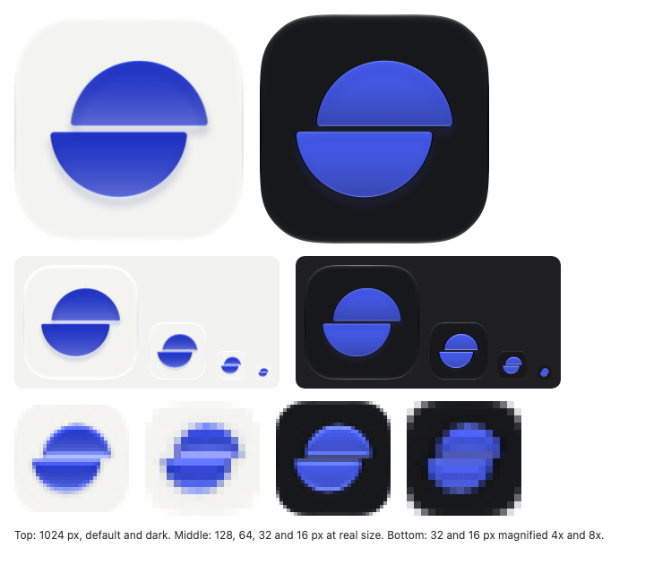
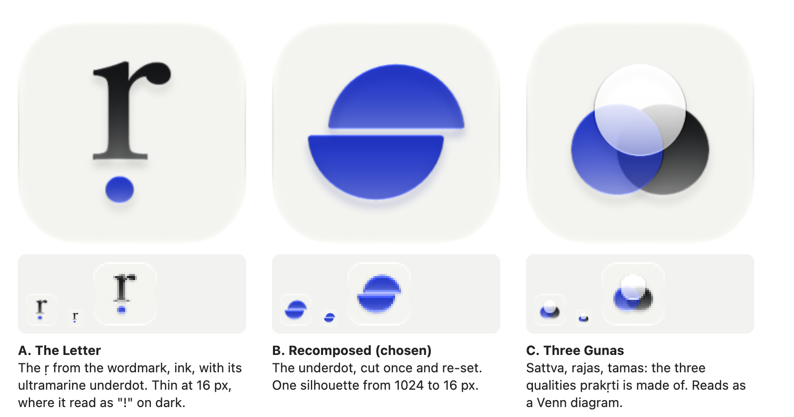
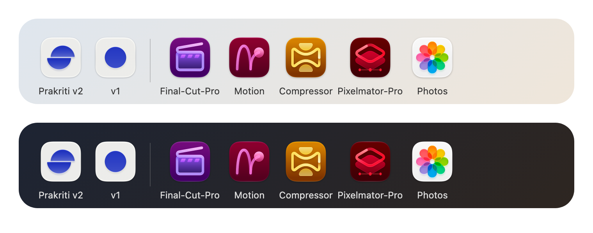
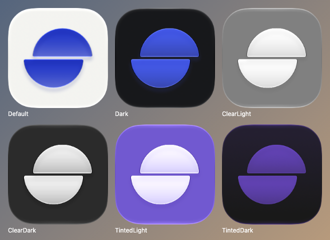
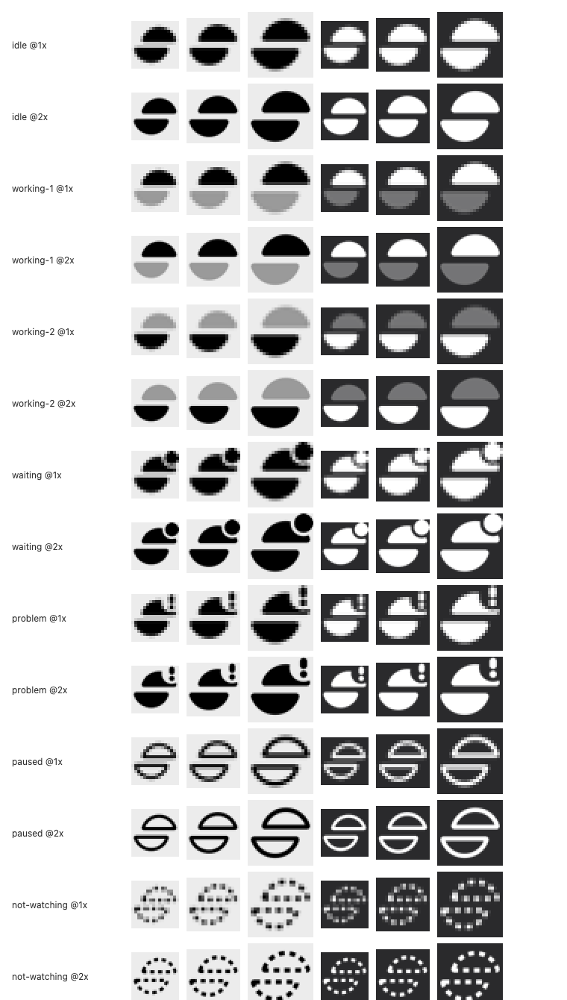

# Prakriti icons, v2: the Dock and the menu bar

Written Sat 10 Oct 2026 for Prakriti for Mac v2 (Ivan's request, item 12: "Design a better icon for both
the dock and menu bar"). This folder holds the design, its reasons, every source file, the previews, and
the steps to put it in the app. Nothing in `mac/` has been changed; the build agent does that from the
steps below.



## The recommendation, in one paragraph

**"Recomposed": the brand's ultramarine dot, cut once and re-set.** The dot is the one bold idea of
Prakriti's identity: the underdot of the ṛ in the wordmark, the diacritic that makes the word Sanskrit,
and the only decorative color on the website. v1's icon was that dot alone, which has two problems: on its
own a colored dot is the universal sign for *record*, the one reading an app about recordings should avoid,
and it says nothing about what the app does. v2 cuts the dot across its middle and slides the halves
apart. That is the name made visible (raw matter recomposed into a new form), and it is the jump cut, the
one gesture of the editing grammar v2 adopts, said without drawing film, cameras or waveforms. The same
mark, drawn as a black template glyph, becomes the menu bar icon, with six shapes for v1's six states.

## What is in this folder

| Path | What it is |
|---|---|
| `source/Prakriti.icon/` | **The icon.** An Icon Composer document: two glass layers plus a stone background, with dark, clear and tinted versions. Open it in Icon Composer, or copy it into the Xcode project |
| `source/layers/` | The same artwork as three plain 1024 x 1024 SVG layers: `0-background`, `1-mid-lower-half`, `2-foreground-upper-half` |
| `source/prakriti-icon-flat.svg` | A flat 1024 x 1024 fallback, full bleed and unmasked (the system rounds the corners) |
| `source/prakriti-icon-rounded.svg` | The flat icon inside the classic macOS rounded square. For the website and documents only; the app ships the `.icon` |
| `source/menubar/*.svg` | Seven menu bar template glyphs, 18 x 18 pt, black on clear |
| `source/menubar/imagesets/` | The same seven, ready to drop into `Assets.xcassets` (template rendering, vector kept) |
| `concepts/` | The three concepts as flat SVG sketches |
| `previews/` | Every render: the icon at 1024, 256, 64, 32 and 16 px; all six appearances; the flat fallback; the menu bar glyphs at 16, 18 and 22 pt on light and dark, 1x and 2x; review sheets |
| `previews/context/` | The icon as the system draws it in Finder, and in a Dock beside Apple's creative apps. **Internal only:** the Dock picture contains Apple's icons |
| `tools/` | The generator (`make_icons.py`), the renderer (`render.swift`) and `render_previews.sh`, which rebuilds everything here in about 10 seconds |

## The three concepts



**A. The Letter.** The ṛ itself, outlined from Tiro Devanagari Sanskrit (the website's display face), in
ink, with its underdot in ultramarine as a separate glass layer. It is the most literal link to the
wordmark and beautiful at full size. Not chosen: Apple's guidance is to "include text only when it's
essential", the serif's thin strokes break up at 32 px, at 16 px it reads as an exclamation mark, and a
single letter on a light square looks like a font or dictionary app.

**B. Recomposed (chosen).** Described above. One silhouette that survives from 1024 px to 16 px, two
shapes in total, no text.

**C. Three Gunas.** In Samkhya philosophy prakṛti is made of three qualities, sattva, rajas and tamas.
Three overlapping translucent discs in white, ultramarine and ink. The deepest idea of the three, and the
one Apple's guidance most directly invites ("filled, overlapping shapes... with transparency"). Not
chosen: it reads as a Venn diagram or a color-mixing tool, the meaning needs a caption, and the ink disc
disappears in dark mode.

Variations of B that were tried and dropped, each rendered and looked at:

- **Three bands** (the dot cut twice, middle band moved): read as a hamburger menu or a "no entry" sign.
- **Ultramarine ground, stone halves:** closest to Apple's 2026 Creator Studio look (deep color ground,
  one luminous form), but it turns ultramarine from a mark into a field, against the identity rule that
  ultramarine is only ever the dot, and it also read as a hamburger.
- **A faint "ghost" of the uncut disc behind the halves** (before and after): muddier at Dock size and
  invisible in dark mode.
- **Step sizes** of 0.11, 0.15 and 0.19 of the diameter: 0.11 lost the step at 32 and 16 px; 0.19 read as
  two loose pieces. 0.15 is used.
- **Disc sizes** of 57%, 60% and 62.5% of the canvas, side by side with Photos, Compressor and Motion at
  Dock size: 57% looked timid next to them, 62.5% crowded the corners. 60% is used.

## Why B

1. **It keeps what people already know.** The dot is on the website, the favicon and v1's icon. B is still
   recognisably that dot, so nothing about the brand restarts.
2. **It adds the one thing the dot lacked: what the app does.** Cut and re-set is editing, at its most
   reduced. It is abstract, so it obeys the standing rule: never skeuomorphic, no film, reels, cameras,
   microphones or waveforms.
3. **It stops reading as a record button.** A dot on a light square is the record symbol. A cut dot is not.
4. **It survives every size.** Apple's renderer at 16 px still shows a disc with a line through it; at
   32 px the step is clear. A and C both failed at 16 px.
5. **It is built the way Apple builds icons now.** Two filled shapes on a plain ground, one per glass
   layer, with clearly defined edges and no drawn effects; the system adds the light, the depth and the
   shadow (HIG, App icons: "Prefer clearly defined edges in foreground layers", "Let the system handle
   blurring and other visual effects").
6. **One mark for both places.** The menu bar glyph is the same drawing, so the Dock and the menu bar are
   plainly the same app, which the old ring was not.

## How it sits next to Apple's apps



Apple's own creative apps were redrawn for Creator Studio in January 2026: each is a deep single-color
ground with one bold, light form in glass (purple clapperboard for Final Cut Pro, a crimson motion path for
Motion, an amber hourglass ribbon for Compressor, red layered diamonds for Pixelmator Pro). Photos is the
other family: a white ground with translucent color. Prakriti sits with Photos as a light icon, which
matches its identity (cool stone, black type, one ultramarine mark) and makes it easy to find among the
dark pro icons. Logic Pro is not installed on this Mac, so it was not compared. (Picture made from the
icons installed on this Mac. It contains Apple's icons: keep it internal.)

## The design, precisely

**Colors** (from `web/public/assets/site.css`):

| Appearance | Ground | Mark |
|---|---|---|
| Default (light) | Stone `#F3F3F0` (`--ground`) | Ultramarine `#2337C6` (`--accent-mark`) |
| Dark | `#18191C` (site dark `--surface`) | `#4459E8` (site dark `--accent-mark`: stays saturated, never lavender) |
| Clear and tinted | Chosen by the system | White, so the system's tint reads on it |

**Geometry** (1024 x 1024 canvas, square and unmasked; the system applies the rounded corners):

- A disc of diameter 610 px (60% of the canvas), centred.
- Cut across its horizontal diameter by a 26 px gap.
- The upper half moved 46 px right and the lower half 46 px left (92 px apart in all, 0.15 of the
  diameter), so the mark's box and its centre of mass stay on the centre of the canvas.
- The four corners where the cut meets the circle are rounded to 16 px (HIG: avoid sharp corners).

**Layers and glass** (in `source/Prakriti.icon/icon.json`):

| Order | Group | Settings |
|---|---|---|
| Front | `foreground-upper-half` | Liquid Glass on, specular on, translucency 35%, shadow in the layer's color at 50% |
| Middle | `mid-lower-half` | The same |
| Back | Background | The document's fill: stone, or `#18191C` in dark (Apple: a solid fill makes an imported background unnecessary; the SVG in `source/layers/` is there for other tools) |

The upper half is in front so its shadow falls across the cut: the piece that was moved sits on top.

**All six appearances**, rendered by Apple's renderer:



The first render of Tinted Dark showed the mark dark on dark and nearly invisible. The fix, now in the file:
the halves turn white in the clear and tinted appearances, so the system's tint has something to color.

## The menu bar



**The glyph.** The same cut disc as a template image: black on clear, so macOS colors it for light and dark
menu bars and for the highlighted state (HIG, The menu bar: "the system can apply other colors to the black
areas"). 18 x 18 pt, the disc 14 pt tall. Two deliberate differences from the app icon, because the menu
bar is tiny: every horizontal edge sits on a whole point (top 2, cut 8 to 10, bottom 16), so it is crisp at
1x; and the step is 3 pt (0.21 of the disc, not 0.15), because a proportional step is under 2 px at 16 px
and the mark collapses into a plain dot. Next to Wi-Fi, Control Center and the moon it carries the same
weight as the filled system symbols.

**Six states, six shapes.** v1 gives each menu bar state its own shape (`RulesTests`: "each menu bar
state has its own shape"; the site's rule: status is a word plus a shape, never color alone). v2 keeps
that:

| v1 state | v1 symbol | v2 glyph | File |
|---|---|---|---|
| Idle | `circle` | The mark | `prakriti-menubar` |
| Working | `circle.dotted` | The halves lit in turn, swapped every 0.7 s | `prakriti-menubar-working-1`, `-working-2` |
| Waiting for you | `circle.inset.filled` | The mark with a dot at the top right | `prakriti-menubar-waiting` |
| Problem | `exclamationmark.circle` | The mark with an exclamation mark at the top right | `prakriti-menubar-problem` |
| Paused | `pause.circle` | The mark as an outline | `prakriti-menubar-paused` |
| Not watching | `circle.dashed` | The mark as a dashed outline | `prakriti-menubar-not-watching` |

Paused and not watching are outlines, a change of shape rather than a dimmed copy, because macOS already
dims every menu bar item on a display that is not active, and a dim glyph dimmed again disappears. The
badges sit in a notch cut into the mark itself, 1 pt clear, rather than drawn with an SVG mask.

**The working animation: what was tested.** A `TimelineView` inside a `MenuBarExtra` label renders once and
never ticks: the label is drawn once and kept (tested 10 Oct 2026 in a scratch app on macOS 27.2, the
label logged one render in five seconds). A change of state from outside the label does redraw it: a timer
toggling an `@Observable` value redrew the label every 0.7 s (eight renders in five seconds). So the app
must swap the two frames from its model, not animate inside the label. For the same reason SF Symbols
effects such as `.symbolEffect(.variableColor)` should not be expected to play in the menu bar label
[unverified, inferred from the TimelineView result]. With Reduce Motion on, hold `working-1` still.

## Putting it in the app (for the build agent)

Tested end to end in a scratch XcodeGen 2.46 and Xcode 27 project on 10 Oct 2026: with the steps below the
build succeeds with no warnings, `actool` compiles the `.icon` into `Assets.car` and `AppIcon.icns` (the
`.icns` is generated from the `.icon` for older systems), Info.plist gets `CFBundleIconName` and
`CFBundleIconFile` automatically, and the seven glyphs compile as template images at 1x and 2x and load
from the bundle at 18 x 18 pt with `isTemplate` true. XcodeGen files the `.icon` as `wrapper.icon` in Copy
Bundle Resources, which is what Xcode needs. The real project was not touched.

1. **The app icon.** Copy the document in under the name the project already uses, `AppIcon` (the build
   setting `ASSETCATALOG_COMPILER_APPICON_NAME: AppIcon` must match the file name):

   ```bash
   cd ~/Code/prakriti && cp -R docs/v2/icons/source/Prakriti.icon mac/Prakriti/Resources/AppIcon.icon
   ```

2. **Retire v1's icon.** Remove the old icon set and the script that drew it. Not strictly needed (tested:
   with both present Xcode uses the `.icon` and warns about nothing), but two sources for one icon is how a
   stale one comes back:

   ```bash
   cd ~/Code/prakriti && git rm -r mac/Prakriti/Resources/Assets.xcassets/AppIcon.appiconset mac/scripts/make_icon.swift
   ```

   Then update the two docs that describe the old icon: `START_HERE.md` (the "App icon" row) and the
   milestone 1 entry in `docs/BUILD-LOG.md`.

3. **The menu bar glyphs.**

   ```bash
   cd ~/Code/prakriti && cp -R docs/v2/icons/source/menubar/imagesets/*.imageset mac/Prakriti/Resources/Assets.xcassets/
   ```

4. **Regenerate the project:**

   ```bash
   cd ~/Code/prakriti/mac && xcodegen generate
   ```

5. **Code.** In `StatusSummary.Icon`, keep the SF Symbol raw values (the Today screen uses them inside the
   window, where SF Symbols belong) and add the menu bar asset per case:

   ```swift
   var menuBarAsset: String {
       switch self {
       case .idle: "prakriti-menubar"
       case .working: "prakriti-menubar-working-1"   // the model swaps in -working-2 every 0.7 s
       case .waitingForYou: "prakriti-menubar-waiting"
       case .problem: "prakriti-menubar-problem"
       case .paused: "prakriti-menubar-paused"
       case .notWatching: "prakriti-menubar-not-watching"
       }
   }
   ```

   In `MenuBarIcon`, draw `Image(name)` instead of `Image(systemName:)`, keep the accessibility label
   ("Prakriti: " plus the status line), and for `.working` pick the frame from a value the model flips with
   a timer. The pattern that was tested:

   ```swift
   @MainActor @Observable final class WorkingTicker {
       var odd = false
       private var timer: Timer?
       func start() {   // call when work starts; do not start it when Reduce Motion is on
           guard timer == nil,
                 !NSWorkspace.shared.accessibilityDisplayShouldReduceMotion else { return }
           timer = Timer.scheduledTimer(withTimeInterval: 0.7, repeats: true) { [weak self] _ in
               MainActor.assumeIsolated { self?.odd.toggle() }
           }
       }
       func stop() { timer?.invalidate(); timer = nil; odd = false }   // call when work stops
   }
   // In the label: Image(ticker.odd ? "prakriti-menubar-working-2" : "prakriti-menubar-working-1")
   ```

   Stop the timer whenever nothing is working, so the app never wakes twice a second for nothing.
   Add a test beside the existing one: the six `menuBarAsset` names are distinct and each loads as a
   template image.

6. **Verify by looking, not by reading.** Build, install, then:
   - Finder: `~/Applications/Prakriti.app` shows the cut disc. If the Dock still shows the old dot, the
     icon cache is stale: `cd ~ && killall Dock` [unverified that it is needed on macOS 27.2].
   - Switch System Settings, Appearance to Dark, then Icon and widget style to Clear and to Tinted: the mark
     stays visible in each (the previews in `previews/appearances/` show what to expect).
   - Menu bar: idle shows the mark; drop a file in `~/Prakriti/Drop` and the halves alternate while it
     works; Pause All shows the outline. Look in light and dark menu bars, and once with the menu open (the
     highlighted state). The menu bar cannot be screenshotted without Screen Recording permission, so this
     is Ivan's eyes once.

## For Ivan: opening it yourself

To look at it, turn it, and try the light and glass controls in Apple's own tool:

```bash
cd ~/Code/prakriti/docs/v2/icons && open -a "/Applications/Xcode.app/Contents/Applications/Icon Composer.app" source/Prakriti.icon
```

At the bottom of the canvas, pick macOS, then Default, Dark or Mono to see each appearance. If you change
something and save, **your saved file becomes the master copy**: tell the build agent, and do not run
`tools/make_icons.py` again, because it rewrites `source/Prakriti.icon` and would undo your changes.

To rebuild every preview after a change to the generator:

```bash
cd ~/Code/prakriti/docs/v2/icons && zsh tools/render_previews.sh
```

## How this was checked

- **Apple's renderer, not a browser.** Every icon preview is drawn by `ictool`, the command-line renderer
  inside Icon Composer (Xcode 27, Icon Composer 27.0 build 129), in all six appearances.
- **The real system path.** The `.icon` was compiled with `actool` exactly as Xcode does, wrapped in a
  throwaway app bundle, and drawn by `NSWorkspace` the way Finder and the Dock get it
  (`previews/context/finder-render-512.png`). The system adds its own margin: the icon body is 412 of 512 px,
  the same as Final Cut Pro and Photos on this Mac.
- **Looked at, at every size.** 1024, 256, 64, 32 and 16 px, light and dark, magnified pixel for pixel;
  the menu bar glyphs at 16, 18 and 22 pt at 1x and 2x, and in a menu bar beside system symbols.
- **The file format.** Apple does not publish the `icon.json` format. It was written from Xcode's own Icon
  Composer template and a reverse-engineered reference, then proved by rendering: the first group in the
  file is the frontmost (two overlapping circles, rendered), and the `tinted` appearance key covers both
  the clear and the tinted looks.
- **Not checked:** a trademark or likeness search for a split-disc mark [unverified]. Before the mark goes
  anywhere public (the website, an App Store page), search it once.

## Decisions this changes, and things to watch

- **Replaces v1's icon decision** (BUILD-LOG milestone 1: "the front door's mark, ultramarine dot on
  stone, drawn by `make_icon.swift`"). The colors and the dot survive; the drawing script and the icon set
  are retired (steps 1 and 2).
- **Replaces v1's menu bar ring** with the mark, keeping six distinct shapes for six states, so the
  "each state has its own shape" rule and its test still hold. One behaviour is new: the working state
  animates, and it must be driven from the model (see "The working animation").
- **The website's favicon is still the plain dot.** Matching it to the cut disc is a separate, small
  decision for the site; the site's identity notes give ultramarine exactly four jobs, and the cut disc is
  the same job (the underdot), so it would fit. Not done here.
- **A premise elsewhere is stale:** `START_HERE.md` ("The engine's standing warnings") and SCOPE §8.5 say
  notifications never use a badge "because the engine has no Dock icon". Prakriti for Mac does have one:
  the live copy runs as a regular foreground app (`lsappinfo`: `type="Foreground"`, checked 10 Oct), it has
  a main window and no `LSUIElement`, and Ivan has now asked for a Dock icon. So a Dock badge (the count
  of recordings waiting for Ivan's yes, as Mail counts unread mail) is now possible. Whether to use it is
  a separate decision; the reason given for "never badge" no longer holds.

## Sources

- Apple HIG, App icons (layers, Liquid Glass, appearances, 1024 x 1024 layout, "include text only when
  it's essential"; changed 8 Jun 2026): https://developer.apple.com/design/human-interface-guidelines/app-icons
- Apple, Creating your app icon using Icon Composer (layers in SVG, at most four groups, no masks, no
  baked effects, the document replaces the AppIcon asset catalog, 26 and 27 design generations):
  https://developer.apple.com/documentation/xcode/creating-your-app-icon-using-icon-composer
- Apple HIG, The menu bar (menu bar extras, template images, the 24 pt bar, "display a menu, not a
  popover"): https://developer.apple.com/design/human-interface-guidelines/the-menu-bar
- Apple HIG, Icons (interface icons in black and clear, vector PDF or SVG, optical centering):
  https://developer.apple.com/design/human-interface-guidelines/icons
- Apple HIG, SF Symbols (custom symbols, variable color, badges from the component library):
  https://developer.apple.com/design/human-interface-guidelines/sf-symbols
- Apple, Custom SF Symbols: https://developer.apple.com/documentation/technologyoverviews/custom-sf-symbols
- Jim Nielsen, A brief history of app icons from Apple's Creator Studio (2026):
  https://blog.jim-nielsen.com/2026/history-of-creator-studio-icons/
- PetaPixel, Creator Studio is Apple's answer to Creative Cloud (13 Jan 2026):
  https://petapixel.com/2026/01/13/creator-studio-is-apples-long-awaited-answer-to-adobe-creative-cloud
- 9to5Mac, macOS Tahoe's gray box around nonconforming icons (why a proper `.icon` matters):
  https://9to5mac.com/2025/08/08/macos-tahoe-fix-gray-box-icons/
- Icon Composer `icon.json`, reverse-engineered models and samples:
  https://github.com/peterpoliwoda/icon-composer-template
- Tiro Devanagari Sanskrit (concept A's letter; SIL Open Font License):
  https://github.com/google/fonts/tree/main/ofl/tirodevanagarisanskrit
